> 
> 
> <a id="32eeda9b0fe180bea3f3c0a1930c3ad4"></a>
> 
> <strong>목차</strong>
> 
> - [비동기 처리 아키텍처 이해와 확장](#32eeda9b0fe180999431d9fcc9c68b7a)
> - [비동기 처리 시스템](#32feda9b0fe180559911f3be8526b191)
> - [[규모 확장] 단일 프로세스에서의 비동기 처리](#32feda9b0fe180359403ec399b646293)
> - [[규모 확장] 대규모 시스템에서의 비동기 처리](#32feda9b0fe1803c9d60ca1ec07633be)
> - [비동기 메세징 시스템](#32feda9b0fe18038bbf0dea96401f11f)
> - [메세징 시스템을 통한 비동기 처리](#32feda9b0fe1803bb050c67135f9d040)
> - [Message Queue](#32feda9b0fe1803c8949e9d0c4986a80)
> - [EDA (Event-Driven Architecture)](#32feda9b0fe180048008e9d415c5db14)
> - [비동기 메세징 시스템의 확장성과 안전성 보장](#32feda9b0fe180c8bdddddbee239c790)
> - [비동기 메세징 시스템 이해](#32feda9b0fe180608c21df1d5735dea9)
> - [주요 개념](#32feda9b0fe180cab816f9659d42816e)
> - [이벤트 버스 (Event Bus)](#32feda9b0fe180c0a96fc2182c534051)
> - [메시지 큐 (Message Queue)](#32feda9b0fe18043b963d7a7458907ad)
> - [메시지 브로커 (Message Broker)](#32feda9b0fe180779a94eedad465e38d)
> - [메시지 큐, 메시지 브로커 비교](#32feda9b0fe1808aa9bdf23f5bd6cd24)
> - [주요 메시징 시스템 서비스 및 패턴](#32feda9b0fe1805c8acce90c2d8d0821)
> - [주요 비동기 메시징 시스템: Apache Kafka](#32feda9b0fe180139651db16c266c3f3)
> - [주요 비동기 메시징 시스템: RabbitMQ](#32feda9b0fe1803d8b40d38ff816ad23)
> - [주요 비동기 메시징 시스템: Amazon SQS (Simple Queue Service)](#32feda9b0fe180b19ba0e21b4cb2e305)
> - [비동기 메시징 시스템의 주요 패턴: Event-Driven Architecture](#32feda9b0fe180f7808ac7e947df60c5)
> - [비동기 메시징 시스템의 주요 패턴: CQRS (Command Query Responsibility)](#32feda9b0fe180a69815c7b55336d021)
> - [비동기 메시징 시스템의 주요 패턴: 사가 패턴 (Saga Pattern)](#32feda9b0fe180d5b784d5442ed38187)
> - [비동기 메시징 시스템의 주요 패턴: 백프레셔 패턴 (Backpressure Pattern)](#32feda9b0fe180d5bf8acd238bf869c8)
> - [비동기 메시징 시스템의 주요 패턴: Durable Messaging Pattern](#32feda9b0fe180fdb442e03c6c253587)
> - [비동기 처리 시스템의 장담점 및 사례](#32feda9b0fe180cc939cd4c31a1616f7)
> - [비동기 처리 시스템의 장담점](#32feda9b0fe180e6ae2fda2cf8a5550c)
> - [주요 장점](#32feda9b0fe18098b36ae4b2a8dae828)
> - [주요 단점](#32feda9b0fe1801d97b9fa81647ad369)
> - [실제 비동기 처리 시스템의 예시](#32feda9b0fe180ecab1eec3ce6b2fef5)
> - [예시 1) 푸시 알림 시스템](#32feda9b0fe1809eb3c2e8e9a3ffe28d)
> - [예시 2) 쿠폰 발급 시스템](#32feda9b0fe180c1920dcb27da65a489)
> - [예시 3) 채팅 시스템](#32feda9b0fe18084951ad29b2abc4c6c)
> - [예시 4) 실시간 주문 처리 시스템](#32feda9b0fe180078970e4e5edafcace)
> - [예시 5) 이메일 발송 시스템](#32feda9b0fe180d78552c1e8b0ce57ba)

<a id="32eeda9b0fe180999431d9fcc9c68b7a"></a>

# 비동기 처리 아키텍처 이해와 확장

---

<a id="32feda9b0fe180559911f3be8526b191"></a>

## 비동기 처리 시스템

> 📖 
> 
> <a id="32feda9b0fe180c6b5c0dbfb88dc9b09"></a>
> 
> <strong>비동기 처리</strong>
> 
> - 비동기 처리는 <strong><u>작업을 병렬</u></strong>로 수행하는 개념으로, <strong>하나의 작업이 완료되기까지 기다리지 않고 다른 작업을 시작</strong>할 수 있는 방식
> 
> - 대표적으로 <strong>I/O 작업에서 대기 시간이 길</strong>어질 경우, <strong>프로그램은 다른 작업을 처리하며 대기 시간을 효율적</strong>으로 사용

> ✏️ 
> 
> <a id="32feda9b0fe180e0ab23fa7711ad216d"></a>
> 
> <code>동기 처리</code>와 <code>비동기 처리</code>의 차이점
> 
> - <strong><code>동기 처리</code></strong>
>     - <strong>작업이 완료될 때까지 호출자가 대기</strong>하는 방식, <strong><u>한 작업이 끝나기 전까지 다른 작업을 수행할 수 없</u></strong>음
> 
> - <strong><code>비동기 처리</code></strong>
>     - <strong><u>호출자가 대기하지 않</u></strong>고, <strong><u>작업이 끝</u></strong>났을 때 <strong><code>콜백</code></strong>이나 <strong><code>이벤트</code></strong>를 통해 <strong><u>작업 완료를 알림</u></strong>

<a id="32feda9b0fe180359403ec399b646293"></a>

### &#91;규모 확장&#93; <u>단일 프로세스</u>에서의 비동기 처리

> 🤔 
> 
> <a id="32feda9b0fe1808b9845da0fe4437f71"></a>
> 
> 비동기 처리를 해야하는 이유
> 
> - 작은 시스템에서는 자원의 효율적인 사용이 중요
> 
> - I/O 작업(파일 읽기, 네트워크 요청 등)은 처리 시간이 길어질 수 있음
> 
> - 비동기 처리를 통해 그 대기 시간을 활용하여 다른 작업을 진행함으로써 전체 성능을 향상 시킬 수 있음
> 
> - CPU 자원이 놀지 않고 계속 작업을 처리하도록 돕는 것이 비동기 처리의 핵심 장점

> ✏️ 
> 
> <a id="32feda9b0fe180be8dcec23312ce198d"></a>
> 
> Java에서 비동기 처리의 기본 구성
> 
> - 스레드 풀 (Thead Pool)
> 
> - 이벤트 루프(Event Loop)를 활용한 비동기 처리

> 🫵🏻 
> 
> <a id="32feda9b0fe1800a8c30ddb783ae336f"></a>
> 
> <strong><code>AsynchronousFileChannel</code></strong><strong>을 통해 I/O 대기(wait)를 JVM 스레드가 아니라 OS에 맡긴다&#46;</strong>
> 
> - <strong>I/O 작업의 대기를 하지 않고, </strong><strong><u>완료 시점에 통지되는 이벤트를 OS에 등록</u></strong><strong>한 뒤, </strong><strong><u>해당 이벤트가 발생하면 처리를 수행</u></strong><strong>한다&#46;</strong>

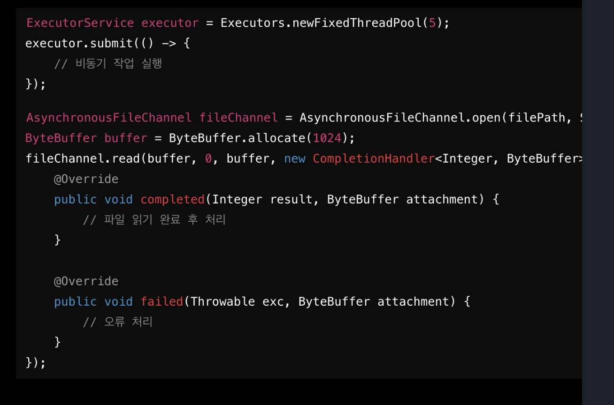

<details>
<summary>&#91; 전체 코드 &#93;</summary>

<a id="32feda9b0fe180fba4dfca1d40eb8677"></a>

```java
import java.io.IOException;
import java.nio.ByteBuffer;
import java.nio.channels.AsynchronousFileChannel;
import java.nio.channels.CompletionHandler;
import java.nio.file.Path;
import java.nio.file.Paths;
import java.nio.file.StandardOpenOption;
import java.util.concurrent.ExecutorService;
import java.util.concurrent.Executors;

public class AsyncExample {

    public static void main(String[] args) throws IOException {

        // 1. 스레드 풀 생성
        ExecutorService executor = Executors.newFixedThreadPool(5);

        // 2. 비동기 작업 실행
        executor.submit(() -> {
            System.out.println("비동기 작업 실행 중: " + Thread.currentThread().getName());
        });

        // 3. 파일 경로 설정
        Path filePath = Paths.get("example.txt");

        // 4. 비동기 파일 채널 오픈
        AsynchronousFileChannel fileChannel =
                AsynchronousFileChannel.open(filePath, StandardOpenOption.READ);

        // 5. 버퍼 생성
        ByteBuffer buffer = ByteBuffer.allocate(1024);

        // 6. 비동기 파일 읽기
        fileChannel.read(buffer, 0, buffer, new CompletionHandler<Integer, ByteBuffer>() {

            @Override
            public void completed(Integer result, ByteBuffer attachment) {
		            // 7. 파일 읽기 완료 후 처리
                System.out.println("파일 읽기 완료: " + result + " bytes");

                attachment.flip(); // 읽기 모드 전환

                byte[] data = new byte[attachment.remaining()];
                attachment.get(data);

                System.out.println("내용: " + new String(data));
            }

            @Override
            public void failed(Throwable exc, ByteBuffer attachment) {
			           // 8. 오류 처리
                System.err.println("파일 읽기 실패: " + exc.getMessage());
            }
        });

        // executor 종료 (실무에서는 shutdown 타이밍 주의)
        executor.shutdown();
    }
}
```

- 코드 설명
    1. ExecutorService → 비동기 작업 실행
        <a id="32feda9b0fe180bdad59c83f3179fc47"></a>

        ```java
        ExecutorService executor = Executors.newFixedThreadPool(5);
        ```

        - 내부적으로 <strong>스레드 5개를 재사용</strong>

        - submit() → 작업을 던지면 알아서 실행

    1. <strong>AsynchronousFileChannel → OS 레벨 비동기 I/O</strong>
        > 🫵🏻 
        > 
        > <a id="32feda9b0fe180dba7c4f3e93f70406c"></a>
        > 
        > <strong>I/O 대기(wait)를 JVM 스레드가 아니라 OS에 맡기기 위해서</strong> 사용
        > 
        > - <strong>I/O 작업의 대기를 하지 않고, </strong><strong><u>완료 시점에 통지되는 이벤트를 OS에 등록</u></strong><strong>한 뒤, </strong><strong><u>해당 이벤트가 발생하면 처리를 수행</u></strong><strong>한다&#46;</strong>

        <a id="32feda9b0fe180fca2b1c3903409cd44"></a>

        ```java
        AsynchronousFileChannel.open(...)
        ```

        - 커널 기반 비동기 I/O
            | <strong>방식</strong> | <strong>설명</strong> |
            | --- | --- |
            | Executor | 유저 스레드 기반 비동기 |
            | AsyncFileChannel | OS 이벤트 기반 비동기 |

    1. CompletionHandler → 콜백 기반 처리
        <a id="32feda9b0fe180b6aa98fc4570e20bda"></a>

        ```java
        fileChannel.read(..., new CompletionHandler<>() { ... });
        ```

        - Future&#46;get() 없이, 완료되면 자동 호출
            <a id="32feda9b0fe180e99a6de9b4ad5e49d3"></a>

            ```java
            completed(...) → 성공 시 호출
            failed(...)    → 실패 시 호출
            ```

    1. ByteBuffer → NIO 핵심
        <a id="32feda9b0fe180b19c53fb510a41fdb6"></a>

        ```java
        buffer.flip();
        ```

        - 상태 변화
            | <strong>단계</strong> | <strong>설명</strong> |
            | --- | --- |
            | write | OS → buffer |
            | flip | 읽기 모드 전환 |
            | read | buffer → app |

            - flip 처리를 하지 않으면 데이터를 읽지 못함

</details>

<a id="32feda9b0fe1803c9d60ca1ec07633be"></a>

### &#91;규모 확장&#93; 대규모 시스템에서의 비동기 처리

> ✏️ 
> 
> - 대규모 시스템에서는 <strong><u>많은 요청이 동시</u></strong>에 들어오고, 이러한 요청을 효율적으로 처리하기 위해서는 <strong><u>비동기 처리가 필수</u></strong>적
> 
> - <strong>트래픽이 많</strong>은 환경에서 <strong><u>비동기 처리</u></strong>를 통해 <strong><u>시스템의 확장성과 안전성을 보장</u></strong>할 수 있음
> 
> - 이때 <strong>비동기 메세징 시스템</strong>을 사용하여 <strong><u>아키텍처를 확장</u></strong>함

- 비동기 메세징 시스템에 대한 내용은 아래 참조

<a id="32feda9b0fe18038bbf0dea96401f11f"></a>

## 비동기 메세징 시스템

> 📖 
> 
> <a id="32feda9b0fe18066bc10c0738fe8f67a"></a>
> 
> <strong>비동기 메세징 시스템</strong>
> 
> - 비동기 메세징 시스템은 <strong>시스템 간 또는 애플리케이션 내부의 여러 구성 요소 간 통신을 비동기적으로 처리</strong>하는 방식
> 
> - <strong><u>작업이 비동기적으로 처리</u></strong>되기 때문에 <strong>각 구성 요소가 독립적으로 작업을 수행</strong>할 수 있어, <strong><u>시스템의 확장성과 성능을 크게 향상</u></strong>시킬 수 있음
>     - <code>독립성</code>, <code>확장성</code>, <code>성능 향상</code>
> 
> - <strong>메세지 큐(Message Queue)</strong>와 <strong>메세지 브로커(Message Broker)</strong>가 이러한 <strong>비동기 메세징 시스템의 핵심 요소</strong>

> ✏️ 
> 
> - <code>메세지 큐 (Message Queue)</code>
>     - 메세지를 큐에 저장해 두고, 소비자가 준비되면 메세지를 비동기적으로 처리하는 역할
> 
> - <code>메세지 브로커 (Message Broker)</code>
>     - <code>이벤트 브로커</code>는 <strong>발행&#45;구독 패턴</strong>을 기반으로 <strong><u>여러 서비스가 이벤트를 구독</u></strong>하고, <u>특정 이벤트가 발생</u>할 때 이 <u>이벤트를 비동기적으로 구독자에게 전달</u>

<a id="32feda9b0fe1803bb050c67135f9d040"></a>

### 메세징 시스템을 통한 비동기 처리

> ✏️ 
> 
> <a id="32feda9b0fe180fdabbcc6e0d36e8801"></a>
> 
> 한 서비스가 작업을 완료하기 전에 메세지를 큐에 넣고, 다른 서비스가 비동기적으로 이를 처리함으로써 시스템의 부하를 줄일 수 있음

![  • [코드 예시\] RabbitMQ 라우팅](6a4c3424fdf0def9.webp)

<details>
<summary>&#91;코드&#93;</summary>

<a id="32feda9b0fe180bfb7dac3299e6460a4"></a>

```java
@Service
public class MessageProducer {
		@Autowired
		private AmqpTemplate amqpTemplate;
		
		public void sendMessage(String message) {
				amqpTemplate.convertAndSend(
						"exchangeName",
						"routingKey",
						message
				);
		}
}
```

- RabbitMQ에서 지원하는 AmqpTemplate을 통해 exchange 기반으로 구독한 consumer 들에게 메세징 라우팅이 가능하다 &#46;

</details>

<a id="32feda9b0fe1803c8949e9d0c4986a80"></a>

### Message Queue

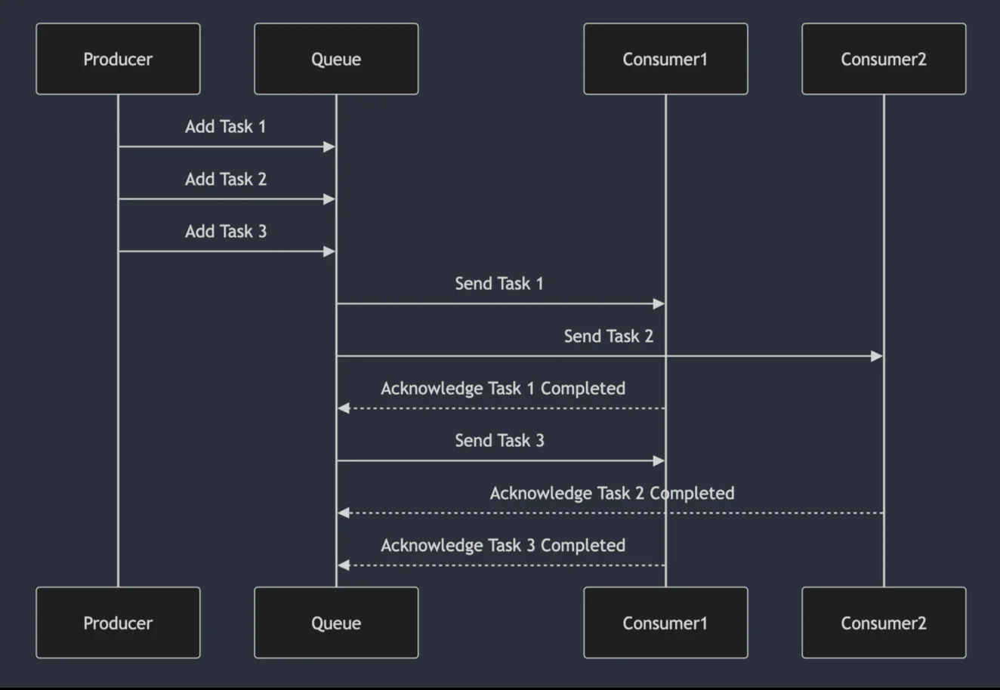

- 비동기 처리에서 자주 사용되는 <strong><u>작업 큐</u></strong>는 요청을 처리하기 위해 <strong><u>순차적으로 저장된 작업을 관리</u></strong>한다&#46; 

- <code>Producer</code>가 <u>메세지를 큐에 넣</u>고, <code>Consumer</code>는 <u>큐에서 메세지를 꺼</u>내 <strong><u>비동기적으로 처리한다</u></strong>&#46; 

- <strong><code>큐</code></strong>는 <u>작업을 병렬로 분산 처리</u>하는데 중요한 역할을 한다&#46;

<a id="32feda9b0fe180048008e9d415c5db14"></a>

### EDA (Event&#45;Driven Architecture)

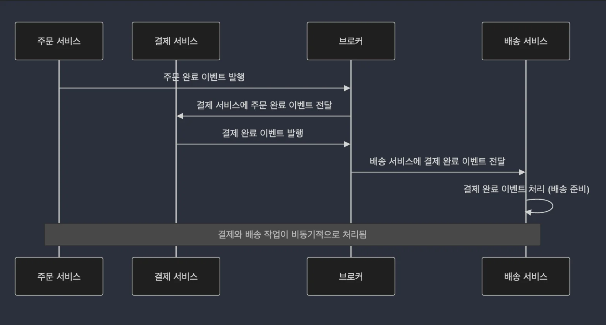

- <strong>서버스 간 느슨한 결합</strong>과 <strong>실시간 반응성</strong>을 제공하는<u> 또 다른 비동기 메세징 시스템</u>

- 이벤트 기반 아키텍처는 <strong>시스템 내에서 발생하는 상태 변화를 이벤트로 처리</strong>하고, 각<strong> 서비스는 이 이벤트에 비동기적으로 반응</strong>하는 구조

<a id="32feda9b0fe180c8bdddddbee239c790"></a>

### 비동기 메세징 시스템의 확장성과 안전성 보장

- <code>확장성</code>
    - <code>메세지 큐</code>나 <code>이벤트 버스</code>는 필요에 따라 <strong><u>소비자 또는 서비스 인스턴스를 동적으로 추가</u></strong>할 수 있어, <strong>대규모 트래픽을 처리하기 위한 확장성을 보장</strong>

- <code>안정성</code>
    - <strong><u>각 서비스가 독립적으로 동작</u></strong>할 수 있어 <strong>시스템의 한 부분에 문제가 생기더라도 전체 시스템이 중단되지 않고 작동</strong>

<a id="32feda9b0fe180608c21df1d5735dea9"></a>

# 비동기 메세징 시스템 이해

---

<a id="32feda9b0fe180cab816f9659d42816e"></a>

## 주요 개념

> 📖 
> 
> - <strong><code>프로듀서(Producer)</code></strong> 와 <strong><code>컨슈머(Consumer)</code></strong>가 <strong><u>독립적으로 동작</u></strong>
> 
> - <strong>서로 직접적으로 데이터를 주고받지 않</strong>고 <strong><u><code>메세지 큐</code></u></strong>나 <strong><u><code>이벤트 버스</code></u></strong>와 같은<strong><u> </u></strong><strong><u>중간 매체를 통해 통신</u></strong>하는 시스템

> ✏️ 
> 
> <a id="32feda9b0fe18085bf35d52adc16969b"></a>
> 
> 비동기 메세징 시스템의 필요성
> 
> - 대규모 시스템에서는 매 순간 수많은 요청이 동시에 들어오며, 이를 모두 동기적으로 처리하게 되면 시스템에 과부하가 발생할 수 있다&#46;
> 
> - 이때 비동기 메세징 시스템은 트래픽을 효율적으로 분산하고, 확장성을 보장하는 데 중요한 역할을 한다&#46; 
> 
> - 주요 목적은 시스템 간 느슨한 결합과 작업의 병렬 처리를 통해 효율성을 극대화하는 것이다&#46;

<a id="32feda9b0fe180c0a96fc2182c534051"></a>

### 이벤트 버스 (Event Bus)

> ✏️ 
> 
> <a id="32feda9b0fe180f68a4bdaaf75a5397a"></a>
> 
> <strong>이벤트  버스</strong>
> 
> - 시스템 내에서 발생하는 이벤트를 전달하는 비동기 메세징 시스템
> 
> - 이벤트는 시스템 내의 상태 변화나 사용자 액션에 의해 발생하며, <br>이를 처리하기 위해 비동기적으로 여러 서비스 간에 전달

> 이벤트 버스의 동작원리

- <code>Event Producer</code>&#58;  이벤트를 발생시키는 주체

- <code>Event Bus</code>&#58; 이벤트를 구독하고 있는 여러 서비스로 전달하는 역할

- <code>Event </code><strong><code>Consumer</code></strong>&#58; 이벤트를 구독하고 있는 서비스

<a id="32feda9b0fe18043b963d7a7458907ad"></a>

### 메시지 큐 (Message Queue)

> ✏️ 
> 
> <a id="32feda9b0fe180f58016d42d1c4265df"></a>
> 
> 메세지 큐
> 
> - 프로듀서가 생성한 메세지를 큐에 넣고, 이를 소비자가 준비된 후 처리하는 구조
> 
> - 서비스 간 느슨한 결합을 가능하게 하고, 확장성을 높이는 데 유용함

> 메시지 큐의 동작 원리

- <code>Producer</code>&#58; 메시지를 생성하여 큐에 넣는 주체

- <code>Queue</code>&#58; 메시지가 일시적으로 저장되는 공간

- <code>Consumer</code>&#58; 큐에서 메시지를 가져가 처리하는 주체

<a id="32feda9b0fe180779a94eedad465e38d"></a>

### 메시지 브로커 (Message Broker)

> ✏️ 
> 
> <a id="32feda9b0fe1805da599fd97263c1b53"></a>
> 
> <strong>메시지 브로커</strong>
> 
> - 메시지 큐나 이벤트 버스와 비슷한 개념이지만, <strong><u>더 큰 범위에서 시스템 간 통신을 중계</u></strong>하는 역할
> 
> - 메시지 브로커는 서로 다른 애플리케이션이나 시스템 간에 비동기 메세지를 전달
> 
> - <code>RabbitMQ</code>, <code>Kafka</code>와 같은 도구가 여기에 해당함

> 브로커의 주요 역할

- <code>메시지 저장</code>&#58; 메시지를 큐에 저장하여, 시스템이 메시지를 손실하지 않고 안정적으로 전달

- <code>트래픽 분산</code>&#58; 브로커는 트래픽을 효율적으로 분산시켜 시스템에 과부하가 발생하지 않도록 도와줌

- <code>서비스간 중재</code>&#58; 서로 다른 시스템 간의 메시지를 중개하여, 각 시스템이 독립적으로 동작할 수 있도록 함

<a id="32feda9b0fe1808aa9bdf23f5bd6cd24"></a>

### 메시지 큐, 메시지 브로커 비교

| <code>메시지 큐</code> | <code>메시지 브로커</code> |
| --- | --- |
|   • 단순 메시지 저장소<br>  • 생산자와 소비자 간의 메시지를 임시로 저장하는 역할 |   • 메시지의 흐름 중개 및 라우팅 |
|   • FIFO 방식으로 메시지 처리 |   • 다양한 전달 패턴 지원<br>      ◦ ex&#46; Publish / Subscribe |
|   • 단일 큐에 메시지를 저장하고 순차적으로 처리 |   • 메시지를 여러 수신자에게 동시 전달 가능 |
|   • 주로 일시적 저장과 처리 대기 역할 |   • 메세지의 전달 보장, 확장성, 변환 등을 관리 |
|   • RabbitMq, Amazon SQS 같은 시스템에서 큐로 사용 |   • Kafka, RabbitMq(브로커 역할 포함) 등에서 중걔 역할 |

<a id="32feda9b0fe1805c8acce90c2d8d0821"></a>

## 주요 메시징 시스템 서비스 및 패턴

---

> 🤔 
> 
> <a id="32feda9b0fe1800a90f5e9bd8be25ad6"></a>
> 
> <strong>메시징 시스템 선택 시 고려사항</strong>
> 
> - <code>처리 속도</code>
>     - 메시징 시스템의 처리 속도는 시스템의 성능을 결정짓는 중요한 요소이다&#46; 
> 
>     - 높은 처리량을 필요로 하는 시스템에는 Apache Kafka와 같은 시스템이 적합하다&#46;
> 
>     - 높은 신뢰성과 정밀한 메시지 전달이 중요하다면 RabbitMQ가 유리하다&#46; 
> 
> - <code>메시지 전달 보장</code>
>     - 메시지가 반드시 한 번 전달되는지 (Exactly once)
> 
>     - 최소 한 번 전달되는지 (At least one)
> 
>     - 적어도 한 번 이상 전달될 수 있는지 (At most once)
> 
> - <code>확장성</code>
>     - 시스템 부하가 늘어났을 때 대응할 수 있는 능력
> 
> - <code>사용 사례에 맞는 기능</code>
>     - 각 메시징 시스템은 고유의 기능을 제공
> 
>     - RabbitMq는 메시지 라우팅 기능이 뛰어남
> 
>     - Kafka는 로그 기반의 메시징 처리에 최적화
> 
>     - Amazon SQS는 손쉬운 클라우드 관려형 서비스를 제공

<a id="32feda9b0fe180139651db16c266c3f3"></a>

### 주요 비동기 메시징 시스템&#58; <code>Apache Kafka</code>

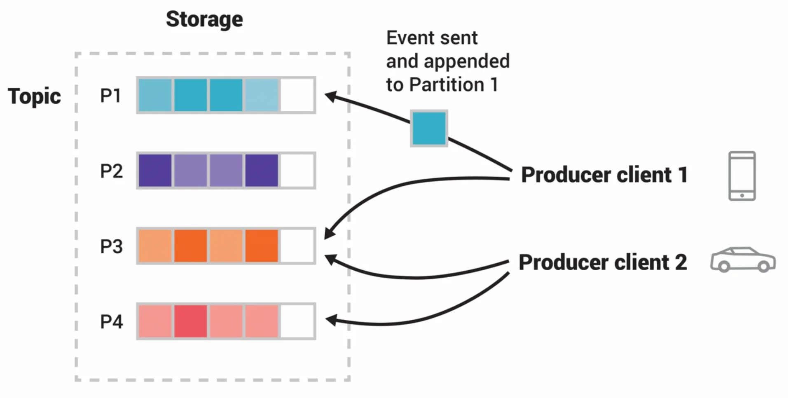

- <code>분산 처리</code>&#58; Kafka는 클러스터로 구성되어 대규모 데이터를 분산처리 하며, 수평저긍로 확장 가능

- <code>높은 처리향과 지연 시간 최소화</code>&#58; Kafka는 고속의 데이터 처리량을 제공하며, 실시간 데이터 스트리밍 처리에 매우 적합

- <code>토픽(Topic) 기반 구조</code>&#58; 
    - 데이터를 토픽으로 관리

    - 프로듀서가 메시지를 특정 토픽에 게시하면, 이를 구독한 여러 소비자가 동시에 데이터를 처리할 수 있음

- <code>순서 보장</code>&#58;
    - 각 파티션 내에서 메시지의 순서를 보장

    - 메시지의 손실 없이 내구성을 보장하는 로그 저장 방식을 채택

- <code>내구성 보장</code>&#58;
    - 데이터를 디스크에 저장

    - 메시지 손실을 방지하기 위해 복제(replication) 지원

<a id="32feda9b0fe1803d8b40d38ff816ad23"></a>

### 주요 비동기 메시징 시스템&#58; <code>RabbitMQ</code>

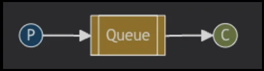

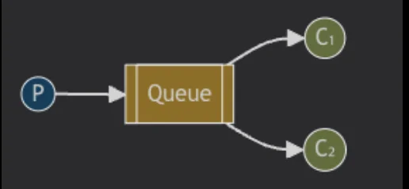

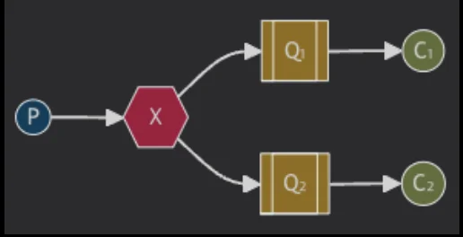

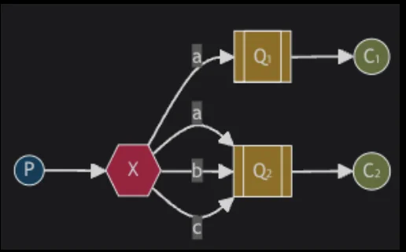

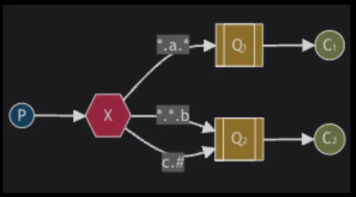

- 출처&#58; <a href="https://www.rabbitmq.com/tutorials">https&#58;//www&#46;rabbitmq&#46;com/tutorials</a>

- <code>큐 기반 구조</code>&#58;
    - 프로듀서가 메시지를 큐에 넣고, 컨슈머가 그 큐에서 메시지를 가져가 처리하는 방식

    - 이는 메시지를 비동기적으로 처리하는 데 적합함

- <code>메시지 라우팅</code>&#58;
    - RabbitMq는 메시지 라우팅 옵션을 제공하여 <code>Direct Exchange</code>, <code>Fanout Exchange</code>, <code>Topic Exchange</code> 등을 통해 <strong><u>특정 조건에 맞는 메시지를 큐로 전달</u></strong>

- <code>스케줄링 및 우선 순위 메시징</code>&#58;
    - 메시지에 우선순위(priority)를 설정할 수 있으며, 메시지의 스케줄링도 지원

- <code>내구성 있는 메시지 저장</code>&#58;
    - 메시지를 디스크에 저장하여 시스템 장애 발생 시에도 메시지 손실을 방지

- <code>확장성</code>&#58;
    - 클러스터링을 통해 RabbitMQ를 확장할 수 있으며, 분산 처리 환경에서 높은 가용성을 제공

<a id="32feda9b0fe180b19ba0e21b4cb2e305"></a>

### 주요 비동기 메시징 시스템&#58; <code>Amazon SQS (Simple Queue Service)</code>


- <code>완전 관리형 서비스</code>&#58; 
    - AWS가 시스템을 관리

    - 사용자는 인프라를 신경쓰지 않고 서비스 구축에 집중 가능

- <code>자동 확장</code>&#58;
    - 트래픽 변화에 따라 자동으로 확장

    - 대규모 메시지 트래픽을 처리할 때 추가적인 설정 없이 시스템이 자동으로 대응

- <code>메시지 전달 보장</code>&#58;
    - 최소 한번 메시지를 전달하는 At least once 방식이 기본으로 제공

    - FIFO 큐를 선택 시 메시지의 순서 보장도 가능

- <code>지연 규</code>&#58;
    - 메시지를 일정 시간 동안 대기시키 후 처리할 수 있는 지연 큐(Delay Queue) 기능 제공

    - 특정 조건에서 메시지를 지연 처리해야 할 때 유용함

- <code>비용 효율성</code>&#58;
    - 클라우드 기반 서비스로, 사용한 만큼만 비용 지불 가능

---

<a id="32feda9b0fe180f7808ac7e947df60c5"></a>

### 비동기 메시징 시스템의 주요 패턴&#58; <code>Event&#45;Driven Architecture</code>

> ✏️ 
> 
> <a id="32feda9b0fe180c99e22dad951b78204"></a>
> 
> <strong>시스템의 각 구성 요소들이 특정 이벤트에 반응하여 작업을 처리</strong>하는 방식
> 
> - 이벤트가 발생하면 다른 서비스나 모듈이 구독하고, 이벤트가 도착하면 해당 작업을 비동기적으로 처리

> 구성요소

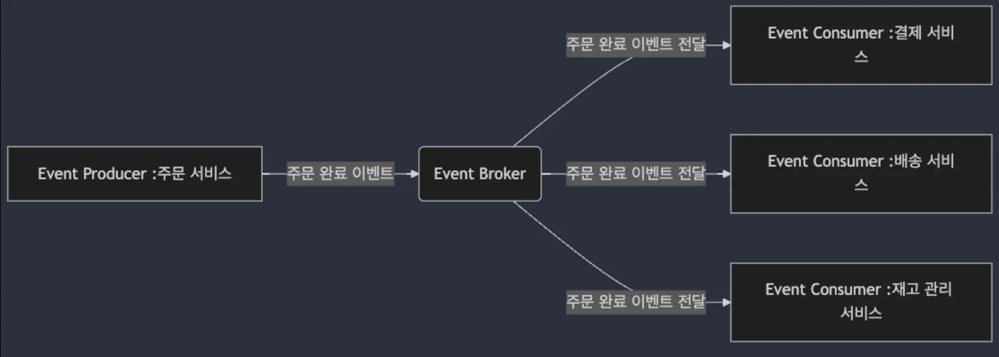

- <code>Event Producer</code>&#58; 이벤트를 발생시키는 주체

- <code>Event Consumer</code>&#58; 이벤트를 구독하고 이를 처리하는 주체

- <code>Event Broker</code>&#58; 이벤트를 구독자들에게 전달하는 중개 역할

<a id="32feda9b0fe180a69815c7b55336d021"></a>

### 비동기 메시징 시스템의 주요 패턴&#58; <code>CQRS (Command Query Responsibility)</code>

> ✏️ 
> 
> <a id="32feda9b0fe180bcbfdbf4695604632e"></a>
> 
> <u><code>명령(Command)</code></u><u>과 </u><u><code>조회(Query)</code></u><u>를 분리</u>하여<strong> </strong><strong><u>각각 독립적으로 처리</u></strong>하는 아키텍처 패턴
> 
> - <code>명령(Command)</code>&#58;  데이터를 변경하는 작업
> 
> - <code>조회(Query)</code>&#58;  데이터를 읽는 작업

> 구성 요소

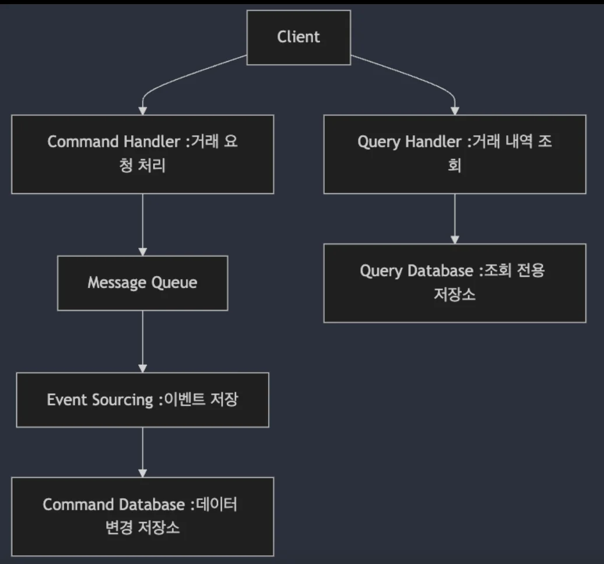

- <code>Command Handlers</code>&#58; 
    - 데이터를 변경하는 작업을 처리

    - 이때 메시지 큐를 사용해 큐에 저장되고, 비동기적으로 처리됨

- <code>Query Handlers</code>&#58;
    - 데이터를 조회하는 작업을 처리

    - 데이터 조회는 즉각적으로 처리될 수 있지만, 명령은 비동기적으로 처리되어 데이터 일관성을 유지

- <code>Event Sourcing</code>&#58;
    - 모든 상태 변경을 이벤트로 기록하고, 이벤트를 통해 시스템의 상태를 재구성하는 방식

<a id="32feda9b0fe180d5b784d5442ed38187"></a>

### 비동기 메시징 시스템의 주요 패턴&#58; <code>사가 패턴 (Saga Pattern)</code>

> ✏️ 
> 
> <a id="32feda9b0fe180fa8e6bfe1b1b8cdcd9"></a>
> 
> 분산 트랜잭션을 처리할 때 사용되는 아키텍처 패턴
> 
> - <strong>각 서비스에서 독립적으로 트랜잭션을 처리</strong>하지만, <strong>전체 프로세스는 </strong><strong><u>논리적으로 하나의 트랜잭션</u></strong><strong>처럼 보이게</strong> 함
> 
> - <strong><u>각 서비스에서 처리된 결과를 비동기적으로 전달받</u></strong>아 <strong>트랜잭션을 완성</strong>하거나 <strong>실패했을 경우 </strong><strong><u>보상 작업을 수행</u></strong>

> 구성 요소

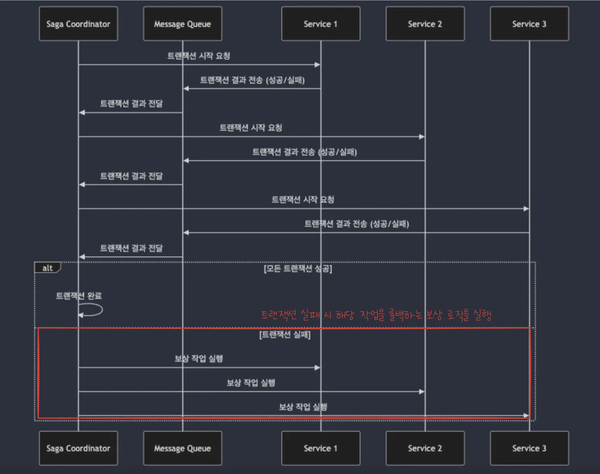

- <code>Saga Coordinator</code>&#58;
    -  트랜잭션의 시작과 종료를 관리

    - 중간에 트랜잭션이 실패할 경우 보상 작업을 실행

- <code>Local Transactions</code>&#58; 
    - 각 서비스에서 실행되는 독립적인 트랜잭션으로 각 서비스는 메시지 큐를 통해 비동기적으로 트랜잭션 결과를 전달함

<a id="32feda9b0fe180d5bf8acd238bf869c8"></a>

### 비동기 메시징 시스템의 주요 패턴&#58; <code>백프레셔 패턴 (Backpressure Pattern)</code>

> ✏️ 
> 
> <a id="32feda9b0fe180f08b4ecdb61e871bc6"></a>
> 
> <strong><u>시스템이 과부하 상태</u></strong>일 때 <strong>요청을 거부하거나 처리 속도를 늦</strong>추는 방식으로 <strong><u>트래픽을 조절</u></strong>하는 아키텍처 패턴
> 
> - 비동기 메시징 시스템과 함께 사용되며, <strong>대규모 트래픽 상황에서 시스템의 안전성을 보장</strong>하는데 도움을 줌

> 구성 요소

- <code>Producer</code>&#58;
    - 메시지를 생성하여 큐에 넣는 역할

    - <u>큐가 가득차면</u><strong> </strong><strong>백프레셔</strong><strong>를 통해 </strong><strong><u>메세지 생산을 중단</u></strong><strong>하거나 </strong><strong><u>속도를 늦</u></strong><strong>춤</strong>

- <code>Consumer</code>&#58;
    - 메시지를 처리하는 소비자

    - <strong>큐에서 처리할 수 있는 메시지의 양을 제어</strong>하여 <strong><u>시스템 과부하 방지</u></strong>

<a id="32feda9b0fe180fdb442e03c6c253587"></a>

### 비동기 메시징 시스템의 주요 패턴&#58; <code>Durable Messaging Pattern</code>

> ✏️ 
> 
> <a id="32feda9b0fe18075a9ede50df21b340f"></a>
> 
> <strong><u>메시지를 손실없이 처리</u></strong><u>할 수 있도록 보장</u>하는 패턴
> 
> - 메시지가 중간에 손실되거나 누락되지 않도록 <strong><u>메시지를 저장</u></strong>하고, <strong><u>시스템 장애 시에도 복구 가능</u></strong>한 상태로 유지

> 구성 요소

- <code>Persistent Queue</code>&#58;
    - 메시지가 시스템에 도착하면 큐에 영구적으로 저장

    - 메시지는 실패 시 재시도될 수 있으며, 시스템이 복구된 후에도 메시지가 손실되지 않음

- <code>Retry Mechanism</code>&#58;
    - 실패한 메시지를 재처리할 수 있는 메커니즘을 포함하여, 메시지가 손실되지 않도록 보장

<a id="32feda9b0fe180cc939cd4c31a1616f7"></a>

# 비동기 처리 시스템의 장담점 및 사례

---

<a id="32feda9b0fe180e6ae2fda2cf8a5550c"></a>

## 비동기 처리 시스템의 장담점

<a id="32feda9b0fe18098b36ae4b2a8dae828"></a>

### 주요 장점

- <code>높은 확장성 (Scalability)</code>
    - 시스템이 동시에 처리할 수 있는 작업 수를 크게 늘리는 것이 가능

    - 특히 트래픽이 증가하는 상황에서도 시스템을 효율적으로 확장 가능함

- <code>시스템 리소스 최적화 (I/O 대기 시간 감소)</code>
    - I/O 대기 시간을 줄여 시스템 리소스 최적화

    - 동기적 방식에서는 작업 완료를 기다리면서 CPU나 메모리 자원을 낭비할 수 있지만, <br>비동기 방식에서는 대기 중에도 다른 작업을 처리

- <code>높은 응답성 (Responsiveness)</code>
    - 비동기 시스템은 사용자에게 빠른 응답을 제공할 수 있음

    - 실시간 시스템에서 비동기 처리는 사용자 경험을 크게 향상시킴

<a id="32feda9b0fe1801d97b9fa81647ad369"></a>

### 주요 단점

- <code>복잡한 오류 처리 및 디버깅</code>
    - 비동기적 흐름에서 발생하는 오류를 처리하고 디버깅하는 것이 복잡할 수 있음

    - 작업이 병렬로 처리되기 때문에 오류가 발생한 시점과 원인을 정확하게 파악하기 어려움

- <code>순서 보장 문제 (Message Ordering)</code>
    - 메시지의 순서 보장이 어려움

    - <strong><u>여러 작업이 동시에 실행</u></strong>되면서, <strong>처리 순서가 중요한 경우 문제가 발생</strong>할 수 있음

- <code>상태 관리의 어려움 (State Management)</code>
    - 비동기 작업이 병렬로 처리되므로, 공유 상태에  대한 접근과 관리가 복잡해질 수 있음

    - 잘못된 상태 관리로 인해 데이터 일관성이 깨질 가능성이 존재

<a id="32feda9b0fe180ecab1eec3ce6b2fef5"></a>

## 실제 비동기 처리 시스템의 예시

<a id="32feda9b0fe1809eb3c2e8e9a3ffe28d"></a>

### 예시 1) <code>푸시 알림 시스템</code>

> ✏️ 
> 
> - 이벤트 기반 비동기 처리
> 
> - 메시지 큐와 푸시 시스템
> 
> - 실시간 알람 처리

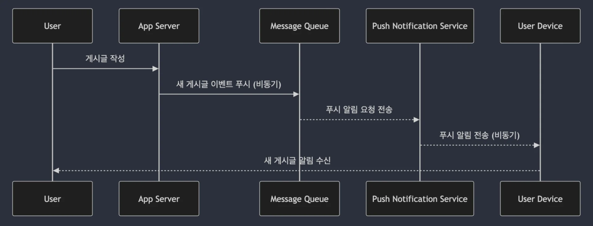

- 뉴스 앱에서 <strong><u>새로운 기사가 업데이트</u></strong> 될 때<strong> </strong><strong><u>실시간으로 푸시 알림을 발송</u></strong>

- <strong>메시징 앱에서 </strong><strong><u>새로운 메시지가 왔</u></strong>을 때 <strong>알림을 제공하는 시스템에서 </strong><strong><u>비동기 처리</u></strong>

<a id="32feda9b0fe180c1920dcb27da65a489"></a>

### 예시 2) <code>쿠폰 발급 시스템</code>

> ✏️ 
> 
> - 쿠폰 발급 요청 비동기 처리
> 
> - 쿠폰 발급 중복 방지 및 순차 처리
> 
> - 비동기 작업으로 백엔드 처리 최적화

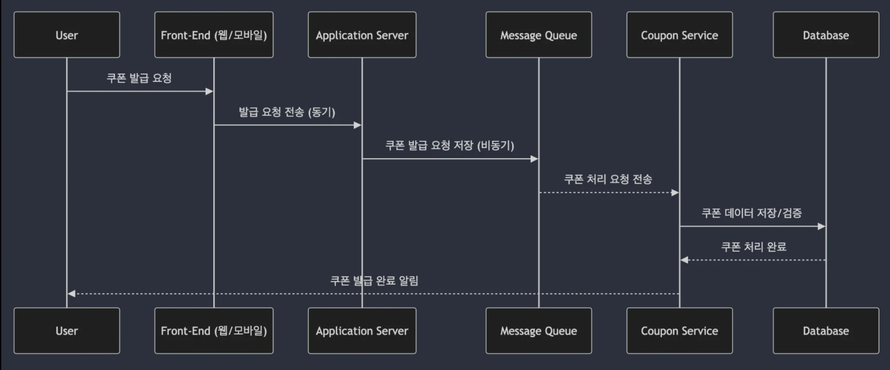

- <code>온라인 쇼핑몰</code>에서 <strong><u>특정 이벤트 기간 동안 수많은 사용자에게 동시에 쿠폰을 발급</u></strong>하는 시스템에서 사용

- <code>타임 세일</code>이나 <code>이벤트 쿠폰 발행</code> 시에 <strong><u>사용자가 빠르게 쿠폰을 받</u></strong>을 수 있도록 <strong>비동기 처리를 통해 부하를 분산 처리</strong>함

<a id="32feda9b0fe18084951ad29b2abc4c6c"></a>

### 예시 3) <code>채팅 시스템</code>

> ✏️ 
> 
> - 메시지 큐 기반 처리
> 
> - 실시간 데이터 전송
> 
> - 다중 사용자 동시 처리

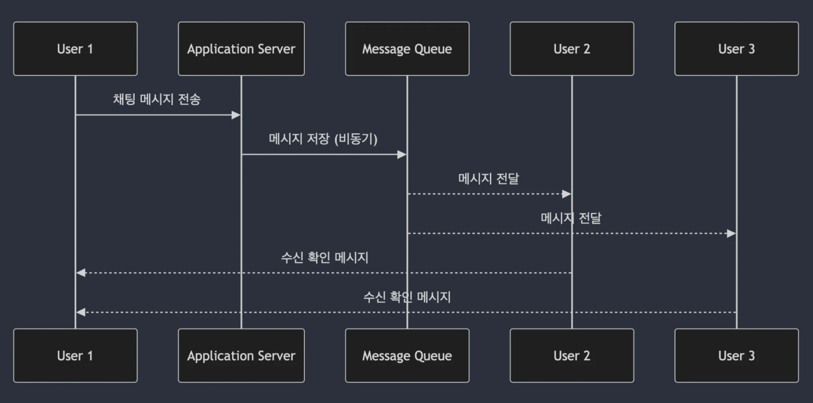

- 메시저 애플리케이션에서 <strong><u>사용자의 채팅 메시지를 실시간으로 전달</u></strong>하는 시스템

- <code>Slack</code>이나 <code>WhatsApp</code>과 같은 서비스는 <strong>비동기 메시징 시스템</strong>을 통해 <strong><u>다수의 사용자 간의 빠른 메시지 전송을 보장</u></strong>함

<a id="32feda9b0fe180078970e4e5edafcace"></a>

### 예시 4) <code>실시간 주문 처리 시스템</code>

> ✏️ 
> 
> - 주문 요청 비동기 처리
> 
> - 재고 관리 시스템과의 비동기 통신
> 
> - 결제 처리 비동기화

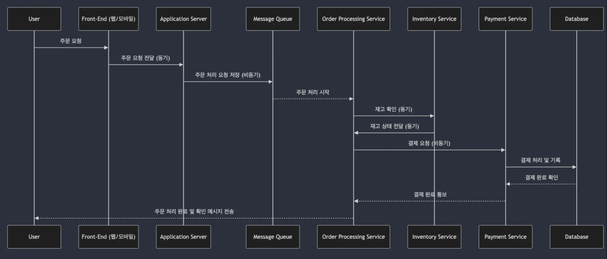

- <code>배달 앱</code>이나 <code>전자 상거래 시스템</code>에서 <strong><u>수백 개의 주문을 동시에 처리</u></strong>하는 상황에서 사용

- <strong>주문 폭주 시에도 서버가 안정적으로 주문을 처리</strong>할 수 있도록 <strong><u>비동기 처리 시스템</u></strong>이 적용

<a id="32feda9b0fe180d78552c1e8b0ce57ba"></a>

### 예시 5) <code>이메일 발송 시스템</code>

> ✏️ 
> 
> - 이메일 발송 큐 관리
> 
> - 실시간 이메일 발송과 대기 처리
> 
> - SMTP 서버와 비동기 통신

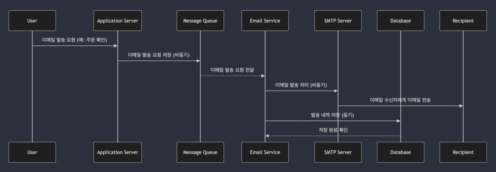

- <code>마케팅 캠퍼인 이메일</code>이나 <code>주문 확인 이메일</code>을 <strong><u>대량으로 발송하는 시스템</u></strong>에서 <strong>비동기 큐를 사용하여 부하를 관리하고 이메일 발송을 보장</strong>함
