> 
> 
> 
> 
> <strong>목차</strong>
> 
> - [Kafka의 기본 개념](#32eeda9b0fe18005b2f8e56c6f8a574f)
> - [Kafka 개요](#331eda9b0fe180a687bcf635468fffa6)
> - [메시징 시스템 개념](#331eda9b0fe1805996f2fdbae6319a00)
> - [Kafka의 핵심 특징](#331eda9b0fe18086bf6ef56809061868)
> - [Kafka 아키텍처](#331eda9b0fe1806eaad1d1d554367847)
> - [Producer 와 Consumer](#331eda9b0fe18029ac26eaa546d65cac)
> - [Broker와 Topic](#331eda9b0fe180718f0ef251e0312a41)
> - [Partition 과 Replication](#331eda9b0fe1801e95eed80773e639c4)
> - [Offset](#331eda9b0fe1807781fee6a2356aa458)
> - [Kafka의 주요 사용 사례](#331eda9b0fe18097ba39e58a72d6afe3)
> - [Kafka  일반적인 사용 사례](#331eda9b0fe180f5a1b8f1c72a8f94e1)
> - [실시간 로그 처리](#331eda9b0fe180baa6bff1da7fbe261b)
> - [데이터 스트리밍](#331eda9b0fe1802698b6de872246ccd3)
> - [Kafka 다양한 사용 사례](#331eda9b0fe1807d8f1fd325e1049042)
> - [로그 집계](#331eda9b0fe180a49bc0d75c70278510)
> - [실시간 데이터 처리](#331eda9b0fe180d297abe28d43819ddb)
> - [마이크로서비스 아키텍처](#331eda9b0fe180bf8f87f84e143fd148)
> - [데이터 파이프라인](#331eda9b0fe1803ea254c81f7a0c45af)
> - [금융 거래 처리](#331eda9b0fe180fa99ffc551ccac89aa)
> - [미디어 스트리밍 서비스](#331eda9b0fe180b5b86cf60a3c9443ea)
> - [온라인 광고 시스템](#331eda9b0fe180bcbee8e5ae33fcb333)
> - [헬스케어 데이터 처리](#331eda9b0fe1808eabf3efe811a3b456)
> - [Kafka의 고급 기능과 설정](#331eda9b0fe180c7beeef15b519fcadc)
> - [Kafka 고급 기능 개요](#331eda9b0fe180af901dcf652989672e)
> - [Kafka Streams](#331eda9b0fe180449faffa697c1a652e)
> - [Kafka Connect](#331eda9b0fe1805780abf472ceba1534)
> - [Kafka 설정 및 튜닝](#331eda9b0fe1803091e9ffede2f185a9)
> - [Broker 설정 및 튜닝](#331eda9b0fe180818297f775c0557adb)
> - [Producer 설정](#331eda9b0fe1805cb43cf001308f6291)
> - [Consumer 리벨런싱 전략](#331eda9b0fe1801dafe7df050820a0d2)
> - [Consumer Offset 관리](#331eda9b0fe1806bb1e0f100ac614ddc)
> - [Replication Factor 및 파티셔닝 전략](#331eda9b0fe1801d8605fcbcfe0e6090)
> - [Kafka 보안](#331eda9b0fe1803b9c34fbe4702ad12d)
> - [SSL / TLS 구성](#331eda9b0fe180bdaaf9ed4df1df8650)
> - [ACL(Access Control List) 보안 관리](#331eda9b0fe18050b18decfaadb1d8ed)
> - [Kafka 운영 및 모니터링](#331eda9b0fe180fd8442d6bad3fb8401)

# Kafka의 기본 개념

---

> 
> 
> 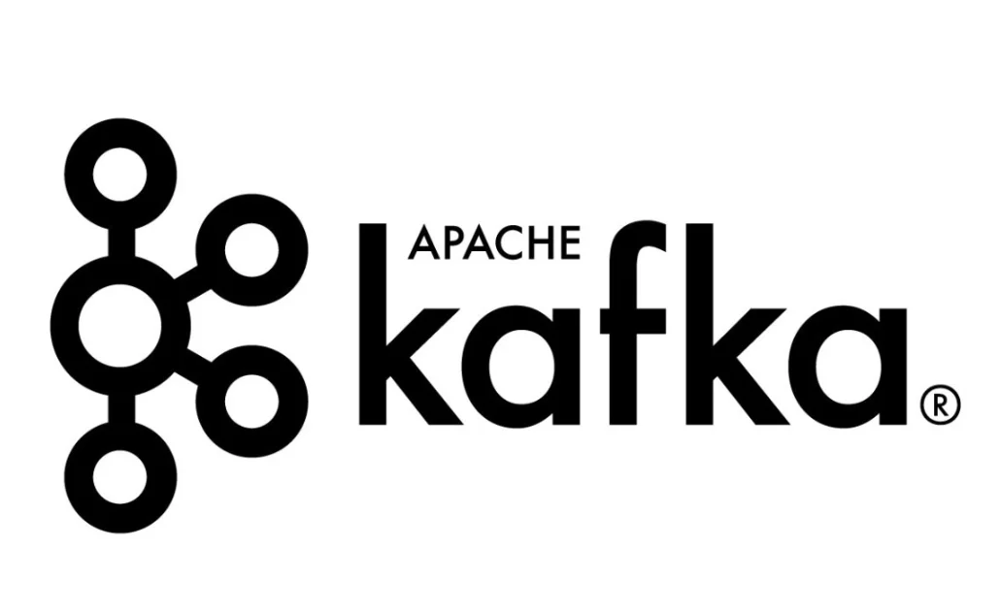
> 
> - LinkedIn에서 시작된 오픈소스 프로젝트
> 
> - 대규모 실시간 데이터 스트리밍 및 로그 수집 문제 해결
> 
> - 2011년 오픈소스화

> 🤔 
> 
> 
> 
> Kafka를 사용하는 이유
> 
> - Kafka 아키텍처를 통한 강력한 성능과 확장성
> 
> - 실시간 데이터 처리 및 로그 수집에 적합
> 
> - 안정적인 데이터 흐름 제공

## Kafka 개요

### 메시징 시스템 개념

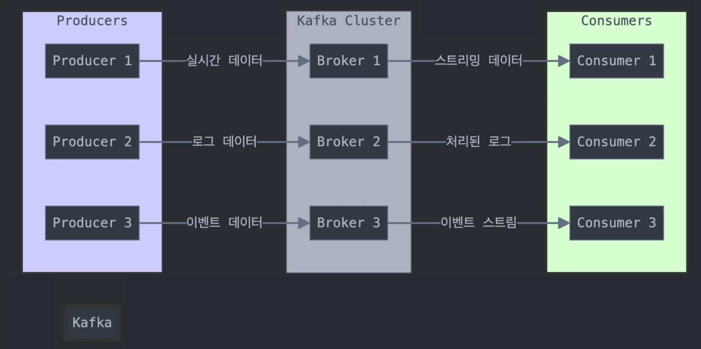

- 분산 메시징 시스템

- 실시간 데이터 스트리밍

- 로그 처리

### Kafka의 핵심 특징

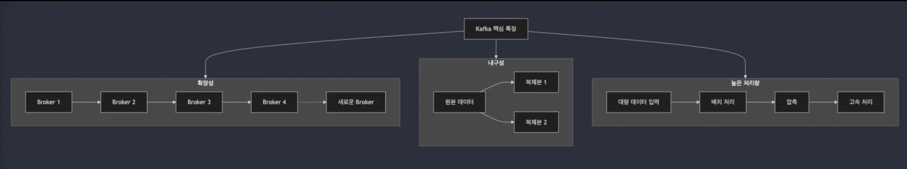

- <code>확장성</code>&#58; 분산 시스템 설게, 수평 확장 용이

- <code>내구성</code>&#58; Replication 기능

- <code>높은 처리량</code>&#58; 배치 처리와 압축을 통한 성능 최적화

## Kafka 아키텍처

### Producer 와 Consumer

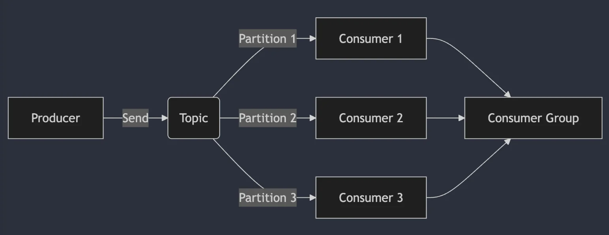

- <code>Producer</code>
    - 데이터 생성 및 Kafka 클러스터로 전송

    - 메시지 전송 과정
        - 특정 Topic의 Partition으로 데이터 전송

        - Partition 선택 전략&#58; <code>라운드 로빈</code>, <code>키 기반 해시</code> 등

    - Producer Acknowledgment(Ack) 설정
        - <code>acks=all</code>&#58; 높은 내구성 보장

- <code>Consumber</code>
    - Kafka에서 데이터 읽기

    - Consumer Group
        - 병렬 처리 가능

        - 하나의 Partition은 하나의 Consumer에만 할당

    - 데이터 중복 및 누락 방지
        - Offset 관리

- <code>Producer&#45;Consumer 흐름</code>
    - 데이터 흐름
        - Producer → Topic (Partition) → Consumer

    - 높은 처리량과 확장성

### Broker와 Topic

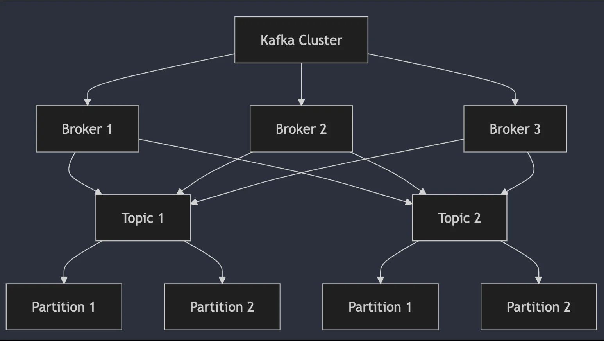

- <code>Broker</code>
    - Kafka 클러스터의 서버 노드

    - Broker 클러스터
        - 여러 Broker로 구성

        - 데이터 저장 및 관리

    - 리더와 팔로워 구조
        - <code>리더</code>&#58; 주 데이터 처리

        - <code>팔로워</code>&#58; 데이터 복제 및 장애 복구 준비

- <code>Topic</code>
    - 메시지 카테고리

    - Topic의 구조
        - 여러 Partition으로 구성

        - 병렬 처리 가능

    - 데이터 처리 전략
        - 발행/구독 모델

- <code>Broker&#45;Topic 관계</code>
    - 데이터 분산 저장
        - Topic의 Partition이 여러 Broker에 분산

        - 고가용성과 성능 보장

### Partition 과 Replication

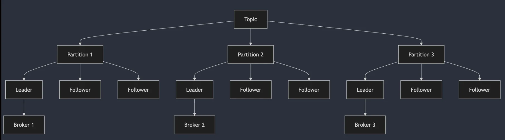

- <code>Partition</code>
    - kafka의 핵심 처리 단위

    - 토픽을 구성하는 기본 단위

    - 특징
        - 고유 번호 부여

        - 물리적으로 다른 Broker에 분산 저장

    - 병렬 처리
        - 고성능 데이터 처리 가능

    - 데이터 저장 구조
        - 로그 파일 형식

- <code>Replication</code>
    - 데이터 복제를 통한 내구성과 고가용성 보장

    - Leader&#45;Follower 구조
        - <code>Leader</code>&#58; 주 데이터 처리

        - <code>Follower</code>&#58; 데이터 복제 및 백업

    - Replication Factor
        - 일반적으로 2&#45;3 개의 복제본 유지

        - 장애 내성 vs 리소스 사용량 trade&#45;off

- <code>Partition&#45;Replication 관계</code>
    - 내구성 보장
        - 데이터 손실 방지

        - 고가용성 제공

### Offset

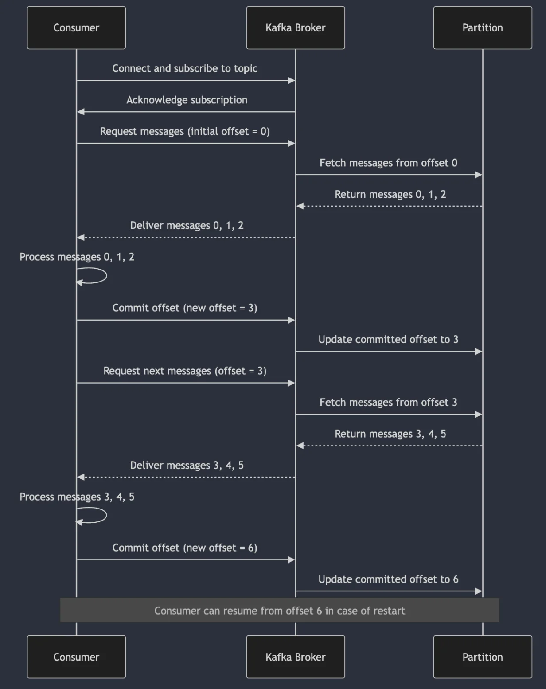

- <code>Offset의 개념</code>
    - 역할&#58; Consumer의 메시지 읽기 위치 기억

    - 메시지 일관성 유지
        - 중복 처리 방지

        - 처리 일관성 유지

- <code>Offset 관리 방식</code>
    - 자동 커밋
        - Kafka가 자동으로 Offset 저장

    - 수동 커밋
        - Consumer가 명시적으로 Offset 저장

        - 안정한 메시지 처리 보장

- <code>Offset과 메시지 처리 일관성</code>
    - 정확히 한 번 처리(Exactly&#45;once) 가능

    - 데이터의 일관성 유지

    - 중복 메시지 처리 방지

# Kafka의 주요 사용 사례

---

> ✏️ 
> 
> 
> 
> Kafka의 주요 사용 사레들을 통해 <strong><u>복잡한 비지니스 문제에 대한 효과적인 해결책</u></strong> 및 <u>kafka의 다양한 산업 적용 가능성</u>을 알아본다&#46; 
> 
> - 주요 이점&#58; <code>실시간 데이터 처리</code>, <code>로그 관리</code>, <code>데이터 스트리밍</code>, <code>사기 탐지</code> 등

## Kafka  일반적인 사용 사례

### 실시간 로그 처리

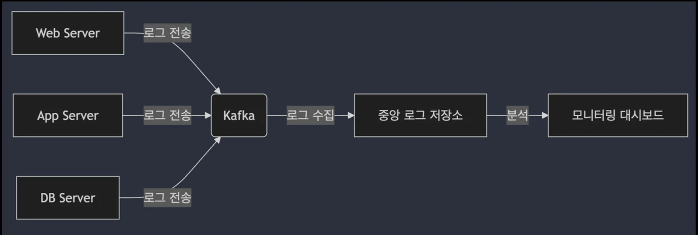

- <code>Kafka의 역할</code>
    - 중앙 집중형 로그 관리 시스템 구축

    - 대규모 시스템에서 로그 데이터 효율적 처리

    - 장애 및 성능 문제 신속 파알

- <code>활용 사례</code>
    - 웹 애플리케이션&#58; 오류 로그, 성능 메트릭 수집

    - 장애 탐지 및 대응 시간 구축

    - DevOps 환경&#58; 인프라 상태 모니터링 및 자동화 대응

### 데이터 스트리밍

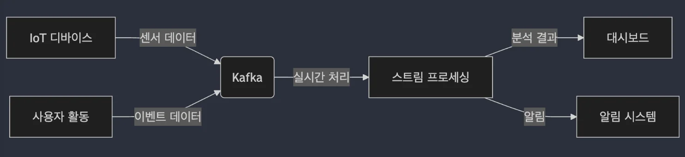

- <code>대규모 데이터 스트리밍 시스템</code>
    - 여러 데이터 소스에서 실시간 데이터 수집

    - 스트리밍 분석 시스템으로 데이터 전송

- <code>적용 사례</code>
    - IoT 장치&#58; 센서 데이터 실시간 처리

    - 실시간 데이터 파이프라인 구축

    - 비지니스 인텔리전스(BI)&#58; 실시간 보고서 생성 및 분석

## Kafka 다양한 사용 사례

### 로그 집계

- <code>중앙 로그 관리</code>
    - 여러 서버의 로그 데이터 중앙화

    - 효율적인 로그 처리 및 문제 원인 추적

- <code>ELK 스택 연동</code>
    - <code>Elasticsearch</code>, <code>Logstash</code>, <code>Kibana</code> 와 통합

    - 실시간 로그 분석 및 검색 시스템 구축

    - 활용&#58; 실시간 로그 모니터링, 즉각적인 문제 해결

### 실시간 데이터 처리

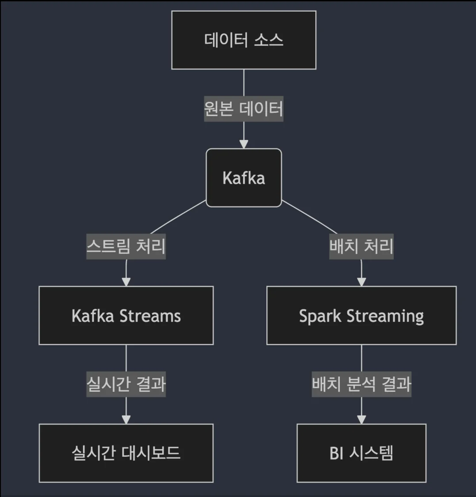

- <code>Kafka 스트리밍 플랫폼</code>
    - 다양한 데이터 소스에서 실시간 데이터 수집 및 분석

- <code>활용 분야</code>
    - <code>금융</code>&#58; 실시간 결제 처리, 거래 분석

    - <code>전자상거래</code>&#58; 고객 행동 분석, 개인화된 추천

    - <code>IoT</code>&#58; 실시간 장치 데이터 분석 및 대응

- <code>기술 스택 연동</code>
    - <code>Kafka Streams</code>&#58; 실시간 데이터 변환 및 이벤트 처리

    - <code>Apache Flink, Spark Streaming</code>&#58; 고급 실시간 데이터 처리

    - <code>예시</code>&#58; 금융 시스템에서 실시간 트랜잭션 데이터 분석

### 마이크로서비스 아키텍처

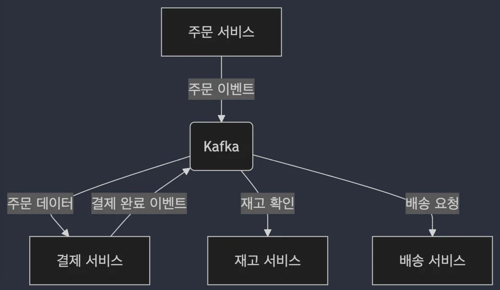

- <code>서비스 간 비동기 통신</code>
    - 마이크로서비스 간 이벤트 기반 아키텍처 지원

    - 확장성과 유연성 제공

- <code>확장 가능한 이벤트 드리븐 시스템</code>
    - 대규모 서비스에서 고성능 비동기 통신 지원

    - 예시&#58; 전자상거래 플랫폼의 주문, 결제, 배송 서비스 연동

### 데이터 파이프라인

- <code>데이터 수집 및 변환</code>
    - 여러 소스에서 실시간 데이터 수집 및 중앙 집계

    - 다양한 분석 시스템으로 데이터 전달

- <code>Kafka Connect 활용</code>
    - 다양한 데이터 소스와 연동(DB, 파일 시스템, 클라우드 서비스)

    - 예시&#58; 실시간 데이터 파이프라인 구축
        - DB → Kafka → Hadoop/Spark

### 금융 거래 처리

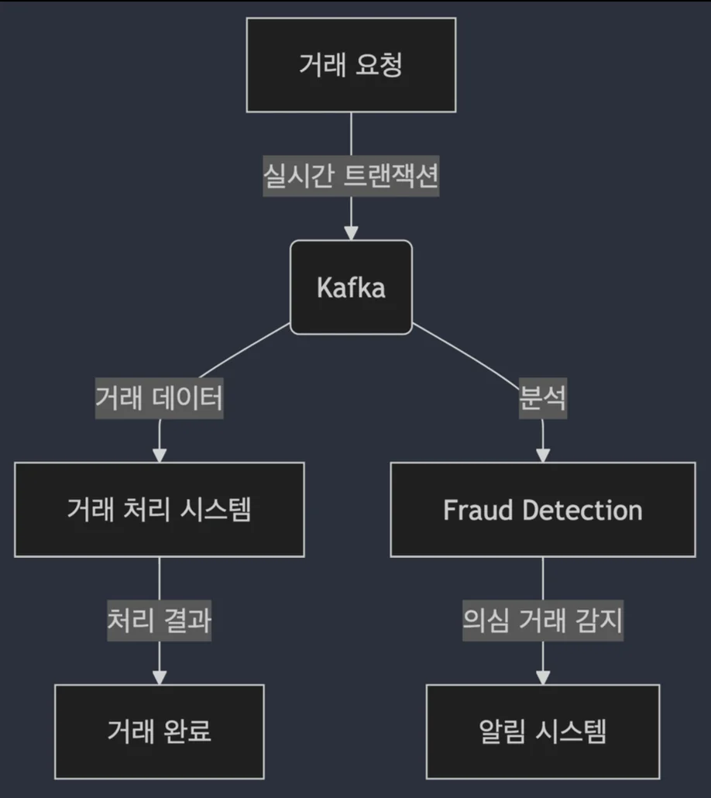

- <code>실시간 금융 거리 처리</code>
    - 대규모 트랜잭션 데이터 실시간 처리

    - 빠른 거래 처리 및 정확한 데이터 분석

- <code>Fraud Detection 시스템</code>
    - 실시간 거래 데이터 분석을 통한 사기 탐지

    - 예시&#58; 은행 시스템에서의 실시간 사기 거래 차단

### 미디어 스트리밍 서비스

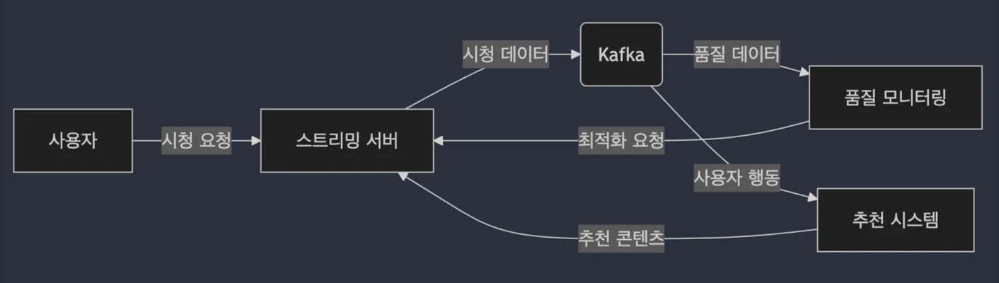

- <code>실시간 미디어 데이터 처리</code>
    - 스트리밍 데이터 처리 및 빠른 콘텐츠 전송

    - 맞춤형 추천 및 미디어 품질 최적화

- <code>실시간 분석을 통한 품질 최적화</code>
    - 사용자 행동 추적 및 서비스 문제 모니터링

    - 예시&#58; Netflix의 실시간 스트리밍 데이터 모니터링 및 최적화

### 온라인 광고 시스템

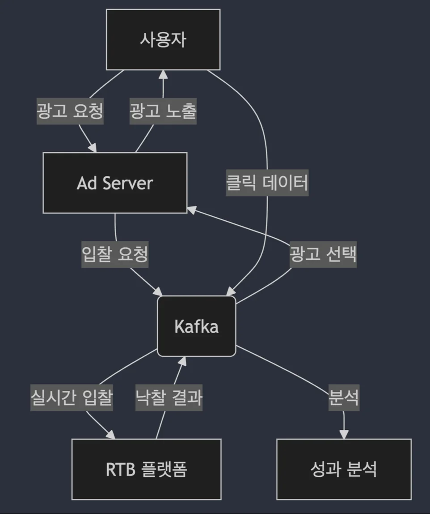

- <code>실시간 광고 배포 시스템</code>
    - 실시간 광고 요청 처리 및 배포 관리

    - 예시&#58; 실시간 광고 경매 시스템(RTB)

- <code>클릭 스트림 분석</code>
    - 실시간 사용자 행동 데이터 수집 및 분석

    - 광고 성과 평가 및 캠페인 실시간 조정

### 헬스케어 데이터 처리

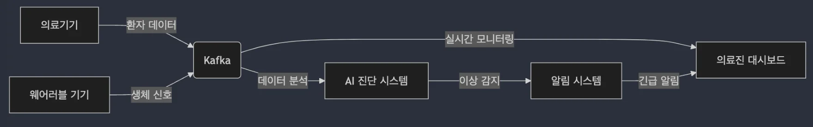

- <code>의료 데이터 수집 및 처리</code>
    - 의료 장비 및 웨어러블 장치 데이터 실시간 수집

    - 환자 상태 실시간 모니터링 및 대응

- <code>IoT 기반 원격 의료</code>
    - IoT 의료 장치 데이터 실시간 수집 및 분석

    - 원격 환자 모니터링 및 즉각적인 의료 대응

# Kafka의 고급 기능과 설정

---

## Kafka 고급 기능 개요

### Kafka Streams

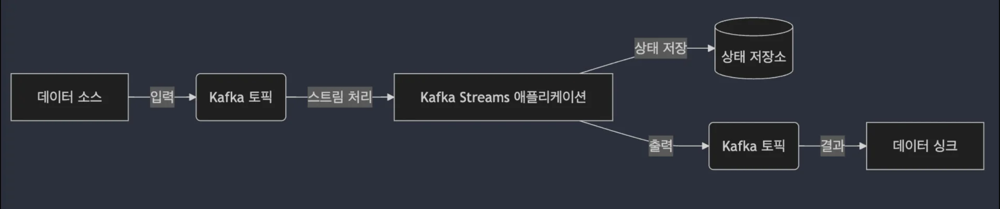

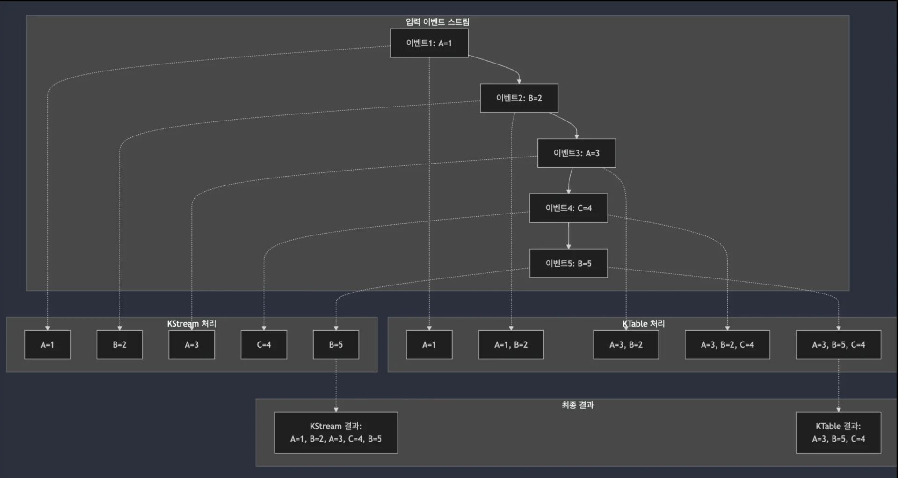

> ✏️ 
> 
> 
> 
> 실시간 데이터 처리를 위한 클라이언트 라이브러리
> 
> - 분산 환경에서 고성능 유지
> 
> - 상태 저장 및 비저장 처리 지원
> 
> - 정확히 한 번 처리 보장

- <code>Stateful Processing</code>
    - 윈도우 연산, 조인 연산, 집게 가능

- <code>KTable 과 KStream</code>
    - <code>KStream</code>&#58; 단순한 데이터 스트림 흐름

    - <code>KTable</code>&#58; 
        - 상태 기반의 데이터 구조

        - 최신 상태만 유지하며 업데이트가 일어날 때마다 데이터가 덮어 쓰여짐

### Kafka Connect

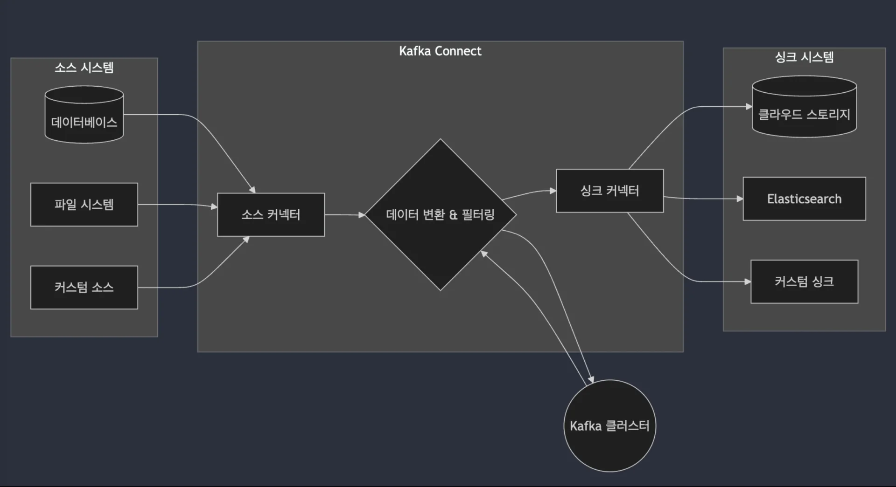

> ✏️ 
> 
> 
> 
> 데이터 통합을 위한 분산 프레임워크
> 
> - 다양한 데이터 소스/싱크 연결
> 
> - 확장 가능한 플러그인 아키텍처
> 
> - 내장 및 커스텀 커넥터 지원

- <code>활용 사례</code>
    - 데이터베이스 CDC (Change Data Capture)

    - 로그 파일 스트리밍

    - 클라우드 스토리지 연동

## Kafka 설정 및 튜닝

### Broker 설정 및 튜닝

- <code>리텐션 정책 설정</code>
    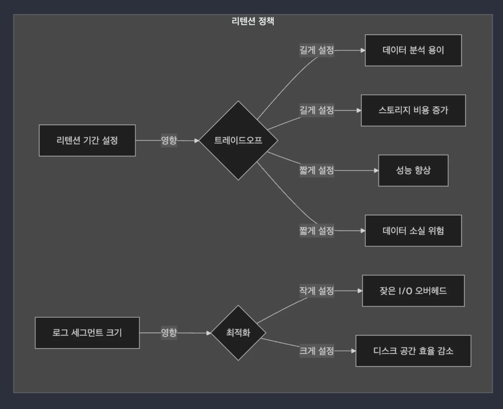

    - <code>리텐션 기간 설정</code>&#58; log&#46;retention&#46;hours, log&#46;retention&#46;bytes

    - <code>세스먼트 크기 최적화</code>&#58; log&#46;segment&#46;bytes

    - <code>고려사항</code>&#58; 스토리지 용량 vs 데이터 보존 기간

- <code>리더와 팔로워 관리</code>
    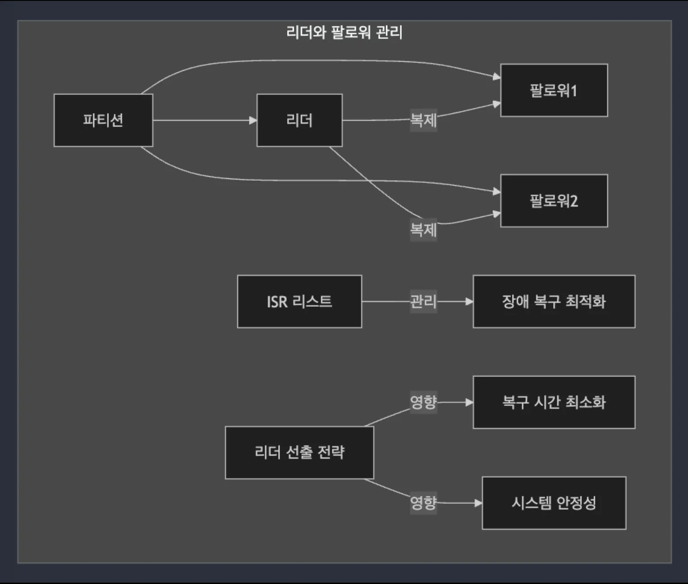

    - Replication Factor 설정

    - <code>ISR(In&#45;Sync&#45;Replicas) 관리</code>&#58; min&#46;insync&#46;replicas

    - <code>리더 선출 전략</code>&#58; unclean&#46;leader&#46;election&#46;enable

### Producer 설정

- <code>Idempotent Producer</code>
    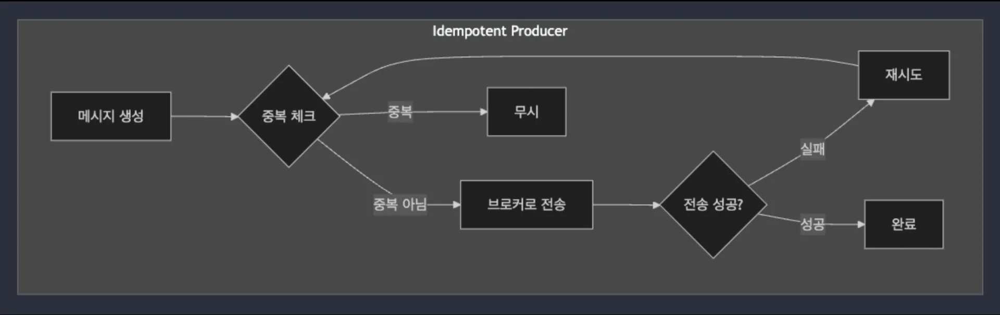

    - 중복 메시지 방지

    - <code>enable&#46;idempotence = true</code>

- <code>Transactional Producer</code>
    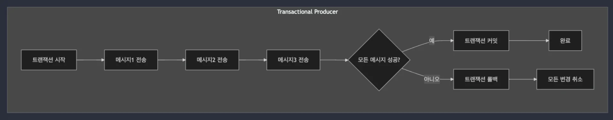

    - 원자적 메시지 전송

    - <code>transactional&#46;id</code> 설정

- <code>압축 설정</code>
    - compression&#46;type (gzip, snappy, Iz4)

### Consumer 리벨런싱 전략

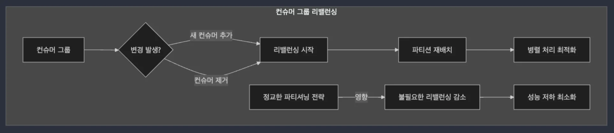

- <code>컨슈머 그룹 관리</code>
    - 파티션 재배치 최적화

- <code>리벨런싱 전략</code>
    - Sticky Assignor

    - Cooperative Sticky Assignor

    - 커스텀 파티션 할당 전략

    - 정적 멤버쉽

    - 증분식 리벨런싱

### Consumer Offset 관리

> 
> 
> - <strong><code>자동 Offset 커밋</code></strong>
>     - 주기적 자동 커밋 (기본 5초)
> 
>     - ✅ 장점&#58; 간단한 구현과 관리
> 
>     - ❌ 단점&#58; 중복 처리 가능성
> 
> ---
> 
> - <code>수동 Offset 커밋</code>
>     - 개발자가 직접 커밋
> 
>     - ✅ 장점&#58; 정확한 처리 보장
> 
>     - ❌ 단점&#58; 복잡한 구현

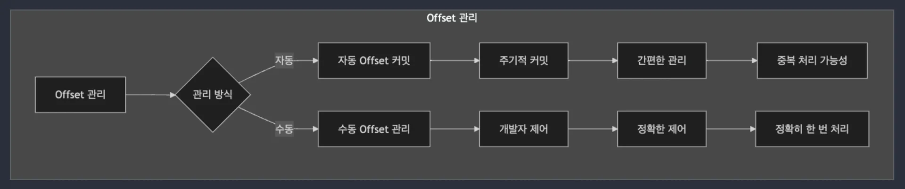

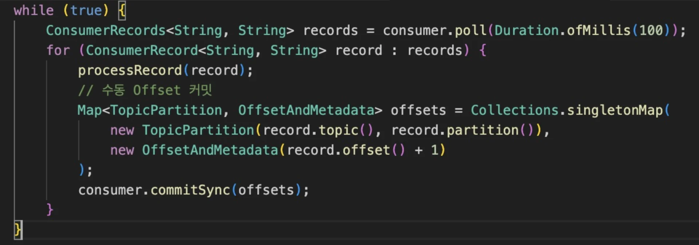

- <code>“정확히 한 번” 처리</code>
    - 수동 Offset 관리로 구현

    - 메시지 처리 와 Offset 커밋을 트랜잭션으로 관리

    - 실패 시 롤백으로 일관성 유지

- <code>중복 처리 방지</code>
    - 멱등성(idempotency) 구현

    - 메시지에 고유 ID 부여

    - 처리 전 중복 확인

---

- <code>Offset 리셋 전략</code>
    - <code>earliest</code>&#58; 가장 오래된 메시지부터 읽기

    - <code>latest</code>&#58; 가장 최근 메시지 부터 읽기

    - 저장된 Offset을 찾지 못할 때 사용

- <code>Offset 관리의 주요성</code>
    - 메시지 손실 방지

    - 중복 처리 방지

    - 시스템 신뢰성과 정확성 보장

    - 효율적인 장애 복구

### Replication Factor 및 파티셔닝 전략

- <code>Replication Factor 조정</code>
    - 데이터 내구성고 장애 복구 능력 향상

- <code>커스텀 파티셔닝 전략</code>
    - 데이터 로컬리티 향상

## Kafka 보안

### SSL / TLS 구성

- <code>SSL 구성</code>
    - 데이터 암호화 및 보안 통신

- <code>SASL을 통한 인증</code>
    - 다양한 인증 메커니즘 지원

    - Kerberos, SCRAM 등

### ACL(Access Control List) 보안 관리

- <code>세밀한 접근 제어</code>
    - 특정 사용자나 애플리케이션이 특정 토픽에 접근할 수 있도록 설정

- <code>보안 정책 적용 및 모니터링</code>
    - 보안 로그를 통해 모든 보안 이벤트를 기록

    - 이를 기반으로 이상 행동을 탐지하거나 침입 방지를 위한 조치

### Kafka 운영 및 모니터링

- 모니터링 도구 사용
    - Prometheus 및 Grafana 연동

    - 실시간 성능 및 상태 모니터링

- 주요 모니터링 메트릭
    - <code>브로커 수준</code>
        - CPU 사용률, 메모리 사용량, 디스크 I/O

    - <code>토픽 수준</code>
        - 메시지 처리량, 지연 시간, 파티션 수

    - <code>컨슈머 그룹</code>
        - 컨슈머랙(Lag), 오프셋 커밋 율

    - <code>프로듀서</code>
        - 메시지 전송 율, 실패율

- Kafka Manager 및 기타 모니터링 도구
    - Cluster Manager for Apache Kafka
        - ‣

    - UI for Apache Kafka
        - ‣

    - 클러스터 운영 상태 관리

    - 장애 사전 파악 및 대응
