> 
> 
> 
> 
> <strong>목차</strong>
> 
> - [분산 시스템 테스트 전략](#32eeda9b0fe18018a653d76dcae12dce)
> - [분산 시스템 테스트의 필요성](#331eda9b0fe18065aa5bd931ca487144)
> - [데이터 일관성 유지](#331eda9b0fe1804f9fb1ec1d186f495d)
> - [동기화 문제](#331eda9b0fe180fe8180f78d3739cdbc)
> - [서비스 간 상태 관리](#331eda9b0fe180219b97ed051c17046c)
> - [실제 장애 사례 분석](#331eda9b0fe18083a045d06500f3cb7e)
> - [분산 시스템의 주요 개념](#331eda9b0fe180e79f5dd4f73a89ced5)
> - [분산 트레이싱](#331eda9b0fe1808bbf5dfbe3818334ed)
> - [성능 메트릭](#331eda9b0fe180079f82c3085feddfdb)
> - [분산 시스템 테스트 전략](#331eda9b0fe1802fb2acee8eb58ca7e5)
> - [엔드투엔드 (E2E) 테스트](#331eda9b0fe180139fc0cf669bbc3005)
> - [계약 기반 테스트 (Contract Testing)](#331eda9b0fe1809eb723c30b029d68ec)
> - [부하 테스트 시나리오](#331eda9b0fe18034b33cd7187a8cb773)
> - [성능 테스트 도구 소개](#32eeda9b0fe1808d899ac1b7599bcf64)
> - [성능 테스트 도구의 필요성](#331eda9b0fe180748b63d2249e4dcee1)
> - [고부하 상태에서 시스템의 응답 성능 파악](#331eda9b0fe180838200e7f320caff0f)
> - [성능 최적화 방안 수립](#331eda9b0fe180a6a33cfe0112977fe8)
> - [지속적인 모니터링을 통한 사전 감지 및 대응](#331eda9b0fe1807fa12fe93d35f5055d)
> - [JMeter를 이용한 부하 및 성능 테스트 ](#331eda9b0fe1802fa63cdb4ced60b303)
> - [JMeter 설정 및 시나리오 작성](#331eda9b0fe1805b85f5d9543213d8d0)
> - [JMeter 와 분산 테스트 ](#331eda9b0fe18031951dd361c446cd04)
> - [JMeter 의 시각화 및 결과 분석](#331eda9b0fe180719e54fd0c79a43443)
> - [Pinpoint](#331eda9b0fe1800d9869f9a863094992)
> - [Pinpoint 에이전트 연동](#331eda9b0fe180d09becf19012bd51d4)
> - [분산 트레이싱 구성](#331eda9b0fe1800d931bf44e999c4130)
> - [실시간 성능 모니터링 및 알람 설정](#331eda9b0fe1807486e0e6363f299255)
> - [JMeter 와 Pinpoint 의 연계 활용](#331eda9b0fe1805c92b7f12fc5bf2471)

> 

> ✏️ 

> 📖 

# 분산 시스템 테스트 전략

---

## 분산 시스템 테스트의 필요성

> ✏️ 
> 
> 
> 
> 분산 시스템은 여러 서비스나 컴포넌트가 독립적으로 운영되면서 하나의 시스템처럼 작동해야 함

### 데이터 일관성 유지

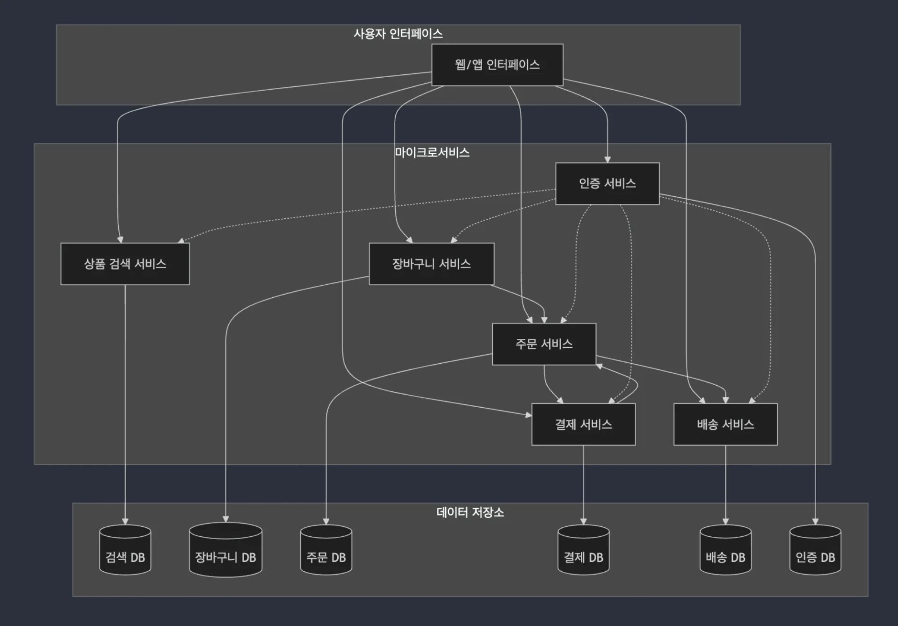

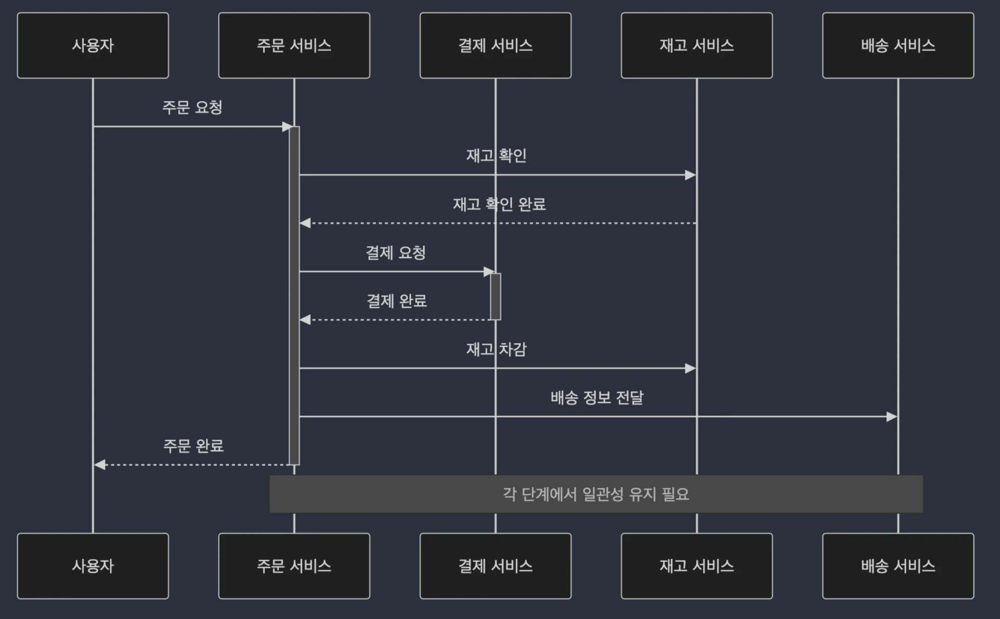

- 데이터가 여러 위치에 분산되어 저장되므로 분산 트랜잭션 관리가 필요함

### 동기화 문제

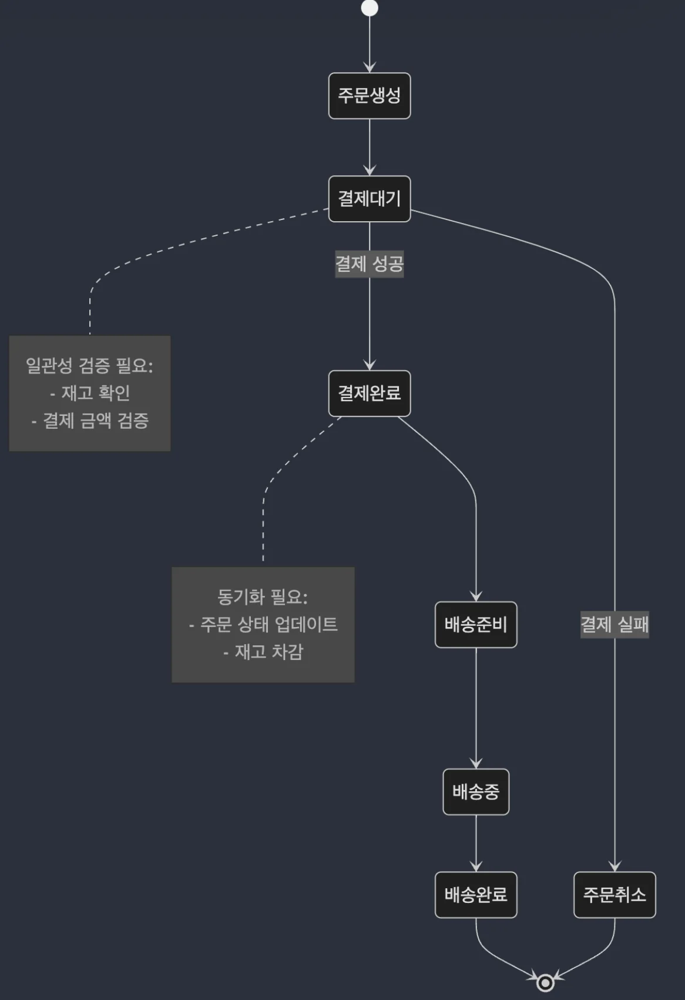

- 비동기적으로 데이터나 이벤트를 전달하는 경우에 대한 처리
    - 예를 들어 사용자가 상품을 주문하면 <code>주문 상태에서 제한되는 처리 중배송 준비 중</code>, <code>배송 중</code>, <code>배송 완료</code> 로 계속 업데이트 되어야 한다&#46; 

    - 이 과정에서 각 서비스가 동기적으로 업데이트하면 상태가 일시적으로 불일치하거나 지연될 수 있다&#46;

    - 따라서 주문 상태가 제대로 반영되지 않거나 잘못된 상태를 사용자에게 보여줄 수 있다&#46; 

- 동기화 문제를 사전에 테스트하고, 서비스 간 데이터 업데이트가 제대로 이뤄지는지 확인 해야한다&#46;

### 서비스 간 상태 관리

- 분산 시스템은 주로 무상태(stateless) 아키텍처로 설계되지만, 일부 기능에서는 상태 관리가 필요하다
    - 인증 정보를 유지하려면 세션이나 토큰을 통해 사용자의 상태 관리를 해야한다&#46;

    - 만약 인증 상태 관리가 제대로 되지 않으면 세션이 완료되거나 로그인 상태가 지속되지 않는 문제가 발생할 수 있다&#46;

- 서비스 간에 상태 관리가 필요한 경우, 이를 제대로 관리하고 테스트할 필요가 있다&#46;
    - 사용자 인증 상태가 여러 서비스에서 일관되게 유지할 수 있도록 세션 관리 로직을 테스트 할 수도 있다&#46;

### 실제 장애 사례 분석

- <strong>Facebook 대규모 장애 (2021)</strong>
    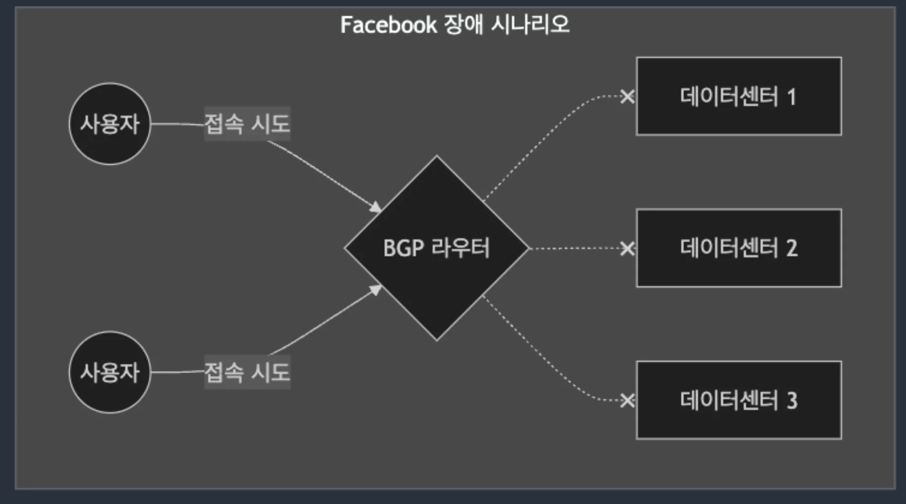

    - 2021년 페이스북은 네트워크 설정 오류로 인해 전세계 사용자가 장시간 동안 서비스를 이용할 수 없는 장애를 겪었다&#46; 

    - 해당 장애는 네트워크 설정 중 실수로 인해 페이스북의 데이터 센터 간 통신이 완전히 차단되면서 발생했다&#46;

    - 이처럼 네트워크 구성에 작은 오류가 대규모 서비스 중단으로 이어질 수 있는 이유는 분산 시스템에서의 의존성 때문이다&#46; 네트워크가 모든 서비스 간 연결을 지원해야 하는데, 그 중 하나라도 잘못되면 전체 시스템이 다운될 위험이 있다&#46;

    - 해당 장애 사례를 통해 분산 시스템에서 네트워크 안정성과 구성 관리가 얼마나 중요한 지를 보여준다&#46; 따라서 이러한 네트워크 구성 오류를 방지하기 위해 네트워크 설정을 테스트하고 장애가 발생했을 때 자동으로 복구할 수 있는 시스템을 구축하는 것이 보다 중요하다고 할 수 있다&#46;

    

     

- <strong>AWS 리전 장애</strong>
    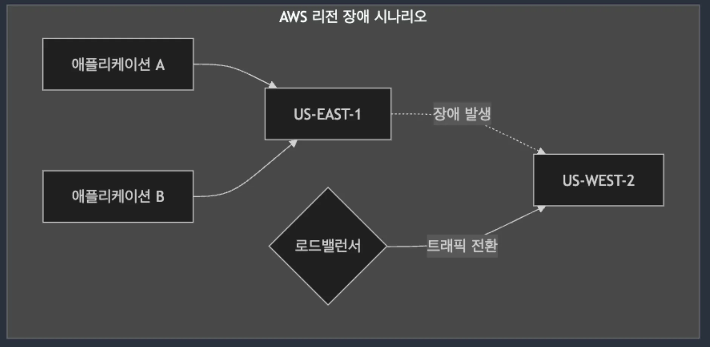

    - aws 클라우드를 사용하는 많은 기업들은 각 지역 리전에 분산된 데이터 센터를 사용해 서비스를 운영한다&#46; 

    - 하지만 <strong>특정 리전에서 장애가 발생하면 해당 리전에 의존하는 모든 서비스가 중단</strong>될 수 있다&#46; 
        - 예를 들어 미국 동부 리전에서 장애를 겪는 경우, 해당 리전에 있는 모든 DB, 서버에 의존하는 어플리케이션은 모두 중단되며 서비스 이용이 불가능해진다&#46; 

    - 이러한 장애를 대비하기 위해서 <strong><u>리든던시를 적용</u></strong>하고 하나의 리전에 장애가 발생하더라도 다른 리전에서 서비스를 유지할 수 있도록 <strong><u>멀티리전 설계</u></strong>도가 필요하다&#46; 
        - 멀티리전 설계를 통해 장애 리전 트래픽을 정상 리전으로 자동으로 전환하여 정상 서비스 운영 유지

- <strong>Netflix의 카오스 엔지니어링 도입 배경</strong>
    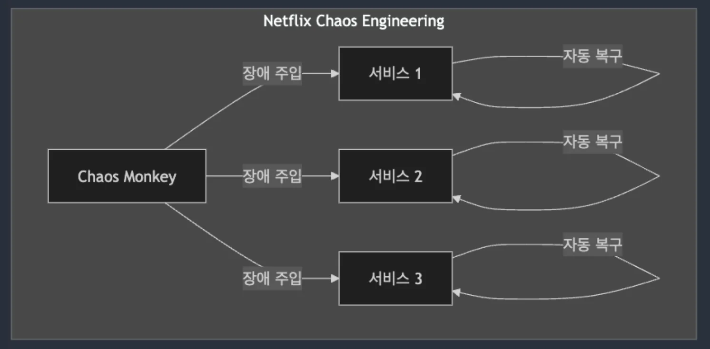

    - 카오스 엔지니어링의 핵심은 <strong>장애를 실제로 주입</strong>해서 <strong>시스템이 이러한 장애 상황을 견뎌낼 수 있</strong>는지, 그리고 <strong>자동 복구가 가능한지</strong>를 <strong><u>테스트</u></strong>하는 것이다&#46; 

    - 넷플릭스는 카오스 원키라는 도구를 통해 <strong><u>특정 서비스나 노드를 의도적으로 중단</u></strong>시키고 <strong><u>시스템이 이를 복구할 수 있는지를 확인</u></strong>한다&#46; 

    - 이 방법은 예상치 못한 장애가 발생되었을 때도, 서비스가 지속적으로 운영될 수 있도록 준비하는 중요한 과정이라 할 수 있다&#46;

## 분산 시스템의 주요 개념

### 분산 트레이싱

> ✏️ 
> 
> 
> 
> 분산 시스템에서는 <strong><u>여러 서비스가 서로 데이터를 주고 받으며 상호작용</u></strong>을 하기 때문에 <strong>서비스 간 호출을 추적</strong>하는 것은 <strong>시스템의 성능을 유지하고 문제를 빠르게 파악</strong>하는 데 <strong><u>필수적</u></strong>이다&#46;

<strong>분산 트레이싱 도구</strong>&#58; <code>Open Telemetry</code>, <code>Jaeger</code>, <code>Zipkin</code>, <code>Pinpoint</code> 

- <code>Open Telemetry</code>
    - 다양한 언어와 프레임워크를 지원하는 분산 트레이싱 도구
        

        각 서비스 간에 호출 관계를 추적하고 성능 문제를 분석하는데 유용하다&#46; 

- <code>Jaeger</code>, <code>Zipkin</code>
    - 대규모 시스템에서도 효율적으로 트랜젝션을 추적할 수 있는 기능을 제공한다&#46; 

    - <code>Zipkin</code>
        - 간단한 트리 구조로 각 서비스의 호출을 보여준다&#46; 

- <code>Pinpoint</code>
    - 어플리케이션 간 성능 관리에 최적화된 기능을 제공한다&#46; 

    - 특히 핀포인트를 활용하면 특정 서비스의 요청 처리 시간, 오류율, 호출 관계를 시각적으로 확인할 수 있고, 이를 통해 성능 병목 구간을 실시간으로 파악할 수 있다&#46;

    - cpu, 메모리 사용량과 같은 리소스 활용도를 함께 모니터링 할 수 있어 분산 시스템의 전반적인 성능 상태를 종합적으로 관리할 수 있다&#46;

- <strong>분산 트레이싱을 통한 문제 분석</strong>
    - &#91;예시&#93; 사용자가 주문을 완료하는 동안 결제 서비스에서 지연 발생
        - <strong><u>Pinpoint나 Jaeger, Zipkin 같은 트레이싱 도구</u></strong>를 통해  <strong>각 서비스 간 호출 관계와 지연 시간을 시각적</strong><strong>으로 </strong>확인하므로써 결제 서비스가 <strong><u>병목 현상의 원인임을 쉽게 파악</u></strong>할 수 있다&#46;

        - 이 정보를 기반으로 결제 서비스에 캐싱을 적용하거나 데이터베이스 접근 방식을 최적화하는 조치를 취할 수 있다&#46;

### 성능 메트릭

- <strong><code>RED 메트릭</code></strong>
    - 각 서비스가 처리하는 <u>요청 속도(처리량), 오류율, 응답 시간</u>을 측정하여 <strong><u>시스템의 성능을 모니터링</u></strong>

    ---

    

    
<strong><code>Rate(처리량)</code></strong>

    - 초당 처리되는 요청 횟수

    - 시스템이 얼마나 많은 요청을 처리할 수 있는지를 보여준다 

    - 처리량이 급격이 증가하거나 감소하는 경우, 사용량 변화나 이상 발생을 빠르게 파악할 수 있다&#46;

    

    

    
<strong><code>Error(오류율)</code></strong>

    - 처리된 요청 중에서 오류가 발생한 비율을 의미한다&#46; 

    - 핀포인트와 같은 apm 도구를 통해 실시간으로 서비스에 오류를 직접 추적해서 특정 서비스에서 발생하는 에러를 빠르게 식별하고 조치할 수있다&#46;

    

    

    
<strong><code>Duration(응답시간)</code></strong>

    - 각 요청이 처리되는데 걸리는 시간을 의미함

    - 핀포인트, 집핀을 통해 서비스 응답 시간 변화를 실시간으로 모니터링 하여 응답 시간 지연이 발생한 경우, 원인을 빠르게 찾아낼 수 있도록 도와준다&#46;

    

- <strong><code>USE 메트릭 </code></strong>
    - 시스템 자원의 활용 상태를 나타내며, 주로 <strong><u>인프라(서버, 네트워크 등)의 성능을 평가</u></strong>하는 데 사용

    ---

    

    
<strong><code>Utilization(사용률)</code></strong>

    - 각 자원(<code>cpu</code>, <code>메모리</code>, <code>네트워크 대역폭</code> 등)이 얼마나 사용되고 있는지를 나타냄

    - 예를 들어, 핀포인트를 통해 cpu 사용률이 일정 한계를 넘어가거나 과부화 상태인지 확인

    

    

    
<strong><code>Saturation(포화 상태)</code></strong>

    - 특정 자원이 한계에 다다른 상태를 의미

    - 예를 들어, 데이터베이스 연결이 포화 상태라면 추가 요청이 대기 상태로 넘어가기 떄문에 이를 통해 병목 지점을 확인할 수 있다&#46;

    - 포화 상태에 대한 지표는 JMeter 부하 테스트와 함께 분석하면 더욱 유용하다&#46; 

    

    

    
<strong><code>Errors(오류율)</code></strong>

    - 자원 사용 중 발생한 오류 빈도

    - 하드웨어나 네트워크 문제로 발생되는 오류를 추적해 문제가 발생하기 전에 이를 감지하고 예방한다&#46;

    

- <strong><code>골든 시그널</code></strong>
    - RED와 USE 메트릭의 요소를 통합적으로 다룬, 네가지 주요 지표를 통해 시스템의 전반적인 상태를 진단함

    ---

    - <strong><code>Latency(지연시간)</code></strong>

    - <strong><code>Traffic(트래픽)</code></strong>

    - <strong><code>Errors(오류)</code></strong>

    - <strong><code>Saturation(포화 상태)</code></strong>

## 분산 시스템 테스트 전략

### 엔드투엔드 (E2E) 테스트

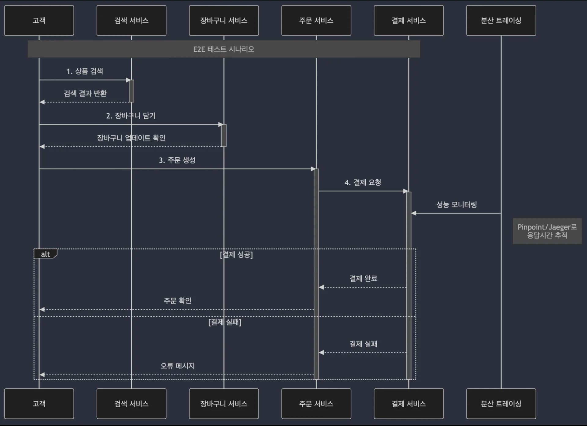

- 시스템의 전체 사용자 흐름을 시뮬레이션하여 개별 서비스들이 통합된 상태에서 정상적으로 작동하는지를 확인한다&#46;

- 분산 시스템의 각 기능이 의도한 대로 협력하여 동작하는지, 최종 사용자 관점에서 문제 없이 사용할 수 있는지를 평가한다&#46; 

- 트레이싱 도구(pinpoint, jaeger 등)을 사용하여 각 서비스의 상태와 성능 모니터링

- 엔드투엔드 테스트는 통합 테스트와 결합해서 시스템의 일반된 상태를 유지하며, 사용자 경험을 보장할 수 있도록 한다&#46; 

### 계약 기반 테스트 (Contract Testing)

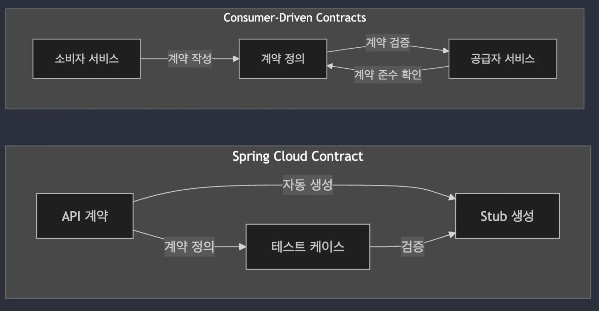

- API 통신이나 데이터 교환 시각에서, 서비들이 서로 합의한 ‘계약’을 준수하는지 검증한다&#46; 

- 이를 통해 각 서비스가 기대한 데이터 형식과 내용을 준수하여 상호작용하는지 확인하고, 의사소통의 안정성을 보장할 수 있다&#46;

<strong>ex) Spring Cloud Context</strong>

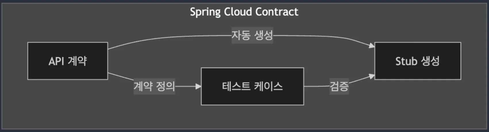

- 각 서비스 간 계약을 정의하고 이를 기반으로 서비스 테스트가 가능하다&#46; 
    - 예를 들어, 주문 서비스가 결제 서비스에 특정 형식으로 데이터를 전송해야 될 때 스프링 클라우드 컨트렉트를 통해 계약을 정리하고 해당 계약이 준수되는 지 확인할 수 있다&#46;

- 이러한 계약 기간 테스트는 api 버전 관리에도 큰 도움을 줄 수 있다&#46; 
    - 예를 들어, 결제 서비스가 api 업그레드를 할 때 계약 기반 테스트를 통해 다른 서비스에 영향을 미치지 않도록 하위 호환성 검증이 가능하다&#46; 

    - 이를 통해 새로운 api가 기존 서비스에 미치는 영향을 최소화하고 전체 시스템이 안정적으로 유지되도록 보장할 수 있다&#46; 

### 부하 테스트 시나리오

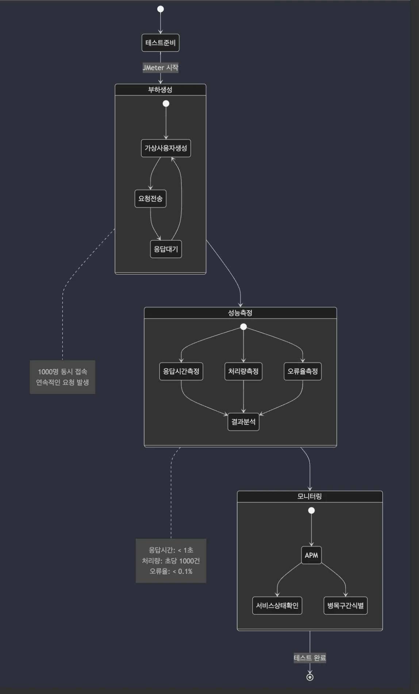

- 부하 테스트는 시스템이 <strong>고부하 상황에서 어떻게 반응하는지를 평가</strong>하는데 중점을 둔 테스트 방식

- 분산 시스템은 고트래픽이나 대량 요청이 발생할 때 성능이 급격히 저하될 수 있으므로, 사전에 부하 테스트를 통해 각 서비스의 한계를 파악하고 대비할 필요가 있다&#46;

- JMeter를 활용해 특정 시간 동안에 트래픽 증가나 여러 요청을 동시에 발생시키는 시나리오를 설정해 <strong><u>서비스 과부화 상태에서 어떻게 반응하는지 테스트</u></strong> 가능하다&#46; 
    - <code>JMeter</code>&#58; 가상의 사용자 트래픽을 발생시켜 시스템에 응답 성능을 테스트하는데 널리 사용되는 도구이다 &#46;

- &#91;테스트 시나리오&#93; 1천명의 사용자가 동시에 결제 요청 가정
    > JMeter를 통해 서버에 과부하를 가해 시스템의 응답 속도와 처리 성능 측정할 수 있다&#46;

    - 응답 시간, 처리량, 오류율 등을 수집
        - 응답 시간 &#45; <strong><u>요청을 받은 후 응답까지 걸리는 시간을 측정</u></strong>해 <strong>사용자 체감 성능을 평가</strong>

        - 처리량 &#45; 특정 시간 내 성공적으로 처리된 요청 수를 나타내서 <strong>시스템의 최대 처리 성능 파악</strong>

        - 오류율  &#45; 과부하 상태에서 발생하는 오류 비율을 통해 시스템이 처리 한계를 넘어설 때 발생하는 문제 식별

    - 키포인트와 같은 apm 도구를 사용해 부하 테스트 중 실시간 서비스의 상태를 모니터링 할 수 있음

# 성능 테스트 도구 소개

---

## 성능 테스트 도구의 필요성

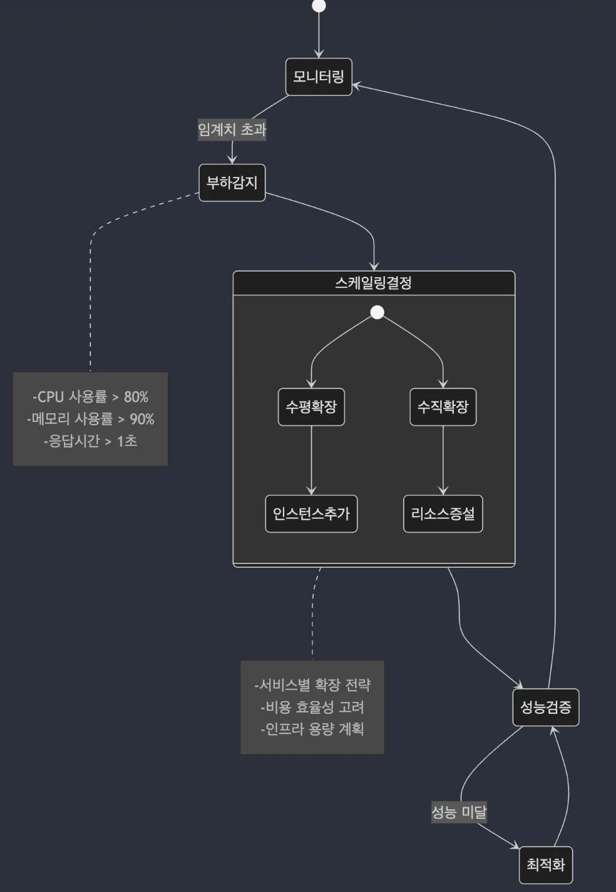

- 분산 시스템에서는 <strong>여러 서비스가 상호작용하며 사용자의 요청을 처리</strong>함

- 따라서 <strong><u>개별 서비스</u></strong><strong> 및 </strong><strong><u>전체 시스템</u></strong><strong>의 </strong><strong><u>성능</u></strong><strong>을 </strong><strong><u>테스트</u></strong><strong>하고 </strong><strong><u>모니터링</u></strong><strong> </strong>하는 것이 중요함

### 고부하 상태에서 시스템의 응답 성능 파악

> ✏️ 
> 
> 
> 
> 분산 시스템은 사용자가 증가하면서 <strong>특정 시간대나 이벤트에 따라 급격한 트래픽 증가</strong>가 발생된다&#46;  따라서 <strong>성능 테스트 도구를 통해 고부하 상황에서 시스템이 어떤 반응을 보이는지 확인이 필요</strong>하다&#46;

- <code>응답 시간</code>

- <code>처리량</code>

- <code>병목 현상 파악</code>

### 성능 최적화 방안 수립

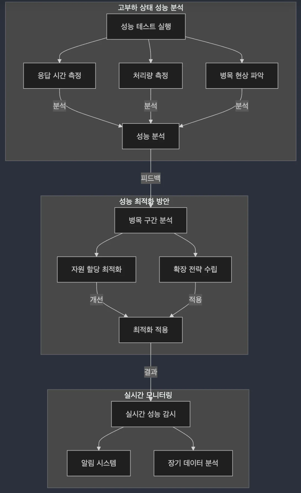

> ✏️ 
> 
> - <strong>시스템의 병목 구간과 자원 부족 여부를 파악</strong>하여 최적화 방안을 마련하는데 도움준다&#46; 
> 
> - <strong><u>성능 테스트 결과를 기반</u></strong>으로<strong><u> 각 서비스가 최적의 성능을 발휘</u></strong>할 수 있도록 <strong>자원 할당을 조정</strong>하거나 <strong>아키텍처를 개선</strong>할 수 있다&#46; 

- <code>병목 구간 식별 및 개선</code>

- <code>자원 할당 최적화</code>

- <code>효율적인 확장 전략 수립</code>

### 지속적인 모니터링을 통한 사전 감지 및 대응

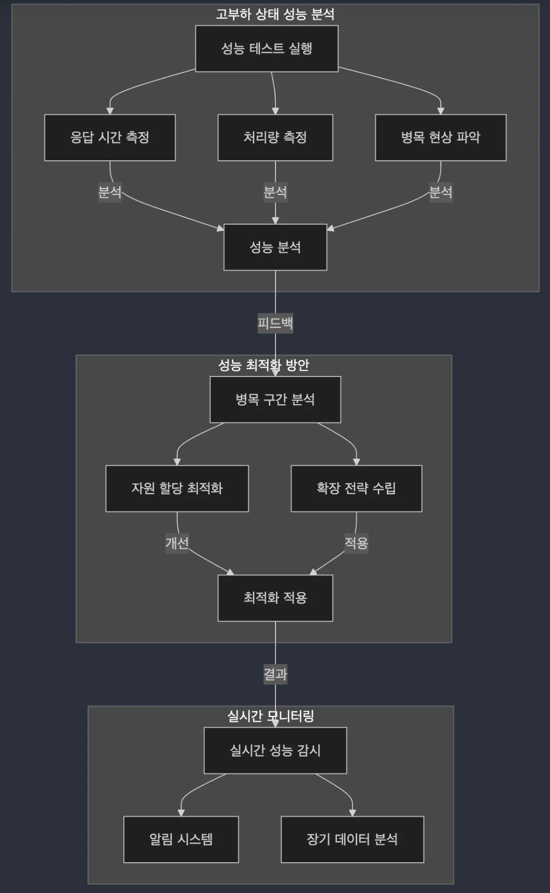

> ✏️ 
> 
> - <strong>성능 저하 징후를 조기 발견</strong>하여 <strong><u>시스템의 안정성을 유지</u></strong>할 수 있도록 함
> 
> - <strong><u>지속적인 모니터링</u></strong>을 통해 <strong><u>사전에 성능 문제를 감지</u></strong>하고, 이를 <strong><u>개선</u></strong>하여 <strong>시스템이 예상 치 못한 문제없이 안정적으로 운영</strong>될 수 있도록 지원함

- <code>실시간 모니터링</code>

- <code>알림 설정</code>

- <code>장기적인 성능 데이터 분석</code>

## JMeter를 이용한 부하 및 성능 테스트 

[jmeter](https://github.com/apache/jmeter)

> 📖 
> 
> 
> 
> <strong>JMeter</strong>
> 
> - 오픈소스 성능 및 부하 테스트 도구
> 
> - 대규모 가상 트래픽을 생성하여 시스템 성능 테스트 가능
> 
> > <strong>주요 기능</strong>
> 
> - <code>부하 테스트 시나리오 작성</code>
> 
> - <code>성능 지표 수집</code>&#58; 응답시간, 처리 속도,  오류율 등 중요한 성능 지표 수집
> 
> - <code>분산 테스트 지원</code>

### JMeter 설정 및 시나리오 작성

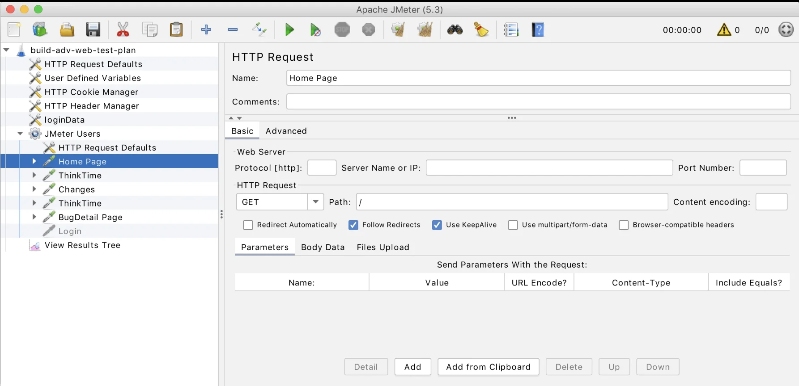

- 테스트 플랜 생성

- 부하 테스트 시나리오 설정

- 성능 지표 모니터링

### JMeter 와 분산 테스트 

- JMeter는 <strong><u>분산 모드로 여러 인스턴스에서 동시에 테스트를 수행</u></strong>하여, 대 <strong>규모 트래픽 시나리오를 시뮬레이션 하는데 효과적</strong>임

- <code>마스터&#45;슬레이브</code> 구성
    - ex)  5개의 슬레이드 노드와 1개의 마스터 노드를 구성하여 5000명의 가상 사용자가 결제 서비스에 동시에 접근하는 상황을 시뮬레이션

### JMeter 의 시각화 및 결과 분석

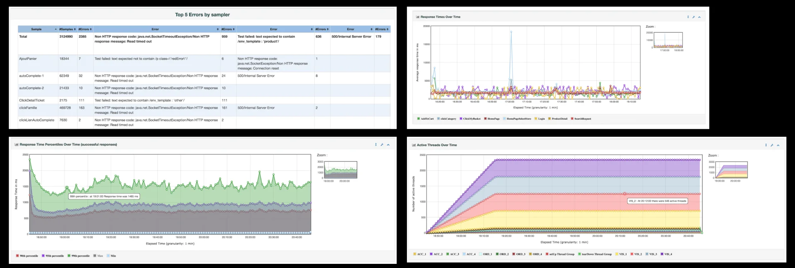

- <strong><u>그래프와 요약 테이블을 제공</u></strong>하여 <strong>실시간으로 테스트 결과를 모니터링</strong>

- 성능 테스가 종료된 후, 전체 성능 데이터를 한눈에 볼 수 있도록 다양한 리포트를 제공하여 시<strong><u>스템의 병목 구간을 시각적으로 분석 가능</u></strong>

## Pinpoint

[pinpoint](https://github.com/pinpoint-apm/pinpoint)

> 📖 
> 
> 
> 
> <strong>Pinpoint</strong>
> 
> 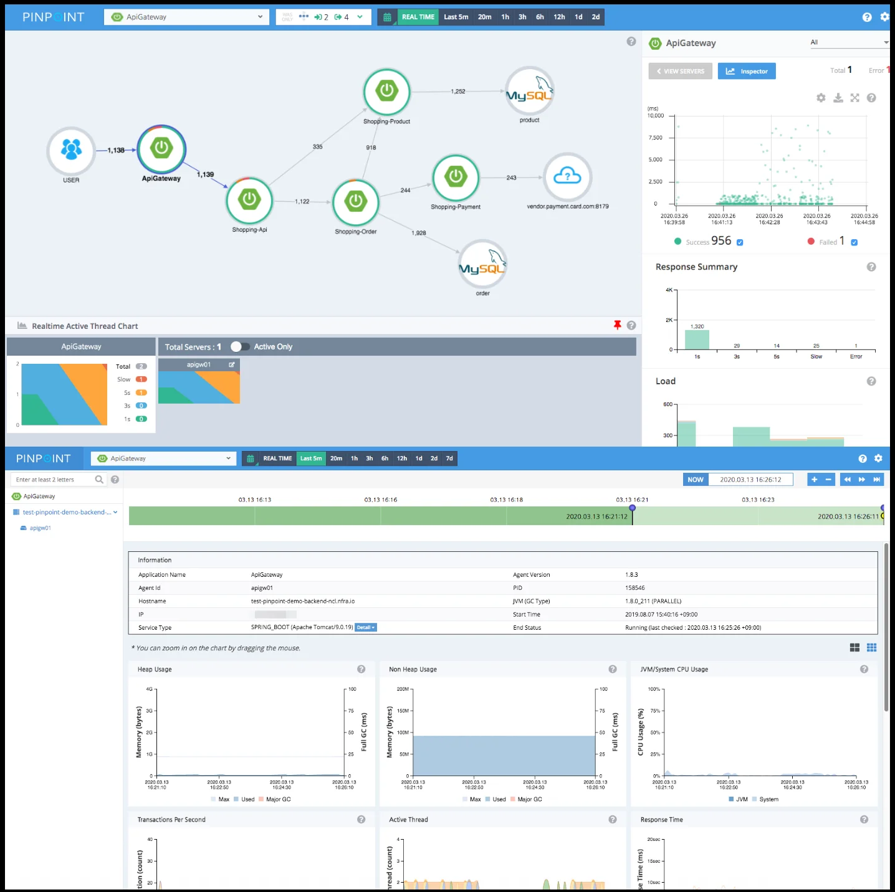
> 
> 
> 
> APM(Application Performance Management) 도구로, 분산 시스템에서 각 서비스의 상태와 성능을 실시간으로 모니터링 할 수 있다&#46;
> 
> > <strong>주요 기능</strong>
> 
> - <code>실시간 트랜잭션 추적</code>
> 
> - <code>서비스 성능 모니터링</code>
> 
> - <code>분산 트레이싱 및 호출 관계 시각화</code>

### Pinpoint 에이전트 연동

- <code>Pinpoint 에이전트 다운로드</code>
    - Pinpoint Github 또는 공식 사이트에서 에이전트 다운

    - 에이전트는 서비스가 베포되는 서버에 함께 설치, 각 서버에 설치할 때 각 서비스에 적합한 버전의 에이전트를 설정하는 것이 중요함

- <code>에이전트 설정</code>
    - 에이전트의 설정 파일(ex&#46; <code>pinpoint&#46;config</code>)을 열어 각 서비스의 기본 설정을 구성

    - <code>applicationName=PaymentService</code>, <code>agentId=PaymentAgent01</code>과 같은 이름으로 설정하여 특정 서비스에 대한 데이터를 식별

- <code>서버에 에이전트 연동</code>
    - 일반적으로 자바 애플리케이션에서는 에이전트를 자바 가상 머신(JVM) 시작 옵션에 추가

    - <code>&#45;javaagent&#58;/path/to/pinpoint&#45;agent&#46;jar</code> 옵션을 애플리케이션 시작 스크립트에 추가

- <code>데이터 수집 확인</code>
    - 에이전트를 부착하고 애플리케이션이 실행되면 에이전트는 수집된 데이터를 Pinpoint Collector로 전송

    - Pinpoint 웹 UI 대시보드를 통해 데이터가 수집되고 있는지 확인할 수 있으며, 각 트랜잭션이 정상적으로 수집되고 있는지를 점검

### 분산 트레이싱 구성

- <code>서비스 호출 관계 설정</code>
    - 에이전트가 설치된 각 서비스는 호출되는 관계를 추적하여 중앙 관리 서버에 전달

- <code>트랜잭션 경로 추적</code>
    - 트랜잭션이 시작된 시점부터 완료될 때까지의 전체 경로를 추적하여 각 서비스 간 지연 시간과 호출 빈도를 시각화함

    - 시스템 내에 가장 많은 시간이 소요되는 구간을 쉽게 파악할 수 있음

- <code>병목 구간 식별</code>
    - 특정 서비스에서 응답 시간이 길어지거나 오류가 발생할 경우 Pinpoint는 그 구간을 빨간색으로 표시하여 쉽게 병목 지점을 식별할 수 있음

    - 이 시각적인 정보를 기반으로 문제 해결을 위해 해당 서비스의 데이터베이스 접근 방식을 최적화하거나, 서비스 인스턴스를 확장하는 등의 대응 방안을 마련할 수 있다&#46;

### 실시간 성능 모니터링 및 알람 설정

- <code>대시보드 구성</code>
    - 대시보드에 각 서비스의 주요 성능 지표가 시각적으로 표시됨

    - 각 서비스의 응답 시간과 호출 빈도도 시각적으로 나타나기 때문에, 특정 시간대에 트래픽이 급증할 경우 해당 서비스에서 잘 처리되는지 확인 가능함

- <code>임계값 기반 알람 설정</code>
    - 특정 임계값 초과 시의 알람 설정 가능

- <code>장기적 성능 데이터 수집 및 분석</code>
    - 단기적인 실시간 모니터링 외, 장기적인 성능 데이터 수집 지원 이를 통해 트래픽 패턴이나 성능 변화 추이를 분석하는데 활용 가능함

    - 이러한 <strong><u>장기적인 데이터를 바탕</u></strong>으로 <strong>자원의 사용량을 미리 예측</strong>하고, 필요한 확장이나 성능 최적화를 통해 서비스의 안정성을 장기적으로 확보할 수 있음

> 📝 
> 
> 
> 
> <strong>주요 활용 사례</strong>
> 
> - <code>결제 서비스 응답 지연 모니터링</code>
> 
> - <code>실시간 자원 사용량 모니터링</code>

## JMeter 와 Pinpoint 의 연계 활용

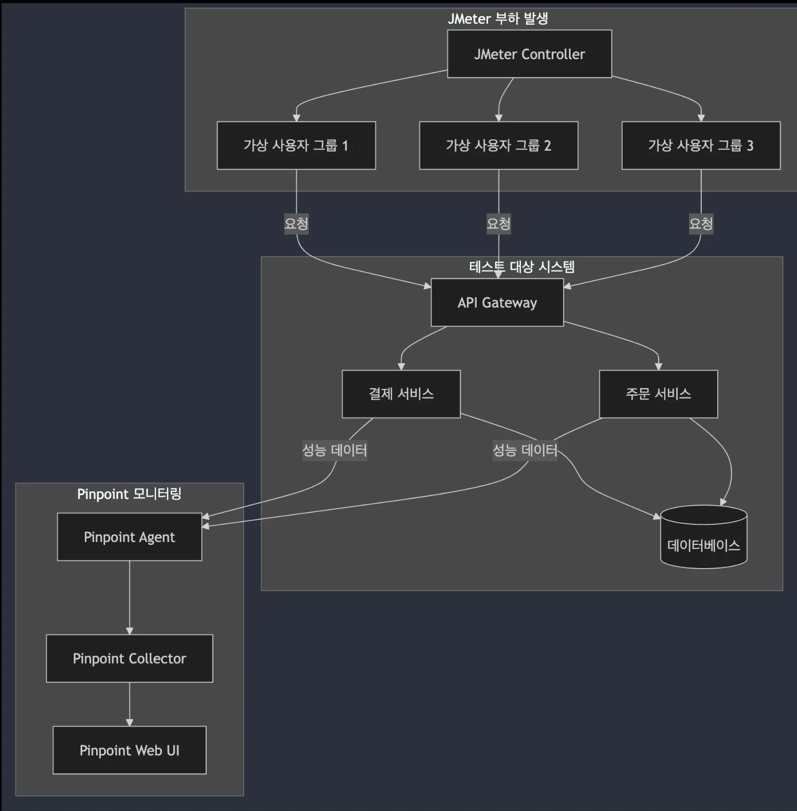

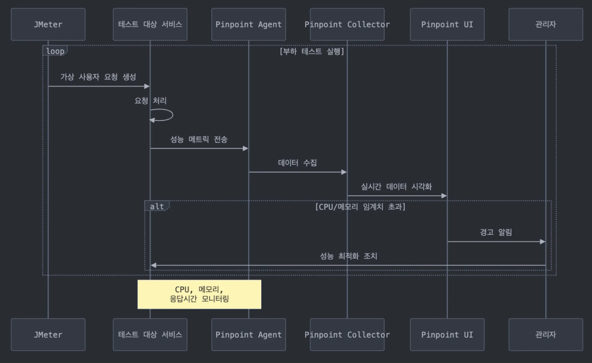

- 부하 테스트 중 실시간 모니터링

- 실시간 성능 문제 대응
