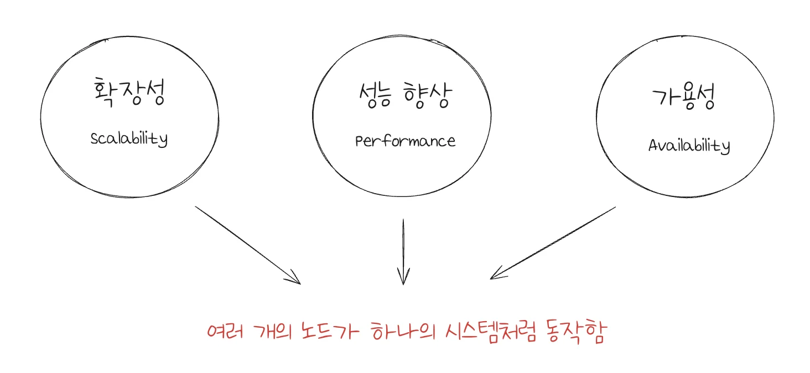
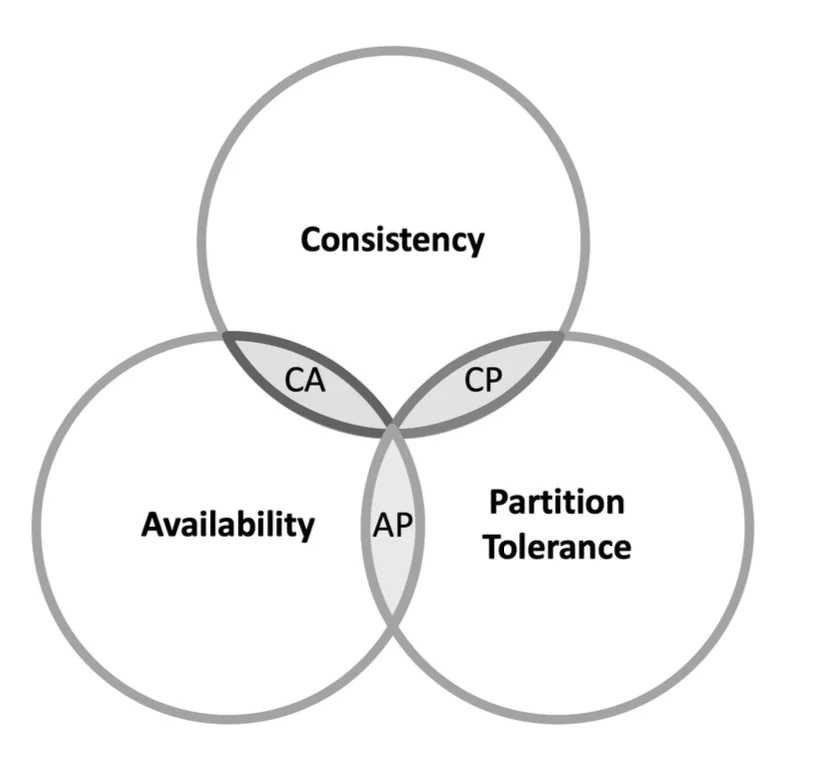
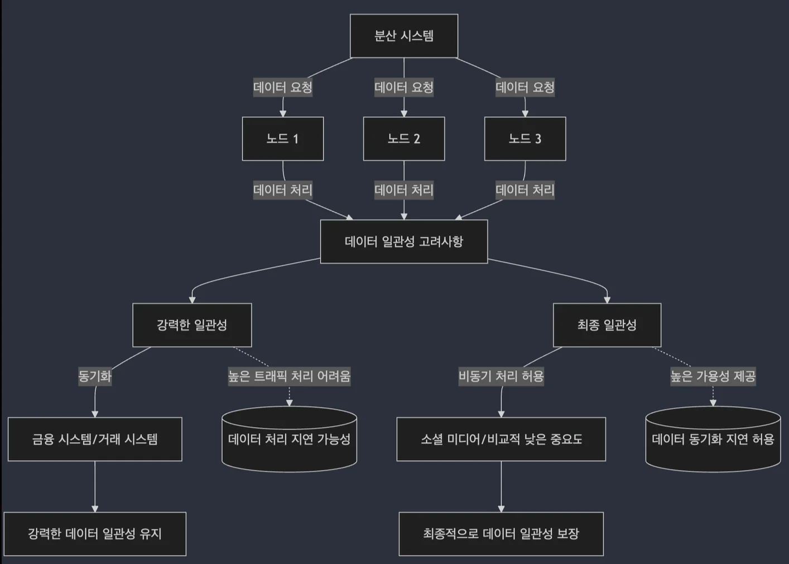
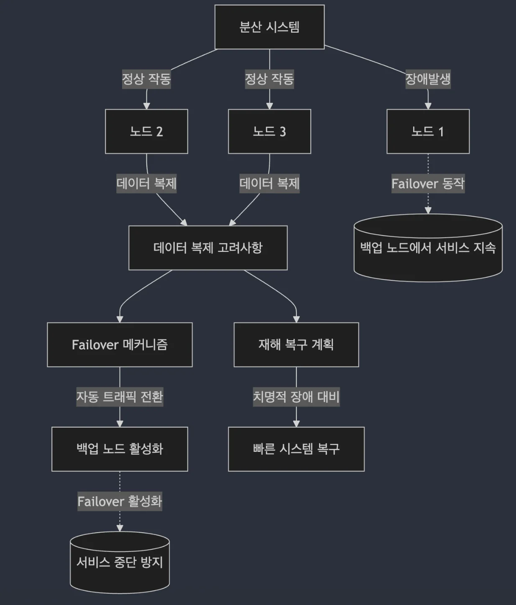
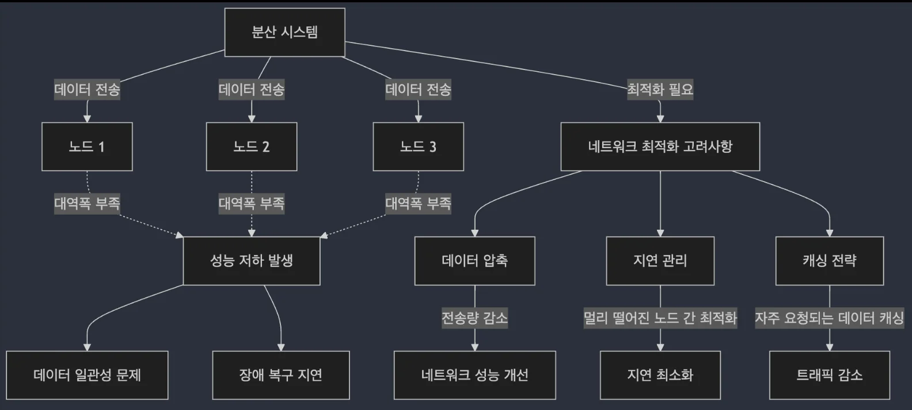

> 
> 
> 
> 
> <strong>목차</strong>
> 
> - [분산 시스템의 구성 요소와 기본 원리](#32eeda9b0fe1800cb2d8f7dd37671d61)
> - [분산 시스템 개요](#32feda9b0fe18027adc9c9e03e6ed1c8)
> - [분산 시스템의 정의](#32feda9b0fe18082aa29ec849954c2f6)
> - [분산 시스템의 주요 구성 요소](#32feda9b0fe180aaa1d5fe44ba86f81e)
> - [분산 시스템의 주요 원리](#32feda9b0fe180ccb6c5ef7bd5ba196a)
> - [CAP 이론](#32feda9b0fe18059a3aaed670948cb1b)
> - [설계 유형](#32feda9b0fe1801c8dc0dc6c891d4580)
> - [CAP 이론을 고려한 설계](#32feda9b0fe18079af0fffa106ca8f3d)
> - [CAP 이론에 따른 설계 전략](#32feda9b0fe1807c8590e79870f1c901)
> - [분산 시스템 설계 시 고려해야 할 요소와 실제  사례  분석](#330eda9b0fe180df961cf0804428beb0)
> - [분산 시스템 설계 시 고려해야 할 요소](#330eda9b0fe180c98c01f696aa3af295)
> - [데이터 일관성 (Data Consistency)](#330eda9b0fe18086ab1bc0d0db107e31)
> - [장애 대응 (Fault Tolerance)](#330eda9b0fe1800494f1e2d992bf821b)
> - [네트워크 대역폭](#330eda9b0fe180e8aa73c4f74b25e48b)
> - [실제 사례 분석](#330eda9b0fe180049a70f7d4c94da992)
> - [Netflix, 스트리밍 서비스 운영을 위한 분산 시스템 설계](#330eda9b0fe18079b518d81dbc85cdeb)
> - [Amazon, 글로벌 운영을 위한 분산 처리 시스템 설계](#330eda9b0fe1804190b9f6c4b0da9e2e)

# 분산 시스템의 구성 요소와 기본 원리

---

## 분산 시스템 개요

### 분산 시스템의 정의

> ✏️ 
> 
> 
> 
> 여러 대의 컴퓨터(노드)가 네트워크를 통해 하나의 시스템처럼 동작하는 시스템
> 
> - 각 노드는 독립적으로 동작하면서도, 시스템 전체적으로 하나의 일관된 서비스처럼 보이도록 협력한다&#46;

- <code>확장성 (Scalability)</code>&#58; 트패픽이 증가해도 여러 서버를 추가하여 부하를 분산시킬 수 있음

- <code>성능 향상 (Performance)</code>&#58; 작업을 여러 노드에 분산 처리하여 시스템의 성능을 극대화할 수 있음

- <code>가용성 (Availability)</code>&#58; 여러 노드에 걸쳐 시스템이 구성되어 있기 때문에, 일부 노드가 장애를 겪더라도 시스템은 계속 운영될 수 있음

### 분산 시스템의 주요 구성 요소

- <code>노드 (Node)</code>
    - 분산 시스템의 기본 단위

    - 각 노드는 독립적인 컴퓨터로서, 역할에 따라 데이터 저장, 처리, 요청 관리 등을 담당

- <code>네트워크</code>
    - 분산 시스템 내의 노드 간 통신을 담당

    - 노드 간 데이터 전송과 상호작용을 관리하며, 네트워크 성능이 분산 시스템의 성능에 큰 영향을 미침

- <code>데이터 복제 및 분산</code>
    - 데이터를 여러 노드에 복제하여 저장함으로써 가용성과 내결함성을 보장

    - 데이터가 분산되어 저장되면, 하나의 노드에 문제가 발생해도 다른 노드에서 데이터를 제공할 수 있음

### 분산 시스템의 주요 원리

- <code>데이터 일관성 (Consistnecy)</code>
    - 모든 노드가 동일한 데이터 상태를 유지하는 능력

    - 하나의 노드에서 데이터가 업데이트되면, 다른 노드도 동일한 데이터를 가지게 됨

- <code>가용성 (Availability)</code>
    - 시스템이 항상 사용자 요청에 응답할 수 있는 능력

    - 하나 이상의 노드가 다운되더라도, 분산 시스템은 여전히 정상적으로 운영될 수 있어야 함

- <code>내결함성 (Fault Tolerance)</code>
    - 시스템이 일부 노드의 장에도 불구하고 서비스를 지속할 수 있는 능력

    - 데이터 복제 및 분산, 장애 발생 시 자동 복구를 통해 내결함성을 확보할 수 있음

## CAP 이론

> ✏️ 
> 
> 
> 
> CAP 이론이란, ‘분산 시스템에서 세가지 주요 특성( <code>일관성(Consistency)</code>, <code>가용성(Availability)</code>, <code>파티션 내성(Partition Tolerance)</code>) 모두 동시에 만족시킬 수 없다’ 는 것을 나타내는 이론이다&#46;
> 
> 
> 
> 즉, 세 가지 특성 중 두 가지 밖에 선택할 수 없다&#46; 

### 설계 유형

1. <code>Consistency</code> &#43; <code>Availability</code>
    - 네트워크 분할을 허용하지 않는 소규모 시스템에 적합

1. <code>Consistency</code> &#43; <code>Partition Tolerance</code>
    - 데이터 일관성이 매우 중요한 시스템에서 가용성을 희생하고 일관성을 유지함

1. <code>Availability</code> &#43; <code>Partition Tolerance</code>
    - 사용자의 요구에 항상 응답해야 하는 시스템에서 일관성을 약간 희생하고, 가용성을 높임

### CAP 이론을 고려한 설계

> 분산 시스템 시, CAP 이론에 따른 선택이 필수적이다&#46;

- <code>일관성 중시 시스템 (Consistency Priority System)</code>
    - 금융 거래 시스템

    - <strong><u>모든 거래가 일관성을 보장</u></strong>해야 하므로, 가용성보다 <strong>일관성이 더 중</strong>요함

    - 이 경우 <strong><u>네트워크 분할이 발생해도 </u></strong><strong><u>데이터의 정확성이 우선시</u></strong> 됨

- <code>가용성 중시 시스템 (Availability Priority System)</code>
    - 소셜 미디어, 스트리밍 서비스

    - <strong><u>빠른 응답이 필수적</u></strong>이므로 <strong><u>일관성을 조금 희생</u></strong>하더라도 <strong>가용성과 네트워크 파티션 내성을 유지</strong>하는 것이 더 중요함

    - 사용자는 약간의 일관성 문제를 느끼지 못하지만, 빠른 서비스가 중요하게 작용

### CAP 이론에 따른 설계 전략

- <code>일관성(C)</code>을 중시하는 시스템
    - <strong>정확성</strong>이 중요한 서비스에서 사용

    - 주로 금융 거래, 주문 시스템과 같은 데이터 일관성이 필수적인 경우 적용됨

- <code>가용성(A)</code>을 중시하는 시스템
    - <strong>빠른 응답</strong>이 중요한 서비스에서 사용

    - 소셜 미디어, 스트리밍 서비스와 같은 빠른 피드백이 요구되는 시스템에 적합함

- <code>파티션 내성(P)</code>을 중시하는 시스템
    - 분산 시스템에서 네트워크 장애가 발생해도 시스템이 안정적으로 작동할 수 있도록 하기 때문에, 거의 모든 분산 시스템에서 필수적으로 고려됨

# 분산 시스템 설계 시 고려해야 할 요소와 실제  사례  분석

---

> 📖 
> 
> 
> 
> 분산 시스템을 설계할 때는 <code>데이터 일관성</code>, <code>장애 대응 능력</code>, <code>네트워크 대역폭</code>을 고려해야 함이 세가지 요소는 <strong><u>시스템의 성능과 안정성에 큰 영향</u></strong>을 미치며, <strong>시스템의 특성 및 요구사항에 맞게 균형 있는 설계가 중요</strong>함

## 분산 시스템 설계 시 고려해야 할 요소

### <code>데이터 일관성 (Data Consistency)</code>

> ✏️ 
> 
> - <strong>분산 시스템에서 </strong><strong><u>데이터의 일관성을 유지</u></strong>하는 것이 중욯다&#46; 
>     - <code>일관성</code>&#58; <strong>여러 노드가 동일한 데이터(상태)를 유지</strong><strong>하는 것</strong>

> 네트워크 지연이나 장애가 발생하면, 데이터가 비동기적으로 처리되면서 동기화 문제가 생길 수 있다&#46; 

- 고려사항
    - <code>강력한 일관성(Strong Consistent)</code> vs <code>최종 일관성(Eventually Consistent)</code>
        - 시스템의 특성에 따라 
            - 데이터의 강한 일관성을 보장하거나, 

            - 약간의 지연을 허용하면서 가용성을 높이는 

        - 방식 중 선택

### <code>장애 대응 (Fault Tolerance)</code>

> ✏️ 
> 
> 
> 
> 분산 시스템에서 <strong>노드가 장애를 겪</strong>더라도 <strong>전체 시스템이 </strong><strong><u>무중단 운영</u></strong><strong>을 유지</strong>하는 것이 중요하다&#46; 
> 
> - 장애에 대한 대비책이 잘 설계되지 않으면, <strong>일부 노드의 장애가 전체 시스템 중단</strong>으로 이어질 수 있다&#46; 

> 노드 장애나 네트워크 장애가 발생했을 때 데이터 손실이나 서비스 중단을 방지할 수 있어야 함

- 고려사항
    - <code>데이터 복제</code>
        - 여러 노드에 데이터를 복제

    - <code>Failover</code>
        - 장애가 발생하면 자동으로 백업 노드로 트래픽 전환

    - <code>재해 복구(Disaster Recovery)</code>
        - 시스템에 치명적인 장애가 발생해도, 빠르게 복구할 수 있는 재해 복구 계획

### <code>네트워크 대역폭</code>

> ✏️ 
> 
> 
> 
> 분산 시스템에서 <strong><u>노드 간의 데이터 전송 속도</u></strong><strong><u>는 시스템 성능에 중요한 영향</u></strong>을 미침
> 
> 
> 
> <strong><u>데이터가 자주 전송되거나 동기화</u></strong>되어야 하는 시스템에서 <strong>네트워크 대역폭이 부족하면 성능 저하가 발생</strong>할 수 있음

> <strong>네트워크 성능이 느리면</strong>, 분산 시스템에서 데이터 일관성 유지나 장애 복구에 문제가 생길 수 있음

- 고려사항&#58;
    - <code>네트워크 최적화</code>
        - 데이터 전송량을 최소화 (압축)

    - <code>지연 (Latency)</code>
        - 데이터 저장 시 지역성을 고려

    - <code>캐싱 (Caching)</code>
        - 네트워크 트래픽을 줄이기 위해 캐싱 전략 활용

## 실제 사례 분석

### <code>Netflix</code>, 스트리밍 서비스 운영을 위한 분산 시스템 설계

> ✏️ 
> 
> 
> 
> 전 세계 사용자에게 동시 스트리밍을 제공하기 위해, 분산 시스템 아키텍처를 사용해 대규모 트래픽을 안정적으로 처리

- <code>데이터 일관성</code>
    - <strong><u><code>최종 일관성(Eventual Consistency)</code></u></strong><u>을 적용</u>하여 <strong><u>빠른 응답</u></strong><strong>을 보장</strong>

    - <strong>데이터가 즉시 동기화되지 않</strong>더라도, <strong>사용자 경험에 영향을 주지 않</strong>음

- <code>장애 대응 전략</code>
    - <code>Chaos Monkey</code>로 <strong><u>고의적인 서버 장애를 발생</u></strong>시켜 <strong>복구 능력 테스트</strong>

    - <strong>다중 리전 데이터 복제</strong>로 <strong><u>특정 리전 장애 시에도 서비스 유지</u></strong>

- <strong><code>네트워크 대역폭 관리</code></strong>
    - <code>CDN</code>을 통해 <strong><u>글로벌 분산 콘텐츠</u></strong><strong><u> 제공</u></strong>

    - <strong>캐싱 기술</strong>로 <strong><u>자주 요청되는 콘텐츠를 미리 저장</u></strong>해 빠른 스트리밍 제공

### <code>Amazon</code>, 글로벌 운영을 위한 분산 처리 시스템 설계

> ✏️ 
> 
> 
> 
> 수백만 명의 동시 접속을 처리하기 위해 대규모 분산 시스템을 구축하여 확장성과 성능을 극대화

- <strong><code>데이터 일관성</code></strong>
    - 강력한 일관성(Strong Consistency)이 필요한 결제, 주문 시스템

    - 최종 일관성(Eventual Consistency)이 허용되는 추천 시스템 등

- <strong><code>장애 대응 전략</code></strong>
    - DynamoDB를 통한 데이터 복제 및 분산 저장으로 빠른 복구 가능

    - Auto Scaling으로 트래픽 증가 시 자동 확장

    - Failover로 장애 발생 시 백업 시스템으로 트래픽 자동 전환

- <strong><code>네트워크 대역폭 관리</code></strong>
    - 글로벌 네트워크에 데이터 분산 저장, 지리적 근접성 활용

    - 캐싱 전략으로 데이터베이스와 서버 간 네트워크 요청 최소화
