> 
> 
> 
> 
> <strong>목차</strong>
> 
> - [동시성 및 비동기 기초 개념](#32eeda9b0fe1813681c3d11a39af817b)
> - [동시성 처리 (Concurrency)](#32eeda9b0fe180df85c4f6ba9b0dfd36)
> - [동시성 처리의 실제 활용: 웹 서버](#32eeda9b0fe1809c8b63fbe2bd7e2af1)
> - [멀티스레딩(Multithreading): 동시성 구현 방법](#32eeda9b0fe180b1ae24f1c0e5a82633)
> - [병렬성(Parallelism)과 동시성(Concurency): 차이점과 활용 방식](#32eeda9b0fe18059b647e32f8149439e)
> - [동시성 처리의 이점과 한계](#32eeda9b0fe1802d8dd5f16e36707181)
> - [비동기 처리(Asynchronous Processing)](#32eeda9b0fe18019b218d19a5dcd21f1)
> - [비동기 처리의 실제 예시: 네트워크 요청과 UI](#32eeda9b0fe1809c8277cc9b73ae75d0)
> - [동기(Synchronous)처리와 비동기(Asynchronous)처리의 차이점](#32eeda9b0fe180b398adeaeaf1970d06)
> - [비동기 처리의 이점과 한계](#32eeda9b0fe18040a440cf84b12c1c33)
> - [동시성 및 비동기 처리를 위한 기본 구조](#32eeda9b0fe1804e928de6b4d06afb14)
> - [스레드 풀 (Thread Pool)](#32eeda9b0fe180b69386d87b76f79ff6)
> - [스레드 풀(Thread Pool)의 구조 및 활용: 스레드 풀(Thead Pool)](#32eeda9b0fe180918472d4ce39550ab1)
> - [스레드 풀(Thread Pool)의 구조 및 활용: 스레드 풀의 구조 및 특징](#32eeda9b0fe18059a690eddd79b8d5e1)
> - [스레드 풀(Thread Pool)의 구조 및 활용: Java의 Excutors API](#32eeda9b0fe1801a9a6bcf5da96acfe1)
> - [스레드 풀(Thread Pool)을 사용할 때, 자원을 효율적으로 사용하려면 어떤 요소를 고려해야 하는가?](#32eeda9b0fe1806ead60d2088b3ed01d)
> - [이벤트 루프 (Event Loop)](#32eeda9b0fe18044b0c9de4c0ce42e42)
> - [비동기 처리와 이벤트 루프: 이벤트 루프 (Event Loop)](#32eeda9b0fe1805084f5ec4794d51d99)
> - [비동기 처리와 이벤트 루프: Java의 비동기 이벤트 루프](#32eeda9b0fe18002b4a9f1453542b9e1)
> - [이벤트 루프가 입출력 작업에 왜 적합한가?](#32eeda9b0fe18070979dfbd170b2b63b)
> - [비동기 작업의 오류 처리 및 콜백 패턴](#32eeda9b0fe180e7ae43efbf0fc3fa50)
> - [비동기 작업의 오류 처리 및 콜백 패턴: Java의 비동기 API 디자인 패턴](#32eeda9b0fe180fe871bfe0b5dd4b64c)
> - [콜백 패턴 (Callback Pattern)](#32eeda9b0fe1809bb734f3d57270604e)
> - [CompletableFuture](#32eeda9b0fe1801e955cf31850844db1)
> - [비동기 작업의 오류 처리 및 콜백 패턴: 비동기 처리 시 유의사항](#32eeda9b0fe180d58617e6dc75d82d8c)
> - [스레드 안정성 (Thead Safety)](#32eeda9b0fe1808783a6cffb29295ef9)
> - [예외처리 필요](#32eeda9b0fe1804c8848c43cb1317147)

# 동시성 및 비동기 기초 개념

---

<strong> 요약 정리</strong>

| 특징 | <code>병렬성(Parallelism)</code> | <code>동시성 (Concurrency)</code> | <code>비동기성 (Asynchronous)</code> |
| --- | --- | --- | --- |
| 주요 개념 | 물리적으로 동시에 실행됨 | 동시에 실행되는 것처럼 보이는 논리적 개념 | 이전 작업을 기다리지 않고 처리 |
| 코어 사용 | 멀티 코어 기반 | 싱글 코어 가능 또한 멀티 코어에서도 가능 | 싱글 코어에서 비동기 작업 가능 |
| 작업 처리 | 다수의 작업을 물리적으로 동시에 처리 | 빠르게 교차하며 처리 | 작업을 위임하고 기다리지 않음 |
| 예시 | 멀티 코어 CPU에서 두 개의 작업 병렬 실행 | 싱글 코어에서 여러 스레드가 교차 처리 | 네트워크 요청 후 다른 작업 처리 |
| 장점 | 작업을 진정으로 동시에 처리하여 성능 최대화 | 빠른 컨텍스트 스위칭으로 효율적인 작업 처리 | 대기 없이 자원을 효율적으로 사용 |
| 단점 | 코어 수에 따라 병렬 작업 수가 제한됨 | 컨텍스트 스위칭 오버헤드가 발생할 수 있음 | 복잡한 오류 처리, 코드 가독성 감소 |

## <strong>동시성 처리 (Concurrency)</strong>

> 📖 
> 
> 
> 
> <strong>동시성 처리 (Concurrency)</strong>
> 
> 
> 
> 동시성은 여러 작업이 동시에 진행되는 것처럼 보이도록 설계된 시스템이다&#46;
> 
> - <strong>실제로는 대부분의 경우, </strong><strong><u>단일 코어에서 여러 작업이 분할되어 교차</u></strong><strong>로 처리</strong>
>     - <strong>굉장히 빠른 속도로 진행되기 때문에 사람이 인지하는데 있어 동시에 처리되는 것과 같이 받아들이게 됨</strong>
> 
> - 사용자는 각 작업이 동시에 실행되는 것처럼 느낌
> 
> - 멀티스레딩을 통해 각 작업을 독립적으로 실행 가능

### 동시성 처리의 실제 활용&#58; <code>웹 서버</code>

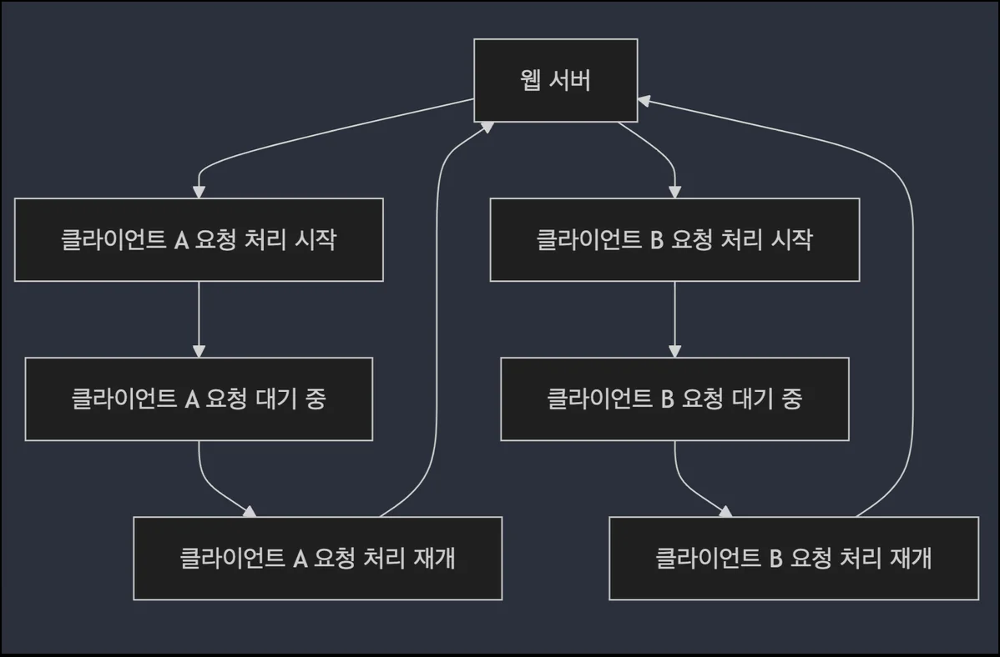

- 웹 서버가 여러 클라이언트의 요청을 처리할 때, <strong><u>각 요청에 대해 별도의 스레드를 생성</u></strong>하거나 <strong><u>작업을 교차적으로 처리</u></strong>하여 <strong><u>병렬성을 제공</u></strong>
    - 예시
        - Context Switching
            - 사용자 A&#39;의 작업을 하다가 잠시 멈추고 &#39;사용자 B&#39;의 작업을 처리한 뒤, 다시 &#39;사용자 A&#39;로 돌아온다&#46; ()

        - nodeJS 
            -  단일스레드로 동작하지만 비동기 io와 이벤트 루프를 사용해 동시성 처리 구현

### 멀티스레딩(Multithreading)&#58; <code>동시성 구현 방법</code>

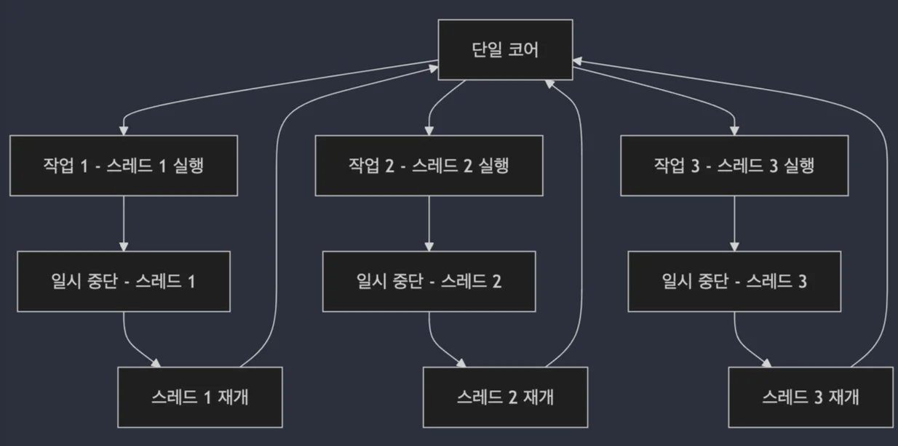

- 멀티스레딩은 하나의 프로세스 내에서 여러 스레드를 사용해 여러 작업을 동시에 처리하는 방식이다&#46;

- 이때 각 스레드는 독립적으로 실행이 되게 되고 cpu 자원을 효율적으로 사용하여 작업을 빠르게 처리할 수 있다&#46; 

- 예시)
    - 수많은 고객이 동시에 주문 처리

    - 멀티스레딩을 통해 각 주문을 개별 스레드에서 처리하여 주문 처리 대기 시간없이 빠르게 주문 완료

### <code>병렬성(Parallelism)</code>과 <code>동시성(Concurency)</code>&#58; 차이점과 활용 방식

- <strong>병렬성 (Parallelism)</strong>
    

    - 병렬성은 물리적인 개념으로, 멀티 코어에서 여러 작업이 동시에 처리되는 것

    - 여러 코어가 동시에 각각의 작업을 처리하기 때문에 실제로 작업이 동시에 수행

- <strong>동시성 (Concurrency)</strong>
    

    - 동시성은 논리적인 개념으로 <strong><u>싱글 cpu 코어에서 여러 스레드를 번갈</u></strong><strong><u>아가며 빠르게 실행</u></strong>
        - 마치 <strong>여러 작업이 동시에 수행되는 </strong><strong><u>것처럼 보</u></strong><strong>이게 만</strong>드는 방식

    - 예시
        - 웹브라우저의 경우 사용자 입력 네트워크 요청, 애니메이션 등 다양한 이벤트를 동시적으로 처리하는 것 처럼 보이지만, 실제로는 이벤트 루프를 사용해 각 이벤트를 빠르게 전환하여 처리함

        - 병렬처리가 아닌 동시성 처리임

### 동시성 처리의 이점과 한계

> <strong>✅ 장점 </strong>

- <code>자원 효율성</code>
    - 시스템 자원을 최대한 활용하여 작업을 빠르게 처리

- <code>응답성</code>
    - 여러 작업을 동시에 처리하여 대기 시간을 줄임

    - 특히 사용자 인터페이스(UI)에서 중요한 역할을 함
        - 외부 앱에서 UI가 빠르게 반응하도록 해 사용자 경험을 개선할 수 있음

> <strong>❌</strong><strong> 단점</strong>

- <code>스레드 관리 문제</code>
    - 여러 스레드를 생성하고 관리하는 것은 복잡할 수 있음

    - 잘못 관리하면 <code>교착 상태(Deadlock)</code>나  <code>경쟁 상태(Race Confition)</code> 같은 문제가 발생함

- <code>동기화 문제</code>
    - 스레드가 공유 자원을 동시에 접근할 때, 적절한 동기화 메커니즘이 없다면 데이터 손상이 발생함

## <strong>비동기 처리(Asynchronous Processing)</strong>

> 📖 
> 
> 
> 
> <strong>비동기 처리(Asynchronous Processing)</strong>
> 
> 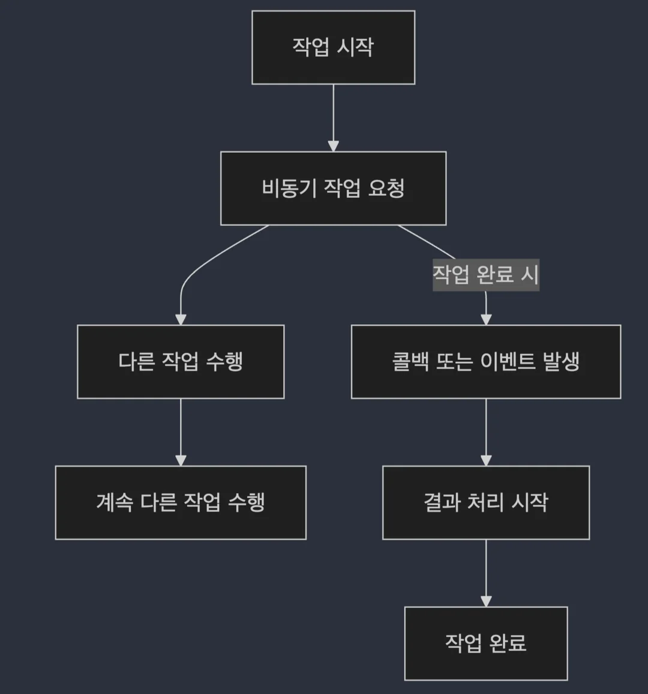
> 
> 
> 
> 비동기 처리(Asynchronous Processing)는 <strong><u>특정 작업이 완료될 때까지 기다리지 않</u></strong><u>고 </u><strong><u>다른 작업을 계속 진행</u></strong>할 수 있는 처리 방식이다&#46;
> 
> - 작업이 완료될 때까지 대기하지 않기 때문에 <strong><u>시스템은 그동안 CPU 자원을 다른 작업에 할당</u></strong>할 수 있다&#46;
> 
> - <strong><u>작업이 완료</u></strong>되면 <u><code>콜백(CallBack)</code></u><u>이나 </u><u><code>이벤트(Event)</code></u><u>를 통해 </u><strong><u>결과를 알</u></strong>리고, <strong><u>그 결과에 대한 추가 작업이 수행</u></strong>된다&#46;

### 비동기 처리의 실제 예시&#58; <code>네트워크 요청과 UI</code>

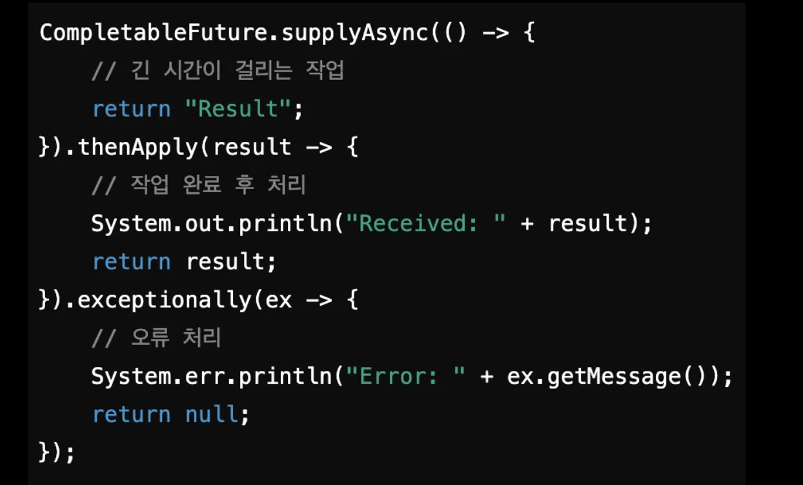

- 네트워크 요청 작업
    - 사용자가 클라이언트에서 서버로 데이터 요청을 할 때, 해당 요청이 완료될 때까지 기다리지 않고 완료되는 동안에도 계속해서 어플리케이션의 다른 기능 동작이 가능하다&#46; 

- 파일 다운로드와 사용자 인터페이스
    - 파일 다운로드 하는 동안 사용자 인터페이스가 멈추지 않고 다른 작업 수이 가능

### <strong><code>동기(Synchronous)처리</code></strong>와 <code>비동기(Asynchronous)처리</code>의 차이점

- <strong><code>동기(Synchronous)</code></strong>
    - 작업이 <strong><u>순차적으로 실행</u></strong>

    - 하나의 작업이 완료되기 전까지 다른 작업을 시작하지 않으며, 작업 완료를 기다린 후 다음 작업을 수행한다&#46; 
        

- <strong><code>비동기(Asynchronous)</code></strong>
    - 작업을 요청한 후 기다리지 않고 다른 작업을 처리할 수 있음

    - 작업이 완료되면 그 결과를 나중에 처리 가능하며, 작업이 완료될 때 콜백 or 이벤트를 통해 알림
        

### 비동기 처리의 이점과 한계

> <strong>✅ 장점 </strong>

- <code>병목 현상 완화</code>
    - 비동기 처리는 긴 시간이 소요되는 작업(예&#58; 네트워크 통신, 파일 읽기/쓰기)이 진행되는 동안 시스템 자원을 더 효율적으로 사용할 수 있게 함
        - cpu가 한 작업이 끝나기를 기다리면서 쉬는 것을 방지해 전체적으로 시스템 성능을 향상시킴

        - io 작업이 끝날 때까지 대기하지 않고 그 사이 다른 작업 처리 가능
            

            → 변목 현상을 줄이고 전체적인 처리 속도 개선

- <code>성능 개선</code>
    - 특히 <strong><u>네트워크 요청</u></strong>이나 <strong><u>파일 입출력 같은 작업</u></strong>에서 비동기 처리는 매우 유요항

> <strong>❌ 단점</strong>

- <code>코드 복잡성</code>
    - 비동기 처리를 사용하면 코드의 흐름이 복잡해질 수 있음
        - 콜백 제어 현상 발생

        - 많은 비동기 처리르 ㄹ하면서 코드가 계층적으로 중첩되는 경우 가독성이 떨어지게 된다&#46; 따라서 디버깅을 좀 더 복잡하게 만든다&#46;

- <code>오류 처리의 어려움</code>
    - 비동기 작업 중 발생하는 오류(Exception)는 즉시 감지하기 어려움
        - 오류가 발생되어도 작업이 계속 진행되어 오류 상태가 누적되어 나타날 수 있음

# 동시성 및 비동기 처리를 위한 기본 구조

---

## 스레드 풀 (Thread Pool)

### 스레드 풀(Thread Pool)의 구조 및 활용&#58; <code>스레드 풀(Thead Pool)</code>

- 미리 생성된 스레드의 집합으로 작업이 들어올 때마다 <strong><u>새로운 스레드를 생성하는 대신,</u></strong> <strong>이미 생성된 스레드를 </strong><strong><u>재사용</u></strong>하여 작업을 처리

- 스레드 풀은 사용하면 <strong><u>스레드 생성 및 소멸에 따른 오버헤드를 줄</u></strong>일 수 있다

- 동시성 처리에서 자원을 효율적으로 관리 가능

### 스레드 풀(Thread Pool)의 구조 및 활용&#58; <code>스레드 풀의 구조 및 특징</code>

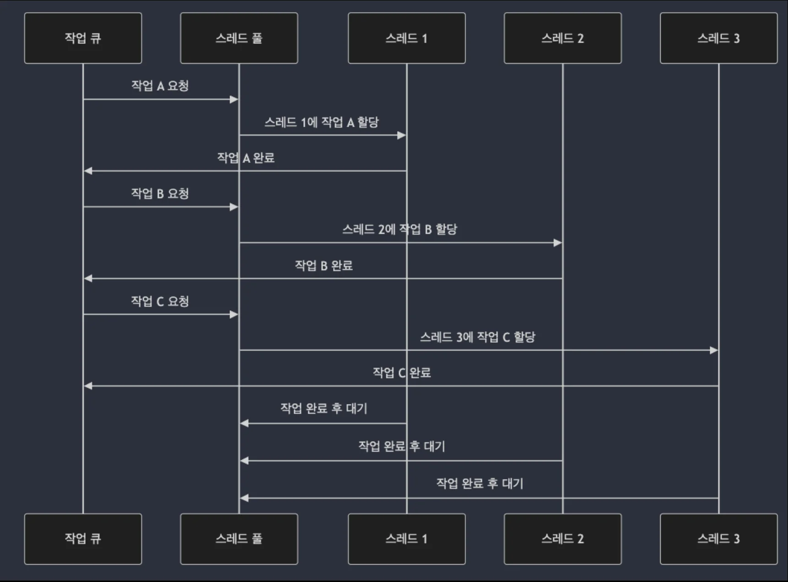

- 스레드 풀은 여러 작업을 동시에 처리하기 위해 미리 생성된 스레드의 집합을 유지
    - 스레드 풀 사용 시 적절한 크기를 설정하는 것이 중요함
        - 너무 작으면 처리량에서 제한적

        - 너무 크면 메모리와 cpu 리소스가 과도하게 사용됨

- 스레드 풀에 작업을 제출하면, 해당 작업이 스레드 풀의 사용 가능한 스레드에 할당
    

    스레드가 작업을 마치면, 그 스레드는 다른 작업에 할당되기 전까지 대기 상태

    - 미리 쓰레드를 생성하며 쓰레드 생성 비용을 줄이고 자원을 보다 효율적으로 사용 가능

    - 특히 작업이 끝난 쓰레드를 다시 사용할 수 있기 때문에 불필요한 쓰레드 생성 및 제거 비용이 줄어듬

### 스레드 풀(Thread Pool)의 구조 및 활용&#58; <code>Java의 Excutors API</code>

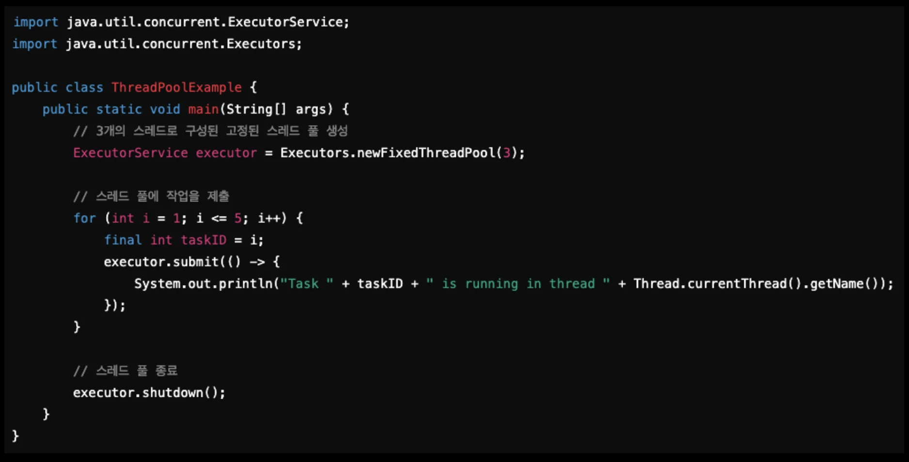

### 스레드 풀(Thread Pool)을 사용할 때, 자원을 효율적으로 사용하려면 어떤 요소를 고려해야 하는가?

- <code>스레드 풀의 크기</code>
    - 너무 많은 쓰레드를 생성하면 쓰레드 컨텍스트 스위칭 비용이 증가하고 시스템의 전반적인 성능이 저하될 수 있다&#46; 

    - 반면 쓰레드가 너무 적으면 cpu 자원이 충분히 활용되지 않을 수 있기 때문에 CPU 코어 수와 작업 특성을 고려하여 최적의 쓰레드 수를 결정해야 한다&#46;

- <code>작업의 종류</code>
    - cpu 집약적인 작업과 io 지배적인 작업은 자원 사용에 있어 서로 다른 접근이 필요하다&#46; 

    - cpu 집약적인 작업의 경우, 스레드 수를 cpu 코어 수에 맞추는 것이 효율적일 수 있다&#46; 

    - io 집약적인 작업에는 쓰레드가 대기하는 시간이 많기 때문에 더 많은 스레드를 할당 해 대기시간 동안 다른 작업을 처리할 수 있도록 하는 것이 좋다&#46; 

- <code>스레드 생성과 파괴의 비용</code>
    - 스레드를 자주 생성하고 파괴하는 것은 비용이 많이 드는 작업이다&#46; 

    - 쓰레드풀을 사용함으로써 스레드 생성 비용을 절약하고 재사용할 수 있다&#46; 
        - 스레드풀에 설정을 통해 초기 스레드 수, 최대 스레드, 요구 시간 등을 조절해 스레드풀을 동적으로 조절하는 것도 좋은 방법이다&#46; 

- <code>메모리 사용량</code>
    - 각 스레드는 자신의 스택 메모리를 필요로 한다&#46; 따라서 스레드 수가 많아질수록 메모리 사용량도 증가하기 때문에 시스템에 메모리 용량과 시드 스레드의 메모리 요구사항을 고려해야 한다&#46;

- <code>동기화 문제</code>
    - 여러 스레드가 공유 자원에 접근할 때 동기화 문제가 발생할 수 있다&#46;

    - 동기화 매커니즘을 사용하면 어플의 성능이 저하될 수 있기 때문에, 가능한 락 경쟁을 최소화하고 락 프리 알고리즘을 고려하는 것이 좋다&#46; 

- <code>응답 시간과 처리량</code>
    - 스레드풀 설정을 조절해 특정 어플리케이션의 요구사항에 맞게 최적화해야 한다&#46; 

    - 예를 들어, 빠른 응답 시간이 중요한 어플리케이션의 경우 스레드풀의 스레드 수를 증가시켜 대시 시간을 줄일 수 있다&#46; 

## 이벤트 루프 (Event Loop)

### 비동기 처리와 이벤트 루프&#58; <code>이벤트 루프 (Event Loop)</code>

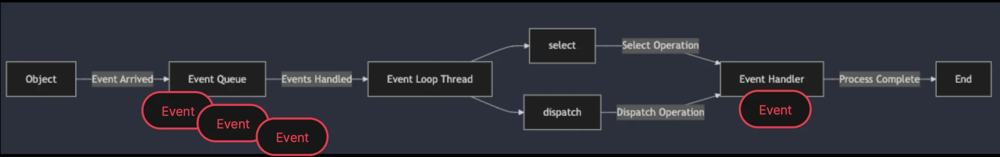

- <code>이벤트 루프(Event Loop)</code>는 <strong><u>비동기 처리</u></strong>를 위한 구조로, <strong>하나의 스레드가 여러 작업을 순차적으로 처리</strong>하는 방식

- <strong><u>입출력(I/O) 작업</u></strong><strong>에서 매우 효율적</strong>

- 이벤트 루프는 <strong><u>단일 스레드 기반으로 동</u></strong>작하여, <u>비동기 작업이 완료</u><strong>될 때마다 </strong><strong><u>이벤트 큐에 있는 작업을 처리</u></strong>

### 비동기 처리와 이벤트 루프&#58; <code>Java의 비동기 이벤트 루프</code>

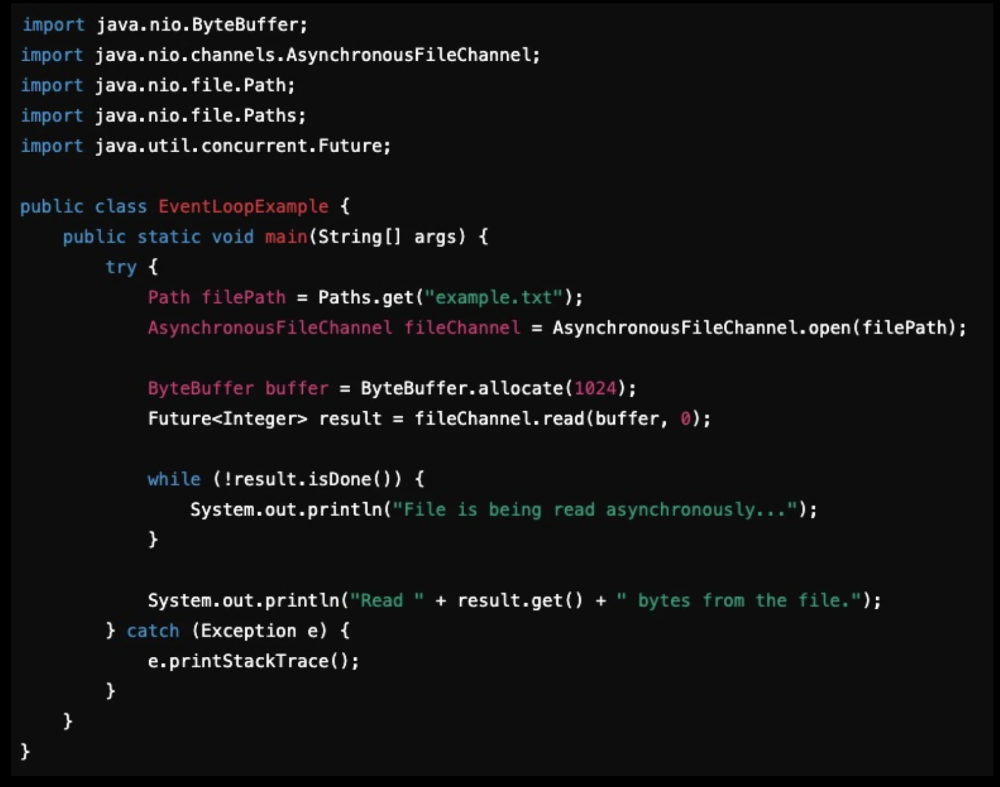

- java에서는 <code>nio</code> 논블로킹 라이브러를 사용해 이벤트 루프 기반 비동기 io를 구현할 수 있다&#46; 

- <code>AynchronousFileChannel</code>을 통해 비동기 채널을 열고 파일을 비동기적으로 읽어 <code>Future&#60;Integer&#62;</code>라는 비동기 작업 결과를 나중에 받아올 수 있다&#46; 
    

    따라서 파일 읽기가 완료될 때까지 이벤트 루프가 계속 다른 작업을 수행 가능하다&#46; 

- 이러한 비동기 처리는 io(입출력) 작업에서 매우 효율적이며 하나의 스레드로 많은 비동기 작업 처리를 가능케 한다&#46; 

- cpu 집약적인 작업에서는 해당 작업이 비효율적이다&#46; 
    - 이벤트 루프는 단일 스레드로 동작하기 때문에 cpu 부하가 큰 작업을 처리하는 데는 적합하지 않다&#46; 

### 이벤트 루프가 입출력 작업에 왜 적합한가?

- <code>논블로킹(Non&#45;Blocking) I/O 모델</code>
    - 이벤트루프는 논블로킹(Non&#45;Blocking) 입출력을 기반으로 동작한다&#46; 
        - 이벤트루프가 입출력을 발생시키고 완료될 떄까지 기다리지 않고 바로 다음 작업으로 넘어간다&#46; 

- <code>효율적인 자원 사용</code>
    - 입출력 작업은 대부분 대기 시간이 긴 작업이다&#46; 

    - 예를 들어, 네트워크 요청을 보내고 응답을 기다리거나 디스크에서 파일을 읽는 경우 긴 대기시간이 발생된다&#46; 

    - 이때 이벤트 루프 모델을 사용하면 이러한 대기시간 동안 이벤트 루프는 다른 이벤트를 처리할 수 있게 되고 이는 시스템의 반응성과 효율성을 높이는데 기여 할 수 있다&#46;

- <code>반응성 유지</code>
    - 이벤트 루프를 사용하는 시스템은 사용자의 입력이나 네트워크 요청 같은 외부 이벤트에 빠르게 반응할 수 있다&#46; 

    - 이벤트 루프가 이런 이벤트를 즉각적으로 받아들이고 처리할 수 있기 때문에 시스템은 항상 반응 준비 상태를 유지할 수 있다&#46; 

    - 특히 실시간으로 반응해야 하는 어플리케이션에서는 큰 장점으로 작용한다&#46; 

## 비동기 작업의 오류 처리 및 콜백 패턴

### 비동기 작업의 오류 처리 및 콜백 패턴&#58; <code>Java의 비동기 API 디자인 패턴</code>

### <code>콜백 패턴 (Callback Pattern)</code>

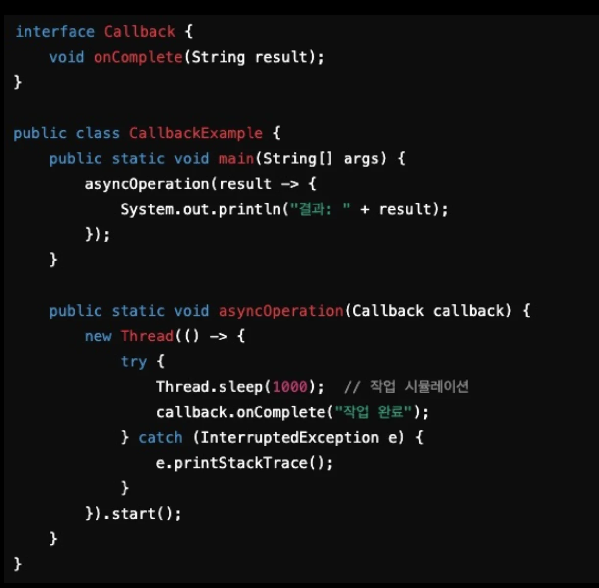

- 비동기 작업이 완료된 후 실행될 작업을 콜백 함수로 미리 등록

- 단순하고 효율적이지만, <strong><u>콜백 지옥(Callback Hell)</u></strong>이라 불리는 <strong><u>복잡한 구조</u></strong>가 될 수 있음

### <code>CompletableFuture</code>

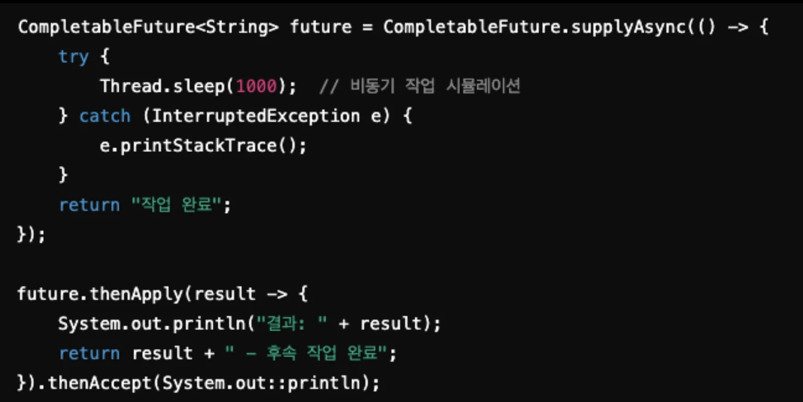

- 비동기 작업의 결과를 비동기적으로 처리할 수 있는 Java의 API

- <strong><u>JavaScript의 Promise와 유사</u></strong>하며, 비동기 작업이 완료되면 그 결과를 사용해 <strong><u>후속 작업 정의 가능</u></strong>
    - <code>then</code>, <code>apply</code> 와 같은 메서드를 사용해 비동기 작업 완료 후, 해당 결과를 후속처리 할 수 있다&#46; 

- 가독성이 증가되고 비동기 작업 간의 종속성을 명확하게 표현할 수 있다 &#46;

- 복잡한 작업에서는 여전히 코드가 길어질 수 있음

- 해당 파이프라인에서 비동기 오류가 발생된다면 여전히 비동기 오류 처리에 대해서 추가적인 관리가 필요하다&#46; 

### 비동기 작업의 오류 처리 및 콜백 패턴&#58; <code>비동기 처리 시 유의사항</code>

### 스레드 안정성 (Thead Safety)

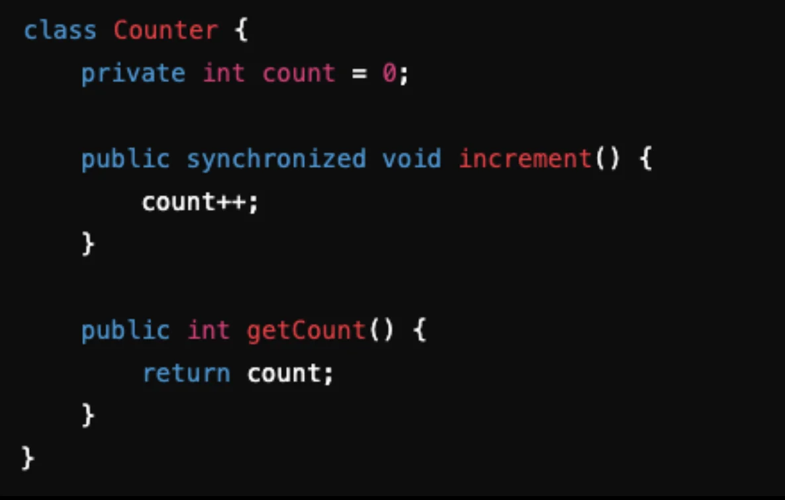

- 스레드가 공유 자원에 접근할 때, 적절한 동기화 메커니즘(예&#58; synchronized)을 사용해야 한다&#46;  

### 예외처리 필요

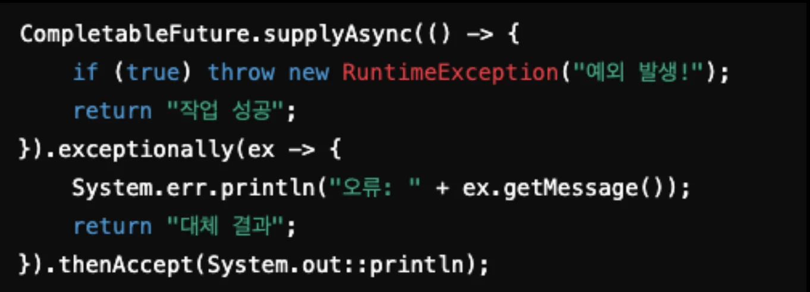

- CompletableFuture 에서 <code>exceptionally()</code>를 사용하여 비동기 작업에서 발생한 예외를 처리한다&#46;
