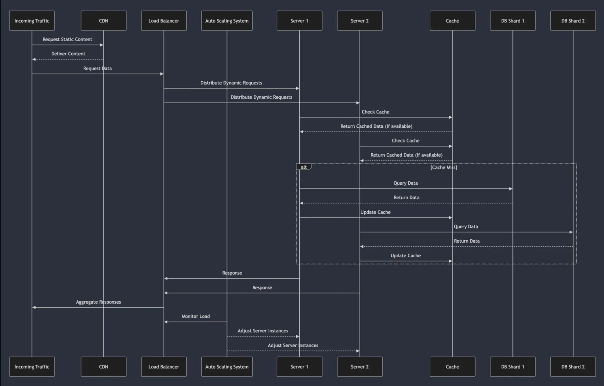
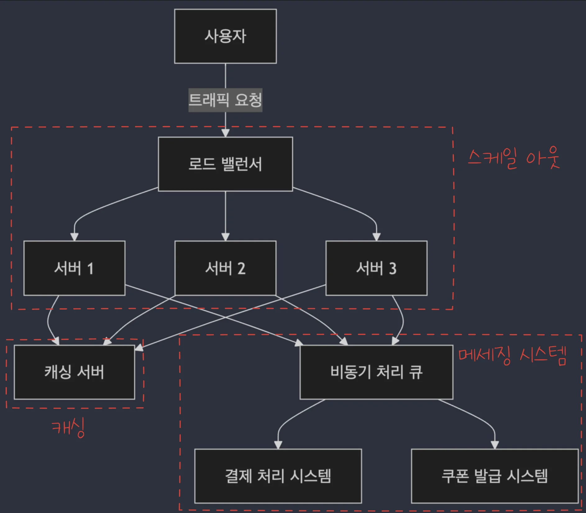
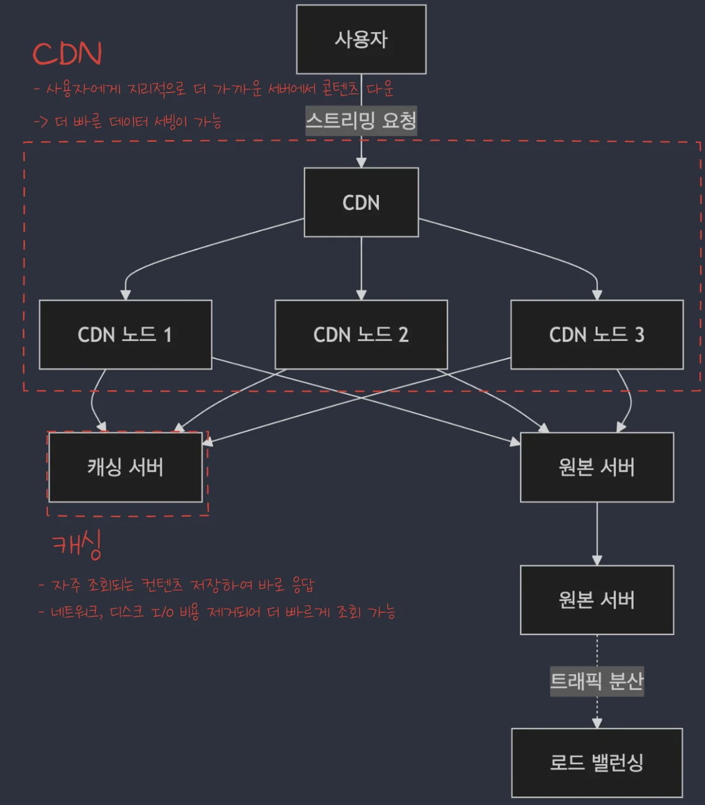
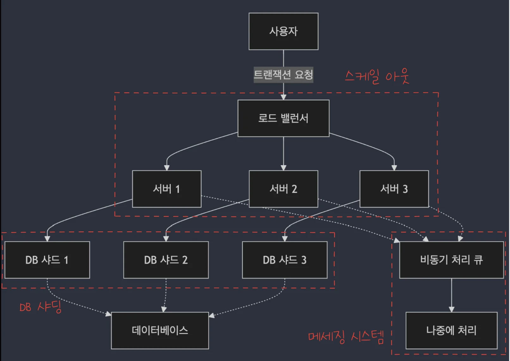

> 
> 
> 
> 
> <strong>목차</strong>
> 
> - [대규모 트래픽 처리 개요](#32eeda9b0fe1800484a2f8b386e9c55b)
> - [개요](#32feda9b0fe180388536eb46fef6fb99)
> - [대규모 트래픽 발생의 주요 요인](#32feda9b0fe18045a3a6d0380db743c3)
> - [대규모 트래픽 처리 실패 시의 문제점](#32feda9b0fe18012a64ce755d174053f)
> - [대규모 트래픽 처리의 필요성](#32feda9b0fe1806fbc76ef0151c5eca9)
> - [트래픽 급증 대비를 위한 주요 처리 전략](#32feda9b0fe1807f9bebe16e768705cc)
> - [대용량 트래픽 처리 기술 개요](#32feda9b0fe180339144dca2dd6436af)
> - [수평적 확장 (Horizontal Scaling)](#32feda9b0fe18080ac0df9f41e76f7ea)
> - [부하 분산 (Load Balancing)](#32feda9b0fe18051a693cec15df8155b)
> - [캐싱 (Caching)](#32feda9b0fe180c793a1e68ee04fa31d)
> - [비동기 처리 (Asynchronous Processing)](#32feda9b0fe180da9189e906fa155837)
> - [데이터베이스 샤딩 (Database Sharding)](#32feda9b0fe180219169ea922b467029)
> - [CDN (Content Delivery Network)](#32feda9b0fe180f4a416fe76668fe226)
> - [대규모 트래픽 처리 사례](#32feda9b0fe1804a8579fd2e1dc093cc)
> - [사례 1) 온라인 쇼핑몰의 타임세일](#32feda9b0fe1800eb2ddc6dc1165432e)
> - [사례 2) 스트리밍 서비스](#32feda9b0fe180cabc28dbf4dbcfe487)
> - [사례 3) 금융 서비스의 트랜잭션 처리](#32feda9b0fe180b196e2c66798a9d7eb)

# 대규모 트래픽 처리 개요

---

## 개요

### 대규모 트래픽 발생의 주요 요인

- <code>마케팅 이번트</code>
    - 대규모 할인 행사, 쿠폰 발급, 타임 세일, 새로운 상품 출시 등 이벤트로 인해 트래픽이 급증

- <code>바이럴 콘텐츠</code>
    - SNS, 뉴스 또는 이벤트에서 급속도로 퍼지는 콘텐츠로 인해 갑자기 트래픽 증가

- <code>인기 서비스</code>
    - 갑작스럽게 주목받은 애플리케이션이나 서비스는 예상보다 훨씬 많은 사용자가 동시에 접속

- <code>리소스 집중</code>
    - 특정 시간 대에 많은 사용자가 몰려드는 경우

    - ex&#46; 저녁 시간대 스트리밍 서비스

### 대규모 트래픽 처리 실패 시의 문제점

- 성능 저하

- 시스템 다운타임

- 데이터 일관성 문제

- 서버 자원낭비

### 대규모 트래픽 처리의 필요성

- 사용자 경험 향상

- 서비스 신뢰성 보장

- 확장성과 비지니스 성장 지원

- 비용 최적화

### 트래픽 급증 대비를 위한 주요 처리 전략

- 수평적 확장 (Horizontal Scaling)

- 부하 분산 (Load Balancing)

- 캐싱 (Caching)

- 비동기 처리

- 데이터베이스 최적화

## 대용량 트래픽 처리 기술 개요

### <code>수평적 확장 (Horizontal Scaling)</code>

> ✏️ 
> 
> - 트래픽이 증가할 때 여러 서버를 추가하여 처리 능력을 확장하는 방식
> 
> - 각가의 서버는 동일한 역할을 수행하며, 트래픽을 분산처리

- 주요 특징
    - 서버를 쉽게 추가하거나 제거할 수 있어 유연한 확장이 가능

    - 장애가 발생한 서버를 제외하고도 다른 서버가 계속 요청을 처리할 수 있어 고가용성을 유지

- 실제 적용
    - 클라우드 환경에서의 Amazon EC2 Auto Scaling

    - Kubernates와 같은 기술을 사용하여 자동으로 서버를 추가하거나 제거

### <code>부하 분산 (Load Balancing)</code>

> ✏️ 
> 
> - Load Balancer는 다수의 서버가 있는 환경에서 트래픽을 균등하게 분배
> 
> - 특정 서버에 부하가 집중되는 것을 방지

- 주요 특징
    - 트래픽이 많을 때도 각 서버가 안정적으로 작동하도록 보장

    - 다양한 알고리즘(라운드 로빈, 최소 연결, IP 해시 등 )을 사용하여 트래픽 분배

    - 서버 장애 시 다른 서버로 트래픽을 자동으로 전환하여 서비스 중단을 방지할 수 있음

- 실제 적용
    - L4를 통한 하드웨어 로드 벨런서

    - NGINX, HAProxy 같은 소프트웨어 로드 벨런서

    - Amazon Elastic Load Balancing(ELB) 과 같은 클라우드 기반 로드벨런서

### <code>캐싱 (Caching)</code>

> ✏️ 
> 
> - 자주 조회되는 데이터를 미리 저장하여 사용자 요청 시 즉시 제공하는 방식
> 
> - 데이터베이스나 API 요청 대신 캐시된 데이터를 사용함으로써, 응답 시간을 줄이고 트래픽 부하를 감소시킴

- 주요 특징
    - 반복 요청에 대해 빠른 응답을 제공

    - 데이터베이스나 원본 서버의 부하를 줄여 성능 향상

    - TTL(Time to Live) 설정을 통해 캐시 데이터의 유효기간을 관리

- 실제 적용
    - Redis, Memcahed 와 같은 인메모리 캐시 솔루션

    - CDN (Content Delivery Network)을 통해 자주 요청되는 파일(이미지, 비디오 등)을 캐싱

### <code>비동기 처리 (Asynchronous Processing)</code>

> ✏️ 
> 
> 
> 
> 즉시 응답할 필요가 없는 작업(ex&#46; 이메일 발송, 로그 기록 등)은 비동기 처리를 통해 백그라운드에서 수행되며, 사용자 요청에 대한 응답은 빠르게 처리

- 주요 특징
    - 실시간으로 즉시 처리할 필요가 없는 작업을 비동기적으로 처리하여 메인 시스템의 부담을 감소시킴

    - 큐를 통해 작업을 저장하고 필요한 시점에 나중에 처리

- 실제 적용
    - RabbitMQ, Apache Kafka, Amazon SQS 와 같은 메시지 큐 시스템을 사용하여 비동기 작업을 처리

### <code>데이터베이스 샤딩 (Database Sharding)</code>

> ✏️ 
> 
> - 데이터베이스의 데이터를 여러 개의 샤드(Shard)로 나누어 분산 저장하는 기술
> 
> - 한 번에 처리할 수 있는 데이터의 양을 줄이고, 데이터베이스의 부하를 분산 처리

- 주요 특징
    - 데이터가 샤드 단위로 분산되어, 각 샤드는 독립적으로 데이터를 처리

    - 데이터베이스 성능 병목을 해소하고, 확장성을 향상시킴

- 실제 적용
    - MySQL, MongoDB, Cassandra와 같은 데이터베이스에서 샤딩 기능을 제공하여 대규모 데이터 처리에 대응

### <code>CDN (Content Delivery Network)</code>

> ✏️ 
> 
> - CDN은 지리적으로 분산된 서버 네트워크로 사용자가 서버와 가까운 위치에서 콘텐츠를 다운로드 할 수 있도록 함
> 
> - 트래픽을 분산시키고 사용자에게 더 빠른 콘텐츠 제공을 가능하게 함

- 주요 특징
    - 사용자가 가까운 노드에서 콘텐츠를 다운로드하여 응답 시간을 최소화

    - 원본 서버의 부하를 줄여, 대규모 트래픽을 효과적으로 처리

- 실제 적용
    - Akamai, Cloudflare, Amazon CloudFront 와 같은 CDN 서비스를 통해 정적 파일(이미지, 동영상 등)을 빠르게 제공

## 대규모 트래픽 처리 사례

> ✏️ 
> 
> 
> 
> <strong>대규모 트래픽 처리의 다양한 사례</strong>
> 
> - <code>수평적 확장 (Horizontal Scaling)</code>&#58; 서버를 여러 대로 늘려 트래픽 급증에 대응하는 기본 전략
> 
> - <code>캐싱 (Caching)</code>&#58; 자주 조회되는 데이터나 파일을 캐시에 저장하여 성능을 극대화하고 부하를 최소화
> 
> - <code>로드 밸런싱 (Load Balancing)</code>&#58; 여러 서버에 트래픽을 분산시켜 과부하를 방지하고 안정성을 보장
> 
> - <code>비동기 처리 (Asynchronous Processing)</code>&#58; 시간이 오래 걸리는 작업은 비동기적으로 처리하여 시스템의 응답성과 자원을 효율적으로 활용
> 
> - <code>데이터베이스 샤딩 (Database Sharding)</code>&#58; 대규모 데이터 처리에서 성능 병목을 방지하는 핵심 기술

### 사례 1) 온라인 쇼핑몰의 타임세일

- 특정 시간대에 진행되는 <code>타임 세일</code>은 <strong><u>수십만 명의 사용자가 동시에 상품을 구매</u></strong>하려고 접속

- <strong>트래픽이 폭발적으로 증가</strong>하며 <u>서</u><strong><u>버가 많은 사용자의 요청을 처리하지 못</u></strong>할 경우 <strong>성능 저하나 장애가 발생</strong>됨

### 사례 2) 스트리밍 서비스

- <code>스트리밍 서비스</code>에서는 <strong><u>많은 사용자가 동시에 비디오를 시청</u></strong>하는 상황이 자주 발생됨

- 인기 프로그램이 신규로 공개되거나, 특정 시간대에 수천 명의 사용자가 동시에 접속할 경우 트래픽이 급증

### 사례 3) 금융 서비스의 트랜잭션 처리

- 금융 시스템에서는 수많은 거래가 동시에 발생

- 특히<u> 급증하는 트래픽 속에서 거래를 안전하게 처리</u>하는 것이 중요하기 때문에,  <strong>데이터 </strong><strong><u>일관성, 성능, 안전성</u></strong><strong>이 보장</strong>되며, <strong><u>트랜잭션이 신속</u></strong><strong>하게 처리</strong>할 수 있는 아키텍처 를 가져가야 함
