> 
> 
> <a id="32eeda9b0fe18093912edcfe458a755a"></a>
> 
> <strong>목차</strong>
> 
> - [Redis의 기본 개념](#32eeda9b0fe18022863bfe1a4c17020d)
> - [Redis 사용 사례](#330eda9b0fe180418addf5f3f3fd61ad)
> - [캐시](#330eda9b0fe1803fb0b8d50e17f2aa77)
> - [세션 저장소](#330eda9b0fe1806696e4f3d9ba34082c)
> - [Redis 주요 특징](#330eda9b0fe18075992ae8d9b6c053e9)
> - [메모리 기반](#330eda9b0fe180edbd1ec97e77a2d610)
> - [영속성 옵션](#330eda9b0fe180acb6d0f17970508482)
> - [다양한 데이터 타입](#330eda9b0fe180a8ba6efc3bb008d978)
> - [복제(Replication)](#330eda9b0fe1805dac47fbfba54a6e38)
> - [고가용성](#330eda9b0fe18038b417d8c36f98ef7a)
> - [클러스터링](#330eda9b0fe180df9ee5e31e74b51f98)
> - [Redis 아키텍처 개요](#330eda9b0fe180cd9e5bfa442d0ab0dc)
> - [싱글 스레드 모델](#330eda9b0fe180a09a4dfff4c20dc1f0)
> - [비동기 I/O](#330eda9b0fe18091a989fec2327c728f)
> - [데이터 영속성](#330eda9b0fe18066a97dcaa8ffbae48a)
> - [Redis 데이터 타입 및 사용 사례](#330eda9b0fe180678356f4b5cfc679e1)
> - [Redis의 주요 데이터 타입](#330eda9b0fe180939bb1d03f33bf85de)
> - [String](#330eda9b0fe1809186e3d0f11c1a46f3)
> - [List](#330eda9b0fe18085960bc62930054257)
> - [Set](#330eda9b0fe180c0b69ac8390e6495eb)
> - [Sorted Set (Zset)](#330eda9b0fe18026b267d5f56ecac63f)
> - [Hash](#330eda9b0fe1805ab595c78d5c1d8b9c)
> - [Bitmaps](#330eda9b0fe180419f5dcecf80172cb6)
> - [HyperLogLog](#330eda9b0fe180e3b841d51a1f0ba4c5)
> - [Redis 고급 기능 및 성능 최적화](#330eda9b0fe180678058ed2fb91951c8)
> - [Redis 고급 기능](#330eda9b0fe1806eb4b0e58edbd6c93c)
> - [Redis Cluster](#330eda9b0fe180d8b8dfdae3bb12fe86)
> - [Redis Sentinel](#330eda9b0fe1804b85b3e166100ba8b8)
> - [Pub/Sub 시스템](#330eda9b0fe180ef8a8ff695fee0579b)
> - [Lua 스크립트](#330eda9b0fe1803b8c42f0ac2ad406d3)
> - [Pipelining](#330eda9b0fe1800c8dc5e2d54694eff1)
> - [성능 최적화 전략](#330eda9b0fe180818c21e04abcb89850)
> - [메모리 최적화](#330eda9b0fe1805f906ef1874d46ca42)
> - [RDB vs AOF](#330eda9b0fe180989b27df5e5e86581a)
> - [파티셔닝](#330eda9b0fe18030a47fe3a63ad23ac6)
> - [TTL(Time-To-Live) 설정](#330eda9b0fe180ea9ce8e6b6f86658c5)
> - [Pipelining](#330eda9b0fe180d48e5cf6b187681bdc)
> - [보안 설정](#330eda9b0fe180de8b83f3883521496f)
> - [Redis 사용 시 잠재적인 문제와 해결 방법](#330eda9b0fe18026a4ace85af4f529a7)
> - [메모리 부족 문제](#330eda9b0fe18007a5e4f302a134f24e)
> - [복제 지연 (Replication Lag)](#330eda9b0fe180bab62ae93edbae4a05)
> - [데이터 영속성 및 복구 시간](#330eda9b0fe18050b684f64072b6fd19)
> - [Redis를 활용한 복합 아키텍처 예시](#330eda9b0fe1805eabe8dda03bf4b1ce)
> - [Redis + MySQL/PostgreSQL](#330eda9b0fe180d6b12af7470fb571c7)
> - [Redis + Kafka](#330eda9b0fe18019bf97e0a5c800b7c6)
> - [Redis + Elasticsearch](#330eda9b0fe1800798f6f0880b8b6a62)

<a id="32eeda9b0fe18022863bfe1a4c17020d"></a>

# Redis의 기본 개념

---

> 
> 
> <a id="330eda9b0fe1805cab87f60c5e6fb397"></a>
> 
> <strong>Redis</strong>
> 
> <a id="330eda9b0fe180779aa3e6ba046f16c9"></a>
> 
> <strong><code>‘Remote Dictionary Server’</code></strong>의 약자로, <strong><u>메모리 기반</u></strong><strong> 고성능 데이터 저장소</strong>이다&#46;
> 
> - 주로 <strong><u>캐시, 메시지 브로커, 세션 저장소로 사용</u></strong>한다&#46;
> 
> - <strong><u>Key&#45;Value</u></strong><strong> 구조</strong>
> 
> - <strong>다양한 데이터 타입 지원</strong>

<a id="330eda9b0fe180418addf5f3f3fd61ad"></a>

## Redis 사용 사례

<a id="330eda9b0fe1803fb0b8d50e17f2aa77"></a>

### <code>캐시</code>

- 자주 조회되는 데이터를 메모리에 저장해 빠르게 응답

- 대형 쇼핑몰에서 상품 목록을 캐시하여, 데이터베이스 조회를 줄이고 사용자에게 즉시 응답 제공

- ex)
    <a id="330eda9b0fe180308e8ce196d0f1753a"></a>

    ```java
    SET product:12345 “{name: ‘Laptop’, price: 1000, stock: 50}"
    GET product:12345
    ```

<a id="330eda9b0fe1806696e4f3d9ba34082c"></a>

### <code>세션 저장소</code>

- 세션 관리에 적합

- 로그인 상태 유지 및 쇼핑 카트 정보 저장

- 전자상거래 사이트에서 사용자의 로그인 세션과 장바구니 정보를 Redis에 저장하여 빠른 액세스 제공

- ex)
    <a id="330eda9b0fe18033a097d709feb4bc69"></a>

    ```java
    SET session:12345 “{user: ‘john_doe’, cart: []}”
    GET session:12345
    ```

<a id="330eda9b0fe18075992ae8d9b6c053e9"></a>

## Redis 주요 특징

<a id="330eda9b0fe180edbd1ec97e77a2d610"></a>

### <code>메모리 기반</code>

- Redis는 메모리 기반으로 동작

- 디스크 I/O에 비해 훨씬 빠른 속도로 데이터를 읽고 쓰기 가능

- Redis가 주로 실시간 데이터 처리 및 고속 캐싱 솔루션으로 사용되는 주요 이유 중 하나

<a id="330eda9b0fe180acb6d0f17970508482"></a>

### <code>영속성 옵션</code>

- Redis는 데이터를 메모리에 저장하면서도, 영속성을 보장하기 위한 옵션을 제공

- <code>RDB (Redis Database) 스냅샷</code>
    - 주기적으로 전체 데이터를 디스크에 저장

- <code>AOF (Append&#45;Only File)</code>
    - 데이터 변경 로그를 저장해 시스템 재시작 시 복구 가능

    - 해당 영속성 옵션을 통해 데이터 손실을 최소화하고 시스템 장애 시 데이터를 복구할 수 있음

<a id="330eda9b0fe180a8ba6efc3bb008d978"></a>

### <code>다양한 데이터 타입</code>

- <code>String</code>
    - 가장 기본적인 Key&#45;Value 타입

    - 문자열, 숫자 등의 데이터 저장

- <code>List</code>
    - 순서가 있는 데이터 목록

    - 삽입 및 삭제 &#45; <code>O(1)</code>

- <code>Set</code>
    - 중복 없는 데이터 집합

    - 집합 연산(교집합, 차집합 등)을 빠르게 수행

- <code>Sorted Set(ZSet)</code>
    - 점수를 기준으로 정렬된 집합

    - 순위, 리더보드 등의 구현에 유용

- <code>Hash</code>
    - 필드&#45;값 쌍으로 구성된 Key&#45;Value 집합

    - 복잡한 객체를 저장할 때 유용

- <code>Bitmaps</code>
    - 비트 값 저장

    - 비트 연산을 빠르게 수행

- <code>HyperLogLog</code>
    > ‣

    - 메모리를 거의 사용하지 않으면서 고유 값의 개수를 추정하는 데이터 구조

<a id="330eda9b0fe1805dac47fbfba54a6e38"></a>

### <code>복제(Replication)</code>

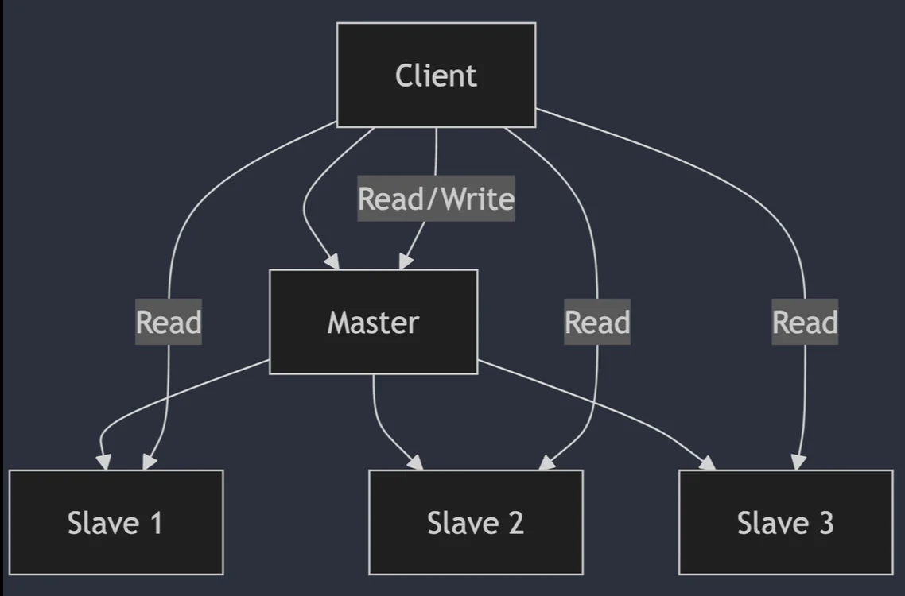

- Redis는 Master&#45;Slave 복제 구조를 지원하여 데이터 가용성을 높이고, 읽기 부하를 분산시킬 수 있음

- Master는 데이터를 쓰고, Slave는 데이터를 읽는 구조로, 읽기 성능 향상 및 데이터 백업을 제공

<a id="330eda9b0fe18038b417d8c36f98ef7a"></a>

### <code>고가용성</code>

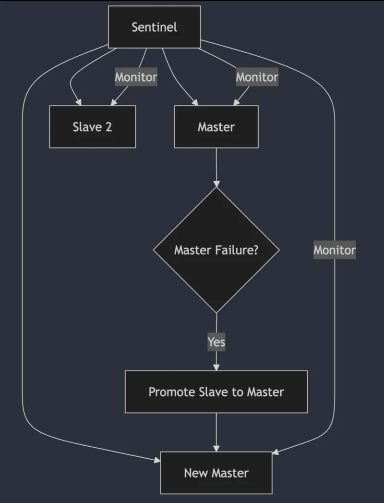

- Redis는 Sentinel이라는 기능을 통해 <strong><u>자동 복구 및 장애 조치(Failover)</u></strong>를 지원

- Sentinel은 <strong><u>Redis 인스턴스를 모니터링</u></strong>하고 <strong><u>Master 노드에 장애가 발생</u></strong>하면 <strong><u>자동으로 Slave 노드를 승격하</u></strong>여 서비스의 중단없이 운영

<a id="330eda9b0fe180df9ee5e31e74b51f98"></a>

### <code>클러스터링</code>

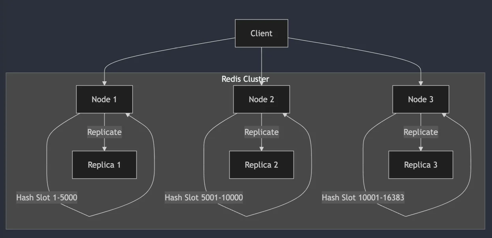

- Redis는 Cluster 기능을 통해 <strong><u>데이터를 여러 노드에 분산 저장</u></strong>하고, <strong>수평적 확장성</strong>을 제공

- <strong><u>대규모 데이터</u></strong><strong><u>를 다루는 환경</u></strong>에서도<strong><u> 성능 저하 없이 확장</u></strong>이 가능

- 클러스터는 <strong><u>자동</u></strong><strong><u>으로 데이터를 노드 간 분산</u></strong>시키며, <strong>각 노드는 </strong><strong><u>해시 슬록</u></strong><strong>을 통해 데이터를 관리</strong>

<a id="330eda9b0fe180cd9e5bfa442d0ab0dc"></a>

## Redis 아키텍처 개요

<a id="330eda9b0fe180a09a4dfff4c20dc1f0"></a>

### <code>싱글 스레드 모델</code>

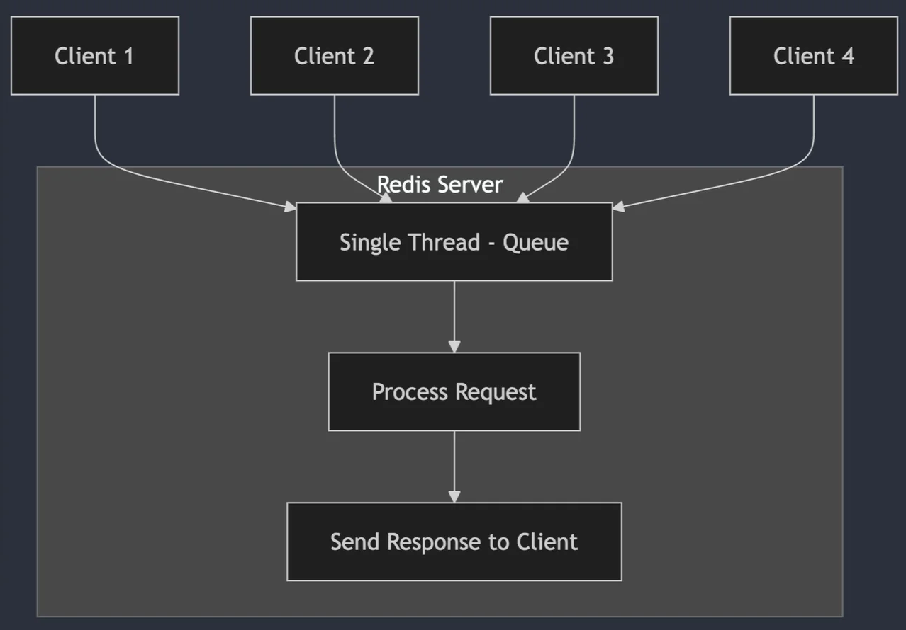

- Redis는 <strong><u>싱글 스레드로</u></strong> 동작하며, <strong><u>하나의 요청을 한 번</u></strong>에 처리

- <strong><u>I/O 성능을 극대화하는 구조로 설계</u></strong>되어, <strong><u>여러 요청을 매우 빠르게 처리</u></strong>할 수 있음

- <strong><u>싱글 스레드 모델</u></strong> 덕분에 <strong><u>락 경합이 없</u></strong><strong>고, </strong><strong><u>프로세스가 경량화</u></strong><strong>되어 성능 저하 없이 빠르게 동작</strong>

<a id="330eda9b0fe18091a989fec2327c728f"></a>

### <code>비동기 I/O</code>

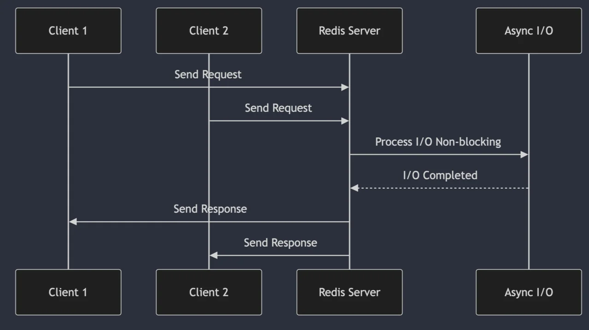

- Redis는 비동기 I/O 모델을 채택하여, <strong>네트워크 요청이나 파일 쓰기와 같은 I/O 작업을 논블로킹(non&#45;blocking)으로 처리</strong>

- 이로 인해 <strong><u>네트워크 대기 시간을 줄</u></strong>이고, <strong><u>많은 요청을 동시에 처리</u></strong>하는 데 있어 높은 성능을 발휘

<a id="330eda9b0fe18066a97dcaa8ffbae48a"></a>

### <code>데이터 영속성</code>

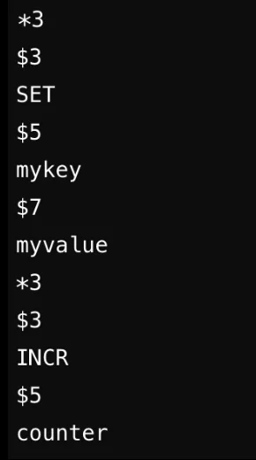

<a id="330eda9b0fe18047a5bcf789bb7cd740"></a>

Redis는 데이터 영속성을 보장하기 위한 두가지 메컨니즘을 제공

- <code>RDB 스냅샷</code>
    - 일정 간격으로 데이터베이스의 상태를 스냅샷으로 저장 (<code>dump&#46;rdb</code>)

    - 주기적인 저장을 통해 데이터를 복구할 수 있음

- <code>AOF 로그</code>
    - 데이터 변경 사항을 지속적으로 기록하며, Redis가 재시작될 때 모든 변경사항을 복구할 수 있음 

<a id="330eda9b0fe180678356f4b5cfc679e1"></a>

# Redis 데이터 타입 및 사용 사례

---

> 
> 
> <a id="330eda9b0fe180caa2f6fe72d2041299"></a>
> 
> <strong>각 데이터 타입의 사용 사례</strong>
> 
> - <code>String</code>&#58; 간단한 캐시, 상태 정보 저장에 사용
> 
> - <code>List</code>&#58; FIFO(First&#45;In&#45;First&#45;Out) 큐 또는 LIFO(Last&#45;In&#45;First&#45;Out) 스택 구형
> 
> - <code>Set</code>&#58; 대규모 데이터에서 중복 제거 및 집합 연산을 빠르게 처리
> 
> - <code>Sorted Set</code>&#58; 랭킹이나 우선순위가 중요한 시스템 구현에 적합
> 
> - <code>Hash</code>&#58; 작은 객체를 필드별로 효율적으로 저장하고 조회
> 
> - <code>Bitmaps</code>&#58; 상태 체크나 비트 연산이 필요한 경우 사용
> 
> - <code>HyperLogLog</code>&#58; 매우 적은 메모리로 유니크 데이터 수 추정에 유용

<a id="330eda9b0fe180939bb1d03f33bf85de"></a>

## Redis의 주요 데이터 타입

<a id="330eda9b0fe1809186e3d0f11c1a46f3"></a>

### <code>String</code>

> ✏️ 
> 
> <a id="330eda9b0fe18064b67bddd115bc74b8"></a>
> 
> Redis에서 <u>가장 기본적인 데이터 타입</u>으로, 단순한 <strong>Key&#45;Value 쌍</strong>의 구조
> 
> <a id="330eda9b0fe180779546e26d4d9ccbde"></a>
> 
> <strong><u>문자열, 숫자, 바이너리 데이터</u></strong>를 저장할 수 있음
> 
> - 주요 명령어&#58; <code>SET</code>, <code>GET</code>, <code>INCR</code>, <code>DECR</code>, <code>APPEND</code>
> 
> - 사용 사례&#58;
>     - <code>캐시 데이터</code>&#58; 
>         - <strong><u>자주 액세스하는 데이터</u></strong>(ex&#46; 상품 목록, 사용자 프로필 정보)를 <u>빠르게 제공</u>하기 위해 <strong><u>String 타입을 사용</u></strong>하여 캐시로 저장
> 
>     - <code>세션 정보 저장</code>&#58; 
>         - 웹 어플리케이션에서 <strong><u>로그인한 사용자의 세션</u></strong>을 <u>저장하고 조회</u>하는데 사용

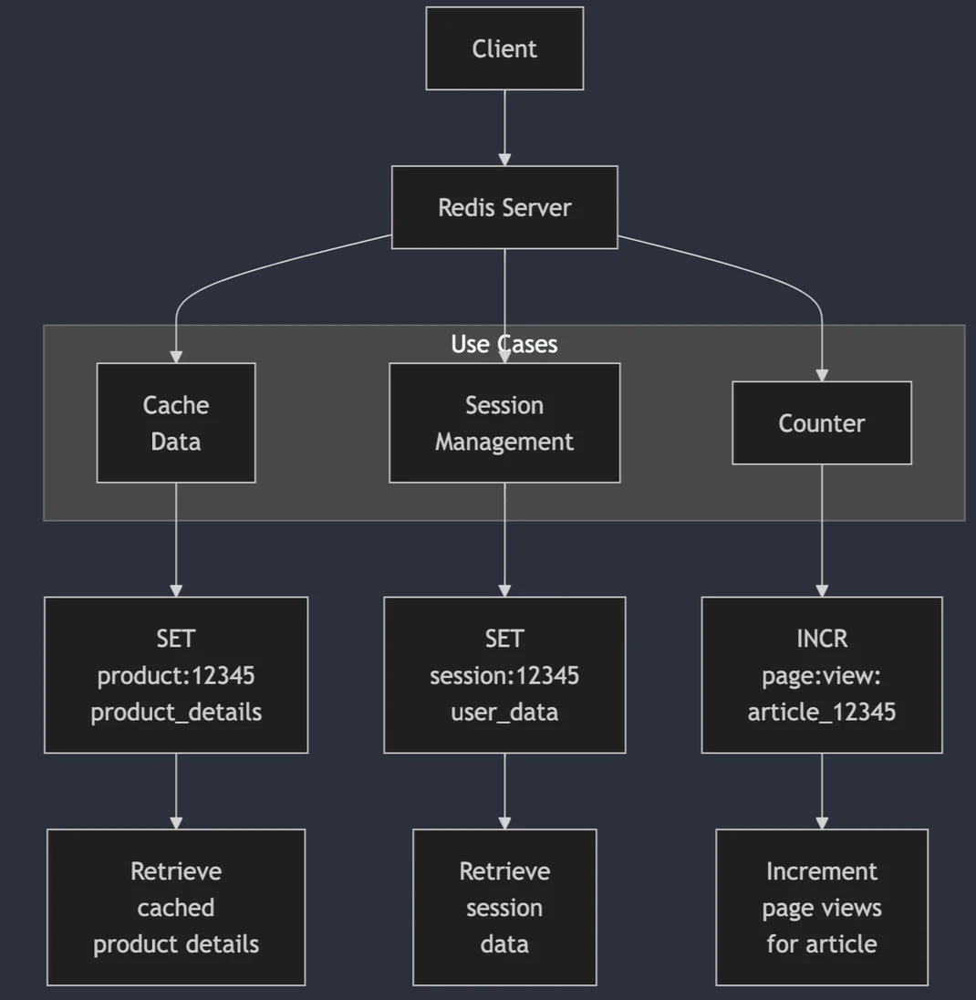

<a id="330eda9b0fe18085960bc62930054257"></a>

### <code>List</code>

> ✏️ 
> 
> <a id="330eda9b0fe180d3a16ac44e745c9ed3"></a>
> 
> 순서가 있는 데이터 목록으로, 삽입 및 삭제가 <code>O(1)</code> 시간 복잡도를 가짐
> 
> <a id="330eda9b0fe1808da10ce5062a83ba39"></a>
> 
> 데이터는 <strong><u>앞에서 삽입</u></strong>하거나 <strong><u>뒤에서 삽입</u></strong>할 수 있음 (deque 지원)
> 
> - 주요 명령어&#58; <code>LPUSH</code>, <code>RPUSH</code>, <code>LPOP</code>, <code>RPOP</code>, <code>LRANGE</code>
> 
> - 사용 사례&#58;
>     - <code>메시지 큐</code>&#58; 
>         - List는 <strong><u>FIFO(First&#45;In&#45;First&#45;Out) 큐</u></strong> 또는 <strong><u>LIFO(Last&#45;In&#45;First&#45;Out) 스택</u></strong>을 구현할 때 적합  (데큐 지원)
> 
>     - <code>타입라인 데이터</code>&#58; 
>         - 소셜 미디어에서 사용자의 활동 내역을 시간순으로 저장하고 보여주는 데 유용하다&#46;

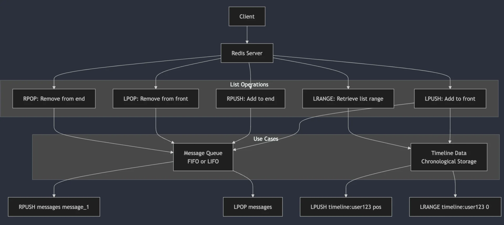

<a id="330eda9b0fe180c0b69ac8390e6495eb"></a>

### <code>Set</code>

> ✏️ 
> 
> <a id="330eda9b0fe180aab18dc7d20c9f9ed8"></a>
> 
> 중복없는 데이터의 집합을 저장한다&#46; 
> 
> <a id="330eda9b0fe180a6a94adf7c3389d625"></a>
> 
> Set 연산(교집합, 차집합, 합집합)을 효율적으로 처리할 수 있음
> 
> - 주요 명령어&#58; <code>SADD</code>, <code>SREM</code>, <code>SISMEMBER</code>, <code>SINTER</code>, <code>SUNION</code>
> 
> - 사용 사례&#58;
>     - <code>태그 저장</code>&#58; 
>         - Set은 중복된 태그를 방지하고, 데이터의 교집합을 처리할 수 있어 태그 시스템에 적합
> 
>     - <code>친구 목록</code>&#58; 
>         - 소셜 네트워크에서 친구 관계를 저장할 때 유용함
> 
>         - 두 사용자 간의 공통 친구나 차집합 연산을 쉽게 처리할 수 있음

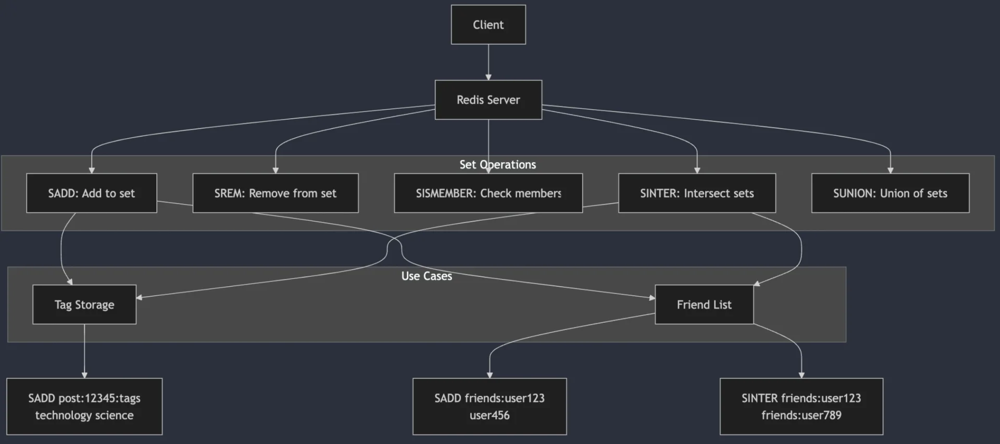

<a id="330eda9b0fe18026b267d5f56ecac63f"></a>

### <code>Sorted Set (Zset)</code>

> ✏️ 
> 
> <a id="330eda9b0fe1808bba2ac6b6d7eaa792"></a>
> 
> Set과 유사하지만, 점수(score) 값을 함께 저장하며, 점수를 기준으로 데이터를 정렬할 수 있음
> 
> - 주요 명령어&#58; <code>ZADD</code>, <code>ZRANGE</code>, <code>ZRANK</code>, <code>ZREM</code>
> 
> - 사용 사례&#58;
>     - <code>리더보드</code>&#58;
>         - Sorted Set은 점수를 기준으로 정렬된 데이터에 적합하여 게임 리더보드와 같은 순위 시스템을 구축하는 데 매우 유용함
> 
>     - <code>이벤트 우선순위 처리</code>&#58;
>         - 이벤트나 작업을 우선순위에 따라 처리하는 시스템을 구현할 때 유용함

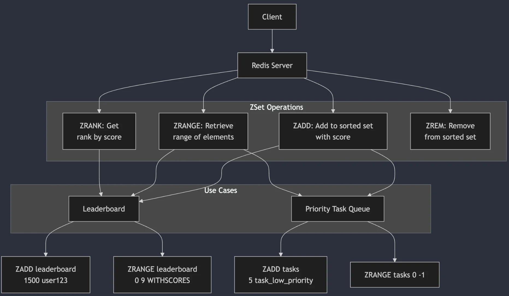

<a id="330eda9b0fe1805ab595c78d5c1d8b9c"></a>

### <code>Hash</code>

> ✏️ 
> 
> <a id="330eda9b0fe180c19e56eedf0b321927"></a>
> 
> 필드와 값을 쌍으로 저장하는 데이터 구조로, 복잡한 객체를 저장할 때 유용함
> 
> - 주요 명령어&#58; <code>HSET</code>, <code>HGET</code>, <code>HGETALL</code>, <code>HDEL</code> 
> 
> - 사용 사례&#58; 
>     - <code>사용자 프로필 정보</code>&#58;
>         - 하나의 키에 대해 여러 필드를 저장할 수 있어 사용자 데이터를 효율적으로 관리할 수 있음
> 
>     - <code>설정 저장</code>&#58;
>         - 어플리케이션의 구성 설정을 Hash로 저장하여 필드별로 빠르게 접근 가능함

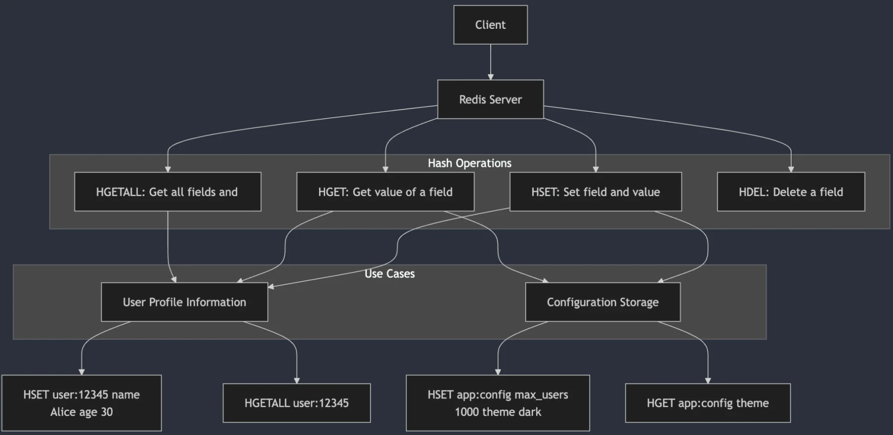

<a id="330eda9b0fe180419f5dcecf80172cb6"></a>

### <code>Bitmaps</code>

> ✏️ 
> 
> <a id="330eda9b0fe180d9b395c4efe2264b3a"></a>
> 
> 비트 값을 저장하며, 비트 연산을 효율적으로 수행할 수 있음
> 
> - 주요 명령어&#58; <code>SETBIT</code>, <code>GETBIT</code>, <code>BITCOUNT</code>
> 
> - 사용 사례
>     - <code>로그인 상태 체크</code>&#58;
>         - Bitmaps는 사용자 로그인 여부와 같은 상태 정보를 저장하는 데 적합
> 
>     - <code>이벤트 기록</code>&#58;
>         - 특정 시간 동안 이벤트 발생 여부를 효율적으로 기록할 수 있음

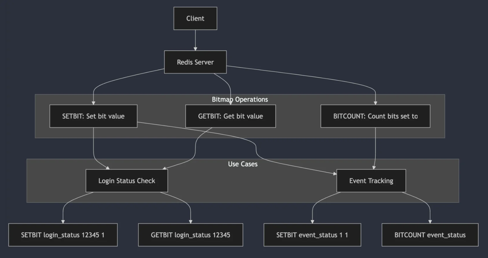

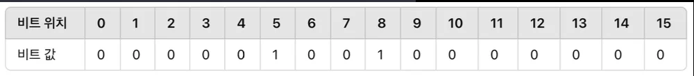

<a id="330eda9b0fe180e3b841d51a1f0ba4c5"></a>

### <code>HyperLogLog</code>

> ✏️ 
> 
> <a id="330eda9b0fe180c8ab9cf7b424314561"></a>
> 
> 고유 값의 개수를 메모리를 거의 사용하지 않고 추정하는 데이터 구조
> 
> <a id="330eda9b0fe180bfa611c442b5c091b3"></a>
> 
> 정확한 값이 아닌 근사치를 제공하지만, 매우 적은 메모리로 대규모 데이터의 중복을 계산할  있음
> 
> - 주요 명령어&#58; <code>PFADD</code>, <code>PFCOUNT</code>, <code>PFMERGE</code>
> 
> - 사용 사례
>     - <code>대규모 중복 데이터 검출</code>
>         - HyperLogLog는 매우 적은 메모리로 대규모 데이터셋에서 중복을 제거하고 고유 항목의 수를 계산하는 데 유용함
> 
>     - <code>사용자 활동 분석</code>
>         - HyperLogLog는 많은 사용자 데이터를 분석하고 중복 데이터를 처리할 때 유용함

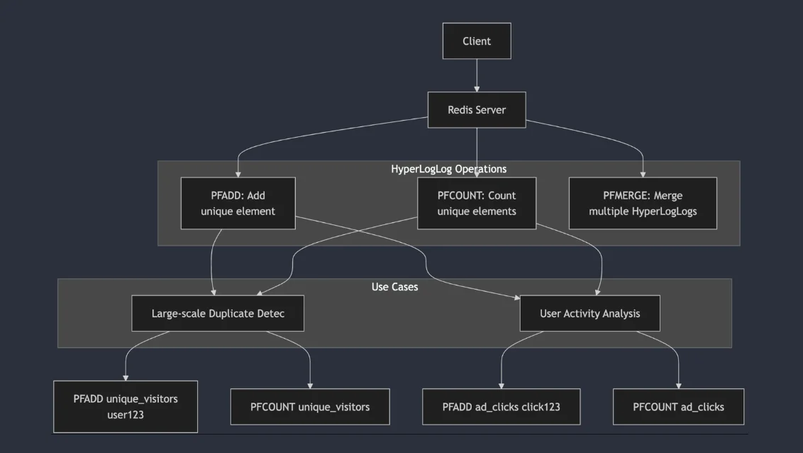

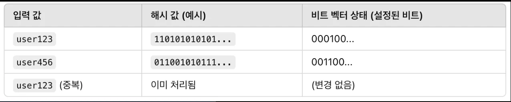

<a id="330eda9b0fe180678058ed2fb91951c8"></a>

# Redis 고급 기능 및 성능 최적화

---

<a id="330eda9b0fe1806eb4b0e58edbd6c93c"></a>

## Redis 고급 기능

<a id="330eda9b0fe180d8b8dfdae3bb12fe86"></a>

### Redis Cluster

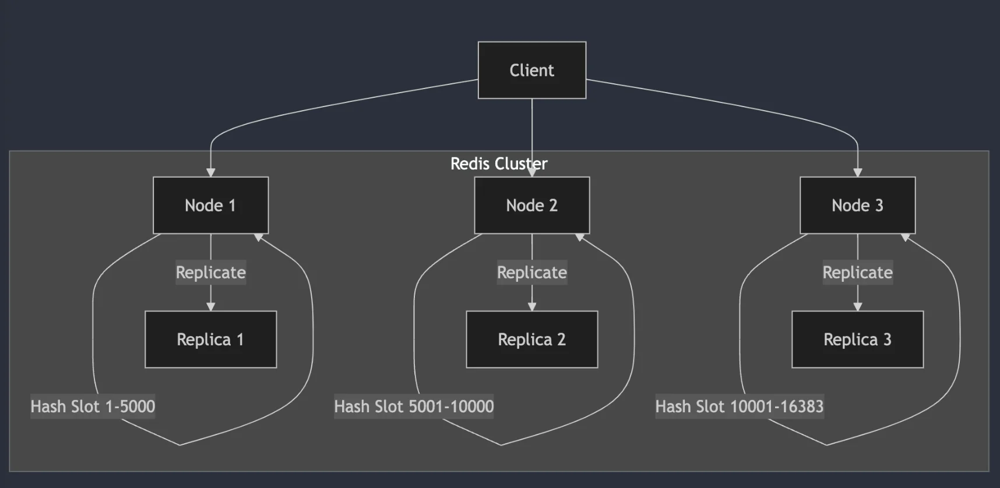

- <code>수평적 확장성 제공</code>
    - 여러 노드에 데이터 분산 저장

    - 단일 노드에만 데이터를 저장하는 전통적인 방식과 달리, <br>Redis Cluster는 노드 추가로 시스템의 성능과 용량을 쉽게 확장 가능

    - 클러스터의 각 노드가 일부 데이터를 관리하게 함으로써 확장성 보장

    - 대규모 데이터를 처리하는 데 매우 유용

- <code>데이터 파티셔닝</code>
    - 데이터 파티셔닝을 사용하여 데이터를 여러 노드에 분산 저장

    - 파티셔닝은 데이터를 해시 슬롯(Hash Slot)이라는 개념을 통해 분배하며, <br>각 노드는 해시 슬록의 일부를 관리

    - 클러스터는 <strong><u>총 16384개의 해시 슬롯을 사용</u></strong>

    - 키를 해시 함수로 계산하고 그 값을 기반으로 적절한 노드에 데이터 저장

<a id="330eda9b0fe1804b85b3e166100ba8b8"></a>

### Redis Sentinel

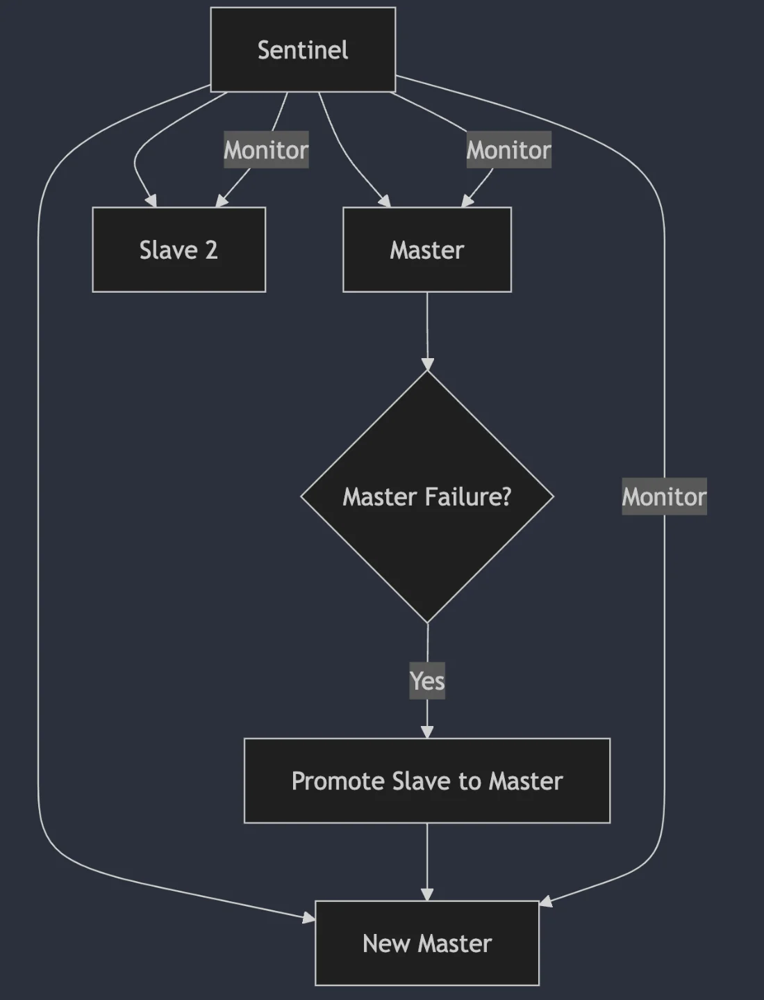

- <code>자동 장애 복구 및 모니터링</code>
    - Redis Sentinel은 <strong><u>자동 장애 복구 기능을 제공</u></strong>하여 Redis 시스템의 고가용성을 보장함

    - Redis 인스턴스를 모니터링하고, Master 노드에 장애가 발생하면 자동으로 Slave 노드를 승격하여 서비스가 중단되지 않도록 함

- <code>고가용성 구현</code>
    - Master&#45;Slave 구조를 통해 데이터 복제

    - Sentinel은 <strong><u>Master 노드가 장애</u></strong>를 일으킬 경우, <strong>자동으로 Failover(장애 조치)를 실행</strong>하여 <strong>Slave 노드를 Master로 승격</strong>하여 <strong><u>전체 클러스터의 가용성을 유지</u></strong>함

    - 데이터 손실 최소화 및 서비스 다운타임 감소

<a id="330eda9b0fe180ef8a8ff695fee0579b"></a>

### Pub/Sub 시스템

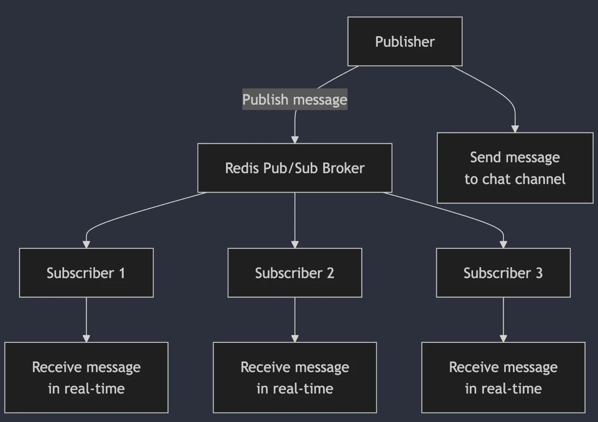

- <code>실시간 메시징 서비스 구현</code>
    - Pub/Sub (Publish/Subscribe) 시스템은 실시간 데이터 처리를 위한 메시징 시스템

    - 발행자(Publisher)가 메시지를 전송하면, 구독자(Subscriber)는 이를 실시간으로 수신

    - 실시간 데이터 스트리밍, 이벤트 처리, 알림 시스템에 적합

- <code>메시지 브로커 역할</code>
    - Pub/Sub 시스템은 메시지 브로커로서 데이터를 전달

    - Publisher(발행자)는 주제(Topic)를 기반으로 메시지를 보내고, Subscriber(구독자)는 해당 topic를 구독하여 실시간으로 데이터 수신

<a id="330eda9b0fe1803b8c42f0ac2ad406d3"></a>

### Lua 스크립트

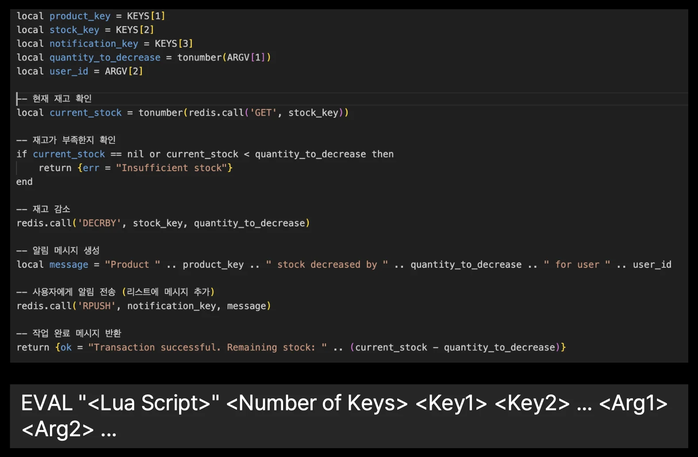

- <code>원자적 트랜잭션 및 복잡한 로직 처리</code>
    - Redis는 <strong><u>Lua 스크립트를 사용</u></strong>하여 서버에서 원자적으로 트랜잭션을 실행함

    - <u>복잡한 로직</u>을 클라이언트가 아니라 <strong><u>서버 측에서 직접 처리</u></strong>함으로써 <strong>성능을 최적화하고 데이터 일관성을 보장</strong>함

- <code>성능 향상</code> 
    - 클라이언트 와 서비 간의 불필요한 네트워크 왕복을 줄이고, 복잡한 작업을 서버에서 실행함으로써 전체 성능을 크게 향상시킬 수 있음

    - Lua 스크립트를 사용하면 여러 명령을 하나의 트랜잭션으로 묶어 처리 가능

<a id="330eda9b0fe1800c8dc5e2d54694eff1"></a>

### Pipelining

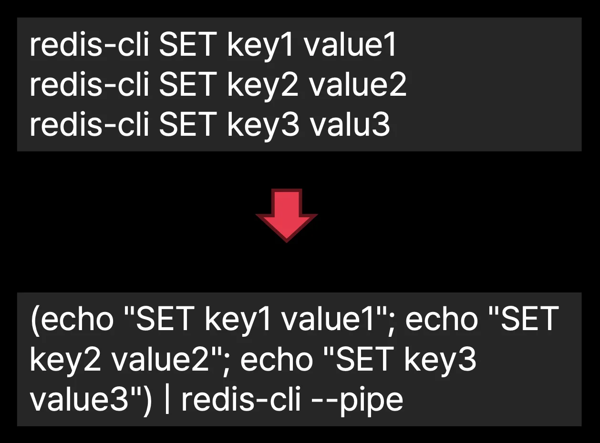

<details>
<summary>&#91; cli &#93;</summary>

<a id="330eda9b0fe1807fb535d17a65b93b08"></a>

```bash
# 3번의 cli 요청
redis-cli SET key1 value1
redis-cli SET key2 value2
redis-cli SET key3 value3

# Pipelining을 통해 한번에 처리
(echo "SET key1 value1"; \
 echo "SET key2 value2"; \
 echo "SET key3 value3";) | redis-cli-pipe
```

</details>

- <code>네트워크 왕복 횟수 감소</code>
    - Redis Pipelining은 <strong><u>여러 명령어를 한 번에 서버로 전송</u></strong>하여 <strong>네트워크 왕복 횟수를 줄</strong>이는 방식이다

    - 병목의 주된 원인인 네트워트 I/O 비용을 제거가 가능하기 때문에 여러 명령을 개별적으로 보내 처리하는 것보다 훨씬 빠르게 처리 가능하다&#46;
        - 네트워크 성능 최적화와 명령어 처리 속도 향상

- <code>성능 최적화</code>
    - 네트워크 오버헤드(네트워크 요청과 응답 간의 시간 지연)를 줄여 성능을 극대화할 수 있음

    - 특히, 클라이언트와 서버 간의 통신이 빈번할 때 효과적으로 활용된다&#46;

<a id="330eda9b0fe180818c21e04abcb89850"></a>

## 성능 최적화 전략

<a id="330eda9b0fe1805f906ef1874d46ca42"></a>

### 메모리 최적화

- <code>데이터 압축 사용 및 메모리 정리</code>
    - Redis는 메모리 기반 데이터 저장소이므로, <strong>메모리 사용량을 최소화</strong>하는 것이 <strong><u>성능 최적화에 매우 중요</u></strong>하다&#46;

    - <strong><u>데이터를 압축</u></strong>하거나 <strong><u>효율적으로 저장</u></strong>하는 방법을 통해 메모리 사용을 줄일 수 있음
        - <strong><code>ziplist</code></strong> 나 <strong><code>inset</code></strong> 과 같은 <strong><u>메모리 효율적인 자료구조를 사용</u></strong>하여 <strong><u>저장 공간을 최적화</u></strong>

- <code>LRU/LFU 정책</code>
    - <strong><code>Least Recently Used (LRU)</code></strong> 또는 <strong><code>Least Frequently Used (LFU)</code></strong> 알고리즘을 사용하여 자주 사용되지 않는 데이터를 자동으로 삭제

    - 메모리 부족 시, 오래 사용되지 않은 데이터를 삭제함으로써 메모리 공간을 확보한다&#46;

<a id="330eda9b0fe180989b27df5e5e86581a"></a>

### <code>RDB</code> vs <code>AOF</code>

| <code>RDB</code> | <code>AOF</code> |
| --- | --- |
| Redis 데이터를 주기적으로 스냅샷 형태로 <br>디스크에 저장 | Redis의 모든 데이터 변경사항을 순차적으로 기록 |
|   • 주기적으로 저장된 스냅샷을 사용하여 시스템 재시작 시 데이터 복구<br><br>  • RDB는 저장 작업이 주기적으로 이뤄지기 떄문에, 시스템의 성능에 미치는 영향이 적음<br><br>  • 그러나 스냅샷 간격 동안의 변경사항은 저장되지 않으므로 데이터 손실 가능성이 있음 |   • 시스템 재시작 시, 모든 변경 기록을 재생하여 완전한 복구 가능<br><br>  • 지속적으로 로그를 기록해야 하므로 시스템 부하가 RDB에 비해 더 높음<br><br>  • AOF 파일 크기는 시간이 지남에 따라 커질 수 있으므로 주기적으로 AOF 파일을 압축하거나 재작성(rewrite)하는 작업이 필요함 |

- <code>적절한 영속성 설정</code>
    - RDB는 고성능을 요구하는 환경에 적합하며, 데이터 손실 가능성이 크지 않은 경우에 사용함

    - AOF는 데이터 손실을 최소화해야 하는 상황에서 유용함

    - RDB와 AOF를 병합하여 설정하면 성능과 데이터 안정성 간의 균형을 맞출 수 있음

<a id="330eda9b0fe18030a47fe3a63ad23ac6"></a>

### 파티셔닝

- <code>Redis Cluster의 파티셔닝 활용</code>
    - Redis Cluster는 파티셔닝을 통해 데이터를 여러 노드에 분산 저장하여 수평적 확장성을 제공한다&#46;

    - 파티셔닝은 <strong>데이터를 해시 슬롯을 기반으로 여러 노드에 분산</strong>시켜, <strong><u>성능 저하 없이 대규모 데이터를 처리</u></strong>할 수 있도록 도와준다&#46;

    - 파티셔닝은 <strong>시스템의 부하를 분산</strong>시켜, <strong><u>각 노드가 처리해야 하는 데이터 양을 줄</u></strong>임으로써 성능을 향상시킨다&#46; 

<a id="330eda9b0fe180ea9ce8e6b6f86658c5"></a>

### TTL(Time&#45;To&#45;Live) 설정

- <code>자동 데이터 제거</code>
    - Redis는 각 키에 대해 TTL(Time&#45;To&#45;Live)을 설정하여, 일정 시간이 지나면 자동으로 데이터를 삭제하는 기능을 제공함

    - 불필요한 데이터가 계속 메모리를 차지하지 않도록 관리할 수 있음

- <code>메모리 관리 최적화</code>
    - TTL을 적절히 설정하면 오래된 데이터가 메모리에서 자동으로 제거되므로, 지속적인 메모리 사용량을 줄일 수 있음

    - 예를 들어, 쇼핑몰에서 장바구니 데이터를 TTL로 관리하여 일정 시간 후 자동으로 삭제하면, 사용하지 않은 데이터를 관리하지 않아도됨
        <a id="330eda9b0fe1805e9671d8fd2f4ed7ba"></a>

        ```bash
        SET user,session123 "data" EX 3600
        ```

<a id="330eda9b0fe180d48e5cf6b187681bdc"></a>

### Pipelining

- <code>네트워크 왕복 횟수 감소</code>
    - <strong>여러 명령어를 한 번에 서버에 보</strong>내는 방식으로 네트워크 I/O 비용 감소

    - 여러 명령어를 개별적으로 처리하는 것보다 훨씬 더 빠르게 처리 가능

- <code>명령어 처리 속도 향상</code>
    - Pipelining 사용을 통해, 클라이언트와 서버 간의 네트워크 지연 최소화시키고 동시 처리를 가능하게 하여 성능을 크게 증가됨

    - 특히 <strong><u>대규모 작업</u></strong>에서 Pipelining을 사용하면 <strong><u>네트워크 부하를 줄</u></strong>이고, <strong><u>더 빠른 응답 시간을 제공</u></strong>할 수 있음

<a id="330eda9b0fe180de8b83f3883521496f"></a>

### 보안 설정

- <code>인증 설정</code>
    - requirepass 설정을 통해 패스워드 인증 도입
        

- <code>방화벽 설정</code>
    - 외부 접근을 제한하기 위한 방화벽 설정

- <code>TLS (전송 계층 보안)</code>
    - 네트워크 통신 중 데이터 암호화를 통해 보안성
        

<a id="330eda9b0fe18026a4ace85af4f529a7"></a>

## Redis 사용 시 잠재적인 문제와 해결 방법

<a id="330eda9b0fe18007a5e4f302a134f24e"></a>

### 메모리 부족 문제

- 원인
    - Redis는 메모리에 데이터를 저장하므로, 저장되는 데이터의 양이 많아질수록 메모리 사용량이 증가

    - 일정 메모리 한도에 도달하면 더이상 새로운 데이터를 저장할 수 없게 되어 문제가 발생

    - 메모리 부족은 주로 캐시 데이터나 대규모 키 저장소를 운영할 때 자주 발생함

- 해결 방법
    - maxmemory 설정

    - LRU/LFU 정책 적용

    - 데이터 압축 및 데이터 타입 최적화

<a id="330eda9b0fe180bab62ae93edbae4a05"></a>

### 복제 지연 (Replication Lag)

- 원인
    - <code>네트워크 지연</code>
        - Master에서 Slave로 데이터가 전송되는 동안 네트워크 지연이 발생할 수 있음

        - 네트워크 대역폭이 낮거나, 여러 노드 간의 거리가 먼 경우 지연이 심화될 수 있음

    - <code>Slave의 성능 저하</code>
        - Slave 노드가 처리해야 할 작업이 많거나, CPU, 메모리 등 자원 부족으로 인해 지연이 발생

    - <code>대규모 쓰기 작업</code>
        - Master에서 대량의 쓰기 작업이 발생할 때 Slave 노드가 그 작업을 처리하는 데 시간이 오래 걸려 지연이 발생

- 해결 방법
    - 복제 압축 활성화

    - 비동기 복제 사용

    - Slave의 성능 최적화

<a id="330eda9b0fe18050b684f64072b6fd19"></a>

### 데이터 영속성 및 복구 시간

- 원인
    - <code>AOF 파일 크기 증가</code>
        - Redis는 데이터를 변경할 때마다 AOF 파일을 기록하므로, 시간이 지남에 따라 AOF 파일이 커짐

        - AOF 파일이 커질수록 Redis가 재시작 시 해당 로그를 모두 재생하는 데 시간이 오래 걸리게 됨

    - <code>주기적인 AOF 파일 압축 미실행</code>
        - Redis는 주기적으로 AOF 파일을 압축 및 재 작성하여 파일 크기를 줄일 수 있지만, 이 작업이 제대로 실행되지 않으면 파일 크기가 계속 증가함

- 해결 방법
    - AOF 파일 압축 및 재작성

    - AOF 와 RDB 병행 사용

<a id="330eda9b0fe1805eabe8dda03bf4b1ce"></a>

## Redis를 활용한 복합 아키텍처 예시

<a id="330eda9b0fe180d6b12af7470fb571c7"></a>

### <code>Redis</code> &#43; <code>MySQL/PostgreSQL</code>

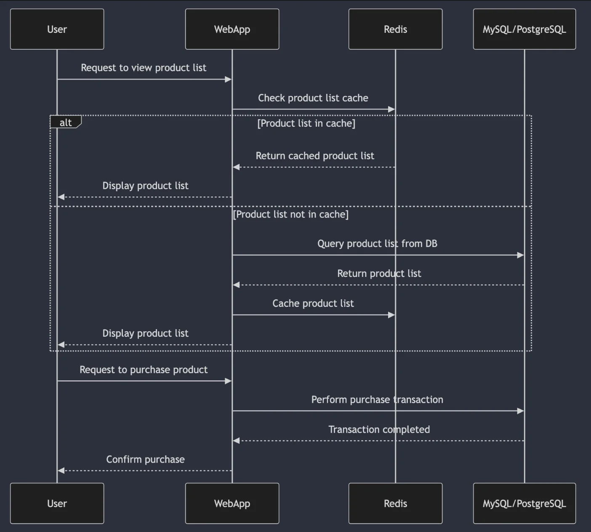

- Redis는 자주 조회되는 데이터(예&#58; 사용자 프로필, 세션 정보, 상품 목록)를 캐시로 저장하여 빠르게 제공하며, 데이터베이스에 대한 읽기 부하를 줄임

- RDB는 복잡한 트랜잭션 또는 복잡한 쿼리 작업을 처리하여 데이터 일관성을 유지하고 복잡한 작업을 효율적으로 처리

- 사용 사례
    - 전자상거래 플랫폼

    - 웹 애플리케이션 세션 관리

<a id="330eda9b0fe18019bf97e0a5c800b7c6"></a>

### <code>Redis</code> &#43; <code>Kafka</code>

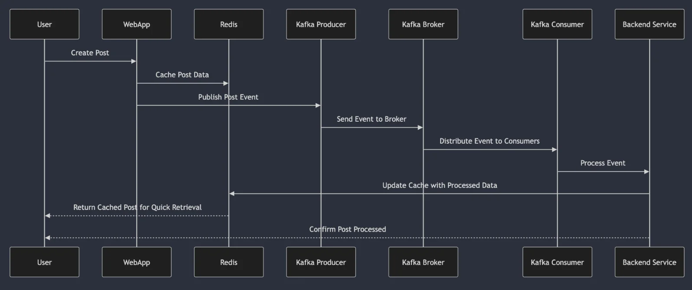

- Redis는 실시간 데이터의 캐시 역할을 맡아 빠른 조회 및 데이터 업데이트 처리

- Kafka는 대규모 실시간 이벤트와 데이터 스트리밍을 관리하여 데이터를 안정적으로 전송하고 처리함

- Kafka는 분산 메시지 시스템으로 대용량의 데이터를 프로듀서에서 컨슈모로 효율적으로 전달하며, Redis는 메시징 프로세스 중, 데이터 캐싱을 통해 빠른 처리와 응답 제공

- 사용 사례
    - 실시간 로그 처리

    - 실시간 알람 시스템

<a id="330eda9b0fe1800798f6f0880b8b6a62"></a>

### <code>Redis</code> &#43; <code>Elasticsearch</code>

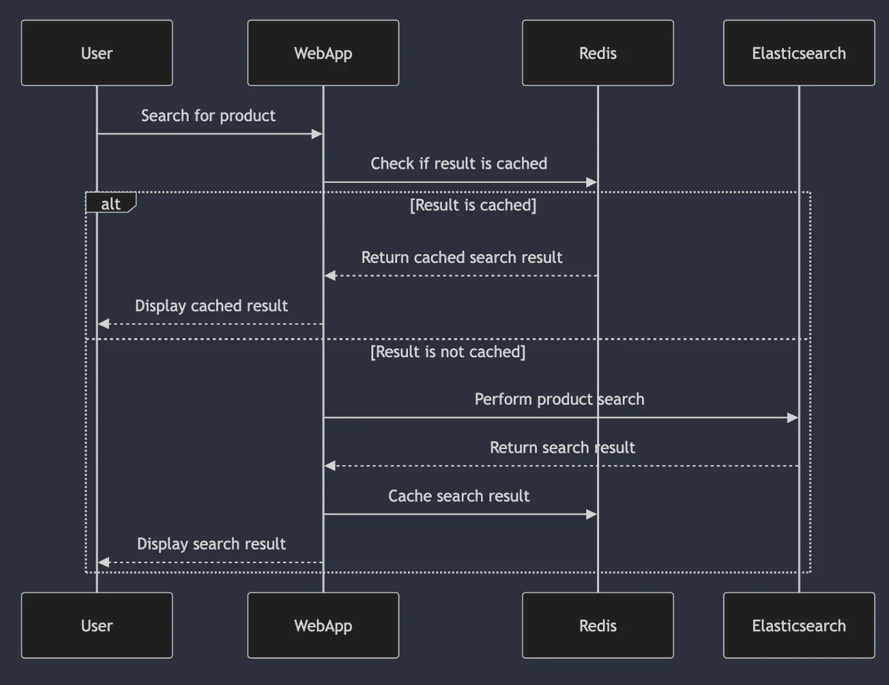

- Redis는 고성능 캐시로 사용되어 자주 조회되는 데이터를 빠르게 제공

- Elasticsearch 는 검색 엔진 역할을 수행하여, 대규모 데이터셋에서 복잡한 검색 작업(ex&#46; 전체 데이터 검색, 필터링, 집계 등)을 처리

- Redis는 검색된 데이터를 캐싱하여 검색 성능을 더욱 향상시킬 수 있으며, Elasticsearch는 정교한 검색 결과를 제공하여 데이터 분석 및 검색 기능을 강화

- 사용 사례
    - 전자상거래 검색 시스템

    - 로그 분석 시스템
