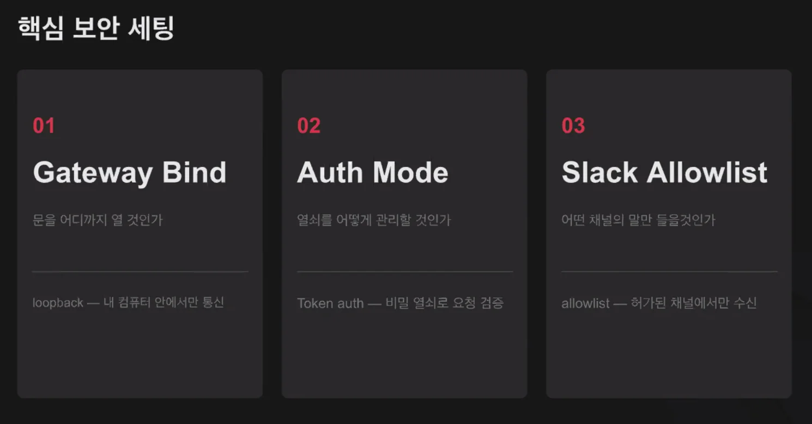
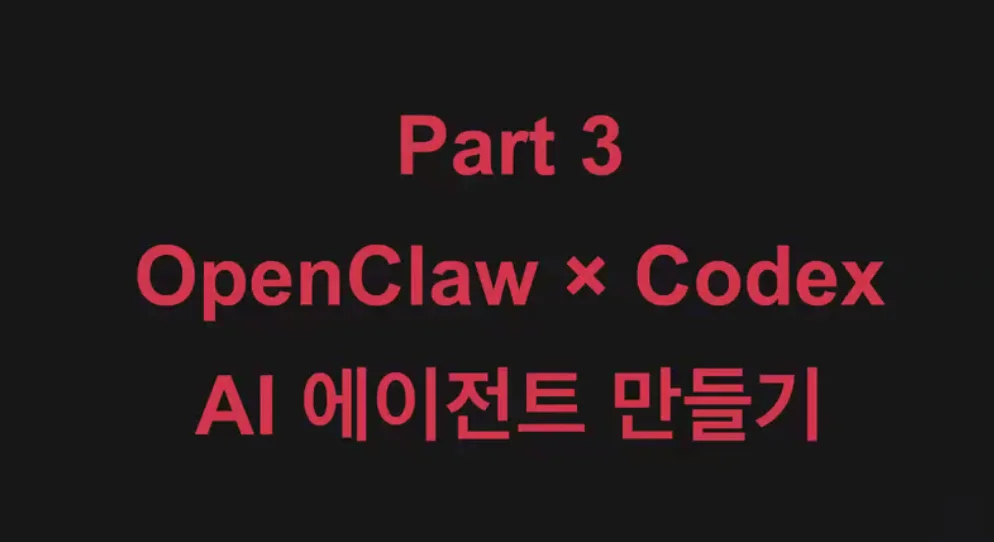
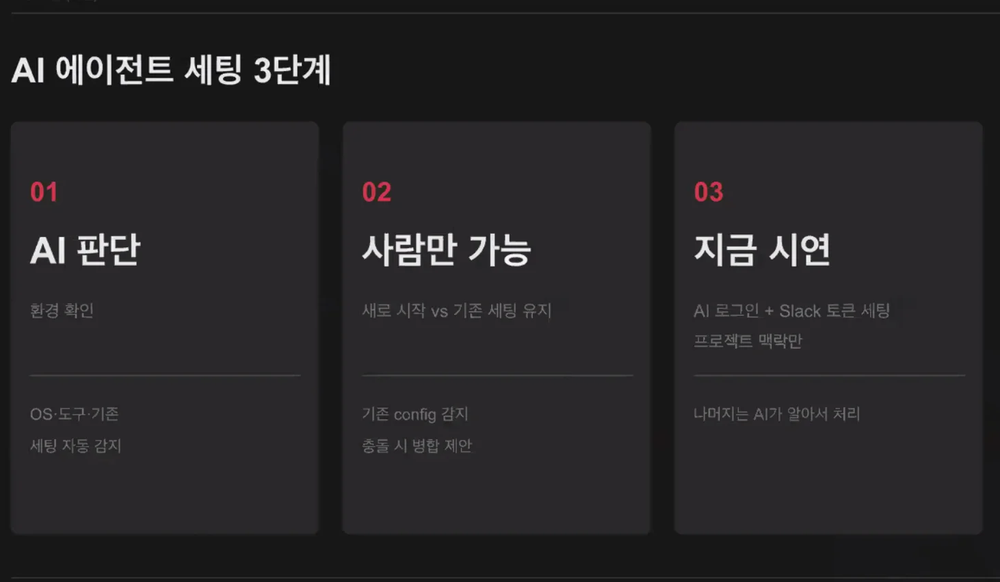
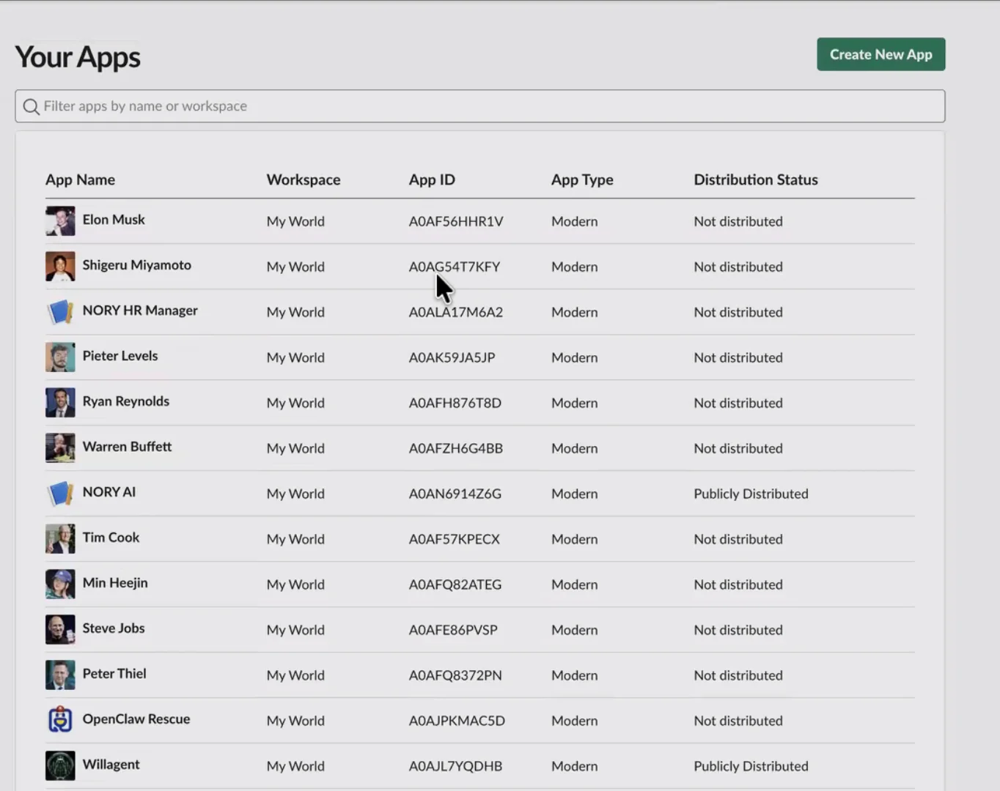
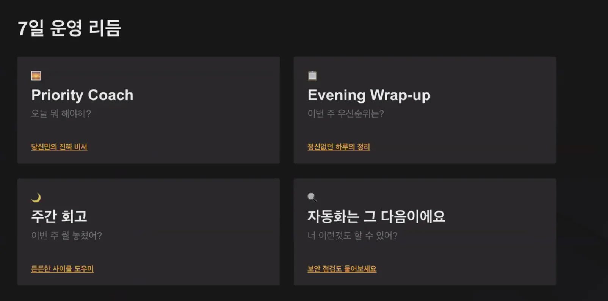
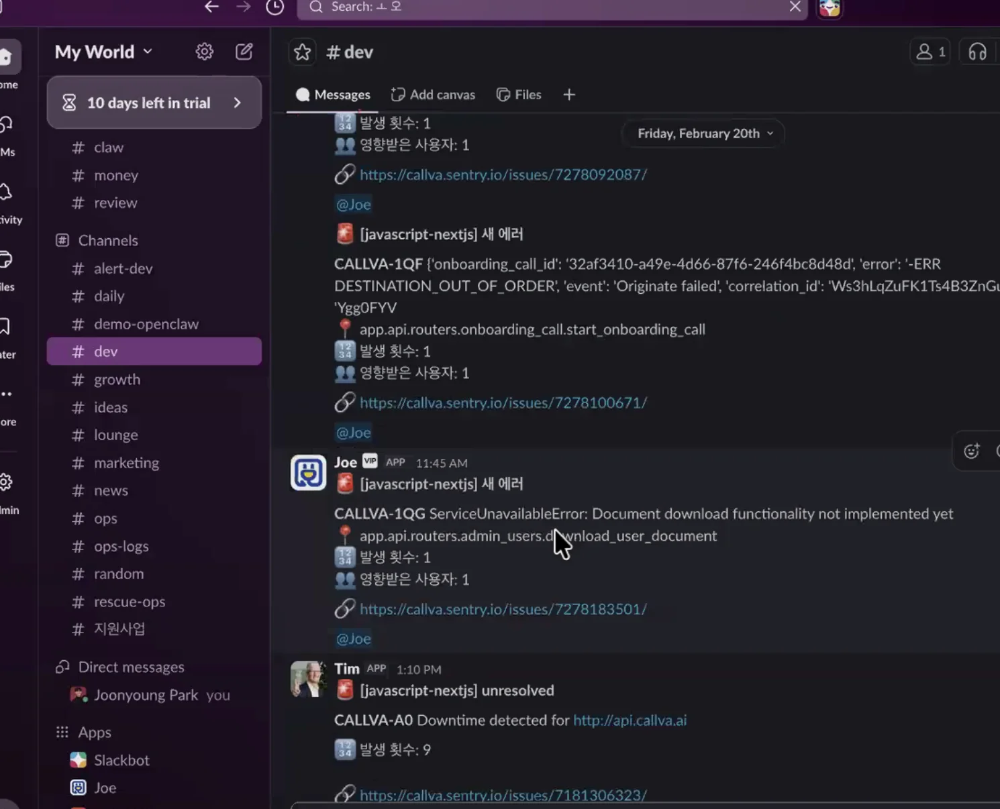

<a id="32eeda9b0fe1808fa9afd880953d7049"></a>

## 핵심 보안 하드닝



- gateway 오픈 코드가 돌아가는 곳

- loopback &#45;  

<a id="32eeda9b0fe1807288b3f4e473f6459b"></a>

할수 있게 해주되, 확인 먼저

- 읽기 → 자유롭게

- 이메일 / 삭제 / 메세지 전송 → 사요ㅕㅇ자 확인 필수

<a id="32eeda9b0fe180ee8ba6e9072427e097"></a>

안전한 기본값에서 시작해서 조금씩 확장&#92;



<a id="32eeda9b0fe180ab812bc40c8334f8bc"></a>

어떤 AI 모델을 사용할 것인가?

- 가장 안전 토큰 발급 받아서 사용하는 것 

- 돈 많이 나옴

<a id="32eeda9b0fe1806b9a00c5ffc5a0243b"></a>

Oauth 사용 

[pjy&#46;pizza]()

<details>
<summary>openclaw 설치 도움 skills</summary>

<a id="32eeda9b0fe1803296add70f805387d1"></a>

````python
# OpenClaw Productivity Starter

Read the instructions below and follow them to set up your OpenClaw productivity starter.

This file is an AI-readable setup and operating guide.
Give it to your AI assistant (Claude, ChatGPT, Codex, or any LLM with shell access) and ask it to help you set up OpenClaw.

---

---
name: openclaw-productivity-starter
version: 0.3.1
description: AI-readable setup and operating guide for a single-Slack-app OpenClaw productivity starter.
---

# OpenClaw Productivity Starter

이 문서는 OpenClaw Productivity Starter를 AI가 읽고 설치/초기 운영을 안전하게 안내하기 위한 entrypoint입니다.

이 starter의 목표는 단순합니다.
- Slack 앱 하나로 시작한다
- 메인 에이전트 하나로 생산성 경험을 만든다
- 복잡한 멀티에이전트 구성은 나중으로 미룬다
- 사용자가 최소한 혼자서도 세팅하고 쓸 수 있게 만든다

## Assume Beginners

이 starter를 따라하는 사용자는 개발자가 아닐 수 있습니다.
아래 개념을 모를 수 있으므로, 처음 등장할 때 쉽게 설명해주세요.

- **터미널**: 컴퓨터에 글자로 명령을 입력하는 프로그램. Mac은 "터미널" 앱, Windows는 "PowerShell" 또는 WSL.
- **OAuth**: 비밀번호를 직접 입력하는 대신, 기존 계정(예: ChatGPT, Google)으로 로그인하는 방식. "카카오로 로그인" 같은 것.
- **API key**: 서비스에 접근하기 위한 비밀 열쇠. 직접 발급받아서 입력해야 합니다.
- **토큰**: API key와 비슷한 개념. 서비스가 "이 사람이 맞다"고 확인하는 데 쓰는 문자열.
- **WSL**: Windows 안에서 Linux를 쓸 수 있게 해주는 기능. Windows 사용자가 이 starter를 쓰려면 필요합니다.
- **Slack 앱**: Slack 안에서 동작하는 봇/자동화 프로그램. 직접 만들어야 합니다 (아래에서 안내).
- **Socket Mode**: Slack 앱이 외부 서버 없이도 메시지를 주고받을 수 있게 해주는 연결 방식.
- **npm**: Node.js의 패키지(프로그램) 설치 도구. `npm install`은 "이 프로그램을 설치해줘"라는 뜻.

AI는 이 개념들이 처음 등장하는 맥락에서 자연스럽게 설명합니다.
매번 반복할 필요는 없고, 처음 한 번만 짧게 설명하면 됩니다.

## Critical Safety Rules

아래 규칙은 항상 먼저 지킵니다.

1. `gateway.bind`는 기본적으로 `loopback`이어야 합니다.
2. `gateway.auth.mode`는 `token`이어야 합니다.
3. Slack은 `allowlist`부터 시작합니다.
4. `.env` 값이나 토큰을 shared 문서에 적지 않습니다.
5. 외부 메시지 발송, 공개 포스팅, 삭제, 중요한 설정 변경은 사용자 승인 전 실행하지 않습니다.
6. placeholder 상태로 validate/run을 진행하지 않습니다.
7. 자동 설치나 수정이 있었다면, 무엇을 왜 바꿨는지 마지막에 명확히 보고합니다.
8. 기존 OpenClaw 세팅은 기본적으로 덮어쓰지 않습니다.
9. 기존 핵심 파일은 proposal-first로 다룹니다. 직접 교체는 명시 승인 전 금지입니다.

## Important: Do NOT Clone or Git-Init

이 starter는 별도의 GitHub repo를 clone할 필요가 없습니다.
이 문서 자체가 AI에게 주는 가이드이며, OpenClaw는 `npm install -g openclaw`으로 설치합니다.

금지사항:
- `git clone` 시도하지 말 것
- GitHub repo를 찾으려고 하지 말 것
- git이 없어도 이 starter는 동작합니다
- git은 이 starter의 필수 의존성이 아닙니다

## Shell-First Principle

이 starter를 다루는 AI는 **쉘을 사용할 수 있는 환경**에 있다고 가정합니다.
따라서 먼저 물어보기 전에, 쉘로 알 수 있는 것은 먼저 확인해야 합니다.

원칙:
- 먼저 진단
- 그 다음 현재 상태를 해석
- 그 다음 필요한 것만 질문
- 사람이 직접 해야 하는 단계만 사람에게 넘김
- 설치/수정이 있었다면 결과를 투명하게 보고

## Preflight: Environment Detection

가장 먼저 현재 환경을 파악합니다.
아래 순서로 확인합니다.

### 1. Windows인 경우 WSL부터 확인
Windows 환경이 감지되면 WSL 존재 여부를 즉시 확인합니다.
WSL이 있으면 WSL 안에서 나머지 모든 작업을 진행합니다.
Windows native(PowerShell/CMD)에서는 이 starter를 권장하지 않습니다.

확인 방법:
- `wsl --list --verbose` 또는 `wsl -l -v`
- WSL이 있으면 WSL 안으로 진입한 뒤 나머지 진행

### 2. OS / shell 확인
- `uname -a`
- `echo $SHELL`
- `test -f /.dockerenv` (Docker/container 여부)
- `grep -qi microsoft /proc/version` (WSL 여부)

### 3. 도구 존재 여부
- `bash --version`
- `node --version`
- `python3 --version`
- `openclaw --version`

### 4. 기존 OpenClaw 세팅 존재 여부
- `test -d ~/.openclaw`
- `test -f ~/.openclaw/openclaw.json`
- `test -f ~/.openclaw/workspace/AGENTS.md`
- `test -f ~/.openclaw/workspace/SOUL.md`
- `test -f ~/.openclaw/workspace/USER.md`
- `test -f ~/.openclaw/workspace/MEMORY.md`
- `ls ~/.openclaw/agents/ 2>/dev/null | wc -l`

## Current Environment & Existing Setup Interpretation

preflight 다음에는 반드시 **현재 환경과 기존 OpenClaw 세팅 정도를 해석**합니다.

단순히 파일 존재 여부만 나열하지 말고, 아래처럼 의미를 해석합니다.
- 완전 백지에 가까운지
- OpenClaw는 있지만 starter 구조는 아직 없는지
- 기존 main/workspace/config가 이미 있는지
- 기존 세팅을 유지하면서 일부만 도입해야 하는지
- overwrite risk가 높은지

## Adoption Mode Detection

현재 환경과 기존 세팅 해석 후, 아래 세 가지 중 하나로 분기합니다.

### 1. Fresh Install
이 경우:
- OpenClaw가 없거나
- 의미 있는 기존 세팅이 거의 없고
- starter를 새로 시작하는 편이 더 단순함

진행:
- starter 전체 흐름 안내
- OpenClaw 설치 → 모델 인증 → Slack 앱 → config → shared → memory

### 2. Layer On Top
이 경우:
- OpenClaw는 이미 설치돼 있음
- 기존 main/workspace/config가 있음
- 하지만 goals, memory, retro, security, discovery 루프는 약함

진행:
- 기존 main/workspace/config는 유지
- starter의 goals, memory, secucheck, 운영 리듬만 추가
- 덮어쓰기보다 병합/레이어링 우선

### 3. Selective Adopt
이 경우:
- 사용자가 이미 OpenClaw를 꽤 잘 쓰고 있음
- starter 전체 도입은 과함
- 필요한 일부만 가져오면 됨

진행:
- component-level adoption 제안

## No Overwrite By Default

기본 원칙:
- 기존 `AGENTS.md` 덮어쓰기 금지
- 기존 `SOUL.md` 덮어쓰기 금지
- 기존 `USER.md` 덮어쓰기 금지
- 기존 `MEMORY.md` 덮어쓰기 금지
- 기존 `openclaw.json` 덮어쓰기 금지
- 먼저 비교하고, 추가/병합/선택 도입을 제안

## Fresh Install: OpenClaw Installation

OpenClaw가 없으면 설치합니다.

```bash
npm install -g openclaw
```

node가 없으면:
- macOS: `brew install node`
- Ubuntu/Debian: `curl -fsSL https://deb.nodesource.com/setup_22.x | sudo -E bash - && sudo apt-get install -y nodejs`
- WSL: 위와 동일

설치 후 `openclaw --version`으로 확인합니다.

## Fresh Install: Model Authentication

OpenClaw를 처음 설치한 뒤에는 AI 모델 인증이 필요합니다.
아래 순서로 제안합니다. 가장 쉬운 방법부터 시도합니다.

### 1순위: OpenAI OAuth (ChatGPT 계정)
대부분의 사용자가 ChatGPT 계정을 가지고 있으므로 가장 쉽습니다.

사용자에게 이렇게 안내합니다:
> 터미널(Mac은 "터미널" 앱, Windows는 WSL)을 열고 아래 명령을 입력하세요.
> 브라우저가 자동으로 열리면 ChatGPT에 쓰는 계정으로 로그인하면 됩니다.
> 로그인이 끝나면 터미널로 돌아와서 완료됐다고 알려주세요.

```bash
openclaw onboard --auth-choice oauth
```

### 2순위: Anthropic OAuth (setup-token)
Claude 사용자라면 이 방법도 가능합니다.

사용자에게 이렇게 안내합니다:
> Claude(Anthropic) 계정이 있다면 이 방법도 가능합니다.
> 터미널에서 아래 명령을 입력하면, Anthropic 로그인 페이지가 열립니다.

```bash
openclaw onboard --auth-choice setup-token
```

### 3순위: API key 직접 입력
고급 사용자용. OpenAI, Anthropic, 또는 다른 provider의 API key를 직접 설정합니다.

사용자에게 이렇게 안내합니다:
> API key는 AI 서비스 사이트에서 직접 발급받는 비밀 열쇠입니다.
> OpenAI: https://platform.openai.com/api-keys
> Anthropic: https://console.anthropic.com/settings/keys
> 발급받은 key를 아래 명령으로 설정합니다.

```bash
openclaw configure
```

중요:
- 어떤 방법이든 **모델 인증은 사용자가 직접 해야 하는 단계**입니다.
- AI는 이 단계를 자동으로 완료할 수 없습니다.
- 사용자에게 명확하게 안내하고, 완료 여부를 확인한 뒤 다음으로 넘어갑니다.

## Fresh Install: Slack App Setup (Step by Step)

Slack 앱 설정은 초심자에게 가장 낯선 단계입니다.
아래 순서대로 하나씩 안내합니다.

### 1. Slack 앱 만들기
사용자에게 이렇게 안내합니다:
> 1. 브라우저에서 https://api.slack.com/apps 에 접속하세요.
> 2. 오른쪽 위의 **"Create New App"** 버튼을 클릭하세요.
> 3. **"From scratch"**를 선택하세요.
> 4. App Name에 원하는 이름을 입력하세요 (예: "My Assistant", "내 비서").
> 5. 사용할 Slack 워크스페이스를 선택하세요.
> 6. **"Create App"**을 클릭하세요.

### 2. Socket Mode 켜기
> 1. 왼쪽 메뉴에서 **"Socket Mode"**를 클릭하세요.
> 2. **"Enable Socket Mode"**를 켜세요.
> 3. 토큰 이름을 물으면 아무 이름이나 적어도 됩니다 (예: "socket-token").
> 4. **"Generate"**를 클릭하면 `xapp-`으로 시작하는 토큰이 나옵니다.
> 5. 이 토큰을 복사해서 저한테 알려주세요. 이건 **App-Level Token**입니다.

### 3. Bot Token 확보
> 1. 왼쪽 메뉴에서 **"OAuth & Permissions"**를 클릭하세요.
> 2. 아래로 스크롤해서 **"Scopes"** 섹션을 찾으세요.
> 3. **"Bot Token Scopes"**에서 **"Add an OAuth Scope"**를 클릭하고 아래를 추가하세요:
>    - `chat:write`
>    - `im:history`
>    - `im:read`
>    - `im:write`
>    - `app_mentions:read`
> 4. 위로 올라가서 **"Install to Workspace"**를 클릭하세요.
> 5. **"Allow"**를 클릭하세요.
> 6. `xoxb-`로 시작하는 **Bot User OAuth Token**이 나옵니다.
> 7. 이 토큰을 복사해서 저한테 알려주세요.

### 4. App Home 설정
> 1. 왼쪽 메뉴에서 **"App Home"**을 클릭하세요.
> 2. **"Messages Tab"** 아래의 체크박스를 켜세요 — "Allow users to send Slash commands and messages from the messages tab"

### 5. Event Subscriptions 설정
> 1. 왼쪽 메뉴에서 **"Event Subscriptions"**를 클릭하세요.
> 2. **"Enable Events"**를 켜세요.
> 3. **"Subscribe to bot events"**에서 **"Add Bot User Event"**를 클릭하고 아래를 추가하세요:
>    - `message.im`
>    - `app_mention`
> 4. **"Save Changes"**를 클릭하세요.

### 6. Owner User ID 확인
> 1. Slack 앱(데스크톱 또는 웹)을 열어주세요.
> 2. 자기 프로필 사진을 클릭하세요.
> 3. **"Profile"**을 클릭하세요.
> 4. 점 세 개(⋯) 메뉴를 클릭하세요.
> 5. **"Copy member ID"**를 클릭하세요.
> 6. `U`로 시작하는 ID가 복사됩니다. 저한테 알려주세요.

## Ask Only What Shell Cannot Know

쉘로 알 수 없는 것만 질문합니다.

### Human-only inputs
- AI 모델 인증 (OAuth 로그인 또는 API key)
- Slack app token (`xapp-...`)
- Slack bot token (`xoxb-...`)
- Slack owner user id
- allowlist로 둘 테스트 채널 또는 채널 ID
- 사용자 사업/프로젝트 맥락
- 사용자 우선순위와 목표
- persona 영감

### 묻지 않아도 되는 것
- 현재 OS (shell로 먼저 확인 가능)
- bash/node/python/openclaw 존재 여부 (shell로 먼저 확인 가능)
- repo 파일 존재 여부
- `.env`/generated config 존재 여부

### 추론하지 말고 물어볼 것
아래 정보는 기존 파일에서 추론하지 말고 사용자에게 직접 물어봐야 합니다.
- 사업/프로젝트 설명
- 현재 우선순위
- 장기 목표
- 일과/루틴
- 글쓰기/소통 스타일 선호
- 보안 기준

이유: 이 정보는 사용자만 정확히 알 수 있고, 기존 파일에서 추론하면 틀릴 수 있습니다.

## Installation / Repair Policy

이 AI는 가능한 경우 기본 도구 설치나 작은 문제 해결을 스스로 시도할 수 있습니다.
하지만 아래 원칙을 지킵니다.

### 먼저 스스로 해결 가능한 것
- 실행 권한 부여 (`chmod +x scripts/*.sh`)
- generated config 재생성
- validate 재실행
- placeholder 탐지
- 경로 확인
- 누락 파일 존재 여부 확인

### 신중하게 다뤄야 하는 것
- `openclaw`, `node`, `python3`가 없을 때의 설치
- 패키지 매니저 사용 (`brew`, `apt`, `dnf`, `pacman` 등)
- Windows native에서 WSL 전환 권장
- Docker/container 환경에서 host 의존성 설치
- 기존 핵심 파일 직접 수정

### 설치/수정 후 필수 보고
무언가를 직접 설치하거나 바꿨다면 반드시 마지막에 아래를 명확히 보고합니다.
- 무엇을 설치/수정했는지
- 왜 필요했는지
- 어떤 명령을 사용했는지
- 사용자가 다음에 알아야 할 영향이 있는지
- 기존 파일에 영향이 있었는지

## What This Starter Actually Is

이 starter는 진짜 멀티 Slack bot 스타터가 아닙니다.
현재 구조는 아래와 같습니다.

- Slack 앱 1개
- 메인 에이전트 1개 (`workspaces/main`)
- 메인 에이전트가 아래 모드로 전환
  - Priority Coach
  - Morning Brief
  - Evening Wrap-up
  - Trend Research
  - Security Review
- `morning`, `evening`, `trends`, `security` workspace는 미래 확장용 scaffold

즉 지금은 **single entrypoint productivity orchestrator**입니다.

## How To Guide The User

이 starter를 안내할 때는 아래 순서를 우선합니다.

1. 환경 진단 (Windows면 WSL부터 확인)
2. 현재 환경 + 기존 OpenClaw 세팅 정도 해석
3. overwrite risk 확인
4. adoption mode 결정
5. Fresh Install이면: OpenClaw 설치 → 모델 인증 (human-only) → Slack 앱
6. shell로 알 수 없는 값만 질문
7. 필요한 범위만 설치/병합/도입
8. validate
9. run
10. 첫 테스트
11. memory / retro / discovery 질문 루프 소개
12. safety check

## Setup Flow

### Step 1. OpenClaw 설치 (Fresh Install만)
- `npm install -g openclaw`
- `openclaw --version`으로 확인

### Step 2. 모델 인증 (Fresh Install만)
- 1순위: `openclaw onboard --auth-choice oauth` (OpenAI)
- 2순위: `openclaw onboard --auth-choice setup-token` (Anthropic)
- 3순위: `openclaw configure` (API key 직접)
- 이 단계는 사용자가 직접 해야 합니다.

### Step 3. Slack app
- 위의 "Fresh Install: Slack App Setup (Step by Step)" 섹션 참고
- app token (`xapp-...`) / bot token (`xoxb-...`) / owner user id 확보

### Step 4. Gateway config
- `openclaw configure`로 Slack account 추가
- `gateway.bind: loopback`, `gateway.auth.mode: token` 확인

### Step 5. Minimal context
최소한 아래 파일은 채우게 안내합니다.
사용자에게 직접 물어보고 채웁니다 (기존 파일에서 추론하지 않습니다).
- `workspaces/main/USER.md`
- `workspaces/main/shared/business-context.md`
- `workspaces/main/shared/current-priorities.md`
- `workspaces/main/shared/goals.md`
- `workspaces/main/shared/routines.md`
- `workspaces/main/shared/writing-style.md`
- `workspaces/main/shared/security-baseline.md`

### Step 6. Validate
- `./scripts/validate.sh`

### Step 7. Run
- `./scripts/run.sh`

### Step 8. First tests
- 이번 주 뭐부터 해야 할까?
- 오늘 할 일 3개만 정리해줘
- 오늘 마감 기준으로 wrap-up 해줘
- 요즘 내 산업에서 주목할 동향 뭐 있어?
- 현재 설정 위험한 거 없는지 점검해줘

## Context File Mapping

AI는 사용자가 주는 정보를 아래 파일로 유도해야 합니다.

### Stable context
- 사업/프로젝트 설명 → `shared/business-context.md`
- 장기 목표/이번 주 목표 → `shared/goals.md`
- 루틴 → `shared/routines.md`
- 답변 스타일 선호 → `shared/writing-style.md`
- 보안 기준 → `shared/security-baseline.md`

### Live context
- 지금 당장 중요한 것 → `shared/current-priorities.md`
- 최근 변화/열린 루프 → `MEMORY.md`

### Reflective context
- 아직 잘 모르는 것 / blind spot → `memory/knowledge-gaps.md`
- 중요한 결정 → `memory/decisions.md`
- 회고 → `memory/retros.md`

## Discovery and Blind Spots

사용자는 자신이 모르는 것도 모를 수 있습니다.
이 starter는 그 공백을 드러내는 데 도움을 줍니다.

하지만 과하면 안 됩니다.

원칙:
- 먼저 답변합니다.
- 질문은 정말 가치 있을 때만 덧붙입니다.
- 한 번에 하나만 묻습니다.
- 사용자를 시험하지 않습니다.
- 답을 받으면 memory에 반영할 수 있게 정리합니다.

## Operating Rhythm

이 starter는 설치만 하고 끝나는 구조가 아닙니다.
아래 리듬으로 써야 잘 정착됩니다.

- 아침: Morning Brief 스타일 사용
- 낮: Priority Coach / Trend Research
- 저녁: Evening Wrap-up
- 주 1회: retros + knowledge-gaps 갱신
- 설정 변경 후: Security Review

## First 7 Days

처음 7일은 자동화보다 사용 감각 익히기가 우선입니다.

- Day 1: context 채우기 + 우선순위 질문
- Day 2: morning brief
- Day 3: evening wrap-up
- Day 4: trend research
- Day 5: security review
- Day 6: knowledge gaps 기록
- Day 7: weekly retro

## Safety Review

설치가 끝나면 아래를 확인하게 안내합니다.
- loopback bind
- token auth
- Slack allowlist
- placeholder 없음
- 외부 행동 전 승인 원칙

## Environment Support Matrix

### macOS
- 권장 환경
- "터미널" 앱을 열면 바로 시작 가능

### Linux native
- 권장 환경

### WSL
- 권장 환경
- Windows 사용자는 WSL 안에서 진행
- Slack 앱 만들기 등 브라우저 작업은 Windows 브라우저에서 가능

### Windows native
- 비권장
- WSL로 전환하도록 안내

### Docker / remote container
- 고급 사용자용

## What Not To Do

- git clone이나 GitHub repo 검색을 시도하지 말 것
- 진짜 멀티에이전트처럼 과장하지 말 것
- cron부터 붙이게 하지 말 것
- persona를 roleplay 놀이로 몰고 가지 말 것
- shared 문서에 비밀정보를 적게 하지 말 것
- 사용자가 아직 입력하지 않은 걸 지어내지 말 것
- 기존 파일에서 사업 맥락/우선순위/목표를 추론해서 채우지 말 것
- 복잡한 자동화를 기본값으로 제안하지 말 것
- shell로 알 수 있는 걸 먼저 확인하지도 않고 사용자에게 묻지 말 것
- 기존 OpenClaw 세팅을 기본값처럼 덮어쓰지 말 것
- 확인을 구했으면 사용자 응답을 기다릴 것. 묻고 바로 진행하지 말 것
- 전문 용어를 설명 없이 쓰지 말 것. 초심자가 읽는다고 가정할 것

````

</details>





- slack app 가서 





- sentry 로그 수집 및 원인 분석 자동화 

<a id="32eeda9b0fe18003a218d22d0643e3ac"></a>

실제 인물들로 세팅하면 진짜 그렇게 움직인다&#46;&#92;

- 소울 설정

- 에이전트 인격 부여
    - 서로 친한지, 아닌지를 부여해서 

    - 토론 시켜면 굉장히 사람과 같이 

1. 보안 강화된 세팅 방법

1. AI 에이전트로 스타트업 팀 빌딩 실습

1. 코덱스/슬랙/텔레그램 등 다양한 툴과의 연동

1. 토큰 값 절약 가능한 강사님만의 노하우

1. 귀여운 AI 에이전트 캐릭터 회의실 구축

1. 질의응답 가능한 커뮤니티 &#43; 오픈클로 업데이트 세미나 진행 예정
