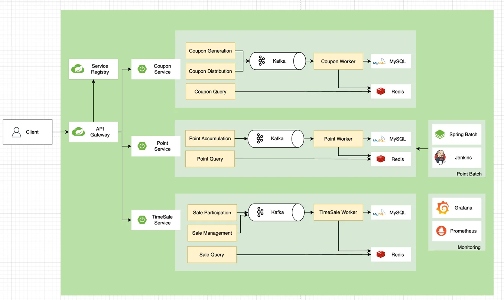

[fastcampus&#45;promotion&#45;project/PROJECT&#45;PROMOTION/docs/P02/CH01&#95;01&#46; 프로젝트 개요 및 설계&#46;md at main · dobby&#45;teacher/fastcampus&#45;promotion&#45;project]()

> 
> 
> 
> 
> <strong>목차</strong>
> 
> - [시스템 설계](#332eda9b0fe180b29577cd5220772d55)
> - [시스템 아키텍처](#339eda9b0fe180f5af12cd0fddeb62af)
> - [핵심 기능](#339eda9b0fe1807ea8b7cfdd65afdf76)
> - [핵심 컴포넌트 ](#339eda9b0fe180ecb23fd936806d15d6)
> - [기술 스택 ](#339eda9b0fe180da94c1c2e9ef16bf69)
> - [공통 기술 스택](#339eda9b0fe180258c23da6883cb68c6)
> - [컴포넌트 주요 기술](#339eda9b0fe1805881f1c009e1380c71)
> - [구현 전략](#339eda9b0fe1804b9c7dc699b3f03006)
> - [동시성 제어](#339eda9b0fe180cb80d3cec48a3e58c7)
> - [확장성](#339eda9b0fe180d9bab8d348ceacf361)
> - [장애 대응](#339eda9b0fe180d7bd79fe8332f2e7de)
> - [성능 최적화](#339eda9b0fe180688b6ef9f9ace0f6e9)
> - [보안 설계](#339eda9b0fe180c3868cd58d0a757436)
> - [인증](#339eda9b0fe18043b6d4e1fac39ba44c)
> - [보안 정책](#339eda9b0fe180dba3c2e3e0a2f770e9)

# 시스템 설계

---

> 📖 
> 
> 
> 
> 본 실습은 <strong><u>대규모 트래픽 환경에서 안정적으로 동작하는 프로모션 시스템을 구현</u></strong>하는 것을 목표한다&#46;
> 
> - 마이크로서비스 아키텍처를 기반으로 하여 확장성과 유연성을 확보하고,  다양한 동시성 제어 방식을 통해 성능을 최적화한다&#46;

## 시스템 아키텍처

---

### 핵심 기능

1&#46; 쿠폰 발급 시스템

- 동시성 제어를 통한 수량 관리

- 다양한 발급 전략 구현
    - 선착순, 지정 대상

2&#46; 사용자 관리

- 회원 가입 / 로그인

- 권한 관리

3&#46; 주문 처리

- 쿠폰 적용 주문

- 주문 상태 관리

- 결제 연동

4&#46; 상품 관리

- 상품 등록/수정

- 재고 관리

- 상품별 쿠폰 정책

5&#46; 포인트 시스템

- 포인트 적립/사용

- 포인트 내역 관리

6&#46; 타임 세일 

- 특정 시간대 할인

- 수량 제한 판매

- 실시간 재고 관리

### 핵심 컴포넌트 

1&#46; API Gateway (Spring Cloud Gateway)

- 인증/인가 처리

- 요청 라우팅

- 로드밸런싱

- 속도 제한

2&#46; Service Discovery (Eureka)

- 서비스 등록 / 발견

- 상태 모니터링

- 로드벨런싱 지원

3&#46; 마이크로서비스

- User Service&#58; 사용자 관리

- Coupon Service&#58; 쿠폰 발급/관리

- Order Service&#58; 주문 처리

- Point Service&#58; 포인트 관리

- Product Service&#58; 상품 관리

- Time Sale Service&#58; 타입세일 관리

## 기술 스택 

---

### 공통 기술 스택

- Java 17

- Spring Boot 4&#46;x

- Spring Cloud

- Gradle

- JUnit 5

- H2(in&#45;memory DB) / MySQL 8&#46;ㅌ

- Redis 7&#46;x

- Docker

### 컴포넌트 주요 기술

1&#46; API Gateway

- Spring Cloud Gateway

- Spring Security

- JWT

- Rate Limiter

2&#46; Service Discovery

- Spring Cloud Netflix Eureka

- Spring Cloud LoadBalancer

3&#46; 마이크로서비스 공통

- Spring Boot

- Spring Data JPA

- Spring Data Redis

- Sping Kafka

- Resilience4j

## 구현 전략

---

### 동시성 제어

분산 락

- Redisson을 활용한 분산 락 구현

- 쿠폰 발급, 재고 관리 등에 적용

- 데드락 방지를 위한 타임아웃 설정

대기열 시스템

- Redis를 활용한 대기열 구현

- 트래픽 부하 분산

- 공정한 처리 순서 보장

### 확장성

수평적 확장

- 서비스별 독립적인 확장

- 로드밸런서를 통한 부하 분산

- 컨테이너 기반 자동 스케일링

데이터 분산

- 서비스별 독립 데이터베이스

- 캐시 계층 활용

- 데이터 정합성 관리

### 장애 대응

서킷 브레이커

- Resilience4j를 활용한 장애 격리

- 폴백 메커니즘 구현

- 장애 전파 방지

모니터링

- Spring Boot Actuator

- 실시간 시스템 상태 모니터링

### 성능 최적화

캐싱 전략

- Redis를 활용한 캐싱

- 캐시 정합성 관리

- 캐시 갱신 전략

비동기 처리

- 이벤트 기반 아키텍처

- Kafka를 활용한 메시지 큐

- 비동기 작업 처리

## 보안 설계

---

### 인증

- JWT 기반 인증
    - Access Token / Refresh Token

    - 토큰 갱신 전략

### 보안 정책

- API 보안
    - Rate Limiting

    - CORS 설정

    - Request Validation
