> 
> 
> <a id="330eda9b0fe1818caaa5fead6a77abd0"></a>
> 
> <strong>목차</strong>
> 
> - [Spring Batch의 기본 개념](#330eda9b0fe181c2aa9fdd1ec43a3e22)
> - [개요](#331eda9b0fe180e39c97d87f1026bc86)
> - [배치 프로세싱의 개념](#331eda9b0fe1800e9dd6c0a7fdc508a3)
> - [Spring Batch 소개](#331eda9b0fe180ebbcd4dcdb151f5c08)
> - [Spring Batch 아키텍처](#331eda9b0fe1802abf9ff093f956799e)
> - [Job Launcher](#331eda9b0fe180c59615c3e78ac0275f)
> - [Job](#331eda9b0fe180d0b760ee086f676a43)
> - [Step](#331eda9b0fe18060b825cdcef0d36aad)
> - [Job Repository](#331eda9b0fe180b5a071ee13527c955c)
> - [Job Configuration](#331eda9b0fe180e3821afcf736ad73b6)
> - [Spring Batch 작업의 일반적인 흐름](#331eda9b0fe180388344ec671985ca3f)
> - [예제 코드](#331eda9b0fe1806baefddf76930de37b)
> - [Spring Batch의 주요 기능 및 사용 사례](#331eda9b0fe180aeb2b9c4a4ad53868f)
> - [주요 기능](#331eda9b0fe18024b548d01b387e11d7)
> - [다양한 데이터 소스 지원](#331eda9b0fe1800cb9fdc6730c233f9d)
> - [리트라이 및 스킵 처리](#331eda9b0fe180029510f09f7c0e04da)
> - [병렬 처리](#331eda9b0fe18018b2edd5fcbbdd3955)
> - [배치 작업 모니터링 및 관리](#331eda9b0fe180039c2fead12392d738)
> - [트랜잭션 관리](#331eda9b0fe1803895b4e5d98ea1fb0e)
> - [주요 사용 사례](#331eda9b0fe1807fbcfadbfc0680783c)
> - [데이터 마이그레이션](#331eda9b0fe18074aaa9f7f4226e85d1)
> - [대규모 데이터 처리](#331eda9b0fe180059d91ee7d79fcb75f)
> - [주기적인 데이터 업데이트](#331eda9b0fe1800791f5eacb8b291976)
> - [예제코드와 사례: CSV 파일을 읽어 DB에 저장하는 작업](#331eda9b0fe180388ba6c0ff6da187f2)
> - [Spring Batch의 스케줄링과 성능 최적화](#331eda9b0fe1807dadbae2a500d1c211)
> - [Spring Batch 스케줄링](#331eda9b0fe180a3a897d40de9c16121)
> - [Spring의 기본 스케줄링 기능](#331eda9b0fe18071be5ac6398ab68181)
> - [Quartz와의 통합](#331eda9b0fe180749ec5cac137f2aca9)
> - [Jenkins 와 Spring Batch 연동](#331eda9b0fe180b29c8ed6382c46fcaf)
> - [배치 작업 성능 최적화 기법](#331eda9b0fe18076a796e9adacb8ed8b)
> - [Chunk 크기 조정](#331eda9b0fe1803ca68ef6dbe4b6e8cf)
> - [병렬 처리 및 멀티스레딩](#331eda9b0fe1800988e5ea927ec86ffd)
> - [리소스 관리](#331eda9b0fe180e3a010c8ed1e4f4f75)

<a id="330eda9b0fe181c2aa9fdd1ec43a3e22"></a>

# Spring Batch의 기본 개념

---

<a id="331eda9b0fe180e39c97d87f1026bc86"></a>

## 개요

<a id="331eda9b0fe1800e9dd6c0a7fdc508a3"></a>

### 배치 프로세싱의 개념

> 📖 
> 
> <a id="331eda9b0fe18011aee1d0677715271a"></a>
> 
> <strong>배치 처리(Batch Processing)</strong>
> 
> - 대량의 데이터를 일괄 처리하는 방식
> 
> - 주기적 또는 조건에 따라 한 번에 여러 작업을 처리

- <code>사용 시점</code>
    - 실시간 처리가 필요하지 않은 작업에 사용

    - 대개 많은 양의 데이터를 처리해야 할 때 적합함

- <code>전통적인 용도</code>
    - 금융 시스템의 일괄 결산, 통계 데이터 생성, 대규모 파일 처리, 대량 데이터 마이그레이션 등에 주로 사용

- <code>실시간 처리와의 차이점</code>
    - 실시간 처리는 빠른 응답성을 요구하는 반면,

    - 배치 처리는 미리 정의된 시간에 주기적으로 작업이 실행되며, 즉각적인 응답성보다는 안정성과 대량 처리가 중요

<a id="331eda9b0fe180ebbcd4dcdb151f5c08"></a>

### Spring Batch 소개


> 📖 
> 
> - 스프링 프레임워크의 일부로, 배치 처리에 필요한 다양한 기능을 제공하는 오픈소스 프레임워크
> 
> - <strong><u>재사용 가능한 컴포넌트</u></strong>를 통해 복잡한 배치 작업을 간단하게 구성하고 관리

- <code>사용 목적</code>
    - 대규모 데이터 처리 및 스케줄링, 데이터베이스 읽기/쓰기, 트랜잭션 관리 등을 쉽게 구현할 수 있도록 지원

    - 트랜잭션 관리, 체크포인트 설정, 에러 Retry 등 다양한 확장 가능성 제공

<a id="331eda9b0fe1802abf9ff093f956799e"></a>

## Spring Batch 아키텍처

> 
> 
> 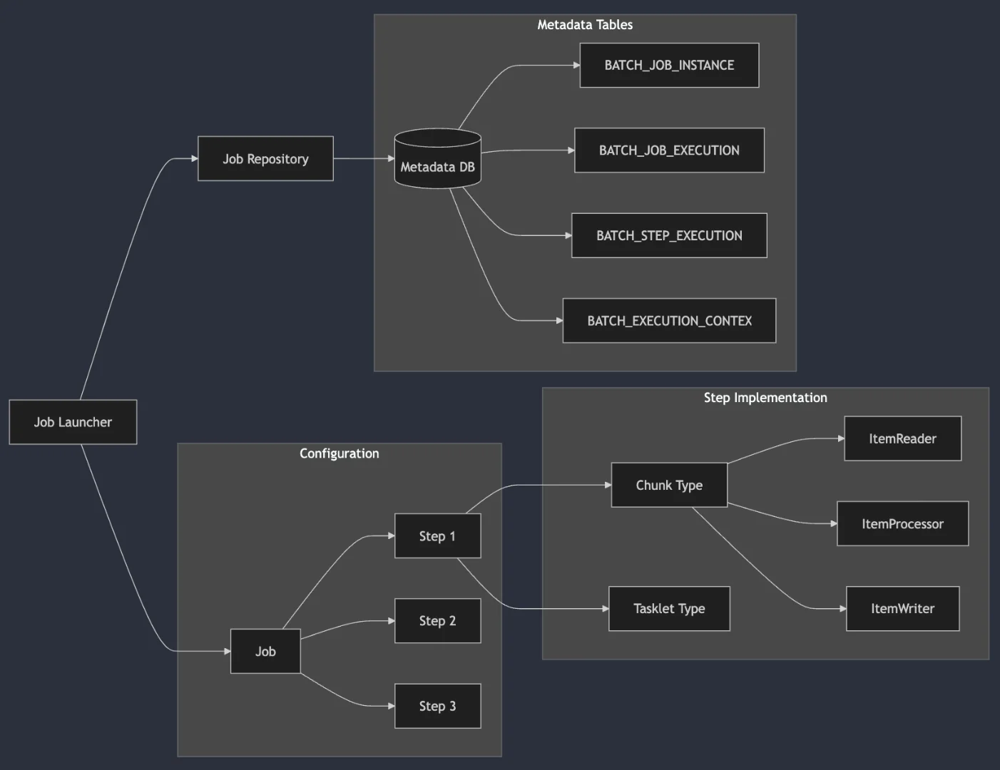
> 
> - <code>Job Launcher</code>
> 
> - <code>Job</code>
> 
> - <code>Step</code>
> 
> - <code>Job Repository</code>
> 
> - <code>Job Configuration</code>

<a id="331eda9b0fe180c59615c3e78ac0275f"></a>

### Job Launcher

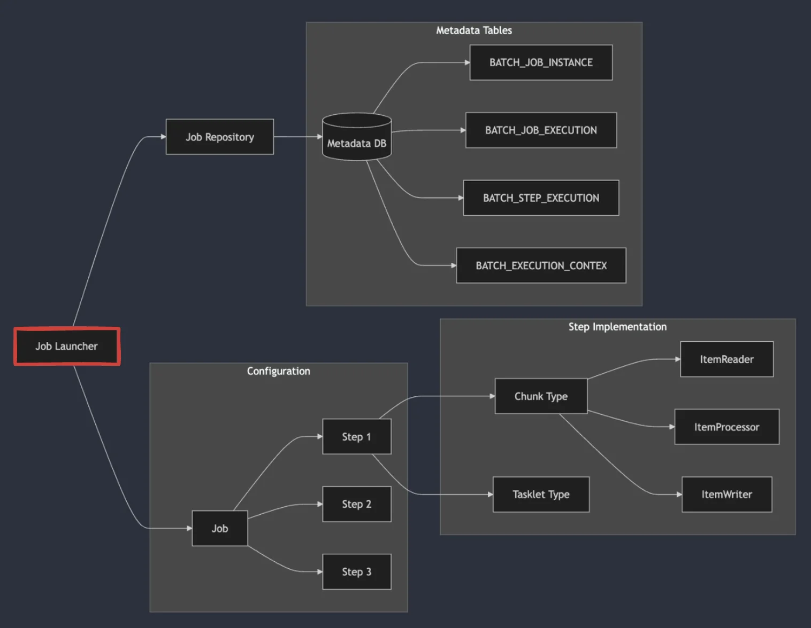

- Job을 실행하는 데 사용되는 클래스

- 외부 이벤트 또는 스케줄러에 의해 실행될 수 있음

<a id="331eda9b0fe180d0b760ee086f676a43"></a>

### Job

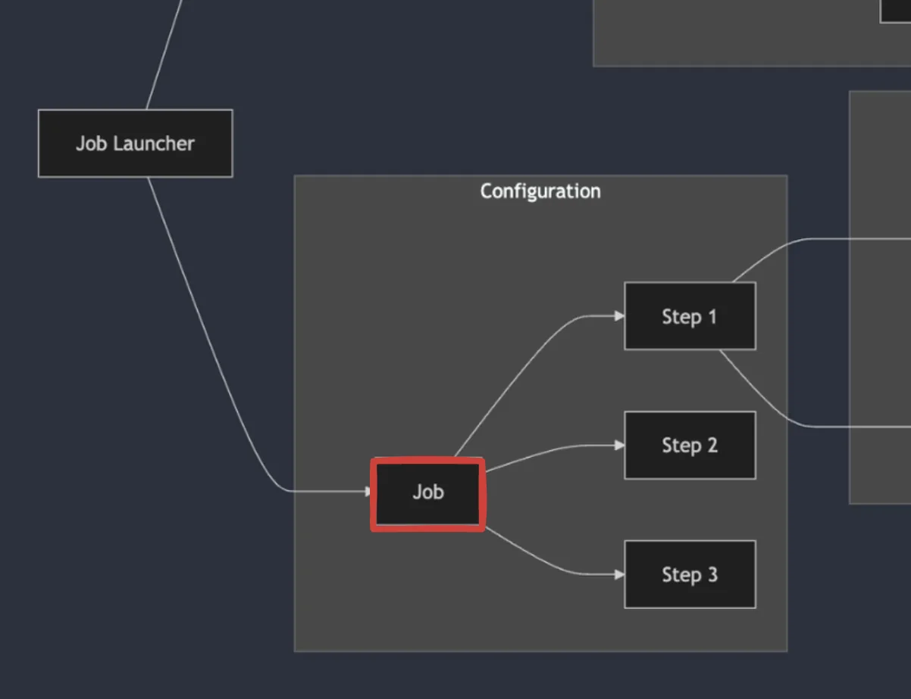

- 배치 처리의 기본 단위로, 여러 step을 묶어서 하나의 작업으로 처리함

- 실행되는 Job은 JobRepository에 저장되어 상태를 관리함

<a id="331eda9b0fe18060b825cdcef0d36aad"></a>

### Step

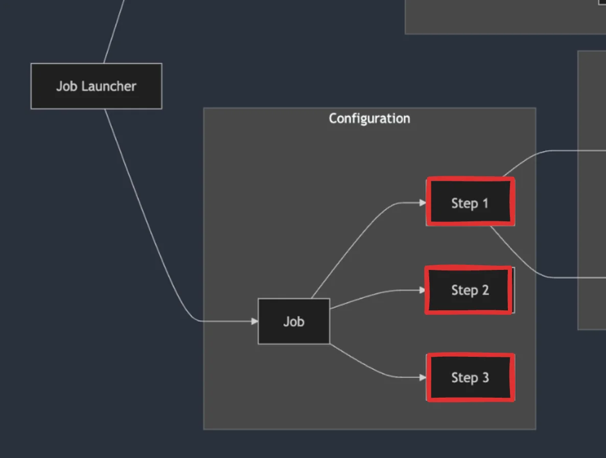

- Job 내부의 세부 작업 단위

- Step은 작업을 구성하는 하나의 모듈로서, 각 Step은 별로도 설정 가능

- <code>Chunk 기반 처리</code>&#58; 대량의 데이터르 작은 단위(Chunk)로 나눠 일괄 처리

- <code>Tasklet 기반 처리</code>&#58; 하나의 단일 작업을 처리하는 간단한 방식

<a id="331eda9b0fe180b5a071ee13527c955c"></a>

### Job Repository

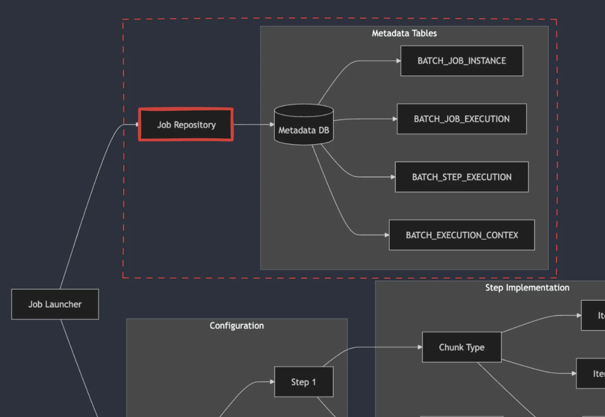

- <strong><u>Job과 Step의 실행 상태, 메타데이터를 관리</u></strong>하는 저장소

- 각 Job의 성공/실패 여부, Step의 실행 상태, 오류 발생 시점 등을 기록

- Job이 재시작되거나 중단된 이후에 다시 실행해야 하는 경우, JobRepository를 참조하여 해당 Job을 이전 상태로 복구

<a id="331eda9b0fe180e3821afcf736ad73b6"></a>

### Job Configuration

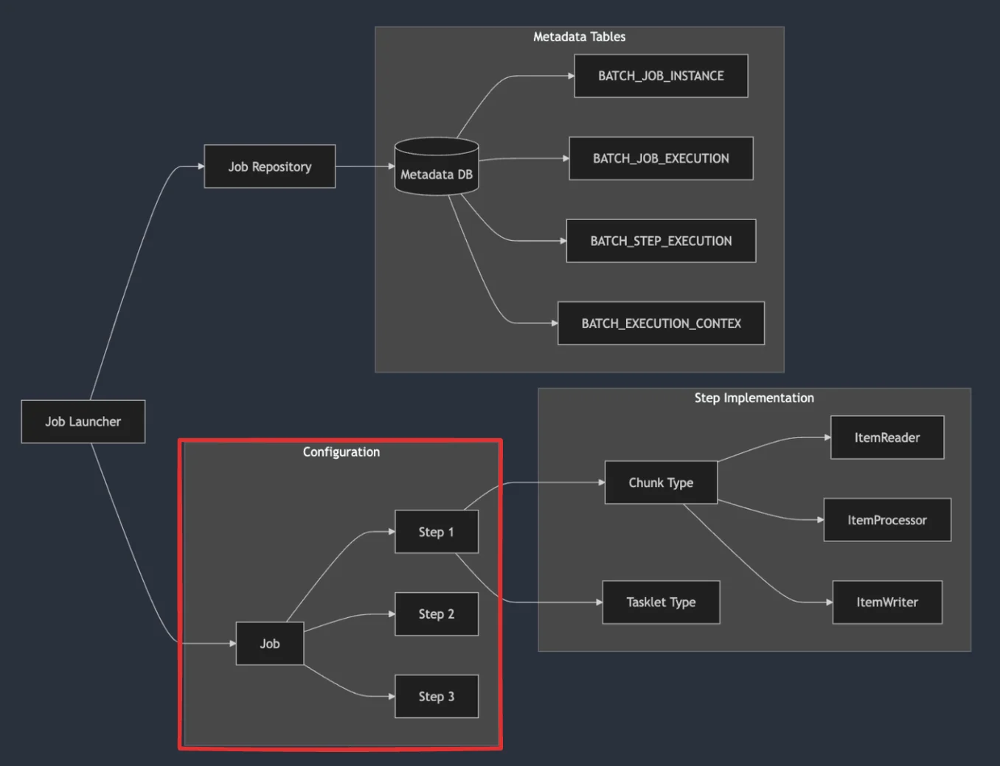

- XML 또는 Java 기반 설정을 통해 Job과 Step의 구성 요소를 정의

- 스프링의 DI(Dependency Injection)를 활용하여 설정 가능

<a id="331eda9b0fe180388344ec671985ca3f"></a>

### Spring Batch 작업의 일반적인 흐름

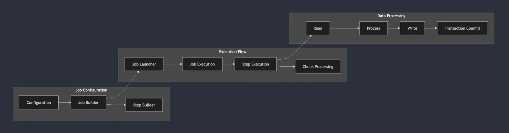

> 
> 
> > <code>READ</code> → <code>PROCESS</code> → <code>WRITE</code> → <code>COMMIT</code>
> 
> 1. 데이터 소스에서 읽기 (Read)
> 
> 1. 데이터 처리 (Process)
> 
> 1. 데이터 저장소에 쓰기 (Write)
> 
> 1. Chunk 기반 트랜잭션 처리

<a id="331eda9b0fe1806baefddf76930de37b"></a>

### 예제 코드

<details>
<summary>&#91; 코드 &#93; </summary>

<a id="331eda9b0fe1804ebc37c53f2bf7f572"></a>

```java
@Bean
public Job exampleJob(JobBuilderFactory jobBuilderFactory, Step exampleStep) {
    return jobBuilderFactory.get("exampleJob")
            .start(exampleStep) // Step 시작
            .build();
}

@Bean
public Step exampleStep(StepBuilderFactory stepBuilderFactory,
                        ItemReader<Customer> reader,
                        ItemProcessor<Customer, ProcessedCustomer> processor,
                        ItemWriter<ProcessedCustomer> writer) {

    return stepBuilderFactory.get("exampleStep")
            .<Customer, ProcessedCustomer>chunk(10) // Chunk 크기를 10으로 설정
            .reader(reader)                         // 데이터 읽기 설정
            .processor(processor)                   // 데이터 처리 설정
            .writer(writer)                         // 데이터 쓰기 설정
            .build();
}

@Bean
public FlatFileItemReader<Customer> reader() {
    return new FlatFileItemReaderBuilder<Customer>()
            .name("customerItemReader")
            .resource(new ClassPathResource("customers.csv"))
            .delimited()
            .names("firstName", "lastName", "birthDate")
            .fieldSetMapper(new BeanWrapperFieldSetMapper<>() {{
                setTargetType(Customer.class);
            }})
            .build();
}
```

</details>

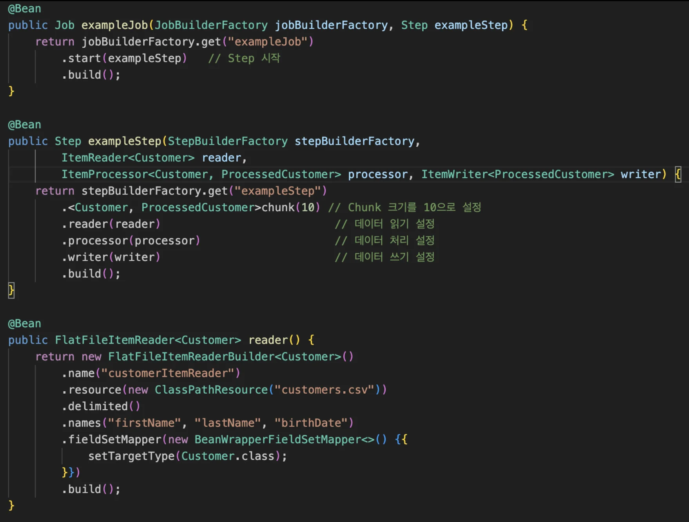

1. <strong>Job</strong>
    - exampleJob → Step 실행 orchestration

1. <strong>Step</strong>
    - chunk 기반 처리 (chunk(10))

    - Reader → Processor → Writer 순서

1. <strong>Reader</strong>
    - CSV 파일(customers&#46;csv) 읽어서 Customer 객체로 매핑

<a id="331eda9b0fe180aeb2b9c4a4ad53868f"></a>

# Spring Batch의 주요 기능 및 사용 사례

---

<a id="331eda9b0fe18024b548d01b387e11d7"></a>

## 주요 기능

<a id="331eda9b0fe1800cb9fdc6730c233f9d"></a>

### 다양한 데이터 소스 지원

<details>
<summary>파일 지원 &#45; 예시&#58; <code>CSV 파일</code></summary>

<details>
<summary>이미지</summary>

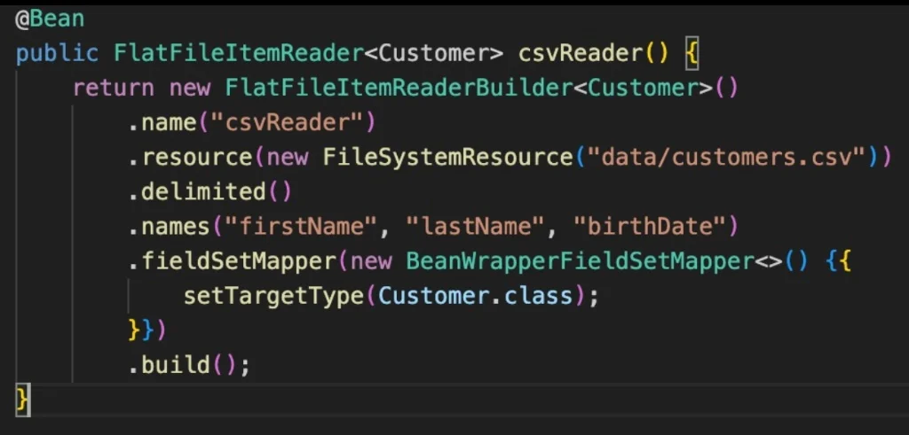

</details>

<a id="331eda9b0fe1802e9fa0c7368ad7dcc1"></a>

```java
@Bean
public FlatFileItemReader<Customer> csvReader() {
    return new FlatFileItemReaderBuilder<Customer>()
            .name("csvReader")
            .resource(new FileSystemResource("data/customers.csv"))
            .delimited()
            .names("firstName", "lastName", "birthDate")
            .fieldSetMapper(new BeanWrapperFieldSetMapper<>() {{
                setTargetType(Customer.class);
            }})
            .build();
}
```

- <strong><code>FlatFileItemReaderBuilder</code></strong>&#58; 
    - CSV와 같은 플랫 파일을 읽기 위한 리더 객체를 생성하는 빌더

- <strong><code>&#46;resource(&#46;&#46;&#46;)</code></strong>&#58; 
    - 읽어올 파일의 경로(<code>data/customers&#46;csv</code>)를 지정

- <strong><code>&#46;delimited()&#46;names(&#46;&#46;&#46;)</code></strong>&#58; 
    - 구분자(기본은 쉼표)를 기준으로 데이터를 나누고, 각 컬럼에 이름 부여

- <strong><code>BeanWrapperFieldSetMapper</code></strong>&#58; 
    - 읽어온 필드 데이터를 <code>Customer</code> 객체의 필드와 자동으로 매핑

</details>

<details>
<summary>DB 지원 &#45; 예시&#58; <code>JdbcCursorItemReader</code></summary>

<details>
<summary>이미지 </summary>

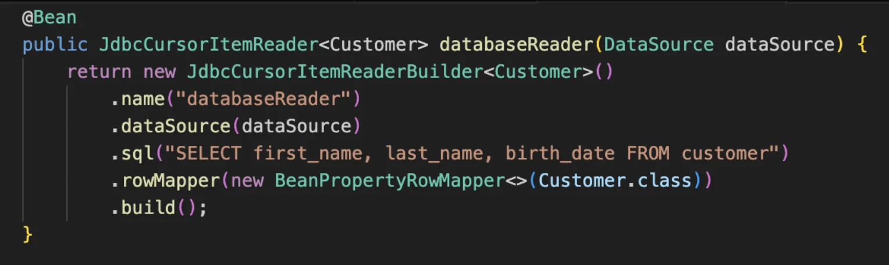

</details>

<a id="331eda9b0fe18066a8a5f9fdc2aaa33e"></a>

```java
@Bean
public JdbcCursorItemReader<Customer> databaseReader(DataSource dataSource) {
    return new JdbcCursorItemReaderBuilder<Customer>()
            .name("databaseReader")
            .dataSource(dataSource)
            .sql("SELECT first_name, last_name, birth_date FROM customer")
            .rowMapper(new BeanPropertyRowMapper<>(Customer.class))
            .build();
}
```

- <strong><code>JdbcCursorItemReaderBuilder</code></strong>&#58; 
    - JDBC 커서(Cursor) 기반으로 데이터베이스 레코드를 읽어오는 리더 생성

- <strong><code>&#46;dataSource(dataSource)</code></strong>&#58; 
    - 연결할 데이터베이스의 <code>DataSource</code>를 주입받아 설정

- <strong><code>&#46;sql(&#46;&#46;&#46;)</code></strong>&#58; 
    - 데이터를 조회할 SQL 쿼리문 작성

- <strong><code>&#46;rowMapper(&#46;&#46;&#46;)</code></strong>&#58; 
    - 조회된 각 행(<code>ResultSet</code>)을 <code>Customer</code> 객체로 어떻게 변환할지 지정

    - <code>BeanPropertyRowMapper</code>를 사용하면 DB의 스네이크 케이스(<code>first&#95;name</code>) 컬럼을 자바의 카멜 케이스(<code>firstName</code>) 필드에 자동으로 매핑함

</details>

<details>
<summary>Kafka 지원 &#45; 예시&#58; <code>KafkaItemReader</code></summary>

<details>
<summary>이미지 </summary>

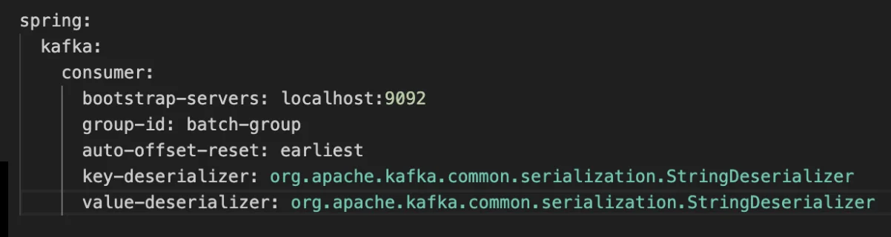

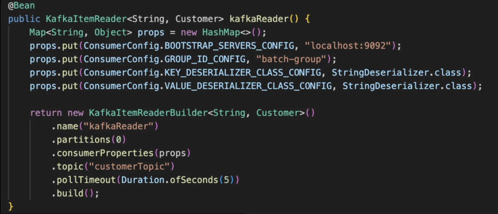

</details>

<a id="331eda9b0fe18040870aed9f1619443e"></a>

```yaml
spring:
  kafka:
    consumer:
      bootstrap-servers: localhost:9092
      group-id: batch-group
      auto-offset-reset: earliest
      key-deserializer: org.apache.kafka.common.serialization.StringDeserializer
      value-deserializer: org.apache.kafka.common.serialization.StringDeserializer
```

<a id="331eda9b0fe18098a866d5acec396e99"></a>

```java
@Bean
public KafkaItemReader<String, Customer> kafkaReader() {
    Map<String, Object> props = new HashMap<>();
    props.put(ConsumerConfig.BOOTSTRAP_SERVERS_CONFIG, "localhost:9092");
    props.put(ConsumerConfig.GROUP_ID_CONFIG, "batch-group");
    props.put(ConsumerConfig.KEY_DESERIALIZER_CLASS_CONFIG, StringDeserializer.class);
    props.put(ConsumerConfig.VALUE_DESERIALIZER_CLASS_CONFIG, StringDeserializer.class);

    return new KafkaItemReaderBuilder<String, Customer>()
            .name("kafkaReader")
            .partitions(0)
            .consumerProperties(props)
            .topic("customerTopic")
            .pollTimeout(Duration.ofSeconds(5))
            .build();
}
```

- <strong><code>partitions(0)</code></strong>
    - 특정 파티션(여기서는 0번)만 지정해서 읽도록 설정

- <strong><code>pollTimeout</code></strong>
    -  카프카에서 데이터를 가져올 때 대기하는 시간

    - 위 예제에서는 5초 동안 데이터가 없으면 빈 결과를 반환

- <strong>중복 설정 주의</strong>
    - 해당 예제에서는 자바 코드 내의 <code>props</code>와 <code>YAML 설정</code>이 동일한 내용을 담고 있음

    - <code>KafkaItemReader</code>는 빌더에 직접 전달된 <code>consumerProperties(props)</code>를 우선시 함

</details>

<details>
<summary>Redis 지원 &#45; 예시&#58; <code>RedisItemReader</code></summary>

<details>
<summary>이미지 </summary>


</details>

<a id="331eda9b0fe18006b9c7e97e1b70c044"></a>

```java
@Bean
public RedisTemplate<String, Customer> redisTemplate(RedisConnectionFactory connectionFactory) {
    RedisTemplate<String, Customer> redisTemplate = new RedisTemplate<>();
    redisTemplate.setConnectionFactory(connectionFactory);
    redisTemplate.setKeySerializer(new StringRedisSerializer());
    redisTemplate.setValueSerializer(new Jackson2JsonRedisSerializer<>(Customer.class));
    return redisTemplate;
}

@Bean
public RedisItemReader<String, Customer> redisReader(RedisTemplate<String, Customer> redisTemplate) {
    return new RedisItemReaderBuilder<String, Customer>()
            .name("redisReader")
            .template(redisTemplate)
            .key("customerList") // Redis의 key 값 설정
            .build();
}
```

- <strong><code>RedisTemplate</code></strong><strong> 설정</strong>
    - <strong><code>Key Serializer</code></strong>
        - Redis의 키를 문자열로 저장하기 위해 <code>StringRedisSerializer</code> 사용

    - <strong><code>Value Serializer</code></strong>
        - <code>Customer</code> 객체를 JSON 형태로 직렬화하여 저장하기 위해 <code>Jackson2JsonRedisSerializer</code> 설정

        - 이렇게 하면 Redis CLI에서도 데이터를 사람이 읽기 쉬운 형태로 볼 수 있어 편리하다&#46;

- <strong><code>RedisItemReader</code></strong>
    - <strong><code>key(&#34;customerList&#34;)</code></strong>
        - Redis 내에서 <code>customerList</code>라는 키에 저장된 데이터를 읽어오겠다는 의미

        - 보통 Redis의 <strong>List</strong>나 <strong>Set</strong> 구조에 담긴 데이터를 하나씩 <code>Item</code>으로 읽어온다&#46;

</details>

<a id="331eda9b0fe180029510f09f7c0e04da"></a>

### 리트라이 및 스킵 처리

<details>
<summary><strong>리트라이 처리</strong></summary>

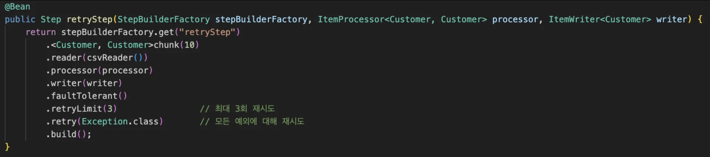

<a id="331eda9b0fe180c7a1ffef12338fb41e"></a>

```java
@Bean
public Step retryStep(StepBuilderFactory stepBuilderFactory, ItemProcessor<Customer, Customer> processor, ItemWriter<Customer> writer) {
    return stepBuilderFactory.get("retryStep")
            .<Customer, Customer>chunk(10)
            .reader(csvReader())
            .processor(processor)
            .writer(writer)
            .faultTolerant()
            .retryLimit(3)            // 최대 3회 재시도
            .retry(Exception.class)   // 모든 예외에 대해 재시도
            .build();
}
```

- <strong><code>&#46;chunk(10)</code></strong>&#58; 
    - 10개의 데이터를 하나의 트랜잭션 단위로 묶어서 처리

- <strong><code>&#46;faultTolerant()</code></strong>&#58; 
    - 에러가 발생했을 때 바로 종료하지 않고 내결함성(재시도, 건너뛰기 등) 기능 활성화

- <strong><code>&#46;retryLimit(3)</code></strong>&#58; 
    - 예외 발생 시 최대 3번까지 다시 시도하도록 설정

- <strong><code>&#46;retry(Exception&#46;class)</code></strong>&#58; 
    - 어떤 예외가 발생하더라도 재시도 로직 가동

</details>

<details>
<summary><strong>스킵 처리</strong></summary>

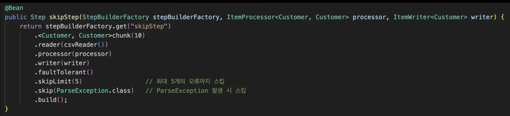

<a id="331eda9b0fe180948ebafbb223ba6950"></a>

```java
@Bean
public Step skipStep(StepBuilderFactory stepBuilderFactory, ItemProcessor<Customer, Customer> processor, ItemWriter<Customer> writer) {
    return stepBuilderFactory.get("skipStep")
            .<Customer, Customer>chunk(10)
            .reader(csvReader())
            .processor(processor)
            .writer(writer)
            .faultTolerant()
            .skipLimit(5)                // 최대 5개의 오류까지 스킵
            .skip(ParseException.class)  // ParseException 발생 시 스킵
            .build();
}
```

- <strong><code>&#46;skipLimit(5)</code></strong>&#58; 
    - 배치 처리 중 설정된 예외가 발생하더라도 최대 5번까지는 해당 데이터를 무시하고 다음 데이터 처리

- <strong><code>&#46;skip(ParseException&#46;class)</code></strong>&#58; 
    - 데이터 파싱 중 발생하는 <code>ParseException</code>에 대해서만 스킵 허용 (예&#58; 날짜 형식이 잘못된 경우 등)

</details>

<a id="331eda9b0fe18018b2edd5fcbbdd3955"></a>

### 병렬 처리

<details>
<summary><strong>병렬 Step 실행</strong></summary>

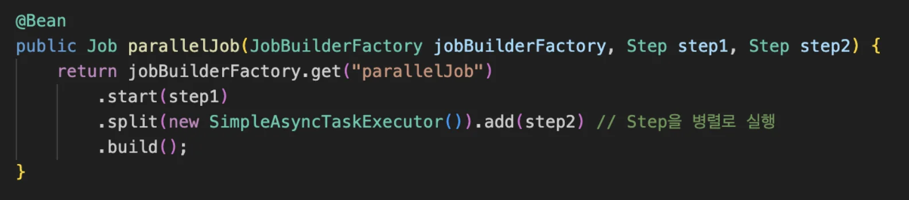

<a id="331eda9b0fe180bda240d7475d45b916"></a>

```java
@Bean
public Job parallelJob(JobBuilderFactory jobBuilderFactory, Step step1, Step step2) {
    return jobBuilderFactory.get("parallelJob")
            .start(step1)
            .split(new SimpleAsyncTaskExecutor()).add(step2) // Step을 병렬로 실행
            .build();
}명
```

<details>
<summary><strong>병렬 분기</strong>&#58; <code>step1</code> 과 <code>step2</code>가 각각의 스레드에서 동시에 시작됨</summary>

- <code>&#46;split(TaskExecutor)</code>
    - 병렬 처리 활성화

    - 해당 메서드가 호출되면 이후에 오는 <code>add(step)</code> 메서드(또는 <code>Flow</code>)는 지정된 <code>TaskExecutor</code>에 의해 해당 작업(step)을  <strong>별도의 스레드</strong>에서 동시에 실행한다&#46;

- <code>new SimpleAsyncTaskExecutor()</code>
    - 가장 기본적인 비동기 실행기

    <details>
    <summary>호출될 때마다 새로운 스레드를 생성하여 작업을 수행한다&#46;</summary>

    - 실무에서는 스레드 관리를 위해 <code>ThreadPoolTaskExecutor</code>를 주로 사용하지만, 간단한 병렬 처리 테스트나 적은 부하일 때는 해당 방식을 사용하기도 한다&#46;

    </details>

- <code>&#46;add(step2)</code>
    - split 영역 안에 step2를 추가함으로써, 앞서 <code>start(step1)</code>에 정의된 흐름과 <code>step2</code>가 병렬로 실행된다&#46;

</details>

- <strong>병합(Join)</strong>&#58; 두 Step이 모두 완료될 때까지 기다린 후, build()를 통해 Job의 최종 상태를 결정함

</details>

<details>
<summary><strong>파티셔닝 (Partitioning)</strong></summary>

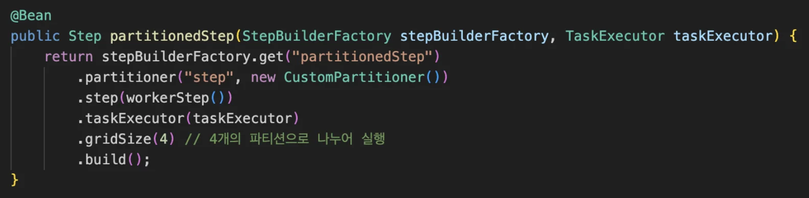

<a id="331eda9b0fe18041aba2dd5cbe478f8a"></a>

```java
@Bean
public Step partitionedStep(StepBuilderFactory stepBuilderFactory, TaskExecutor taskExecutor) {
    return stepBuilderFactory.get("partitionedStep")
            .partitioner("step", new CustomPartitioner())
            .step(workerStep())
            .taskExecutor(taskExecutor)
            .gridSize(4) // 4개의 파티션으로 나누어 실행
            .build();
}
```

- <strong><code>partitioner</code></strong>
    - 대량의 데이터를 어떤 기준으로 나눌지 정의한 <code>CustomPartitioner</code> 등록함

    - 예&#58; ID 범위 1&#126;1000, 1001&#126;2000 …

- <strong><code>step(workerStep())</code></strong>
    - 실제로 비즈니스 로직(Read&#45;Process&#45;Write)을 수행할 개별 작업 단위 지정

- <strong><code>gridSize(4)</code></strong>
    - 동시에 실행할 파티션의 개수 설정

    - 이미지 주석처럼 <strong>4개의 스레드</strong>가 각각의 파티션을 맡아 병렬로 처리

- <strong><code>taskExecutor</code></strong>
    - 병렬 실행을 위한 스레드 풀을 주입받아 사용

</details>

<a id="331eda9b0fe180039c2fead12392d738"></a>

### 배치 작업 모니터링 및 관리

- <strong>Job Repository</strong>
    - Job과 Step의 실행 상태 관리
        - Job의 성공, 실패 여부와 Step의 상태를 기록

    - 실패한 Job을 특정 시점부터 다시 실행할 수 있도록 함

- <strong>Job Execution Listener </strong>
    - Job의 시작과 종료 시 특정 로직을 실행할 수 있는 Listener

    <details>
    <summary>&#91; 코드 예시&#93;</summary>

    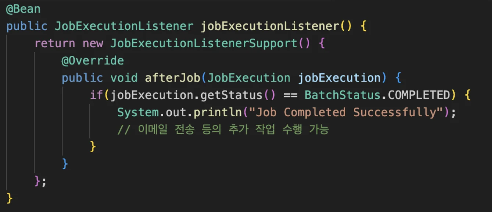

    <a id="331eda9b0fe180aba72bed15c45feea4"></a>

    ```java
    @Bean
    public JobExecutionListener jobExecutionListener() {
    		return new JobExecutionListenerSupport() {
    				@Override
    				public void afterJob(JobExecution jobExecution) {
    						if(jobExecution.getStatus() == BatchStatus.COMPLETED) {
    								System.out.println("Job Completed Successfully");
    								// 이메일 전송 동의 추가 작업 수행 가능								
    						}						
    				}
    		}
    }
    ```

    </details>

<a id="331eda9b0fe1803895b4e5d98ea1fb0e"></a>

### 트랜잭션 관리

- <strong>Chunk 기반 트랜잭션 처리</strong>
    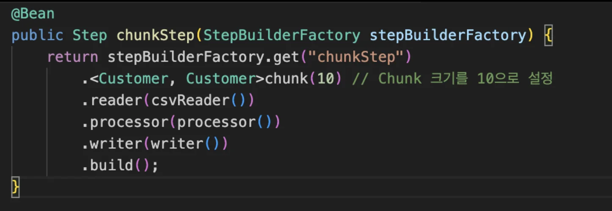

    <a id="331eda9b0fe1802a9e2ccd2a79583f0b"></a>

    ```java
    @Bean
    public Step chunkStep(StepBuilderFactory stepBuilderFactory) {
        return stepBuilderFactory.get("chunkStep")
                .<Customer, Customer>chunk(10) // Chunk 크기를 10으로 설정
                .reader(csvReader())
                .processor(processor())
                .writer(writer())
                .build();
    }
    ```

    - <code>chunk(10)</code>
        - 트랜잭션 범위 내에서 처리할 데이터의 개수

        - 10건을 읽고 가공할 때까지 기다렸다가, 10건이 모두 준비되면 <strong><u>한 번에 DB에 쓰거나 파일로 저장</u></strong>

- <strong>비동기 트랜잭션 지원</strong>
    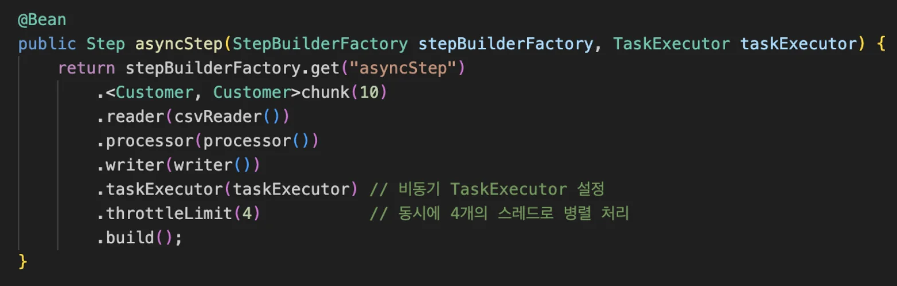

    <a id="331eda9b0fe180a7ace5e9b348058fce"></a>

    ```java
    @Bean
    public Step asyncStep(StepBuilderFactory stepBuilderFactory, TaskExecutor taskExecutor) {
        return stepBuilderFactory.get("asyncStep")
                .<Customer, Customer>chunk(10)
                .reader(csvReader())
                .processor(processor())
                .writer(writer())
                .taskExecutor(taskExecutor) // 비동기 TaskExecutor 설정
                .throttleLimit(4)           // 동시에 4개의 스레드로 병렬 처리
                .build();
    }
    ```

    <a id="331eda9b0fe1802eb539cb68da29d594"></a>

    하나의 Step 안에서 Chunk(데이터 덩어리) 단위로 병렬 처리 수행

    - <strong><code>taskExecutor(taskExecutor)</code></strong>
        - 각 Chunk를 처리할 때 사용할 스레드 풀 지정

        - 스레드들이 <code>Reader</code>에서 데이터를 읽어와 <code>Processor</code>와 <code>Writer</code>를 실행함

    - <strong><code>throttleLimit(4)</code></strong>&#58;
        - 동시에 실행될 수 있는 최대 스레드 수를 4개로 제한
            - 기본값&#58; 4

    - <strong>특징</strong>
        - 데이터를 물리적으로 쪼개는 파티셔닝과 달리, <br><strong>하나의 Reader를 여러 스레드가 공유</strong>하며 데이터를 가져간다&#46;

<a id="331eda9b0fe1807fbcfadbfc0680783c"></a>

## 주요 사용 사례

<a id="331eda9b0fe18074aaa9f7f4226e85d1"></a>

### 데이터 마이그레이션

> ✏️ 
> 
> <a id="331eda9b0fe180dfa1a1dc62ea9ee1e5"></a>
> 
> <strong>데이터 마이그레이션</strong>
> 
> <a id="331eda9b0fe180219beae0314fdb2796"></a>
> 
> 기존 시스템의 데이터를 새 시스템으로 일괄 이동하는 작업

- <strong>구형 시스템에서 새로운 시스템으로의 데이터 전환</strong>
    - <code>데이터 형식 변환</code>
        - 구형 시스템의 데이터 구조가 새로운 시스템과 다르기 때문에,

        -  Spring Batch의 Processor를 통해 데이터 구조를 변환하여 호환성을 맞출 수 있음

    - <code>대량의 데이터 처리</code>
        - 데이터 마이그레이션 작업은 수십만&#45;수백만 건의 데이터를 처리해야 하므로,

        - Spring Batch의 Chunk 기반 트랜잭션 관리로 안정적으로 작업을 수행할 수 있음

- <strong>&#91;예시&#93; 구 시스템(</strong><strong><code>OldCustomer</code></strong><strong>)에서 신규 시스템(</strong><strong><code>NewCustomer</code></strong><strong>)으로 데이터를 옮기는 전형적인 배치 프로세스</strong>
    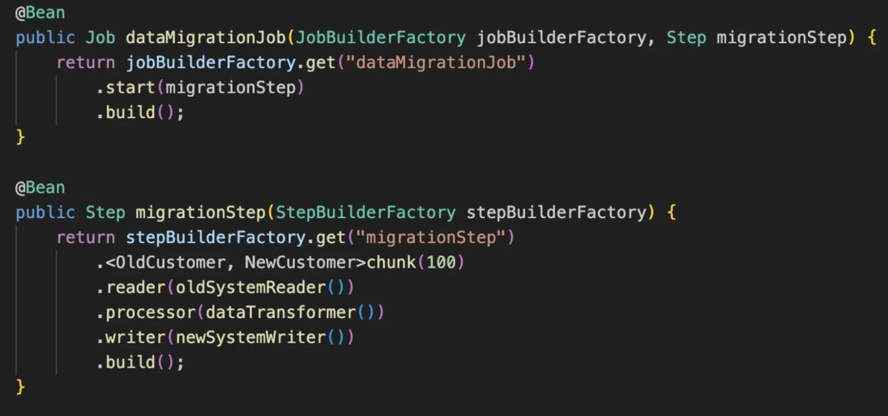

    <a id="331eda9b0fe1801c8136f7bc43355676"></a>

    ```java
    // 전체 작업 단위, migrationStep이라는 실제 작업 단위 포함 및 실행 순서 관리
    @Bean
    public Job dataMigrationJob(JobBuilderFactory jobBuilderFactory, Step migrationStep) {
        return jobBuilderFactory.get("dataMigrationJob")
                .start(migrationStep)
                .build();
    }

    // 실제 비즈니스 로직
    @Bean
    public Step migrationStep(StepBuilderFactory stepBuilderFactory) {
        return stepBuilderFactory.get("migrationStep")
                .<OldCustomer, NewCustomer>chunk(100)  // batch size
                .reader(oldSystemReader())       // 구 시스템의 데이터를 읽어옴
                .processor(dataTransformer())    // 읽어온 데이터를 신규 시스템 규격에 맞게 변환
                .writer(newSystemWriter())       // 변환된 데이터를 신규 시스템에 저장
                .build();
    }
    ```

<a id="331eda9b0fe180059d91ee7d79fcb75f"></a>

### 대규모 데이터 처리

> ✏️ 
> 
> <a id="331eda9b0fe1807cba9ad65312e4a33c"></a>
> 
> 특정 기간 동안 발생한 대량 데이터를 일괄 처리하는 작업

- <strong>웹 로그 데이터 분석</strong>
    > 매일 생성되는 대규모 웹 로그 데이터를 분석하여 트래픽 패턴을 파악하고 사용자 행동을 추적하는데 사용

    - <code>데이터 필터링</code>
        - 특정 이벤트나 페이지 조회 수와 같은 관심 있는 정보만 필터링하여 집계

    - <code>데이터 통계 및 리포트 생성</code>
        - 데이터를 분석하여 일일, 주간, 월간 보고서를 생성하고, 주요 지표를 도출하여 비지니스 의사결정에 활용

- <strong>&#91;예시&#93; 대량의 로그 데이터를 분석(Log Analysis)하여 보고서 생성</strong>
    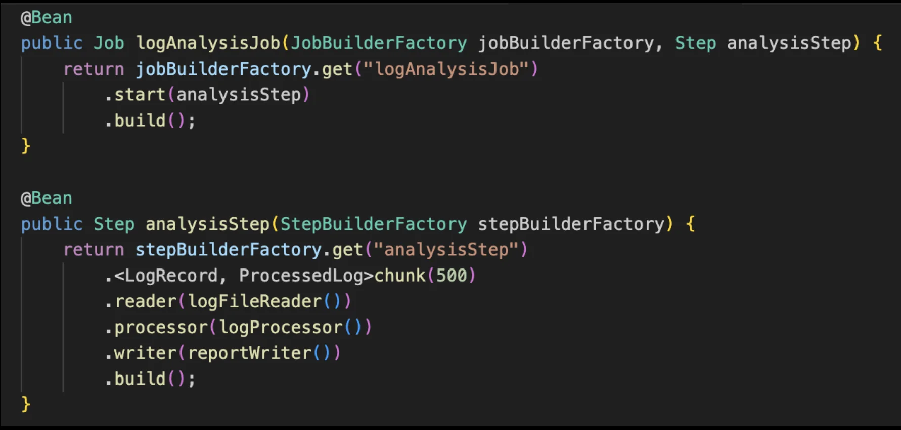

    <a id="331eda9b0fe180fe84fecf7ece1b1846"></a>

    ```java
    @Bean
    public Job logAnalysisJob(JobBuilderFactory jobBuilderFactory, Step analysisStep) {
        return jobBuilderFactory.get("logAnalysisJob")
                .start(analysisStep)
                .build();
    }

    @Bean
    public Step analysisStep(StepBuilderFactory stepBuilderFactory) {
        return stepBuilderFactory.get("analysisStep")
                .<LogRecord, ProcessedLog>chunk(500) // 500건 단위로 트랜잭션 처리
                .reader(logFileReader())
                .processor(logProcessor())
                .writer(reportWriter())
                .build();
    }
    ```

    - <code>chunk(500</code>
        - <strong>500건</strong> 단위로 트랜잭션 처리

        - <strong>로그 데이터</strong>는 보통 텍스트 기반이라 개별 데이터의 크기가 작고 양이 매우 많기 때문에, 이렇게 Chunk 크기를 키워 처리 속도를 극대화하는 것이 일반적이다&#46; 

    - <code>&#46;reader(logFileReader())</code>
        - 서버 로그 파일 등에서 가공되지 않은 한 줄의 로그 객체를 읽어옴

    - <code>&#46;processor(logProcessor())</code>
        - 특정 IP 차단 목록 확인, 에러 키워드 카운팅, 데이터 정제 등을 수행하여 분석 가능한 형태의 객체로 변환

    - <code>&#46;writer(reportWriter())</code>
        - 공된 데이터를 DB에 쌓거나 통계 리포트 파일로 출력

<a id="331eda9b0fe1800791f5eacb8b291976"></a>

### 주기적인 데이터 업데이트

> ✏️ 
> 
> - 매일, 매주, 또는 매월 정기적으로 발생하는 데이터 갱신이나 계산 작업에 사용
> 
> - 데이터 정리나 기초 데이터 갱신, 반복적으로 필요한 통계 생성과 같은 작업에 유용

- <code>주기적인 사용자 데이터 갱신</code>
    - 고객 데이터가 일정 주기로 갱신되어야 하는 경우, 배치 작업을 통해 자동으로 데이터 업데이트

- <code>정기적인 리포트 생성</code>
    - 매일 새벽, 주기적으로 데이터를 집계하고 통게 자료를 생성하여 리포트 생성

- <strong>&#91;예시&#93; 매일 대량의 사용자 정보를 갱신하는 일간 사용자 업데이트(Daily User Update) 배치</strong>
    <a id="331eda9b0fe1802898a8fa28bd1f9e37"></a>

    ```java
    @Bean
    public Job dailyUserUpdateJob(JobBuilderFactory jobBuilderFactory, Step updateStep) {
        return jobBuilderFactory.get("dailyUserUpdateJob")
                .start(updateStep)
                .build();
    }

    @Bean
    public Step updateStep(StepBuilderFactory stepBuilderFactory) {
        return stepBuilderFactory.get("updateStep")
                .<User, User>chunk(1000)
                .reader(userReader())
                .processor(userUpdateProcessor())
                .writer(userWriter())
                .build();
    }
    ```

    > <strong>시스템의 전체 사용자 데이터를 최신 상태로 동기화</strong>할 때 주로 사용

    <details>
    <summary><strong>1&#46; 대규모 데이터 최적화 (</strong><strong><code>chunk(1000)</code></strong><strong>)</strong></summary>

    - <strong>1000건</strong>이라는 상당히 큰 Chunk 단위 사용

    - 이는 DB 트랜잭션 횟수를 최소화하여 처리 속도를 높이기 위함이다&#46;

    - 다만, 이 경우 실패 시 1000건이 통째로 롤백되므로, 데이터의 중요도에 따라 적절한 크기인지 검토가 필요함

    </details>

    <details>
    <summary><strong>2&#46; 데이터 처리 흐름</strong></summary>

    - <strong>Reader (</strong><strong><code>userReader</code></strong><strong>)</strong>
        - 업데이트가 필요한 사용자 목록(예&#58; 활성 상태 변경 대상자 등)을 DB나 파일에서 읽어온다

    - <strong>Processor (</strong><strong><code>userUpdateProcessor</code></strong><strong>)</strong>
        - 각 사용자의 포인트 계산, 등급 조정, 또는 마지막 접속일 기준 상태 변경 등의 비즈니스 로직을 수행

    - <strong>Writer (</strong><strong><code>userWriter</code></strong><strong>)</strong>
        - 변경된 사용자 정보를 DB에 <strong>Bulk Update</strong> 방식으로 저장

    </details>

<a id="331eda9b0fe180388ba6c0ff6da187f2"></a>

### 예제코드와 사례&#58; CSV 파일을 읽어 DB에 저장하는 작업

1. <strong>CSV 파일 읽기 구현 (</strong><strong><code>csvToDatabaseJob</code></strong><strong>)</strong>
    <a id="331eda9b0fe18090b611e3aa4f9749a4"></a>

    ```java
    @Bean
    public Job csvToDatabaseJob(JobBuilderFactory jobBuilderFactory, Step step) {
        return jobBuilderFactory.get("csvToDatabaseJob")
                .start(step)
                .build();
    }

    @Bean
    public Step step(StepBuilderFactory stepBuilderFactory, ItemReader<Customer> reader, ItemProcessor<Customer, Customer> processor, ItemWriter<Customer> writer) {
        return stepBuilderFactory.get("step")
                .<Customer, Customer>chunk(10) // Chunk 단위로 데이터 처리
                .reader(reader)               // 데이터 읽기 설정
                .processor(processor)         // 데이터 처리 설정
                .writer(writer)               // 데이터 저장 설정
                .build();
    }

    @Bean
    public FlatFileItemReader<Customer> reader() {
        return new FlatFileItemReaderBuilder<Customer>()
                .name("customerItemReader")
                .resource(new ClassPathResource("customers.csv"))
                .delimited()
                .names("firstName", "lastName", "birthDate")
                .fieldSetMapper(new BeanWrapperFieldSetMapper<>() {{
                    setTargetType(Customer.class);
                }})
                .build();
    }
    ```

    - <strong><code>FlatFileItemReaderBuilder</code></strong>
        - 텍스트 파일(CSV)을 읽어 자바 객체로 변환하는 가장 표준적인 도구

    - <strong><code>ClassPathResource</code></strong>
        - 프로젝트 내부 <code>resources</code> 폴더에 있는 <code>customers&#46;csv</code> 파일을 읽어옴

1. <strong>병렬 및 예외처리 추가 (</strong><strong><code>parallelStep</code></strong><strong>)</strong>
    <a id="331eda9b0fe18057bf17ef9317a43a18"></a>

    ```java
    @Bean
    public Step parallelStep(StepBuilderFactory stepBuilderFactory, TaskExecutor taskExecutor) {
        return stepBuilderFactory.get("parallelStep")
                .<Customer, Customer>chunk(10)
                .reader(reader())
                .processor(processor())
                .writer(writer())
                .taskExecutor(taskExecutor) // 병렬 처리 설정
                .throttleLimit(4)           // 동시에 4개의 스레드로 병렬 처리
                .faultTolerant()            // 오류 허용 설정
                .retryLimit(3)              // 3회까지 재시도
                .retry(Exception.class)     // 모든 예외에 대해 재시도
                .build();
    }
    ```

    - <strong><code>&#46;faultTolerant()</code></strong>
        - 해당 메서드를 호출함으로써 배치가 예외 상황에 유연하게 대처할 수 있는 모드로 전환된다&#46;

    - <strong><code>&#46;retry(Exception&#46;class)</code></strong><strong> &#38; </strong><strong><code>&#46;retryLimit(3)</code></strong>
        - 일시적인 네트워크 오류나 DB 데드락 같은 상황이 발생했을 때, <br>바로 실패 처리하지 않고 <strong>최대 3번까지 다시 시도</strong>

<a id="331eda9b0fe1807dadbae2a500d1c211"></a>

# Spring Batch의 스케줄링과 성능 최적화

---

<a id="331eda9b0fe180a3a897d40de9c16121"></a>

## Spring Batch 스케줄링

<a id="331eda9b0fe18071be5ac6398ab68181"></a>

### Spring의 기본 스케줄링 기능

- <code>&#64;Scheduled</code> 어노테이션으로 스케줄링 설정
    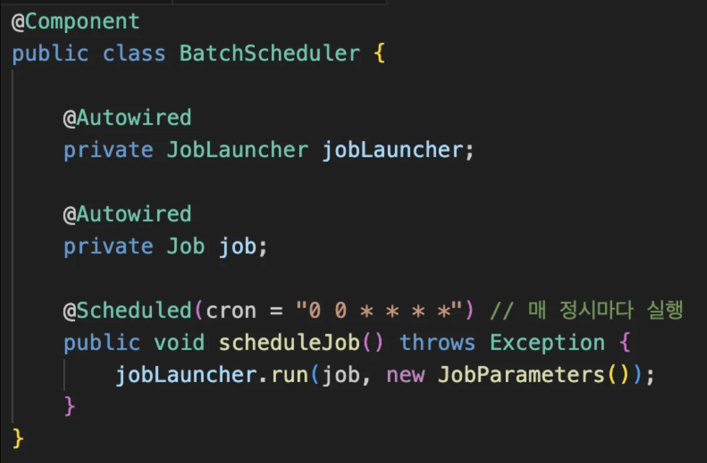

<a id="331eda9b0fe180749ec5cac137f2aca9"></a>

### Quartz와의 통합

- Quartz 스케줄러를 사용해 더 복잡한 스케줄링 시나리오를 설정

- 특정 조건에만 작업을 실행하거나, 특정 시간에 한 번만 실행하는 작업을 구성

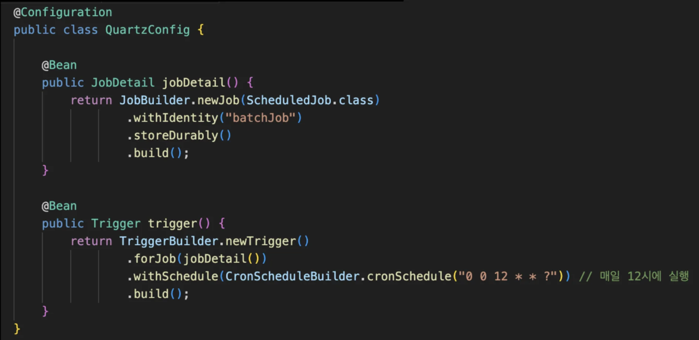

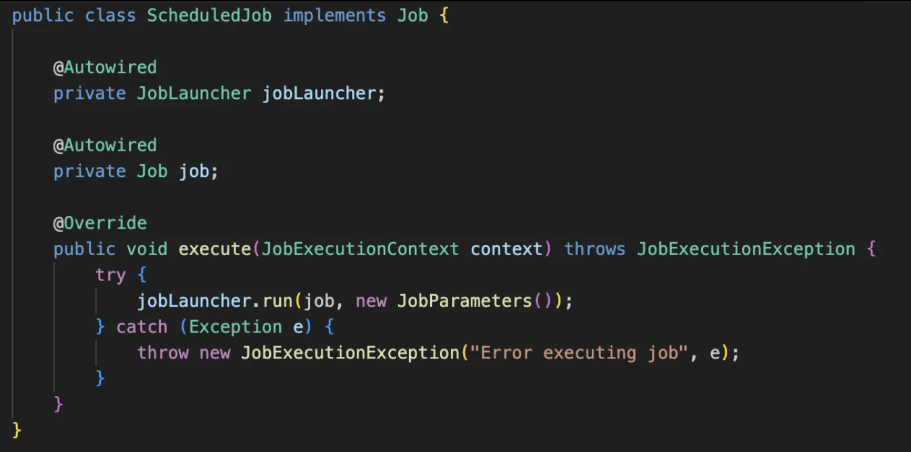

<a id="331eda9b0fe180b29c8ed6382c46fcaf"></a>

### Jenkins 와 Spring Batch 연동

- Jenkins Job을 통한 Spring Batch 실행
    - <strong>Freestyle 프로젝트 생성</strong>
        - Jenkisn에서 Freestyle 프로젝트를 생성하여 Spring Batch 작업 실행

    - <strong>소스 코드 관리 설정</strong>
        - Git이나 SVN에서 코드를 가져오도록 설정

    - <strong>Build 단계 설정</strong>
        - Maven 또는 Gradle로 빌드하여 JAR 파일 생성

    - <strong>Execute Shell 설정</strong>
        - java &#45;jar 명령어를 사용하여 JAR 파일 생성

- 스케줄링 설정
    - Jenkins의 빌드 주기(Schedule)를 통해 배치 작업을 특정 시간에 자동으로 실행하도록 설정

    - <code>H 2 &#42; &#42; &#42;</code>

<a id="331eda9b0fe18076a796e9adacb8ed8b"></a>

## 배치 작업 성능 최적화 기법

<a id="331eda9b0fe1803ca68ef6dbe4b6e8cf"></a>

### Chunk 크기 조정

- Chunk 크기는 데이터를 일정한 단위로 나눠 트랜잭션 범위를 결정하는 것으로,<br>각 Chunk가 완료될 때마다 트랜잭션이 커밋됨

- 적절한 Chunk 크기 조정을 통해 성능을 최적화할 수 있음

---

- Chunk 크기 설정의 원리
    - Chunk 크기가 작을 수록&#58; 
        - 커밋이 자주 발생하므로 메모리 사용은 줄어들지만, 커밋 오버헤드가 커져 성능이 저하됨

    - Chunk 크기가 클수록&#58;
        - 커밋이 덜 발생하므로 빠르게 처리할 수 있지만, 메모리 사용량이 증가함

<a id="331eda9b0fe1800988e5ea927ec86ffd"></a>

### 병렬 처리 및 멀티스레딩

- 병렬 처리 및 멀티스레딩은 데이터를 여러 스레드에서 동시에 처리하여 성능을 크게 향상시킬 수 있는 기법

- Spring Batch는 Partitioner와 멀티스레드 Step을 통해 병렬 처리를 지원

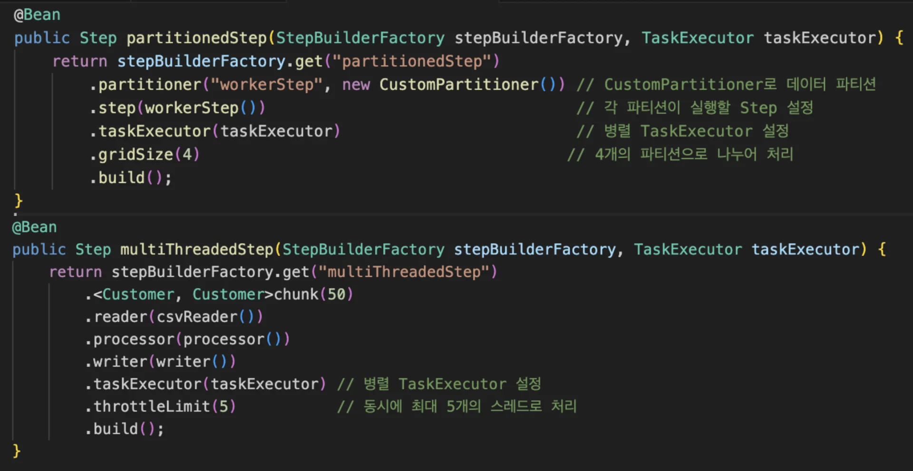

<a id="331eda9b0fe180e3a010c8ed1e4f4f75"></a>

### 리소스 관리

> I/O 성능을 최적화하고, 데이터베이스 연결 자원을 효율적으로 관리하여 배치 작업의 성능을 최적화함

- <strong>데이터베이스 커넥션 풀 관리 (HikariCP 설정 예제)</strong>
    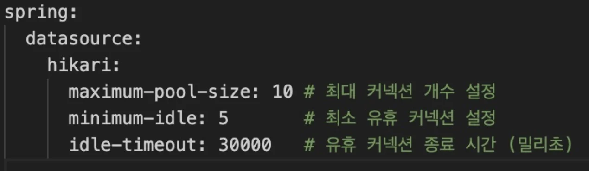

- <strong>I/O 성능 최적화를 위한 버퍼 설정</strong>
    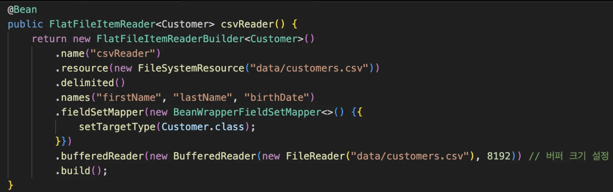
