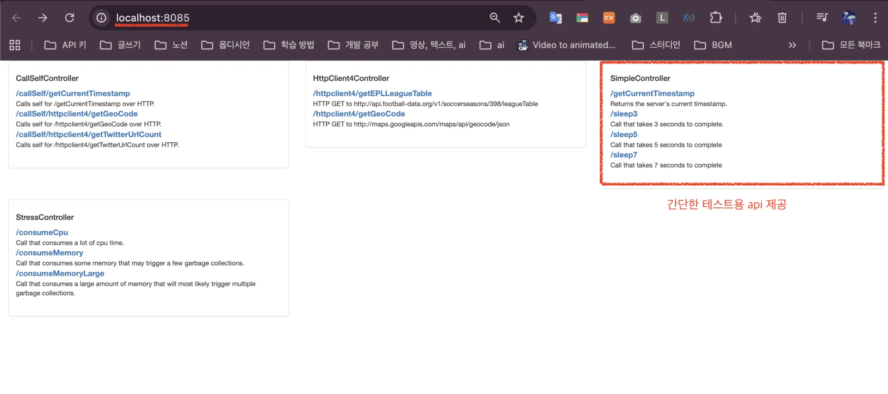

> 
> 
> <a id="332eda9b0fe181a99f0dd9d0fcb5f0ee"></a>
> 
> <strong>목차</strong>
> 
> - [성능 테스트를 위한 환경 구성](#332eda9b0fe181fd851ec7390fc83071)
> - [부하 테스트 실행 및 모니터링](#332eda9b0fe18098a950e788d149495e)

[fastcampus&#45;promotion&#45;project/P01/CH13&#45;monitor/docs at main · dobby&#45;teacher/fastcampus&#45;promotion&#45;project]()

> 

> ✏️ 

<a id="332eda9b0fe181fd851ec7390fc83071"></a>

### 성능 테스트를 위한 환경 구성

[fastcampus&#45;promotion&#45;project/P01/CH13&#45;monitor/docs/CH13&#95;01&#46; 성능 테스트를 위한 환경설정&#46;md at main · dobby&#45;teacher/fastcampus&#45;promotion&#45;project]()

> ✏️ 
> 
> <a id="333eda9b0fe180dc8a57f7d2091716a2"></a>
> 
> 성능 테스트를 위한 pinpoint 인프라 구성
> 
> <a id="333eda9b0fe180478b6dcf999afef710"></a>
> 
> <code>Pinppint</code>는 분산된 어플리케이션의 성능을 모니터링하고 분석하기 위한 <code>APM(Application Performance Management)</code> 도구이다&#46; 
> 
> <a id="333eda9b0fe180859109ecfe0d9d0947"></a>
> 
> 이러한 APM을 통해 <strong><u>서비스의 병목 지점과 장애를 효과적으로 추적 </u></strong>가능하다&#46;

[pinpoint-docker](https://github.com/pinpoint-apm/pinpoint-docker)

<a id="332eda9b0fe180c0b385d864bc4036ad"></a>

```bash
# pinpoint repo clone
git clone https://github.com/pinpoint-apm/pinpoint-docker.git

# 전체 세팅 (노트북 진행 시 메모리 부족으로 실행 불가)
cd pinpoint-docker
docker compose up -d

# api 테스트용으로 만
cd pinpoint-docker/pinpoint-quickstart
docker-compose pull
docker-compose -f docker-compose.yml up -d
```

<details>
<summary>간단한 테스트용 api 제공</summary>



</details>

<details>
<summary>구성 프로세스</summary>

- pinpoint&#45;web

- pinpoint&#45;quickstart

- pinpoint&#45;<strong>collector</strong>

- pinpoint&#45;agent

- pinpoint&#45;batch

- pinpoint&#45;mysql

- pinpoint&#45;hbase

- pinpoint&#45;docker&#45;redis

- pinpoint&#45;docker&#45;zoo (3)

- pinpoint&#45;flink&#45;taskmanager

- pinpoint&#45;flink&#45;jobmanager

</details>

<a id="332eda9b0fe18098a950e788d149495e"></a>

### 부하 테스트 실행 및 모니터링

<a id="332eda9b0fe1802c9f65d59387ee4412"></a>

<strong>JMeter 설치</strong>

<a id="332eda9b0fe180b5a584ea23b1b8e3e0"></a>

```bash
brew install jmeter
```

<a id="332eda9b0fe1800dae73d01bbb9d05ae"></a>

<strong>테스트 설정</strong>

<a id="332eda9b0fe18034a0aadd412cebc7c6"></a>

```bash
# GUI 모드로 JMeter 실행
jmeter

# CLI 모드로 테스트 실행
jmeter -n -t test-plan.jmx -l test-results.jtl
```

[fastcampus&#45;promotion&#45;project/P01/CH13&#45;monitor/docs/CH13&#95;02&#46; 부하 테스트 실행 및 모니터링&#46;md at main · dobby&#45;teacher/fastcampus&#45;promotion&#45;project]()

[fastcampus&#45;promotion&#45;project/P01/CH13&#45;monitor/docs/CH13&#95;03&#46; 성능 분석 및 최적화&#46;md at main · dobby&#45;teacher/fastcampus&#45;promotion&#45;project]()
