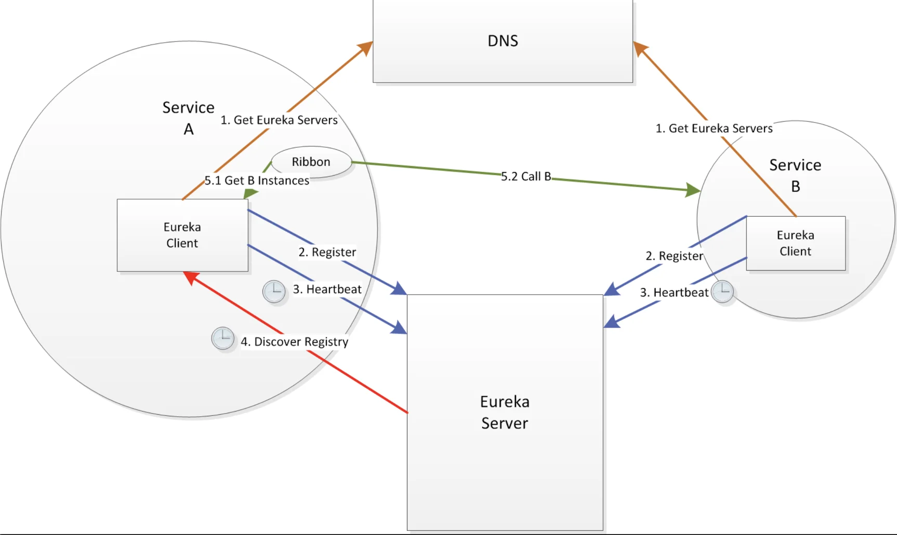
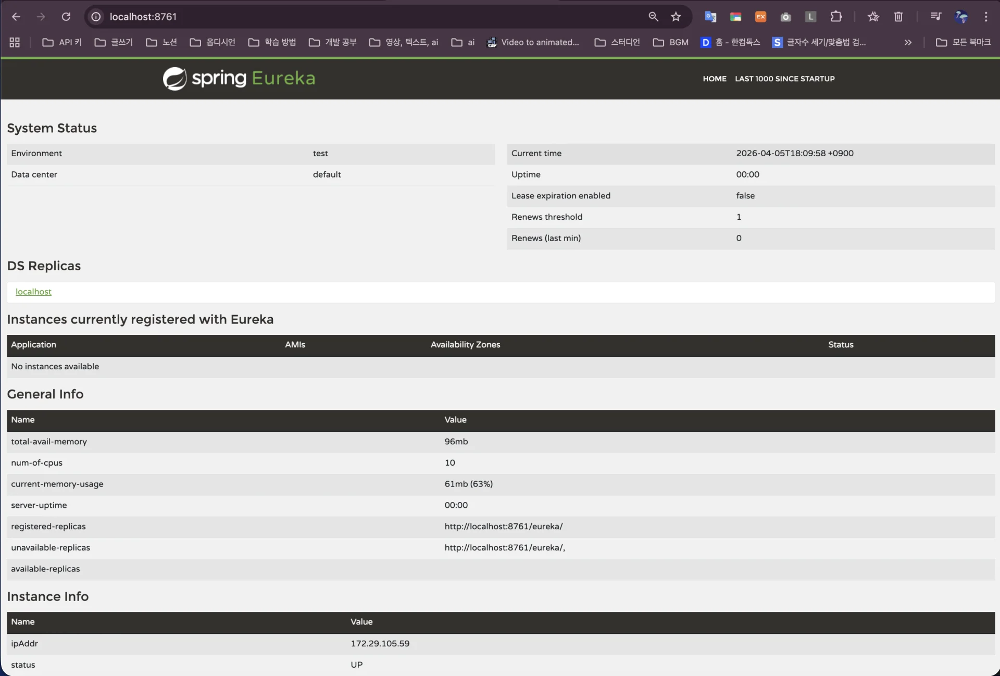

[fastcampus&#45;promotion&#45;project/PROJECT&#45;PROMOTION/docs/P02/CH02&#95;01&#46; Eureka 서비스 디스커버리 구축&#46;md at main · dobby&#45;teacher/fastcampus&#45;promotion&#45;project]()

<a id="339eda9b0fe181ae9922eeba9cafa2e0"></a>

## <strong>Eureka 서비스 디스커버리 구축</strong>

---

> 📖 
> 
> <a id="339eda9b0fe1819b857dddc769c6e8ba"></a>
> 
> Netflix <code>Eureka</code>는 <strong><u>마이크로서비스 아키텍처(MSA</u></strong>)에서 <strong>서비스 디스커버리(Service Discovery) </strong>를 담당하는 <strong>Netflix의 오픈 소스 솔루션</strong>이다&#46; 
> 
> - <strong><u>각 서비스가 자신의 위치(IP, 포트 등)를 중앙에 등록</u></strong>하고, <strong><u>다른 서비스가 그 정보를 찾아 호출</u></strong>할 수 있게 해줍니다

> 🤔 
> 
> <a id="339eda9b0fe1807796ddefd3843cfda2"></a>
> 
> <strong>왜 필요한가?</strong>
> 
> <a id="339eda9b0fe180628c15d8431acae129"></a>
> 
> <strong>MSA</strong>에서는 <strong><u>서비스 인스턴스가 자주 늘고 줄</u></strong>며, <strong><u>IP나 포트도 동적</u></strong><strong>으로 바뀐다&#46; </strong>
> 
> <a id="339eda9b0fe1807aa213fa9dd5a07fea"></a>
> 
> 이때 <code>Eureka</code>를 사용하면 클라이언트가 <strong>하드코딩된 주소 대신 서비스이름으로 상대 서비스를 찾</strong>을 수 있어서 <strong><u>구성 변경과 장애 대응이 훨씬 쉬워진다&#46;</u></strong>

<details>
<summary>구성요소</summary>

1. <code>Eureka Server</code>
    - <strong><u>서비스들의 등록 정보를 보관</u></strong>하는 중앙 레지스트리이다&#46; 

1. <code>Eureka Client</code>
    - 각 마이크로서비스 인스턴스에 붙어서 <strong><u>자기 자신을 등록하고, 다른 서비스 정보를 조회</u></strong>한다&#46; 

</details>

<details>
<summary>동작 방식</summary>



1. 서비스가 시작되면 Eureka Server에 자신을 등록한다&#46;

1. 서비스는 주기적으로 heartbeat을 보내 ‘살아있음’을 알린다&#46; 

1. 다른 서비스는 Eureka에서 등록 목록을 조회하여 목적지 인스턴스를 찾는다&#46; 

1. 일정 시간 heartbeat가 없으면 Eureka는 해당 인스턴스를 레지스트리에서 제거한다&#46; 

</details>

<details>
<summary>실습</summary>

<details>
<summary><strong>Eureka Server 셋업</strong></summary>

> ✏️ 
> 
> <a id="339eda9b0fe1803aa87ee5c919445c4c"></a>
> 
> Eureka Server는 <strong><u>서비스 레지스트리 역할</u></strong>을 하며, 보통 <code>spring&#45;cloud&#45;starter&#45;netflix&#45;eureka&#45;server</code>  의존성을 추가하고 <code>&#64;EnableEurekaServer</code> 를 붙여서 활성화한다&#46;

- <code>build&#46;gradle</code>
    <a id="339eda9b0fe180388ed4c3cb5606d0c2"></a>

    ```groovy
    dependencies {
    	implementation 'org.springframework.cloud:spring-cloud-starter-netflix-eureka-server'
    	implementation 'org.springframework.boot:spring-boot-starter-actuator'
    	compileOnly 'org.projectlombok:lombok'
    	annotationProcessor 'org.projectlombok:lombok'	
    	testImplementation 'org.springframework.boot:spring-boot-starter-test'
    	testRuntimeOnly 'org.junit.platform:junit-platform-launcher'
    }
    ```

- <code>application&#46;yml</code>
    <a id="339eda9b0fe180de9b59ffa731d4af65"></a>

    ```yaml
    server:
      port: 8761

    spring:
      application:
        name: discovery-service

    eureka:
      client:
    	  # 서버이기 때문에 클라이언트로 등록 X
        register-with-eureka: false 
        fetch-registry: false
      server:
    	  wait-time-in-ms-when-sync-empty: 0
    ```

    - <code>wait&#45;time&#45;in&#45;ms&#45;when&#45;sync&#45;empty</code>
        - Eureka Server가 시작될 때, 레지스트리가 비어 있으면 얼마나 기다릴지 정하는 옵션값

        - <u> Eureka Server를 여러 대 운영하는 환경</u>에서  <u>한 서버가 먼저 올라왔을 때 다른 피어 노드의 registry를 아직 못 받아온 상태</u>라면, 이 옵션으로<strong> 잠깐 기다리며 </strong><strong>동기화를 시도</strong><strong>할 수 있</strong>다&#46; 

        - 테스트용 서버이기 때문에 <code>0</code>으로 설정

- <code>DiscoveryServiceApplication&#46;java</code>
    <a id="339eda9b0fe1803ead28f355aac1b765"></a>

    ```java
    package com.example.discoveryservice;

    import org.springframework.boot.SpringApplication;
    import org.springframework.boot.autoconfigure.SpringBootApplication;
    import org.springframework.cloud.netflix.eureka.server.EnableEurekaServer;

    @SpringBootApplication
    @EnableEurekaServer
    public class DiscoveryServiceApplication {

    	public static void main(String[] args) {
    		SpringApplication.run(DiscoveryServiceApplication.class, args);
    	}

    }
    ```

- eureka 서버 실행
    <a id="339eda9b0fe180548c19fb459d126035"></a>

    ```yaml
    ./gradlew :discovery-service:bootRun
    ```

    

    - <code>localhost&#58;8761</code> 접속

    <a id="339eda9b0fe180418082d95777f02cfd"></a>

    <br>

</details>

<details>
<summary><strong>Eureka Client 셋업</strong></summary>

- <code>application&#46;yml</code>
    <a id="339eda9b0fe18059bd72d5c310aa0875"></a>

    ```yaml
    server:
      port: 8081

    spring:
      application:
        name: user-service

    eureka:
      client:
        service-url:
          defaultZone: http://localhost:8761/eureka/
        register-with-eureka: true
        fetch-registry: true
      instance:
        prefer-ip-address: true
    ```

- <strong>Eureka Client</strong>
    <a id="339eda9b0fe180c2bb4af25d4f2dc02e"></a>

    ```java
    @SpringBootApplication
    @EnableEurekaClient
    public class UserServiceApplication {
    }
    ```

</details>

</details>
