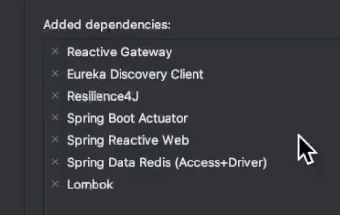
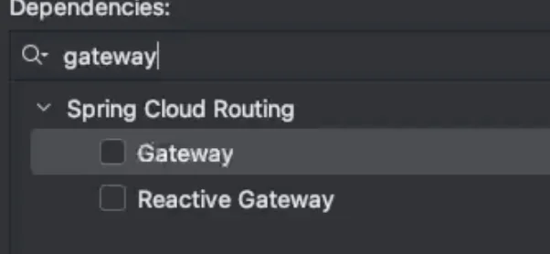
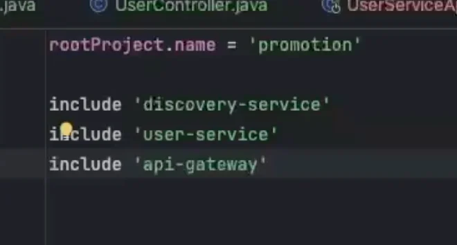
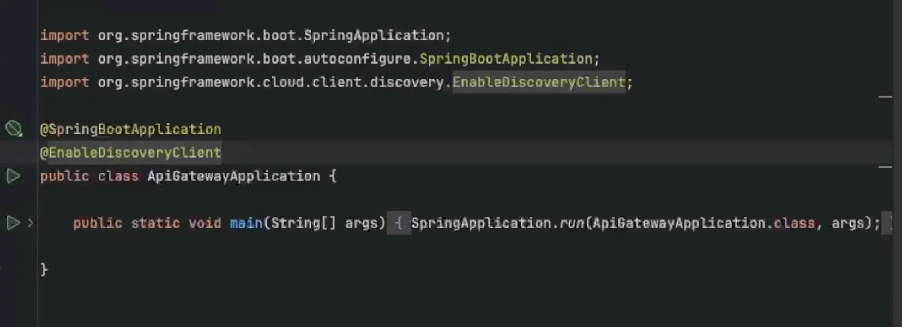
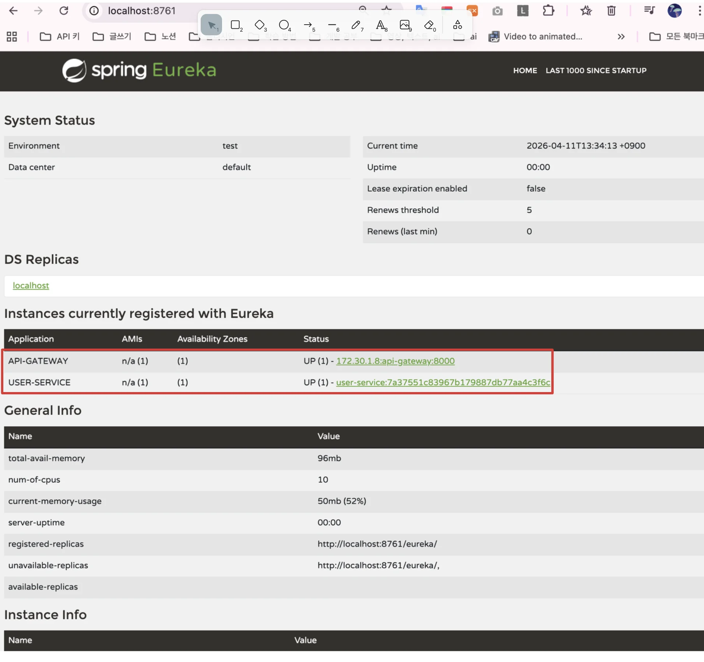

> 
> 
> <a id="339eda9b0fe181c5aaf3dc0e12daf66e"></a>
> 
> <strong>목차</strong>
> 
> - [API Gateway 라우팅 및 인증 관리 구현](#339eda9b0fe181d880eecb4e54e67c5c)
> - [스펙 문서](#33eeda9b0fe180458291c5ec37e72715)
> - [주요 기능](#33eeda9b0fe180f5a0d0f6546859106c)
> - [API Gateway 구성](#33eeda9b0fe18059a3b8c389a0a9a724)
> - [api gateway 모듈 구현](#339eda9b0fe1805caafae4b0fe851d00)
> - [settings.gradle의 역할 ](#33feda9b0fe180b1bc3edd28e36e7fe4)
> - [하위 모듈에서 삭제하는 이유](#33feda9b0fe1807fbe43fcbb0d68d3bf)
> - [테스트](#33eeda9b0fe180acae11e9247785e928)

<a id="339eda9b0fe181d880eecb4e54e67c5c"></a>

## API Gateway 라우팅 및 인증 관리 구현

---

> 📖 
> 
> <a id="339eda9b0fe181ae81f0eb081adfc963"></a>
> 
> 이번 챕터에서는 Spring Cloud Gateway를 사용하여 API Gateway를 구축하고, JWT 기반 인증 시스템을 구현한다&#46;  

> ✏️ 
> 
> <a id="33eeda9b0fe180eb838bfa259ddd8058"></a>
> 
> <code>API Gateway</code>는 <strong>모든 클라이언트 요청의 </strong><strong><u>단일 진입점 역할</u></strong>을 하며, <strong><u>인증/인가, 라우팅, 필터링</u></strong><strong> 등의 </strong><strong><u>공통 기능</u></strong><strong>을 처리</strong>한다&#46; 

<a id="33eeda9b0fe180458291c5ec37e72715"></a>

### 스펙 문서

[fastcampus&#45;promotion&#45;project/PROJECT&#45;PROMOTION/docs/P02/CH03&#95;02&#46; API Gateway 라우팅 및 인증 관리 구현&#46;md at main · dobby&#45;teacher/fastcampus&#45;promotion&#45;project]()

> ⚠️ 
> 
> <a id="33feda9b0fe18057ac95d2a098619310"></a>
> 
> <strong>사전 준비사항</strong>
> 
> - Discovery Service 구축
>     <a id="33feda9b0fe180e3b894fa948b429c8a"></a>
> 
>     → <a href="#/post/339eda9b-0fe1-8052-a23a-d9595977c881">페이지</a> 참조
> 
> - JDK 17 설치
> 
> - IDE (IntelliJ IDEA 권장)

<a id="33eeda9b0fe180f5a0d0f6546859106c"></a>

### 주요 기능

- <strong>라우팅</strong>
    - 서비스 디스커버리 연동

    - 경로 기반 라우팅

    - 로드밸런싱 자동 적용

- <strong>인증</strong>
    - JWT 토큰 검증

    - 헤더 기반 인증

- <strong>필터</strong>
    - 전역 필터

    - 라우트별 필터

    - 커스텀 필터

<a id="33eeda9b0fe18059a3b8c389a0a9a724"></a>

### API Gateway 구성

1. <strong>의존성 추가 (build&#46;gradle)</strong>
    <a id="33eeda9b0fe180e5ae54f78acb4f79d7"></a>

    ```groovy
    dependencies {
        implementation 'org.springframework.cloud:spring-cloud-starter-gateway'
        implementation 'org.springframework.cloud:spring-cloud-starter-netflix-eureka-client'
    }
    ```

1. <strong>Gateway 설정  (application&#46;yml)</strong>
    <a id="33eeda9b0fe180529b5bd2ab0f887dae"></a>

    ```yaml
    spring:
      cloud:
        gateway:
          routes:
            - id: user-service
              uri: lb://USER-SERVICE
              predicates:
                - Path=/api/users/**
              filters:
                - RemoveRequestHeader=Cookie
                - AuthorizationHeaderFilter

            - id: coupon-service
              uri: lb://COUPON-SERVICE
              predicates:
                - Path=/api/coupons/**
              filters:
                - RemoveRequestHeader=Cookie
                - AuthorizationHeaderFilter
    ```

<a id="339eda9b0fe1805caafae4b0fe851d00"></a>

### api gateway 모듈 구현

> ✏️ 
> 
> <a id="33eeda9b0fe180819ecbeb4d6a1555e4"></a>
> 
> 기본적인 API Gateway 라우팅 설정 및 Custom Filter 유저 도메인 연동까지 진행

[bookmark]()

[fastcampus&#45;promotion&#45;project/PROJECT&#45;PROMOTION/promotion/api&#45;gateway at main · dobby&#45;teacher/fastcampus&#45;promotion&#45;project]()

<details>
<summary>의존성</summary>



- Reactive Gateway
    <details>
    <summary>🧐 Spring Boot Gateway 종류&#58; 2가지 </summary>

    

    - Gateway
        - MVC 기반 게이트웨이

    - Reactive Gateway
        - Reactive 방식의 게이트웨이

    </details>

- Eureka Discovery Client

- Resilience4J
    - 서킷 브레이커 패턴에서 사용

- Spring Boot Actuactor

- Spring Reactive Web
    - webflux

- Spring Data Redis (Access &#43; Driver)

- Lombok

</details>

<details>
<summary>상위 모듈에 api&#45;gateway 모듈 의존성 추가</summary>

<details>
<summary>🧐 <strong>settings&#46;gradle의 역할</strong> 및 <strong>하위 모듈에서 삭제 이유</strong></summary>

<a id="33feda9b0fe180b1bc3edd28e36e7fe4"></a>

### <strong>settings&#46;gradle의 역할</strong> 

1. <strong>프로젝트 구조 정의</strong>
    <a id="33feda9b0fe180b698f7c5654620e4f8"></a>

    ```groovy
    rootProject.name = 'my-project'

    include 'user-service'
    include 'order-service'
    include 'common'
    ```

    - 해당  Gradle 빌드는 총 3개의 하위 모듈을 가짐

    - Gradle은 이 정보를 기반으로 <strong>멀티 모듈 그래프를 구성</strong>함

1. <strong>빌드 시작 지점 (Entry Point)</strong>
    <a id="33feda9b0fe180708de5f3c5706ec874"></a>

    Gradle 실행 시 아래의 순서로 읽음

    - <code>settings&#46;gradle</code>→ 각 module의 <code>build&#46;gradle</code>

    <a id="33feda9b0fe180b7acedeaa9805053f1"></a>

    따라서 <code>settings&#46;gradle</code>이 없으면 멀티 모듈 구조 자체를 인식하지 못한다&#46; 

<a id="33feda9b0fe1807fbe43fcbb0d68d3bf"></a>

### <strong>하위 모듈에서 삭제하는 이유</strong>

> <strong>빌드는 </strong><strong><u>하나의 루트에서만 관리</u></strong><strong>되어야 한다&#46;  (멀티 모듈 기준)</strong>

- <strong>❌ 잘못된 구조 (문제 발생)</strong>
    <a id="33feda9b0fe18022aac2cd8da7add59f"></a>

    ```groovy
    root/
     ├─ settings.gradle
     ├─ user-service/
     │   ├─ settings.gradle ❌
     │   └─ build.gradle
     └─ order-service/
         ├─ settings.gradle ❌
         └─ build.gradle
    ```

    <a id="33feda9b0fe180b68687c08532526d25"></a>

    이렇게 하면 각 모듈이 독<strong>립적인 Gradle 프로젝트</strong>가 되어버린다&#46;

    <a id="33feda9b0fe180d3b223ed9d5f6db25b"></a>

    → 의존성 공유 불가

    <a id="33feda9b0fe180688c2cd373afef3e6c"></a>

    → 공통 설정 적용 불가

    <a id="33feda9b0fe180f08ae8f33215b623d1"></a>

    → 빌드 시 통합되지 않음

- <strong>✅ 올바른 구조</strong>
    <a id="33feda9b0fe1803cac99f4707450505c"></a>

    ```groovy
    root/
     ├─ settings.gradle  ✅ (단 하나)
     ├─ build.gradle     (공통 설정)
     ├─ user-service/
     │   └─ build.gradle
     └─ order-service/
         └─ build.gradle
    ```

    - <code>settings&#46;gradle</code>은 <strong>루트에 단 하나만 존재</strong>
        - <strong> 왜 하나만 있어야 하냐? (복습)</strong>
            - settings&#46;gradle = “프로젝트 트리 생성기”

            - 여러 개 있으면 → 트리가 여러 개 생김 (서로 연결 안 됨)

</details>

<details>
<summary>🧐 MSA, 멀티 모듈 <code>settings&#46;gradle</code> 관리</summary>

- MSA 구조에서는 각 서비스마다 독립적으로 구성되어야 한다&#46; <br>따라서 <code>settings&#46;gradle</code>이 <strong><u>따로 존재</u></strong>하는 게 맞다&#46;
    - 각 서비스 내부에서는 <code>settings&#46;gradle</code>은 하나만 존재한다&#46;

<a id="33feda9b0fe18026ac05ffa8f1c33aab"></a>

<strong><br>✅ 올바른 MSA 구조</strong>

<a id="33feda9b0fe18009b41ae2858c0c8bfc"></a>

```groovy
user-service/
 ├─ settings.gradle
 ├─ build.gradle
 └─ (multi-module 가능)

order-service/
 ├─ settings.gradle
 ├─ build.gradle

payment-service/
 ├─ settings.gradle
 ├─ build.gradle
```

<a id="33feda9b0fe1801781edd2557b2cbca3"></a>

→ MSA는 서비스 단위로 <strong><u>settings&#46;gradle이 분리</u></strong>되고, <strong><u>각 서비스 내부에서만 멀티 모듈을 구성</u></strong>한다&#46;

</details>

1. 생성된 api&#45;gateway 모듈의 settings&#46;gradle 제거 및

1. 상위 모듈에 해당 모듈(<code>api&#45;gateway</code>) 추가
    

</details>

<details>
<summary>Eureka Client 설정 추가</summary>



- <code>&#64;EnableDiscoveryClient</code> 추가

</details>

<details>
<summary><code>application&#46;yml</code>&#58; <strong>Spring Cloud Gateway 기반 API Gateway, Redis, JWT 인증 필터 구조 설정</strong></summary>

<a id="33feda9b0fe18076a1fbdc02d43255be"></a>

```yaml
server:
  port: 8000

spring:
  application:
    name: api-gateway

  data:
    redis:
      host: localhost
      port: 6379

  cloud:
    gateway:
      routes:
	      # Public API -  인증 없이 접근 가능 (회원가입, 로그인, 토근 검증, refresh 토큰 재발급)
        - id: public-user-service
          uri: lb://USER-SERVICE
          predicates:
            - Path=/api/v1/users/signup, /api/v1/users/login, /api/v1/users/token/validate, /api/v1/users/refresh-token
				
				# Private API - 인증 필요
        - id: user-service
          uri: lb://USER-SERVICE
          predicates:
            - Path=/api/v1/users/**
          filters:
            - name: JwtAuthenticationFilter

```

<details>
<summary><strong>gateway routes 설정</strong></summary>

<details>
<summary><strong>Gateway Route 설정 구조</strong></summary>

<a id="33feda9b0fe18019adeac65d4e2f05d5"></a>

```yaml
spring:
  cloud:
    gateway:
      routes:
```

- Gateway는 기본적으로 <strong><u>요청을 어디로 보낼지</u></strong>, <strong><u>어떤 전처리 할지</u></strong> 정의한다&#46;

</details>

<details>
<summary><strong>routes 내부 구성 요소</strong></summary>

<a id="33feda9b0fe1808f8b1ac87396a3c5cc"></a>

```yaml
cloud:
    gateway:
		  routes:
				- id: public-user-service
				  uri: lb://USER-SERVICE
				  predicates:
            - Path=/api/v1/users/signup, /api/v1/users/login, /api/v1/users/token/validate, /api/v1/users/refresh-token
```

<details>
<summary>1&#46; <code>id</code>&#58; 라우트 식별자</summary>

<a id="33feda9b0fe1803f82bec6f9c95d17bf"></a>

```yaml
- id: user-service
```

- 로그 추적

- 디버깅

- 관리 목적

</details>

<details>
<summary>2&#46; <code>uri</code>&#58;  서비스(모듈) 식별 주소</summary>

<a id="33feda9b0fe1801bad4eebad916aae14"></a>

```yaml
uri: lb://USER-SERVICE
```

- <strong><code>lb&#58;//</code></strong><strong> 의미</strong>
    - <code>lb</code>&#58; Load Balancer(로드밸런서)

- <strong>서비스 이름 기반 호출</strong>
    - 보통 <strong>Eureka / Service Discovery</strong> 사용

    - ex) <code>USER&#45;SERVICE</code>
        - 실제 Eureka에 등록된 유저 서비스 이름

</details>

<details>
<summary>3&#46; <code>predicates</code>&#58; 라우팅할 경로 조건 설정</summary>

<a id="33feda9b0fe180bd8cc3d1b89991afcc"></a>

```yaml
predicates:
  - Path=/api/v1/users/**
```

<details>
<summary>설정한 경로로 들어온 요청만 해당 라우트 적용</summary>

<a id="33feda9b0fe1808e922fc2176e686038"></a>

```yaml
Path=/api/v1/users/signup
```

- <code>/api/v1/users/&#42;&#42;</code>에 속하기 때문에 설정한 uri(서비스)로 라우팅 처리

</details>

<details>
<summary>OR 조건</summary>

<a id="33feda9b0fe1805db2aeffe45cc7e72d"></a>

```yaml
Path=/a, /b, /c
```

- 위와 같이 <code>,</code>로 or 조건 명시 가능

</details>

</details>

<details>
<summary>4&#46; <code>filters</code>&#58; 전처리 계층 설정</summary>

<a id="33feda9b0fe180049fa8ff4d678e401d"></a>

```yaml
filters:
  - name: JwtAuthenticationFilter
```

- 인증
    - <code>JwtAuthenticationFilter</code>
        - Jwt 파싱 및 인증 처리 필터를 앞 단에 두어 처리 

- 로깅

- 헤더 변경

- Rate limi

</details>

</details>

</details>

<details>
<summary>🧐 <code>Redis</code>를 같이 사용하는 이유는?</summary>

<a id="33feda9b0fe1807fb1d7c1935d66359b"></a>

<strong>JWT 구조의 단점 보완</strong>

- JWT 사용 시, <strong><u>서버에서 stateless하게 사용자를 관리</u></strong>한다&#46;<br>이는 장점이자 단점이 되는데, <strong>서버가 유저의 상태를 기록하지 않</strong>기 때문에<br><strong>강제 로그아웃, 토큰 무효화</strong> 등의 <strong>관리의 어려움</strong>이 있다&#46; 

- 이를 보완하기 위해 redis를 같이 사용한다&#46; 

<a id="33feda9b0fe180bd905af660d7fc3080"></a>

<strong><br> Redis 활용 케이스</strong>

| <strong>용도</strong> | <strong>설명</strong> |
| --- | --- |
| Refresh Token 저장 | 재발급용 |
| 블랙리스트 | 로그아웃된 토큰 저장 |
| 세션 캐시 | 로그인 상태 |
| Rate Limit | 요청 제한 |

<a id="33feda9b0fe1803d9b3ae8dbb63887c6"></a>

<strong><br>Redis 특징</strong>

| <strong>특징</strong> | <strong>의미</strong> |
| --- | --- |
| In&#45;Memory | 매우 빠름 |
| TTL 지원 | 자동 만료 |
| Key&#45;Value | 단순 구조 |
| Optional Persistence | 필요하면 디스크 저장 가능 |

<a id="33feda9b0fe1801baa51da2c78f7add7"></a>

⇒ <strong>속도 &#43; TTL &#43; 상태 관리</strong>

</details>

</details>

<details>
<summary>filter 구현</summary>

<details>
<summary>&#91;코드&#93; JwtAuthenticationFilter</summary>

<a id="33eeda9b0fe1807f9a0bdbd2198c46be"></a>

```java
package com.fastcampus.apigateway.filter;

import org.springframework.cloud.client.loadbalancer.LoadBalanced;
import org.springframework.cloud.client.loadbalancer.reactive.ReactorLoadBalancerExchangeFilterFunction;
import org.springframework.cloud.gateway.filter.GatewayFilter;
import org.springframework.cloud.gateway.filter.GatewayFilterChain;
import org.springframework.cloud.gateway.filter.factory.AbstractGatewayFilterFactory;
import org.springframework.http.HttpStatus;
import org.springframework.stereotype.Component;
import org.springframework.web.reactive.function.client.WebClient;
import org.springframework.web.server.ServerWebExchange;
import reactor.core.publisher.Mono;

import java.util.Map;

@Component
public class JwtAuthenticationFilter extends AbstractGatewayFilterFactory<JwtAuthenticationFilter.Config> {

    @LoadBalanced
    private final WebClient webClient;

    public JwtAuthenticationFilter(ReactorLoadBalancerExchangeFilterFunction lbFunction) {
        super(Config.class);
        this.webClient = WebClient.builder()
                .filter(lbFunction)
                .baseUrl("http://user-service")
                .build();
    }

    @Override
    public GatewayFilter apply(Config config) {
        return (exchange, chain) -> {
            String authHeader = exchange.getRequest().getHeaders().getFirst("Authorization");
            if (authHeader != null && authHeader.startsWith("Bearer ")) {
                String token = authHeader.substring(7);
                return validateToken(token)
                        .flatMap(userId -> proceedWithUserId(userId, exchange, chain))
                        .switchIfEmpty(chain.filter(exchange)) // If token is invalid, continue without setting userId
                        .onErrorResume(e -> handleAuthenticationError(exchange, e)); // Handle errors
            }

            return chain.filter(exchange);
        };
    }

    private Mono<Void> handleAuthenticationError(ServerWebExchange exchange, Throwable e) {
        exchange.getResponse().setStatusCode(HttpStatus.UNAUTHORIZED);
        return exchange.getResponse().setComplete();
    }

    private Mono<Long> validateToken(String token) {
        return webClient.post()
                .uri("/auth/validate")
                .bodyValue("{\"token\":\"" + token + "\"}")
                .header("Content-Type", "application/json")
                .retrieve()
                .bodyToMono(Map.class)
                .map(response -> Long.valueOf(response.get("id").toString()) );
    }

    private Mono<Void> proceedWithUserId(Long userId, ServerWebExchange exchange, GatewayFilterChain chain) {
        exchange.getRequest().mutate().header("X-USER-ID", String.valueOf(userId));
        return chain.filter(exchange);
    }

    public static class Config {
        // 필터 구성을 위한 설정 클래스
    }
}
```

</details>

</details>

<a id="33eeda9b0fe180acae11e9247785e928"></a>

### 테스트

<details>
<summary>서버 실행 및 정상 동작 확인</summary>

- 서버 실행
    <a id="33feda9b0fe1807caa38d39382875d2a"></a>

    ```yaml
    # 1. Eureka Server (먼저 실행)
    ./gradlew :discovery-service:bootRun

    # 2. User Service
    ./gradlew :user-service:bootRun

    # 3. API Gateway
    ./gradlew :api-gateway:bootRun
    ```

    <details>
    <summary>한번에 실행</summary>

    <a id="33feda9b0fe180ca86c2c315529d16e9"></a>

    ```yaml
     ./start-all.sh
    ```

    <details>
    <summary>&#91;코드&#93; start&#45;all&#46;sh</summary>

    <a id="33feda9b0fe180818ce6d68b663238db"></a>

    ```yaml
    #!/bin/bash

    SCRIPT_DIR="$(cd "$(dirname "${BASH_SOURCE[0]}")" && pwd)"
    LOG_DIR="$SCRIPT_DIR/logs"
    mkdir -p "$LOG_DIR"

    # 색상 정의
    RED='\033[0;31m'
    GREEN='\033[0;32m'
    YELLOW='\033[1;33m'
    CYAN='\033[0;36m'
    NC='\033[0m' # No Color

    echo -e "${CYAN}========================================${NC}"
    echo -e "${CYAN}  Starting All Services                 ${NC}"
    echo -e "${CYAN}========================================${NC}"

    # 1. Discovery Service 먼저 실행
    echo -e "\n${YELLOW}[1/3] Starting discovery-service...${NC}"
    ./gradlew :discovery-service:bootRun > "$LOG_DIR/discovery-service.log" 2>&1 &
    DISCOVERY_PID=$!
    echo "  PID: $DISCOVERY_PID | Log: logs/discovery-service.log"

    # Eureka Server가 완전히 뜰 때까지 대기 (포트 8761 응답 확인)
    echo -e "  Waiting for discovery-service to be ready..."
    for i in $(seq 1 30); do
      if curl -s http://localhost:8761/actuator/health | grep -q '"status":"UP"' 2>/dev/null; then
        echo -e "  ${GREEN}✔ discovery-service is UP${NC}"
        break
      fi
      if [ $i -eq 30 ]; then
        echo -e "  ${RED}✘ discovery-service did not start in time. Check logs/discovery-service.log${NC}"
        exit 1
      fi
      sleep 2
    done

    # 2. User Service 실행
    echo -e "\n${YELLOW}[2/3] Starting user-service...${NC}"
    ./gradlew :user-service:bootRun > "$LOG_DIR/user-service.log" 2>&1 &
    USER_PID=$!
    echo "  PID: $USER_PID | Log: logs/user-service.log"

    # 3. API Gateway 실행
    echo -e "\n${YELLOW}[3/3] Starting api-gateway...${NC}"
    ./gradlew :api-gateway:bootRun > "$LOG_DIR/api-gateway.log" 2>&1 &
    GATEWAY_PID=$!
    echo "  PID: $GATEWAY_PID | Log: logs/api-gateway.log"

    echo -e "\n${GREEN}========================================${NC}"
    echo -e "${GREEN}  All services started!                 ${NC}"
    echo -e "${GREEN}========================================${NC}"
    echo -e "  discovery-service : http://localhost:8761"
    echo -e "  user-service      : http://localhost:8080 (or configured port)"
    echo -e "  api-gateway       : http://localhost:8080 (or configured port)"
    echo -e "\n${CYAN}Press Ctrl+C to stop all services.${NC}\n"

    # Ctrl+C 시 모든 프로세스 종료
    trap "echo -e '\n${RED}Stopping all services...${NC}'; kill $DISCOVERY_PID $USER_PID $GATEWAY_PID 2>/dev/null; exit 0" SIGINT SIGTERM

    # 모든 프로세스가 종료될 때까지 대기
    wait $DISCOVERY_PID $USER_PID $GATEWAY_PID

    ```

    </details>

    </details>

- 정상 동작 확인
    

    - Eureka 관리자 페이지에서 api&#45;gateway, user&#45;service 모듈이 정상 실행되어 인식되는것을 확인할 수 있다&#46; 

</details>

<details>
<summary>api 테스트</summary>

> ✏️ 
> 
> <a id="33feda9b0fe18088b017def27cb59a1b"></a>
> 
> <strong> 테스트 환경</strong>
> 
> - API Gateway&#58; <code>http&#58;//localhost&#58;8000</code>
> 
> - User Service (Internal)&#58; <code>http&#58;//localhost&#58;8004</code> (Eureka 등록됨)
> 
> - Auth Strategy&#58; JWT (API Gateway에서 검증 및 헤더 주입)

<details>
<summary><strong>1&#46; 회원가입 (Signup)</strong></summary>

- <strong>Endpoint</strong>&#58; <code>POST /api/v1/users/signup</code>

- <strong>Request</strong>&#58;
    <a id="33feda9b0fe1809eab59c842a456f0e7"></a>

    ```plaintext
    bash
    curl-XPOSThttp://localhost:8000/api/v1/users/signup\
    -H"Content-Type: application/json"\
    -d'{"email":"test@example.com","password":"password123","name":"Test User"}'
    ```

- <strong>Response</strong>&#58; <code>201 Created</code>
    <a id="33feda9b0fe18068aa83c42c6fc3da21"></a>

    ```plaintext
    json
    {
    "id":1,
    "email":"test@example.com",
    "name":"Test User",
    "createdAt":"2026-04-11T14:12:53.4942"
    }
    ```

</details>

<details>
<summary><strong>2&#46; 로그인 (Login)</strong></summary>

- <strong>Endpoint</strong>&#58; <code>POST /api/v1/users/login</code>

- <strong>Request</strong>&#58;
    <a id="33feda9b0fe180b99ce2e3dd4ba12fbe"></a>

    ```plaintext
    bash
    curl-XPOSThttp://localhost:8000/api/v1/users/login\
    -H"Content-Type: application/json"\
    -d'{"email":"test@example.com","password":"password123"}'
    ```

- <strong>Response</strong>&#58; <code>200 OK</code>
    <a id="33feda9b0fe180e280e6d9c98ffcf923"></a>

    ```plaintext
    json
    {
    "accessToken":"eyJhbGciOiJIUzUxMiJ9...",
    "refreshToken":"eyJhbGciOiJIUzUxMiJ9..."
    }
    ```

</details>

<details>
<summary><strong>3&#46; 토큰 검증 (Internal Validation)</strong></summary>

- <strong>Description</strong>&#58; 게이트웨이 필터가 내부적으로 수행하는 토큰 검증 과정을 직접 확인합니다&#46;

- <strong>Endpoint</strong>&#58; <code>POST /api/v1/users/token/validate</code>

- <strong>Response</strong>&#58; <code>200 OK</code>
    <a id="33feda9b0fe180e1bf6ef6d562646b41"></a>

    ```plaintext
    json
    {"id":1 }
    ```

</details>

<details>
<summary><strong>4&#46; 내 정보 조회 (Get Profile &#45; Protected)</strong></summary>

- <strong>Description</strong>&#58; 게이트웨이가 토큰을 검증하고 <code>X&#45;User&#45;Id</code> 헤더를 삽입하여 하위 서비스로 전달하는 핵심 테스트입니다&#46;

- <strong>Endpoint</strong>&#58; <code>GET /api/v1/users/me</code>

- <strong>Headers</strong>&#58; <code>Authorization&#58; Bearer &#60;Access&#95;Token&#62;</code>

- <strong>Response</strong>&#58; <code>200 OK</code> (성공)
    <a id="33feda9b0fe1805fb05dc56e397bb13a"></a>

    ```plaintext
    json
    {
    "id":1,
    "email":"test@example.com",
    "name":"Test User",
    "createdAt":"2026-04-11T14:17:53.245066",
    "updatedAt":"2026-04-11T14:17:53.245066"
    }
    ```

</details>

---

<details>
<summary>&#91;테스트&#93; user&#45;service&#46;http</summary>

<a id="33eeda9b0fe18080afb2c96320084c19"></a>

```java
// promotion/api-gateway/src/main/resources/http/user-service.http
### User Signup
POST http://localhost:8000/api/v1/users/signup
Content-Type: application/json

{
  "email": "test@example.com",
  "password": "password123",
  "name": "Test User"
}

### User Login
POST http://localhost:8000/api/v1/users/login
Content-Type: application/json

{
  "email": "test@example.com",
  "password": "password123"
}

> 

### Validate Token
POST http://localhost:8000/api/v1/users/token/validate
Content-Type: application/json

{
  "token": "{{auth_token}}"
}

### Get User Profile (Protected)
GET http://localhost:8000/api/v1/users/me
Authorization: Bearer {{auth_token}}

### Update User Profile (Protected)
PUT http://localhost:8000/api/v1/users/me
Content-Type: application/json
Authorization: Bearer {{auth_token}}

{
  "name": "Updated Name",
  "phone": "01087654321"
}

### Change Password (Protected)
PUT http://localhost:8000/api/v1/users/me/password
Content-Type: application/json
Authorization: Bearer {{auth_token}}

{
  "currentPassword": "password123",
  "newPassword": "newpassword123"
}
```

</details>

</details>
