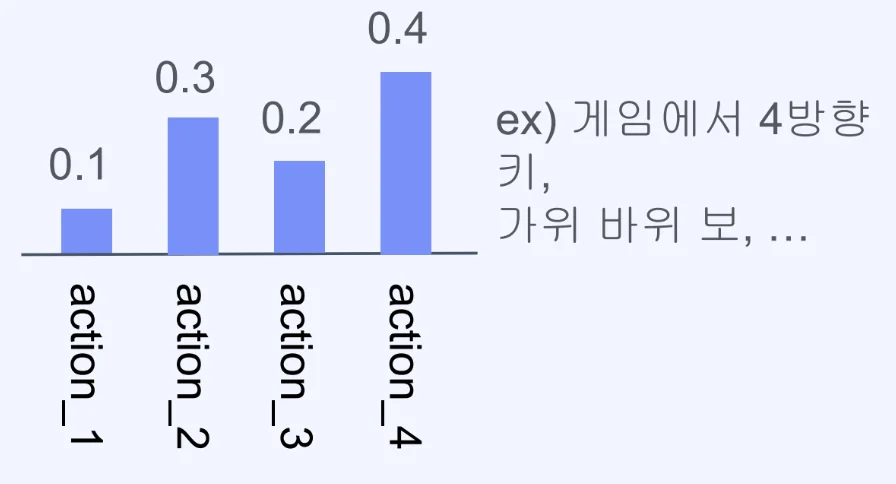
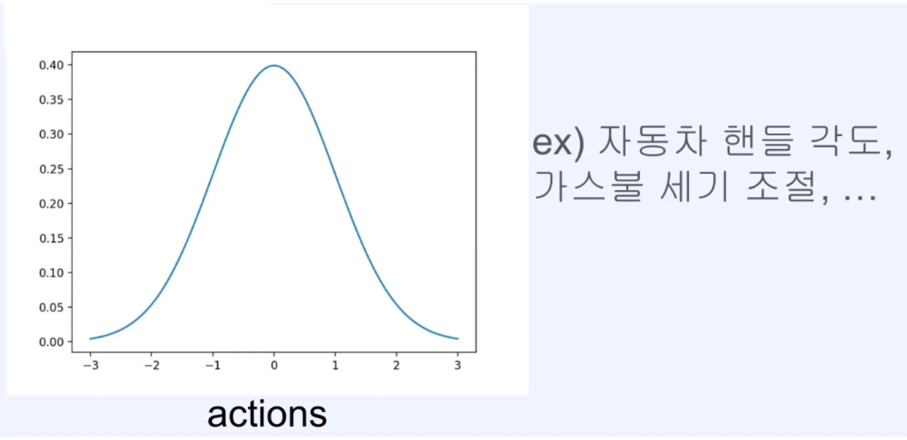
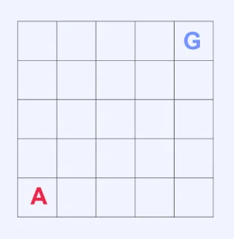
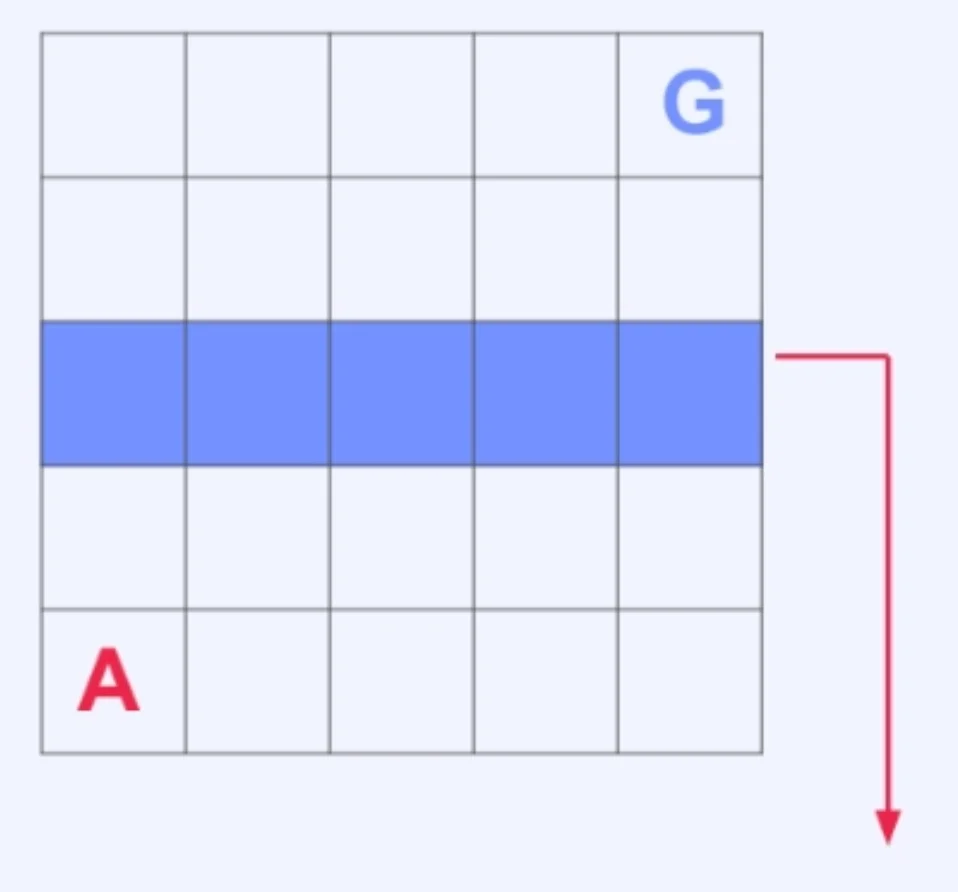
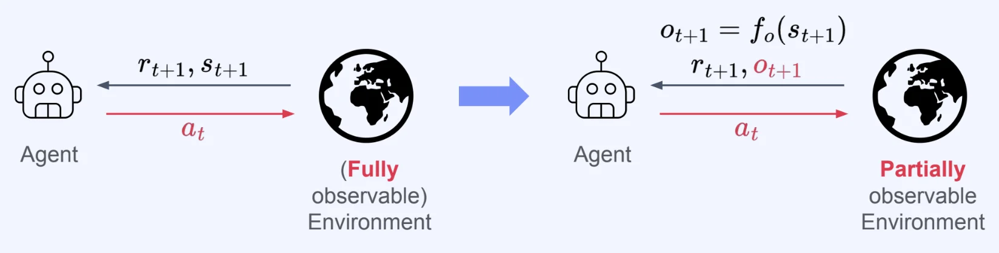

## ‘강화학습’의 정형화 &#45; 기본 개념

---

### 강화학습의 정형화된 표현

- <code>Agent</code>&#58; 환경과 상호작용을 하며 학습을 진행하는 주체

- <code>Environment</code>&#58; Agent가 상호작용을 진행하는 대상이 되는 객체

- <code class="language-math">s&#95;t</code><code> (state)</code>&#58; 특정 시점 t의 환경의 상태

- <code class="language-math">a&#95;t</code><code> (action)</code>&#58; 특정 시점 t에 agent가 취한 행동

- <code class="language-math">r&#95;{t&#43;1}</code><code> (reward)</code>&#58; 특정 시점에 t&#43;1에 agent가 받은 보상

- <code>Transition</code>&#58; 환경이 action을 받아 next state로 변화되는 현상

- <code class="language-math">(s&#95;t, a&#95;t, r&#95;{t&#43;1}, s&#95;{t&#43;1})</code>(transition tuple)&#58; 한 번의 상호작용에 대한 정보

### Episode, trajectory and policy

일반적으로 환경과의 상호작용은 한 번으로 끝나는 것이 아니라, 계속해서 이어진다&#46; 

- <code class="language-math">E=(s&#95;0, a&#95;0, r&#95;1, s&#95;1, &#92;cdots, s&#95;{T&#45;1}, a&#95;{T&#45;1}, r&#95;T, s&#95;T)</code> (episode)
    - 환경과 상호작용의 시작부터 끝까지 모든 state, action, reward

- <code class="language-math">H&#95;t = E=(s&#95;0, a&#95;0, r&#95;1, s&#95;1, &#92;cdots, s&#95;{t&#45;1}, a&#95;{t&#45;1}, r&#95;t, s&#95;t)</code> (history)
    - 환경과 상호작용의 시작부터 특정 시점 t까지의 state, action, reward

- <code class="language-math">T = (s&#95;t, a&#95;t, r&#95;{t&#43;1}, s&#95;{t&#43;1}, &#92;cdots , s&#95;{t&#43;L&#45;1}, a&#95;{t&#43;L&#45;1}, r&#95;{t&#43;L}, s&#95;{t&#43;L})</code> (trajectory)
    - 특정 시점부터 시작된 임의의 길이의 state, action, reward 배열

- <code class="language-math">&#92;pi</code> (policy)
    - Agent의 행동 방식 (일반적으로 확률 분포)

- <code class="language-math">&#92;pi(a&#95;t&#124;s&#95;t)</code>
    - 특정 시점 t에서 주어진 state, <code class="language-math">s&#95;t</code>에서 특정 행동 <code class="language-math">a&#95;t</code>를 선택할 확률

### Policy (detail)

> ✏️ 
> 
> - <code class="language-math">&#92;pi</code> (policy)&#58; Agent의 행동 방식 (일반적으로 확률 분포)
> 
> - <code class="language-math">&#92;pi(a&#95;t&#124;s&#95;t)</code>&#58; 특정 시점 t에서 주어진 state, <code class="language-math">s&#95;t</code>에서 특정 행동 <code class="language-math">a&#95;t</code>를 선택할 확률

Agent Policy는 일반적으로 아래의  두 형태를 지닌다&#46;

- <strong>Discrete Distribution</strong>
    

- <strong>Continuous Distribution</strong>
    

### Transition (detail)

Transition이 발생하는 과정을 더 자세히 소개

- Transition에 <strong><u>randomness가 없</u></strong>는 경우, 아래와 같이 표현됨
    - Detreministic environment

    - <code class="language-math">s&#95;{t&#43;1} = f&#95;T(s&#95;t, a&#95;t)</code>
        - <code class="language-math">f&#95;t</code>&#58; Transition function

- Transition에 <strong><u>randomness가 있</u></strong>는 경우, 아래와 같이 표현됨
    - Stochastic environment

    - <code class="language-math">s&#95;{t&#43;1} </code><code> &#126; </code><code class="language-math">P(&#92;cdot&#124;s&#95;t, a&#95;t)</code>
        - <code class="language-math">P(&#92;cdot&#124;s&#95;t, a&#95;t)</code>&#58; Transition probability

### Environment 예시들

예시 1) <code>Discrete action</code>, <code>Deterministic env</code>

> 상하좌우 이동이 가능한 5x5 Grid 환경

- <code class="language-math">s&#95;t</code>&#58; 5 x 5 grid 정보

- <code class="language-math">a&#95;t</code>&#58; 상하 좌우

- <code class="language-math">r&#95;{t&#43;1}</code>&#58; Goal에 도달하면 &#43; 1

예시 2) <code>Discrete action</code>, <code>Stochastic env</code>

> Random Teleport Zone&#58; 입장 시 <strong><u>random한 위치</u></strong>로 순간이동

- <code class="language-math">s&#95;t</code>&#58; 5 x 5 grid 정보

- <code class="language-math">a&#95;t</code>&#58; 상하 좌우

- <code class="language-math">r&#95;{t&#43;1}</code>&#58; Goal에 도달하면 &#43; 1

예시 3) <code>Continuous action</code>, <code>Deterministic env</code>

> 
> 
> 
> 
> &#45; 일정한 속도로 발사되는 공 &#45; 각도 조절 기능 (0&#126;90)

- <code class="language-math">s&#95;t</code>&#58; 발사 각도

- <code class="language-math">a&#95;t</code>&#58; 각도 설정, 발사

- <code class="language-math">r&#95;{t&#43;1}</code>&#58; 수평 거리 &#42; 0&#46;1 의 보상

### Partial observability

- 만약 환경의 상태를 <strong><u>부분적</u></strong>으로만 볼 수 있다면?

- 환경의 상태 중 일부를 <strong><u>특정 transformation(변환)</u></strong>을 통해서 얻게 됨

- 환경의 작동과 관려된 전체 상태는 상호작용이 진행되며 내부적으로 계속 업데이트 됨&#46;

- <code class="language-math">s&#95;{t&#43;1} = f&#95;T(s&#95;t, a&#95;t)</code> or <code class="language-math">s&#95;{t&#43;1}</code><code> &#126; </code><code class="language-math">P(&#92;cdot&#124;s&#95;t, a&#95;t</code><code>)</code>

### 강화학습 정형화 예시 

‣
