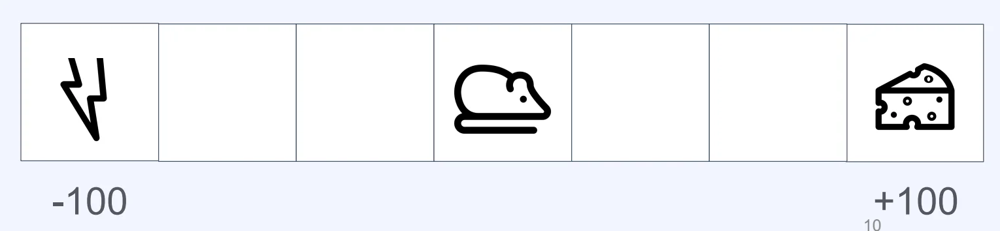

## ‘강화학습’의 학습 목표

---

### 강화학습의 <u>보상(Reward)</u>이란?

강화학습에서 <code>보상(reward)</code>은 <strong><u>학습주체(에이전트)</u></strong>가 <strong><u>어떤 행동을 취</u></strong>했을 때, <strong><u>그 결과가 얼마나 </u></strong><strong><u>좋고 나쁜</u></strong><strong><u>지</u></strong>를 <strong>수치</strong>로 표현한 신호이다&#46; 

<strong>보상은 행동 직후 즉시 발생하지 않을 수도 있다&#46; </strong>운동을 매일 한다고 해서 당장 내일 건강해지지 않는 것처럼, 보상은 지연되어 나타나기도 한다&#46;

우리 일상에서도 보상은 자연스럽게 존재한다&#46;

| 행동 | 보상 |
| --- | --- |
| 뜨거운 여름날 시원한 레몬에이드를 마심 | <code>&#43;50</code> |
| 농구에서 골을 넣음 | <code>&#43;10</code> |
| 게임에서 이김 | <code>&#43;20</code> |
| 핸드폰 보며 걷다가 넘어짐 | <code>&#45;20</code> |
| 내기 게임에서 짐 | <code>&#45;100</code> |
| 어머니의 꽃병을 실수로 깨뜨림 | <code>&#45;1000</code> |

### 학습 목표&#58; 즉각적인 보상이 아닌, <u>보상의 합</u>

그렇다면 강화학습의 궁극적인 목표는 무엇일까? 단순히 지금 당장 큰 보상을 얻는 것일까?

아래의 예시를 보자

> <strong>중간고사 전날 밤, 공부를 하나도 안 한 상황</strong>
> 
> - <strong>게임을 한다</strong> → <code>&#43;20</code> &#46;&#46;&#46; 그런데 다음날 시험을 망친다 → <code>&#45;100</code> → <strong>합계&#58; </strong><strong><code>&#45;80</code></strong>
> 
> - <strong>공부를 한다</strong> → <code>20</code> &#46;&#46;&#46; 그런데 다음날 시험을 잘 본다 → <code>&#43;100</code> → <strong>합계&#58; </strong><strong><code>&#43;80</code></strong>

게임을 하면 지금 당장은 기분이 좋다&#46; 하지만 결과적으로 손해이다&#46; 

강화학습의 에이전트도 마찬가지다&#46;<u> </u><strong><u>즉각적인 보상이 크</u></strong><strong>더라도 </strong><strong><u>이후에 더 큰 손해</u></strong><strong>를 낳는 행동은 </strong><strong>좋은 행동이 아니다</strong><strong>&#46;</strong> 반대로, 지금의 보상을 포기하더라도 <strong><u>장기적으로 더 높은 총합을 만드는 행동</u></strong>이 <strong><u>좋은 행동</u></strong>이다&#46;

따라서 <strong><code>강화학습의 학습목표</code></strong>는 <strong><u>특정 기간 동안 얻는 </u></strong><strong><u>보상의 합</u></strong><strong> </strong><code class="language-math">G&#95;t</code><strong>로 정의한다&#46; </strong>

- <code class="language-math">G&#95;t = R&#95;{t&#43;1} &#43; R&#95;{t&#43;2} &#43; &#92;cdots</code>

### 할인율(Discount Factor)&#58; 미래 보상의 가중치

보상의 합 공식에서 한 발 더 나아가면, 실제로는 <strong>할인율(Discount Factor), </strong><code class="language-math">&#92;gamma</code><strong>를 도입한 형태를 사용</strong>한다&#46;<strong> </strong>

- <code class="language-math">G&#95;t = R&#95;{t&#43;1} &#43; &#92;gamma R&#95;{t&#43;2} &#43; &#92;gamma^2 R&#95;{t&#43;3} &#43; &#92;cdots</code> 
    - <code class="language-math">&#92;gamma &#92;text{ &#58; Discount factor}, ( &#92;; 0 &#92;le &#92;gamma &#92;le 1 )</code> 

#### <strong>할인율(Discount Factor, </strong><code class="language-math">&#92;gamma</code><strong>) 이 의미하는것</strong>

할인율은 쉽게 말해 <strong><u>“미래 보상을 얼마나 중요하게 볼 것인가”</u></strong>를 결정하는 파라미터다&#46; 

- <code class="language-math">&#92;gamma = 0</code><strong> </strong>
    - 오직 지금 당장의 보상만 고려 →  <code class="language-math">Gt=Rt&#43;1</code>

    - 극단적으로 근시안적인 에이전트

- <code class="language-math">&#92;gamma = 1</code> 
    - 미래 보상을 현재와 동등하게 고려 →  <code class="language-math">Gt=Rt&#43;1&#43;Rt&#43;2&#43;⋯</code>

    - 장기적 관점을 최대로 반영

또한 <strong><u>수학적으로도 중요</u></strong>한 이유가 있다&#46; 

<code class="language-math">&#92;gamma &#60; 1</code> 이면 무한히 이어지는 <strong><code>보상의 합</code></strong>이 <strong><u>발산하지 않고 </u></strong><strong><u>수렴</u></strong>하게 되어 <strong><u>학습이 안정적</u></strong>으로 이루어진다&#46;

따라서 <u>어떤 에이전트를 설계</u>하느냐에 따라<u> 적절한 </u><code class="language-math">&#92;gamma</code><u> 값이 달</u>라지며, 이는 곧 그 에이전트의 <strong>&#34;성향&#34;</strong> 을 결정한다고도 볼 수 있다&#46;

### 예시) 강화학습 목표값 구하기

1. 시험 공부를 하나도 하지 않은 중간고사 전달, <code>Discount factor = 0&#46;1</code>
    - 게임을 한다&#58; <code>&#43;20</code> → 중간고사를 망친다&#58; <code>&#45;100</code> 
        - → 목표값&#58; <code class="language-math">&#43;20 &#43; 0&#46;1 &#42; (&#45;100) = &#43;10</code>

    - 공부를 한다&#58; <code>&#45;20</code> → 중간고사를 잘본다&#58; <code>&#43;100</code> 
        - → 목표값&#58; <code class="language-math">&#45;20 &#43; 0&#46;1&#42;(&#43;100) = &#45;10</code>

    - → 목표값&#58; <code class="language-math">&#43;20 &#43; 0&#46;9 &#42; (&#45;100) = &#45;70</code>

1. 시험 공부를 하나도 하지 않은 중간고사 전달, <code>Discount factor = 0&#46;9</code> 
    - 게임을 한다&#58; <code>&#43;20</code> → 중간고사를 망친다&#58; <code>&#45;100</code> 

    - 공부를 한다&#58; <code>&#45;20</code> → 중간고사를 잘본다&#58; <code>&#43;100</code> 
        - → 목표값&#58; <code class="language-math">&#45;20 &#43; 0&#46;9&#42;(&#43;100) = &#43;70</code>

1. 치즈를 좋아하는 쥐, <code>Discount factor = 0&#46;9</code> 
    

    - 전기 충격 목표값&#58; <code class="language-math">0 &#43; 0&#46;9 &#42; 0 &#43; 0&#46;9^2&#42;(&#45;100) = &#45;81</code>

    - 치즈 획득 목표값&#58; <code class="language-math">0 &#43; 0&#46;9 &#42; 0 &#43; 0&#46;9^2&#42;(&#43;100) = &#43;81</code>
