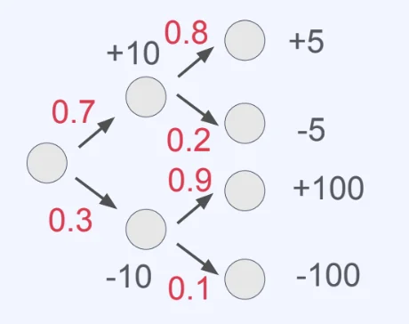

## 강화학습의 정형화 — Return, Value Function, 그리고 학습 과정

---

###  Return이란?

강화학습에서 에이전트가 최대화하고자 하는 값을 <strong>return</strong>이라고 한다&#46;

> <code class="language-math">G&#95;t = R&#95;{t&#43;1} &#43; {&#92;gamma}R&#95;{t&#43;2} &#43; {&#92;gamma}^2R&#95;{t&#43;3} &#43; &#92;cdots</code>

- <code class="language-math">&#92;gamma&#58; Discount factor, 0 ≤ &#92;gamma ≤ 1</code>
    - <code class="language-math">&#92;gamma</code>(감마)가  1에 가까울수록 미래 보상을 현재와 거의 동일하게 취급하고,  0에 가까울수록 즉각적인 보상을 중시한다&#46;

###  Return은 Random Variable이다

Return은 <strong>확률변수(random variable)</strong>다&#46; 에이전트의 policy가 확률적이거나, 환경의 state transition이 확률적이라면 동일한 state에서 출발하더라도 매번 다른 return을 얻게 된다&#46;

- <strong>예시</strong>(<code class="language-math">&#92;gamma = 1</code>인 경우, 특정 state에서 출발한 4가지 시나리오)
    

    | 시나리오 | 보상 구성 | Return | 발생 확률 |
    | --- | --- | --- | --- |
    | 1 | &#43;10, &#43;5 | 15 | 0&#46;56 |
    | 2 | &#43;10, −5 | 5 | 0&#46;14 |
    | 3 | −10, &#43;100 | 90 | 0&#46;27 |
    | 4 | −10, −100 | −110 | 0&#46;03 |

같은 출발점에서도 어떤 행동을 선택하느냐, 환경이 어떻게 반응하느냐에 따라 return이 완전히 달라진다&#46; 이처럼 return의 확률적 성질은 <strong>policy에 의존</strong>한다&#46;

###  Value function, Action&#45;value function

<code>Return</code>이 확률변수이기 때문에, 강화학습에서는 <strong><u>return의 기댓값을 기준</u></strong>으로 판단한다&#46; 이를 위한 두 가지 핵심 함수가 바로 <strong>value function</strong>과 <strong>action&#45;value function</strong>이다&#46;

- Value Function
    > <code class="language-math">V^&#92;pi(s&#95;t)= E&#95;{&#92;pi}&#91;G&#95;t&#124;s&#95;t&#93;</code>

    - 특정 state(<code class="language-math">s&#95;t</code>)에서 policy(<code class="language-math">&#92;pi</code>)에 따를 때 평균적으로 얻게 되는 return&#46; 

    - 즉, <strong>어떤 state가 얼마나 좋고 나쁜지</strong>를 나타내는 척도다&#46;

- Action&#45;value function
    > <code class="language-math">Q^{&#92;pi}(s&#95;t, a&#95;t) = E&#95;{pi}&#91;G&#95;t&#124;s&#95;t,a&#95;t&#93;</code> 

    - state <code class="language-math">s&#95;t</code>에서 action <code class="language-math">a&#95;t</code>를 선택한 뒤 policy <code class="language-math">&#92;pi</code>를 따를 때(행동 했을 때)의 평균적으로 얻게 되는 return&#46;

    - <strong>Q&#45;function</strong>이라고도 불리며, <strong>주어진 state에서 특정 action이 얼마나 좋고 나쁜지</strong>를 나타내는 척도다 ( 실용적으로는 이 해석이 더 자주 쓰인다&#46; )

    - 두 함수 모두 <strong>policy </strong><code class="language-math">&#92;pi</code><strong>에 의존하며</strong> Policy가 바뀌면 value function과 action&#45;value function도 함께 바뀐다&#46;

    ---

    

      → 어떤 (state, action)이 얼마나 <strong><u>좋거나 나쁜지</u></strong>에 대한 <strong><u>척도</u></strong>라 할 수 있음

    

      → 주어진 state에서 특정 action이 얼마나 좋거나 나쁜지에 대한 첫도라 할 수 있음 ( 보통 이 의미로 더 자주 해석됨 )

###  강화학습의 반복 사이클

> ✏️ 
> 
> - <code>Value function</code>과 <code>action&#45;value function</code>은 환경과의 상호작용을 통해 얻은 데이터로부터 <strong>추정(estimate)</strong>된다&#46; 
> 
> - 그리고 이 추정값을 바탕으로 policy를 개선한다&#46; 
> 
> - 개선된 policy는 다시 새로운 데이터를 만들어내고, 
> 
> - 이 사이클이 반복된다&#46;

1. 환경과 상호작용 → 학습 데이터 수집

1. <code class="language-math">V(s)</code>, <code class="language-math">Q(s,a)</code> 추정 (value function, action&#45;value function 추정)

1. Policy 업데이트 (강화)

1. 개선된 Policy로 다시 상호작용 → (반복)
