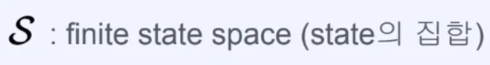
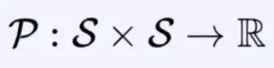
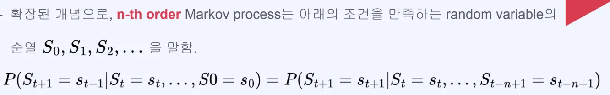
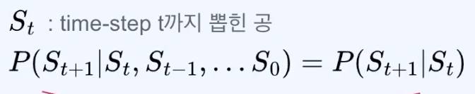
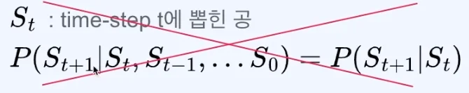

## 마르코프 과정 (Markov Process)

---

> 📖 
> 
> 
> 
> 마르코프 과정(Markov Process)은 <strong>마르코프 가정을 만족</strong>하는 <strong><u>연속적인 일련의 상태</u></strong>이다&#46; 마르코프 과정은 일련의 상태 <code class="language-math">&#60;S&#95;1, S&#95;2, &#92;cdots , S&#95;t&#62;</code>와 <code>상태 전이 확률(state transition probability)</code>로 구성된다&#46; 

### 마르코프 과정 (Markov Process)

- finite state space (유한한 state 집합)

- random variable S가 취할 수 있는 가능한 모든 값의 집합

- Transition probability model (metrix)

- <code class="language-math">P(S&#95;{t&#43;1} = s&#95;{t&#43;1} &#124; S&#95;{t} = s&#95;{t})</code>

- P라는 함수가 S(state) 두개를 받아서 0 &#126; 1 사이의 확률값,  실수를 가진다는 의미인다&#46; 

### <strong>상태 전이 확률(state transition probability)에 대한 매트릭스(P) 표현</strong>

- state space가 <code class="language-math">s&#95;0</code>, <code class="language-math">s&#95;1</code>, <code class="language-math"> s&#95;2</code> 3개가 있다고 가정했을 때,  Transition이 일어날 수 있는 경우는 위 3 x 3 매트릭스로 표현할 수 있다&#46; 

- 현재 state에다 다음 state로 갈 모든 확률의 합은 1이다&#46; 
    - <code class="language-math">s&#95;0</code>→ <code class="language-math">s&#95;0</code> = 0&#46;2, 

    - <code class="language-math">s&#95;o</code> → <code class="language-math">s&#95;1</code> = 0&#46;1 

    - <code class="language-math">s&#95;o</code> → <code class="language-math"> s&#95;2</code> = 0&#46;7
        

        ⇒ 0&#46;2 &#43; 0&#46;1 &#43; 0&#46;7 = 1

### <strong>n&#45;th order Markov process</strong>

<em>→ </em><strong><u>미래 정보를 예측</u></strong>하기 위해 <strong><u>모든 과거 상태</u></strong>가 <strong>다 필요하지 않</strong>고, <strong><u>가장 최근의 n개의 상태</u></strong>만 있어도 충분하다&#46;

- <code class="language-math">P(S&#95;{t&#43;1} = s&#95;{t&#43;1} &#92;mid S&#95;t=s&#95;t, &#92;dots , S0 = s0)</code>
    

    <code class="language-math">= P(S&#95;{t&#43;1} = s&#95;{t&#43;1}&#124;S&#95;{t} = s&#95;t, &#92;dots ,</code>  <code class="language-math">S&#95;{t&#45;n&#43;1} = s&#95;{t&#45;n&#43;1}</code> <code class="language-math">)</code>

→ 앞서 살펴본 마르코프 프로세스는 <strong>first order Markov process</strong> 라고 할 수 있다&#46; 

### 마르코프 프로세스 예시

- 그래프, 매트릭 예시
    

- 현실에서의 Markov process 예시
    

    
<strong>예시 1) 로또 복권</strong>

    

    - 어떻게 state를 설정하느냐에 따라 마르코프 프로세스가 될 수도 있고 안될 수 도 있다&#46; 
        

        - <code class="language-math">t</code> 까지 뽑힌 공이기 때문에 <code class="language-math">S&#95;t</code>에 이전 state들이 포함되어 있다&#46; 

        

        - <code class="language-math">t</code> 에 뽑힌 공이기 때문에 <code class="language-math">S&#95;t</code>에 이전 state들을 모두 알아야 한다&#46;

    

    

    
<strong>예시 2) 지하철 도착시간</strong>

    

    - 다음 정거장에서 도착 시간은 이전 정거장에서의 도착 시간만 알면 유추할 수 있다&#46; 

    

