

## 마르코프 보상 과정 (Markov Reward Process)

---

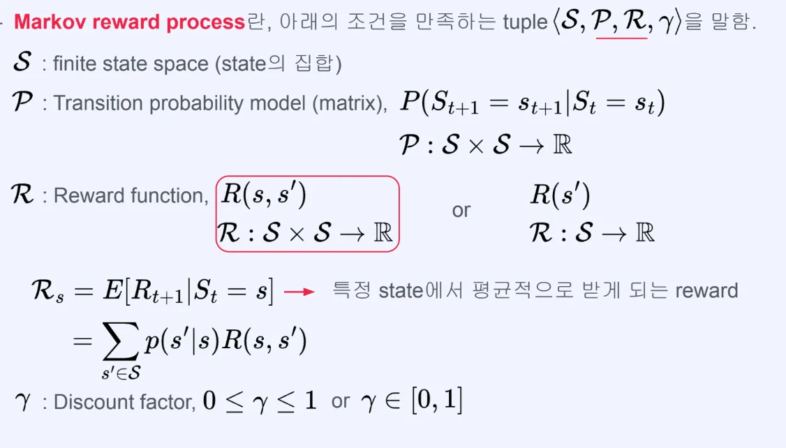

- 마르코프 과정(Markov Process)에 <code>R</code>, <code class="language-math">&#92;gamma</code> 가 추가된 형태이다&#46; 
    - S, P 까지는 마르코프 과정(Markov Process) 과 동일

🧐 from → to

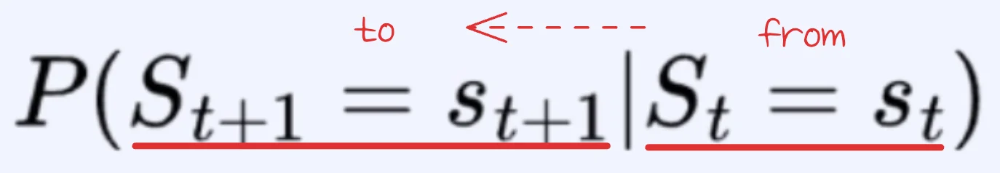

- 마르코프 가정에서의 개념을 표현한다&#46; 
    - 다음 state 값을 구하기 위해서는 이전 state 값이 있어야 한다&#46; 

- 이전 state(from)에서 다음 state(to)로 진행

<code class="language-math">R</code> (Reward function)

아래의 2가지 방법으로 표현된다&#46; 

1. <code class="language-math">S</code> 2개
    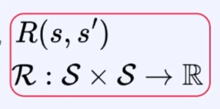

    - s, s’ 둘 다 input으로 들어가는 경우

    - 두 state간의 차이 값을 보상으로 주는 경우에 많이 사용한다&#46; 

    - 아래의 S 1개의 경우를 포함한다&#46; 
        - s의 값을 무시한 채로 s’ 만을 인자로 줘 계산한다면 아래와 같다&#46; 

    - ex) s가 온도라고 했을 때, 어떤 두 state 간의 온도 차이를 보상으로 준다고 가정하면         s, s’ 두개의 인자 값이 필요하다&#46; 

1. <code class="language-math">S</code> 1개
    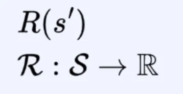

    - to state 만 가지고 보상을 계산한다&#46;  즉, 어느 state에 도달하기만 하면 그 state를 기반으로 보상을 계산한다는 말이다&#46;

    - ex) 어떤 목적지에 주어지는 보상 같은 경우, 그 목적지에 도달했는지 아닌지 여부만 체크해 보상을 계산할 수 있다&#46;

1. 상태 s에서 기대되는 즉시 보상(expected immediate reward)
    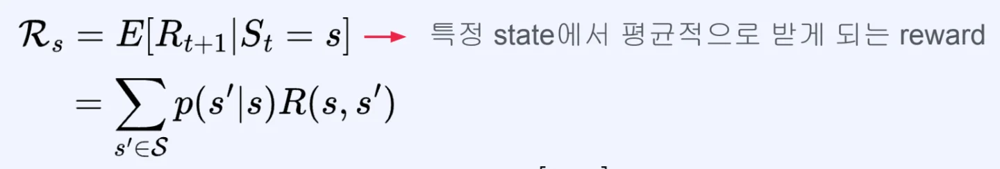

    - 현재 상태 s에서 출발했을 때, <strong>다음 상태로 이동</strong>하면서 받는 보상의 <u>평균값</u>
        - <code class="language-math">R&#95;s = &#92;mathbb{E}&#91;R&#95;{t&#43;1} &#124; S&#95;t = s&#93;</code>
            - 현재 상태가 s일 때, 다음 timestep에서 받는 보상 <code class="language-math">R&#95;{t&#43;1}</code> 의 기댓값

        - <code class="language-math">P(s&#39; &#124; s)</code>
            - 상태 s에서 s&#39;로 갈 확률

            - Markov 성질&#58; 오직 현재 상태만 영향

        - <code class="language-math">R(s, s&#39;)</code>
            - 상태 s → s&#39;로 이동할 때 받는 보상

            - deterministic(결정론적)일 수도 있고 stochastic(확률론적)일 수도 있음  

    - 예시 1
        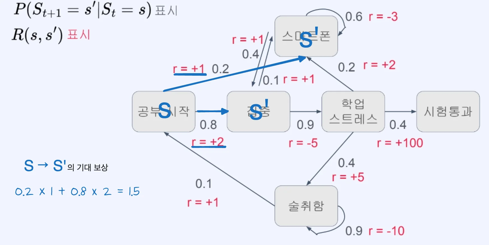

        

        ⇒ <code class="language-math">R&#95;s = 0&#46;2 &#92;cdot 1 &#43; 0&#46;8 &#92;cdot 2 = 0&#46;2 &#43; 1&#46;6 = 1&#46;8</code>

        

        ⇒ <strong><u>상태 s의 기대 보상 = 1&#46;8</u></strong>

    - 예시 2
        | <strong>다음 상태 </strong>s&#39; | <strong>확률 </strong>P(s&#39;&#124;s) | <strong>보상 </strong>R(s, s&#39;) |
        | --- | --- | --- |
        | s1 | 0&#46;7 | &#43;10 |
        | s2 | 0&#46;3 | &#45;5 |

        

        ⇒ <code class="language-math">R&#95;s = 0&#46;7 &#92;cdot 10 &#43; 0&#46;3 &#92;cdot (&#45;5) = 7 &#45; 1&#46;5 = 5&#46;5</code>

        

        ⇒ <strong><u>상태 s의 기대 보상 = 5&#46;5</u></strong>

🧐 MDP 에서 의미하는 ‘평균’ 이란?

---

일반적인 평균 &#45; 모든 경우의 수가 동일한 확률값

> <code class="language-math">&#92;text{평균} = &#92;frac{x&#95;1 &#43; x&#95;2 &#43; &#46;&#46;&#46; &#43; x&#95;n}{n}</code>

 일반적으로 말하는 평균은 위와 같다&#46; 

그러나 이건 <strong>모든 경우가 </strong><strong><u>동일한 확률</u></strong>일 때만 성립하는<strong> </strong><strong><u>‘특수한 평균’</u></strong><strong> </strong>이다&#46;

MRP(Markov Reward Process)에서 사용하는 <strong>평균 = 기대값</strong>

>  <code class="language-math">&#92;text{기대값} = &#92;sum (&#92;text{확률} &#92;times &#92;text{값})</code>

MRP에서의 수식(<code class="language-math">R&#95;s = &#92;sum&#95;{s’} P(s’&#124;s) R(s, s’)</code>)은 사실 위와 같다&#46; 

즉, 평균이라 하지만 <strong>‘나누기 n’ 이 보이지 않</strong>는다&#46; 

<strong>균등 분포 (우리가 아는 평균) </strong>

| <strong>값</strong> | <strong>확률</strong> |
| --- | --- |
| <code>10</code> | <code>0&#46;5</code> |
| <code>20</code> | <code>0&#46;5</code> |

<code class="language-math">= 0&#46;5 &#92;cdot 10 &#43; 0&#46;5 &#92;cdot 20 = 15</code>

이걸 풀면 아래와 같다&#46; 

= <code class="language-math">&#92;frac{10 &#43; 20}{2}</code>

즉, 확률이 <code class="language-math">&#92;frac {1}{n}</code>이라 나누기 <code>n</code>과 동일해 진 것이다&#46; 

<strong>일반 확률 분포 (MRP 상황)</strong>

| <strong>값</strong> | <strong>확률</strong> |
| --- | --- |
| <code>10</code> | <code>0&#46;7</code> |
| <code>&#45;5</code> | <code>0&#46;3</code> |

<code class="language-math">= 0&#46;7 &#92;cdot 10 &#43; 0&#46;3 &#92;cdot (&#45;5) = 5&#46;5</code>

여기서는 <strong><u>확률이 다르기</u></strong> 때문에 그래서 <strong><u>단순 평균 (n으로 나누기)</u></strong><strong><u>이 아니라</u></strong> <strong>가중 평균(weighted average)</strong>으로 계산한다&#46; 

### 정리

- <strong>일반 평균 </strong>→ 모든 경우를 똑같이 취급

- <strong>기대값 (MRP) → 자주 발생하는 경우는 더 크게 반영</strong>

⇒  <strong>MRP에서의 “평균”</strong><strong> = </strong><strong>가중 평균(weighted average)</strong><strong> = </strong><strong>기대값(expected value)</strong>

그래서 단순 평균이 아닌 <strong><u>현실에서 실제로 기대되는 값</u></strong>을 사용한다&#46;  즉, <strong><u>확률을 고려한 평균(= 기대값), 가중 평균</u></strong>을 사용한다&#46; 

MRP는 <strong><u>확률적 시스템</u></strong>이기 때문에 <u>어떤 상태는 자주 발생</u>하며 <u>어떤 상태는 거의 안 발생</u>한다&#46; 

<code class="language-math">&#92;gamma</code> (Discount factor)

- 0 ≤ <code class="language-math">&#92;gamma</code> ≤ 1 의 값

<strong>&#91; 복습&#93; 🧐 왜 </strong><strong><code>discount factor(</code></strong><code class="language-math">&#92;gamma</code><strong><code>)</code></strong><strong>를 사용하는가?</strong>

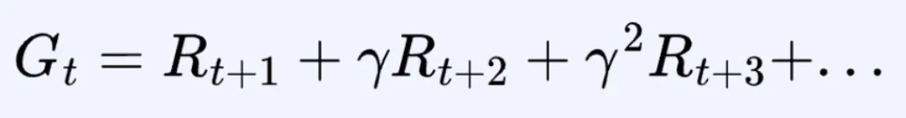

1. Return이 <strong><u>무한한 값을 가지지 않고 수렴</u></strong>하도록 하여 수학적인 안정성을 준다&#46; 

1. 지금 당장의 보상 혹은 먼 미래의 보상에 대한 가중치
    - <code>Discount factor</code>가 <strong><u>작</u></strong><strong>을수록</strong>, <strong>지금 당장 받는 보상이 return에 많이 포함</strong>

    - <code>Discount factor</code>가 <strong><u>클</u></strong>수록, <strong>나중에 받는 보상이 return에 많이 포함</strong>

1. 만약 환경에서 존재 가능한 모든 sequence (episode)가 유한하다면, <code class="language-math">&#92;gamma</code><code> = 1</code>로 설정 가능
    - 에피소드나 시퀀스의 길이가 유한하다면 즉, 리턴을 계산할 때 보상이 무한하게 더해지지 않고 유한하게 더해진다&#46; 

    - 이때는 <code class="language-math">&#92;gamma</code> 는 1로 설정해도 된다&#46; 

    - episode 
        - 환경과 상호작용에 관련되 모든 정보의 배열이다&#46;

        - state, action, reward 포함

마르코프 보상 과정 (Markov Reward Process) 예시

<strong>예시 문제</strong>

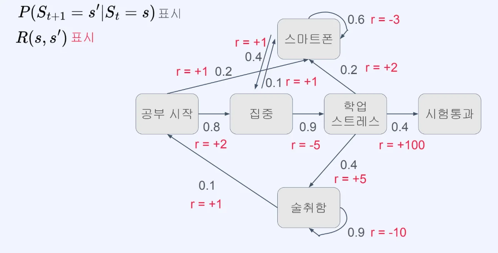

아래와 같이 진행하여 시험 통과

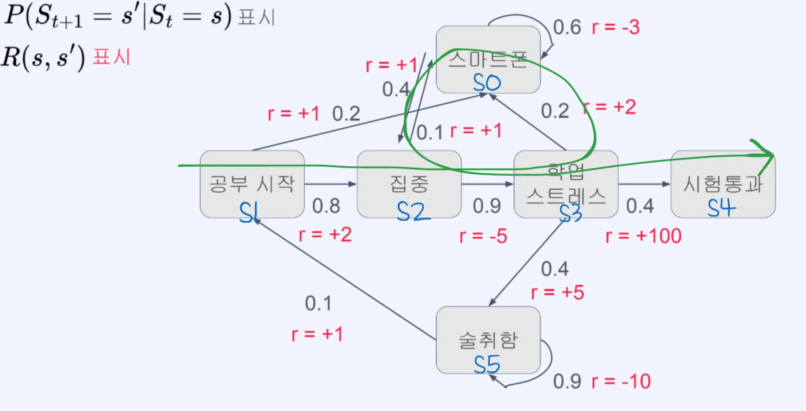

- return 값 계산
    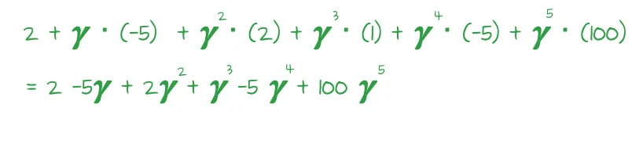

- Transition probability metrix(model)  계산
    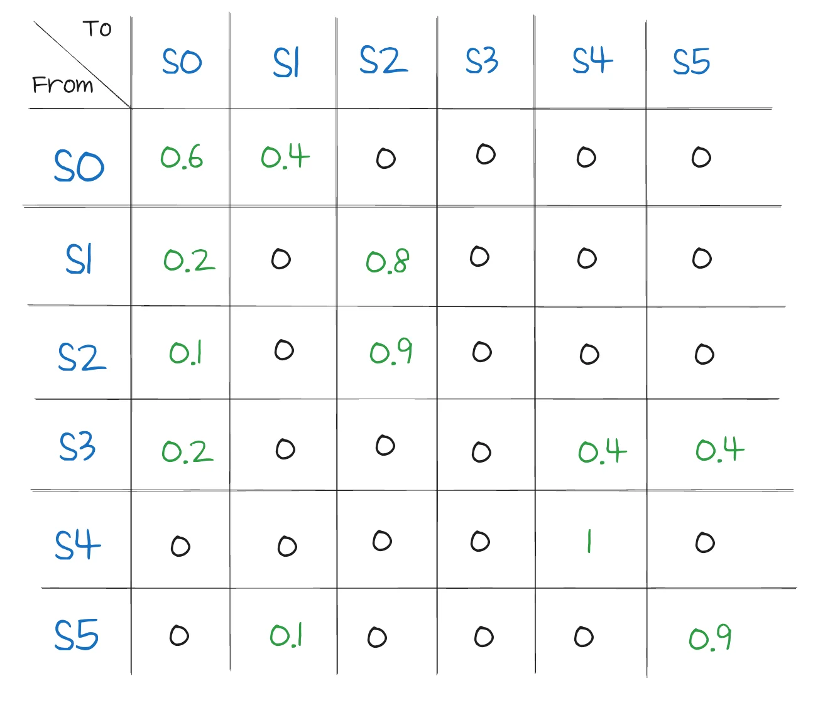

현실에서의 Markov Reward Process 예시

- 예시 1) 로또 복권
    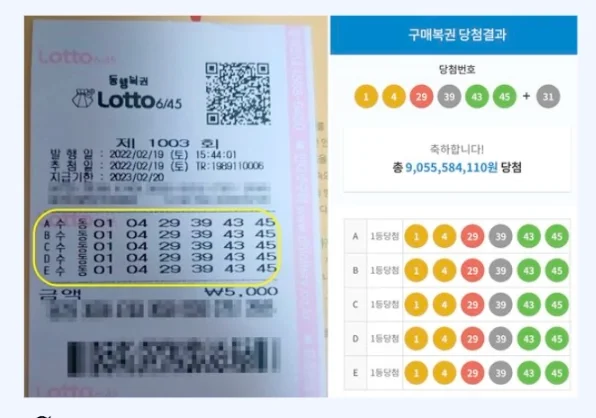

    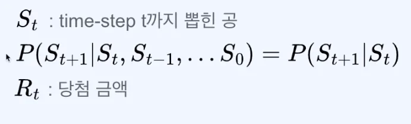

    - 이전과 같이 state 와 transition probability는 모두동일하다&#46; 

