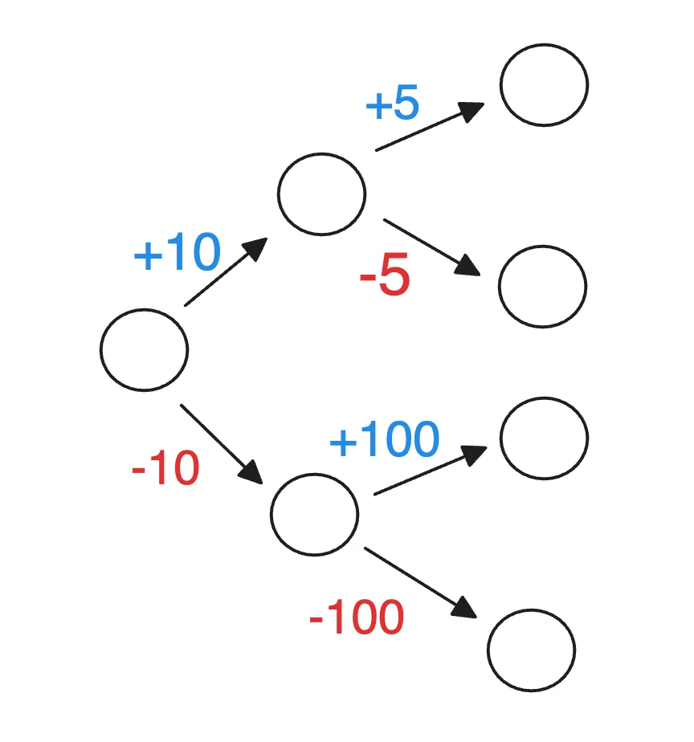

## ‘강화학습’의 특징

---

- 강화학습에서 <u>학습을 진행</u>하기 위해서는 <code>환경</code>과 <code>학습 주체</code>가 필요하다&#46; 

- <code>학습 주체</code>는 <strong><u>환경의 상태를 인식</u></strong>하고, <strong><u>행동을 취</u></strong>할 수 있어야 한다&#46; 

- 일반적으로 <strong><u>학습 주체가 취한 행동</u></strong>은 <strong><u>환경의 상태에 변화를 일</u></strong>으킨다&#46; 

- 학습 주체는 <strong><u>환경에 대한 </u></strong><strong><u>불확실성</u></strong> 가운데 학습을 진행한다&#46;
    - <strong><u>환경의 작동</u></strong><u> 메커니즘을 모르는 상태</u>로 학습 진행

- 학습 주체는 어떤 행동이 <strong><u>목표값 최대화</u></strong>에 도움이 되는지 <strong><u>직접 시도</u></strong>하며 <strong>시행착오</strong>를 통해 학습
    

     → Trial&#45;error&#45;learning

- <strong><u>목표값을 최대화</u></strong>하기 위한 <strong>행동을 배운다</strong>는 것은, <strong><u>주어진 환경의 상태</u></strong>에서 <strong><u>어떤 행동을 취하는게 좋은지 학</u></strong>습하는 과정을 말함
    - <code class="language-math">action = MyAction(state)</code>

<strong><u>현재 취하는 행동</u></strong>이 <strong><u>나중에 얻게 될 보상에도 영향</u></strong>을 끼치므로,  <strong>미래를 고려</strong>해서 행동을 취해야한다&#46; 

- 일반적으로 강화학습은 학습데이터가 주어지지 않으며, 환경만 주어진 상태에서 직접 학습 데이터를 수집함

- 이때 자주 발생하는 문제가 바로 exploration &#38; exploitation trade off 이다&#46;( 강화학습의 중요한 특성 )
    - <strong><code>탐험 (Exploration)</code></strong><strong>&#58; 아직 해보지 않은(or 좋지 않았던) 행동을 시도해서 새로운 가능성을 찾기</strong>

    - <strong><code>탐사 (Exploitation)</code></strong><strong>&#58; 이미 잘 되는 행동을 반복해서 높은 보상을 얻기</strong>

예시 &#45; exploration &#38; exploitation trade off  

1. 자주 가는 맛집을 갈 것인가(exploitation), 새로 생긴 식당을 갈 것인가(exploration)?
    - 보장된 행복 vs 새롭거나 더 큰 행복의 가능성  (= 더 큰 불행의 가능성)

1. 잘 아는 종목 위주로 투자해서 수익(exploitation), 새로운 종목을 찾아볼 것인가(exploration)?
    - 보장된 기대 수익 vs 더 큰 수익의 가능성 (= 더 큰 손해의 가능성)
