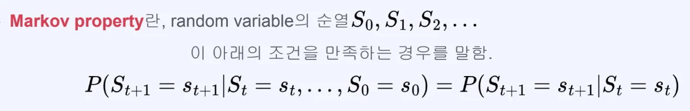

## 마르코프 가정 (Markov assumption)

---

### 미래 정보를 예측하기 위해 <strong><u>모든 과거 상태</u></strong>가 다 <strong>필요하지 않</strong>고, <strong><u>가장 최근의 상태</u></strong>만 있어도 충분하다&#46; 

> <em>“</em><em><u>상태</u></em><em>가 </em><em><strong><u>연속</u></strong></em><em>적인 시간에 따라 이어질 때, </em><em><strong>어떠한 시점의 상태</strong></em><em>는 바로 </em><em><strong><u>그 이전의 상태에만 영향</u></strong></em><em>을 받</em><em>는다”</em>

현재의 상태가 바로 이전 상태에만 영향을 받는다는 가정은 억지같아 보일 수 있지만,  직관적으로 <u>현재의 상태가 이전 상태에 가장 큰 영향</u>을 받고, <u>이전 상태는 그 이전 상태에 큰 영향</u>을 받는 <strong>순차적인 과정의 반복</strong>이라 생각하면 나름 합리적 가정이라 볼 수 있다&#46;

결정적으로 마르코프 가정으로 <strong><u>어려운 문제들을 단순화</u></strong>하고 <strong><u>만족스러운 결과를 얻</u></strong>는 경우가 많다&#46;

### 수식&#58; <code class="language-math">P(S&#95;1&#124;S&#95;1, S&#95;2, &#92;dots , S&#95;{t&#45;1}) = P(S&#95;t&#124;S&#95;{t&#45;1})</code>

---

- <code class="language-math">P(S&#95;1&#124;S&#95;1, S&#95;2, &#92;dots , S&#95;{t&#45;1})</code> (좌변)
    -  어떠한 시점 <code class="language-math">t</code> 에서의 상태 <code class="language-math">S&#95;t</code> 는 최초의 상태 <code class="language-math">S&#95;1</code>에서 바로 이전의 상태 <code class="language-math">S&#95;{t&#45;1}</code>까지 영향을 받는다는 뜻이다&#46; 

    - 이는 연속적으로 존재하여 일어나는 일련의 상태들을 확실하게 표현하지만, 이를 실제로 계산하기는 매우 어렵다&#46; 

- <code class="language-math">P(S&#95;t&#124;S&#95;{t&#45;1})</code> (우변)
    - 좌변의 식을 마르코프 가정을 적용시키면 우변과 같이 단순화할 수 있다&#46; 
        - 마르코프 가정을 적용 시, 상태 <code class="language-math">S&#95;t</code>는 바로 이전 상태인 <code class="language-math">S&#95;{t&#45;1}</code>에 가장 큰 영향을 받고 <code class="language-math">S&#95;{t&#45;1}</code> 는 <code class="language-math">S&#95;{t&#45;2}</code>에서 가장 큰 영향을 받는다&#46; 

        - 이러한 <strong>연쇄적으로 과정들을 반복</strong>하면 <u>모든 이전 상태가 반영</u>되는 <code class="language-math">P(S&#95;t&#124;S&#95;{t&#45;1})</code> 표현으로 <strong>단순화 </strong>할 수 있다&#46; 

- <code class="language-math">S&#95;t</code>&#58; Markov라 표현
