

## Dynamic Programming을 활용한 policy evaluation&#58; <code>Iterative Policy Evaluation</code>

---

> 🤔 
> 
> 
> 
> <strong>Policy evaluation</strong>
> 
> 
> 
> 임의의 policy <code class="language-math">&#92;pi</code> 의 value function <code class="language-math">V^{&#92;pi}</code>를 계산하는 방법을 의미

> 🤔 
> 
> 
> 
> <strong>Dynamic programming</strong>
> 
> - 1950 Richard Bellman에 의해 고안된 최적화 방법
> 
> - 크고 복잡한 문제를 <strong>작은 문제로 쪼개고 되풀이 되는(recursive) 형태로 푸는</strong> 방법론
>     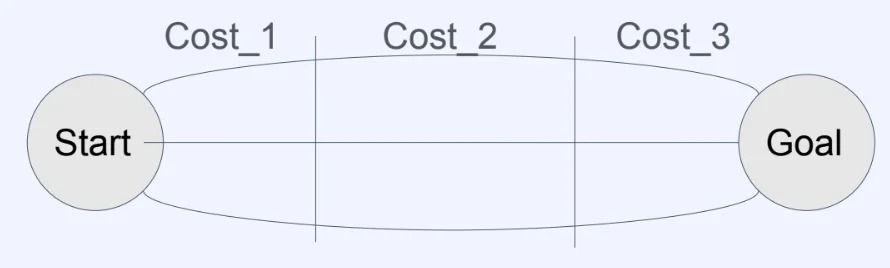
> 
>     - <code>Total&#95;Cost n</code> = <code>Total&#95;Cost n&#45;1</code> &#43; <code>Cost n</code>

### Dynamic Programming을 활용한 policy evaluation

> 
> 
> 
> 
> <strong>Bellman equation for Value function (MDP)</strong>
> 
> 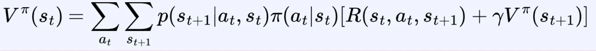

> 해당 알고리즘을 <code>iterative policy evaluation</code>이라 한다&#46; 

1.  <strong>모든 state</strong>에 대해 정의된 임의의 <strong>value function</strong>을 만든다&#46;  (보통 table 혹은 array로 만듦)
    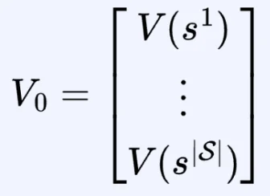

1.  Value function에 대한 <strong>Bellman equation</strong>을 이용해 아래와 같이 Value function을 <strong>업데이트</strong> 한다&#46; 
    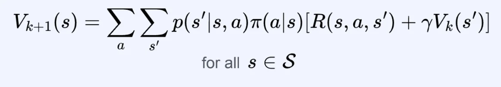

    - <code class="language-math">V&#95;k(s&#39;)</code> 를 통해서 <code class="language-math">V&#95;{k&#43;1}(s)</code>을 만드는 과정이다&#46;

1.  계속해서 <code>2</code>를 반복하다가, <strong><u>충분히 수렴</u></strong>했다고 판단되면 멈춘다&#46; 
    - 미리 설정한 threshold 값  이하로 Value function의 변화량이 낮아질 때
        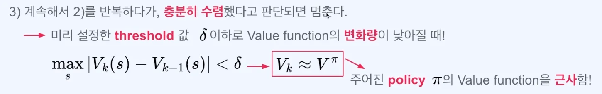

- 충분히 수렴했다는 것은 어떻게 판단할 수 있나?
    - 미리 설정한 threshold 값  이하로 Value function의 변화량이 낮아질 때 수렴했다고 판단한다&#46; 
        

        ⇒ k를 계속 증가시키면서 V를 업데이트(<code class="language-math">max&#95;a &#124;V&#95;k(s) &#45; V&#95;{k&#45;1}(s)&#124;</code>) 하는데 이 값이 <code class="language-math">&#92;delta</code> 이하로 떨어지면 변화량이 작기 때문에 거의 수렴했다고 판단하는 것이다&#46;

        

        ⇒ <code class="language-math">max&#95;a &#124;V&#95;k(s) &#45; V&#95;{k&#45;1}(s)&#124; &#60; &#92;delta</code>

- <code class="language-math">V&#95;k</code> 가 <code class="language-math">V^{&#92;pi}</code> 와 비슷해진다는 것을 어떻게 판단하는가?
    - 만약 <code class="language-math">&#92;gamma &#60; 1</code> 이고 <code>2</code>를 <strong><u>무한히 반복</u></strong>한다면, <strong>실제</strong> Value function <code class="language-math">V^{&#92;pi}</code> 에 수렴한다&#46;
        - 이론적으로 증명됨 

    - 이를 수학적으로 표현한 것이 아래와 같다&#46; 
        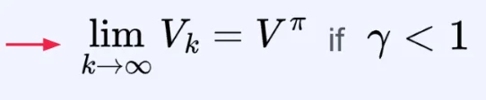

    - 그러나 실제 상황에서는 무한히 반복할 수 없다&#46; 

### iterative policy evaluation

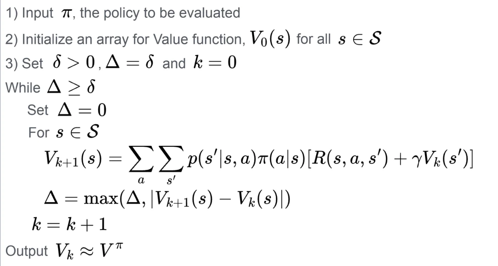

1. policy 정의
    

    - 해당 policy로 value function을 계산하는 것이 목적이다&#46;

1. value function 초기화
    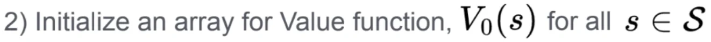

    - 환경에 존재하는 모든 state에 대해서 value function의 값을 초기화한다&#46; 

    - 0 혹은 어떤 랜덤한 실수로 설정해도 괜찮다&#46; 

1. 변수 설정
    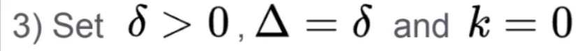

    - 충분히 수렴했다는 것을 확인하기 위한 <code class="language-math">&#92;delta </code> 값을 양수로 설정

    - policy evaludation이 진행되는 동안 value function의 변화량 중 가장 큰 값을 저장하기 위한 변수 <code class="language-math">&#92;Delta</code> 를 <code class="language-math">&#92;delta </code> 와 같게 설정한다&#46; 
        - <code class="language-math">&#92;Delta  = &#92;delta</code> ( 대문자 델타 = 소문자 델타 )

    - value function이 얼마나 evaluation 됐는지 나타내는 k는 0으로 초기화한다&#46; 

1. While 문부터 policy evaluation이 시작된다&#46; 
    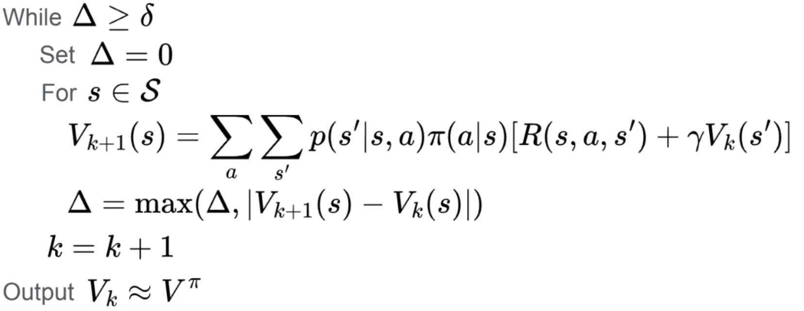

    - <code class="language-math">&#92;Delta</code>가 <code class="language-math">&#92;delta</code>(thredhold) 보다 크거나 같다면 충분히 수렴하지 않았다고 판단하고 policy evaluation 반복해서 진행한다&#46; 

    - policy evaluation 시작 시, value function의 변화량 중 가장 큰 값을 저장하기 위한 <code class="language-math">&#92;Delta</code>는 0으로 초기화한다&#46; 

### DP(Dynamic Programming)을 활용한 iterative policy evaluation의 특징

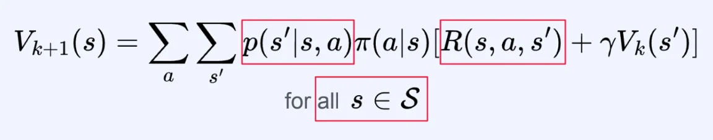

1. 환경의 <strong>MDP 모델</strong>을 알아야 한다&#46;
    - bellman equation을 구하기 위해서는 <code>transition probability</code>가 필요하고 <code>reward function</code>도 필요하다 

    - 위 2개가 모두 MDP에 속한 요소이기 때문이다&#46;  즉, MDP 모델을 알아야 한다&#46;

1. <strong>State space</strong>가 <strong><u>너무 큰 경우</u></strong>에는 Computation이 많이 요구되므로 사용하기 어려움&#46;
    - 모든 state에 대해서 반복하기 때문에 state 개수가 많아지면 계산해야 될 양이 굉장히 많아진다&#46; 
        - O(<code class="language-math">n^2</code>)으로 연산량 증가
