<a id="34eeda9b0fe18060aa46dc8768ee3158"></a>

### &#91;추가&#93;

[&#91;강화학습&#93; 2&#45;1강&#46; Markov Decision Process (MDP) 쉬운 설명]()

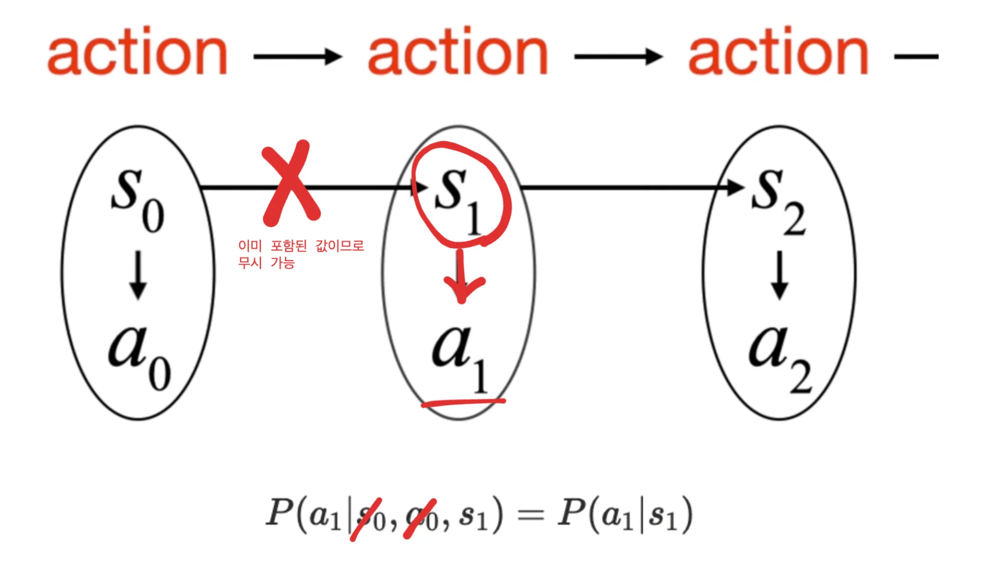

<a id="34eeda9b0fe18022a0c0df9b49ee3f6a"></a>

마르코프 가정에 의해서 다음 state는 이전 state에 영향을 받는다&#46; 

<a id="34eeda9b0fe1805c945cebba64672f5d"></a>

즉, 이전 state에는 이미 그 전 state에 대한 내용이 다 반영된 값이다&#46;

<a id="34eeda9b0fe18022b7c4c684719ec153"></a>

따라서 아래 식이 성립할 수 있다&#46; 

<a id="34eeda9b0fe180a8b87bf7b022ec6068"></a>

<code class="language-math">P(a&#95;1 &#124; s&#95;0, a&#95;0, s&#95;1 ) = P(a&#95;1 &#124; s&#95;1 )</code>

- <code class="language-math">s&#95;1</code>에 이미 <code class="language-math">s&#95;0</code>, <code class="language-math">a&#95;0</code>에 대한 정보가 들어있기 때문에 무시할 수 있다&#46; 

<a id="34eeda9b0fe18039b135f003cf0f1ad0"></a>

### 강화학습의 목표 &#45; 최대의 평균 보상값


- 범위에 대해서 random variable을 가정하기 때문에 평균을 취한 값으로 계산한다&#46; 

<a id="341eda9b0fe1800980ebca2b73b7f79b"></a>

## 마르코프 의사결정 과정(Markov decision process)

---

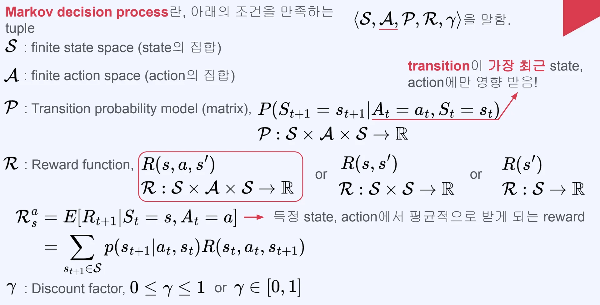

- 이전 Markov Reward Process에서 <strong><u>Action이 추가</u></strong>된 형태이다&#46; 

<details>
<summary><code class="language-math">P</code>, <strong>Transition probability model(metrix) (</strong><strong><code>전이 확률 모델(매트릭)</code></strong><strong>)</strong></summary>

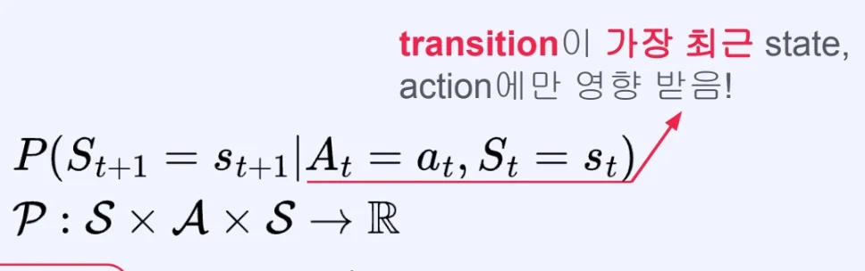

> <code class="language-math">P(S&#95;{t&#43;1} = s&#95;{t&#43;1} &#124; </code> <code class="language-math"> A&#95;t = a&#95;t</code><strong> </strong><code class="language-math">, S&#95;t = s&#95;t)</code>

- transition이 가장 최근 state, <strong><u>action</u></strong>에만 영향을 받는다&#46; 

</details>

<details>
<summary><code class="language-math">R</code> , <strong>Reward function </strong></summary>

- Reward function 표기 1 &#45; action 고려
    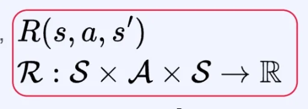

    - <strong><u>Action을 고려</u></strong>한 Reward function이다&#46; 
        - action에 따라 보상의 차이가 발생할 수 있다&#46; 

        <details>
        <summary>ex)</summary>

        - S(state)&#58; 돈

        - R(reward)&#58; 현재 소유하고 있는 돈의 액수의 차이로 계산

        <a id="342eda9b0fe18074b0dcce3fda281a0f"></a>

        돈의 소유량을 증가시키기 위해 다양한 행동을 할 수 있다&#46; <br>열심히 일을 해서 돈을 벌 수 있지만, 나쁜 행동을 통해서 돈을 벌 수도 있다&#46; 

        <a id="342eda9b0fe180b48c04fb8c3a99f78e"></a>

        이때, 만약 <strong>액션이 고려되지 않은 보상</strong>이면 <strong>나쁜 행동을 통해서 번 돈과 열심히 일을 해서 번 돈을 똑같은 reward로 계산</strong>한다&#46; 

        <a id="342eda9b0fe180d58ff9ec5a49634262"></a>

        그러나<strong> </strong><strong><u>action을 고려</u></strong>한 경우, <strong>나쁜 행동을 통해서 번 돈을 </strong><strong>음의 보상으로 변환</strong>하여 <br>에이전트 행동까지 고려한 보상 체계를 만들 수 있다&#46; 

        - 좀더 포괄적으로 사용되는 reward function 이다&#46;

        </details>

- Reward function 표기 2 &#45; action 제외
    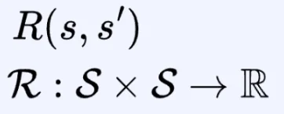

    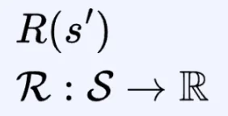

    - 앞서 <a href="#/post/340eda9b-0fe1-8068-9b3c-f1a707f244c0">페이지</a>에서 살펴본 <br>Reward function과 동일하다&#46;

</details>

<details>
<summary><strong>특정 state, action에서 평균적으로 받게 되는 reward</strong> (<strong><code>Stochastic environment</code></strong><strong>)</strong></summary>

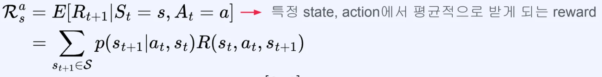

- <code class="language-math">&#92;mathbb{E}&#91;R&#95;{t&#43;1} &#124; S&#95;t = s, A&#95;t = a&#93;</code>
    - 특정 state, action 에서 평균적으로 받게 되는 reward

- <code class="language-math">p(s&#95;{t&#43;1}  &#124; a&#95;t, s&#95;t)</code>
    - 특정 state에서 action을 통해 다음 state로 갈 확률

- <code class="language-math">R(s&#95;t, a&#95;t, s&#95;{t&#43;1})</code>
    - 특정 state, action에서 다음 state로 이동할 때 받는 보상

</details>

<details>
<summary>Action 선택에 대한 확률</summary>

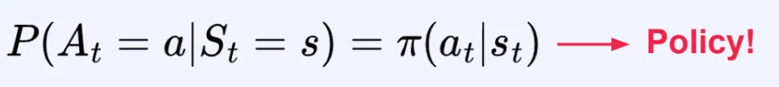

- <code class="language-math">S&#95;t</code> 가 s로 주어졌을 때 특정 행동을 고를 확률

- 앞에서 배웠던 Policy와 같은 개념이다&#46; 
    - <code class="language-math">&#92;pi(a&#95;t &#124; s&#95;t)</code>

    - 어떤 state가 주어졌을 때 특정 행동을 고를 확률과 같다&#46; 

</details>

<details>
<summary> State 간의 transition probability</summary>

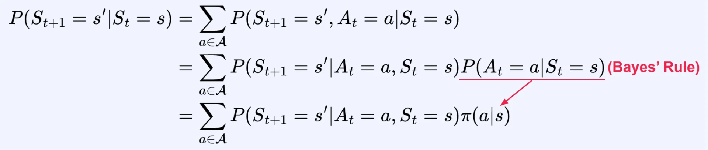

- 조건으로 Action이 추가 되었다&#46; 

- MDP에서 state 간의 transition probability matrix를 만들기 위해서 위 수식이 필요하다&#46; 

</details>

<details>
<summary><strong>Deterministic environment</strong>에 대한 state 간 transition</summary>

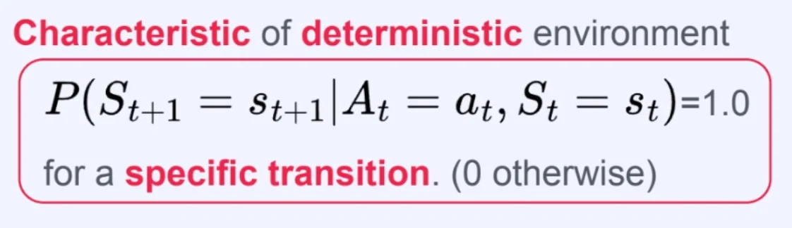

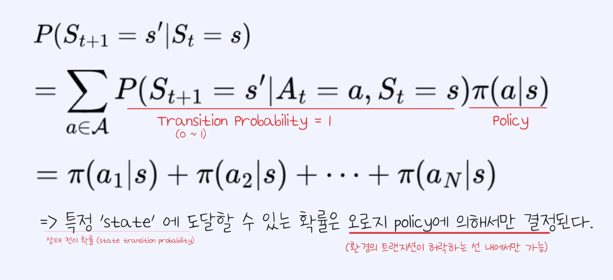

- 현재 상태 s에서 행동 a를 하면, 다음 상태 s&#39;와 보상 r이 <strong><u>항상 하나로 고정</u></strong><strong>되는 환경</strong>
    > <code class="language-math">P(S&#95;{t&#43;1} = s’ &#92;mid A&#95;t = a, S&#95;t = s) = 1</code>

    - 어떤 특정 state에서 행동을 취했다면, 그 다음 가게되는 <code class="language-math">s&#95;{t&#43;1}</code>은 무조건 한 가지 경우에 대해서만 확률이 ‘1’ 이다&#46;

</details>

<details>
<summary><strong>Markov decision process 예시 1  &#45; </strong><strong><code>Deterministic environment</code></strong></summary>

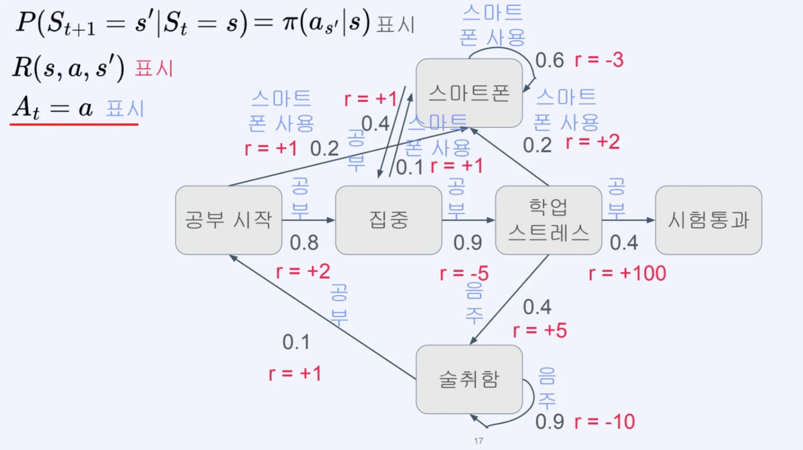

- 각 action에 대한 확률은 1로 동일하다&#46;  <br>즉, <code class="language-math">P(S&#95;{t&#43;1} = s’ &#92;mid A&#95;t = a, S&#95;t = s) = 1</code> 이라는 의미이다&#46; 
    <a id="343eda9b0fe18023a75dc524e0777de9"></a>

    → <strong>Deterministic environment</strong>

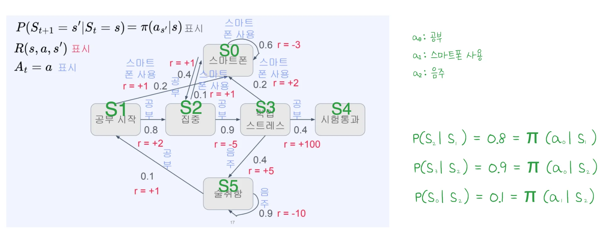

- <strong>Deterministic environment 이기 때문에 policy 값만을 통해서 transition probability를 구할 수 있다&#46; </strong>

</details>

<details>
<summary><strong>Markov decision process 예시 2  &#45; </strong><strong><code>Stochastic environment</code></strong></summary>

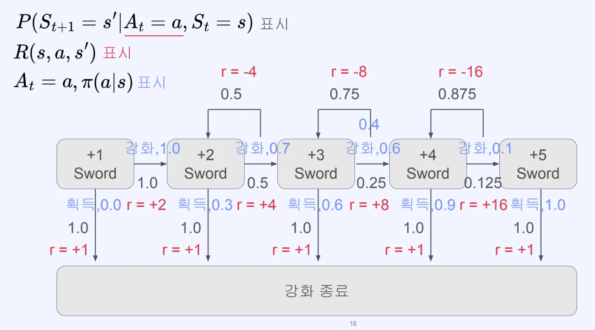

- 해당 예제는 <code>Stochastic environment(확률적 환경)</code>이다&#46;  <br>즉,  action에 대해서 발생 확률이 존재한다&#46; 

- 따라서 <code>전이 확률(transition probability)</code>를 구하기 위해서 

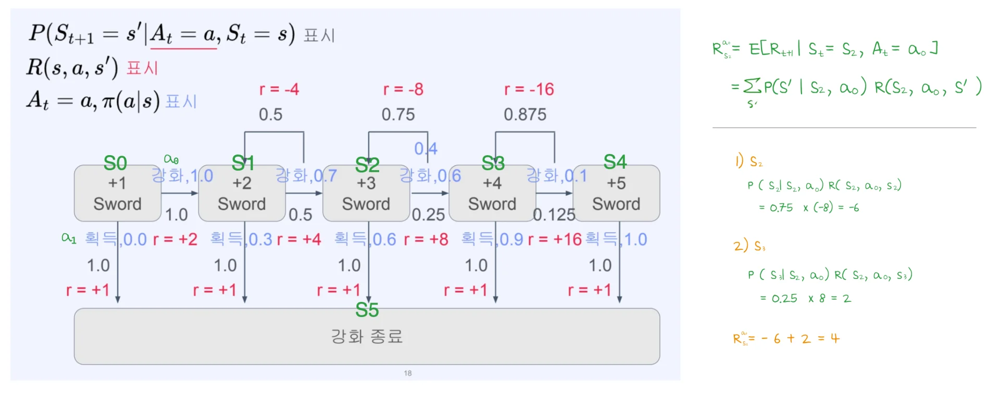

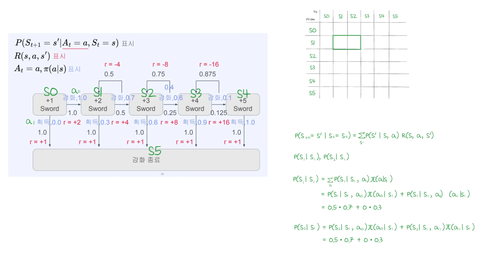

</details>

<details>
<summary>🧐 <strong>&#91;선행 지식&#93; 조건부 확률</strong></summary>

- 조건부 확률의 정의
    > <code class="language-math">P(B &#92;mid A) = &#92;frac{P(B, A)}{P(A)}</code> <code class="language-math">= &#92;frac { P(B ∩ A)}{P(A)}</code> 

    -  ( <code class="language-math">P(B, A) = P(B ∩ A)</code> )

    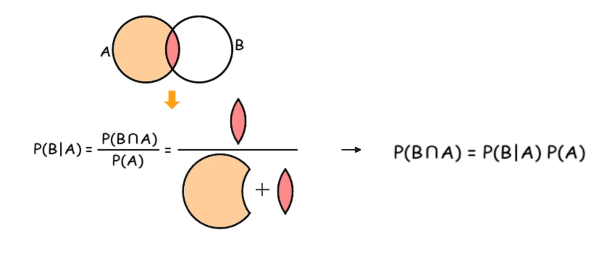

    <details>
    <summary>예시<br></summary>

    > 
    > 
    > - 전체 사람&#58; 100명
    > 
    > - B (남자)&#58; 40명
    > 
    > - A ∩ B (남자 &#43; 키 180 이상)&#58; 10명

    - 구하려는 값&#58; 남자 중에서 키 180 이상일 확률
        <a id="342eda9b0fe180e2b138fd73d75a6c82"></a>

        <code class="language-math">P(B &#124; A)</code>

        - <code class="language-math">&#10;</code><code class="language-math">A</code>&#58; 남자

        - <code class="language-math">B</code>&#58; 180 이상일 확률

        <a id="342eda9b0fe180ea8b79c6fda40fc928"></a>

        <code class="language-math">P(B &#92;mid A) = &#92;frac{P(B, A)}{P(A)}</code> <code class="language-math">= &#92;frac { P(B ∩ A)}{P(A)}</code> 

        <a id="342eda9b0fe180e09b6dc63ae1410b67"></a>

        <code class="language-math">= &#92;frac {10} {40} = 0&#46;25</code>

    </details>

- 확장
    > <code class="language-math">P(X &#92;mid Y, Z) = &#92;frac{P(X, Y &#92;mid Z)}{P(Y &#92;mid Z)}</code>

    <a id="342eda9b0fe1804a8f4dd069166fc599"></a>

    <strong><u>전체 확률 공간을 Z로 제한</u></strong>한다고 생각하면 아래와 같다 &#46;

    - <code class="language-math">P&#95;Z(A) = P(A &#92;mid Z)</code>

    <a id="342eda9b0fe1809fbd46f591bb2201ae"></a>

    이 상태에서 다시 조건부 확률 정의를 쓰면 아래와 같은 수식을 가지게 된다&#46; 

    - <code class="language-math">P&#95;Z(X &#92;mid Y) = &#92;frac{P&#95;Z(X, Y)}{P&#95;Z(Y)}</code> 

    <a id="342eda9b0fe180d9b2b7d6179419a65a"></a>

    이걸 다시 원래 표기로 바꾸면 확장된 식으로 유도가 된다&#46; <br>즉, <strong><u>Z라는 조건 아래</u></strong>에서 <strong><u>다시 조건부 확률 정의를 쓴 것</u></strong>이다&#46; 

    - <code class="language-math">P(X &#92;mid Y, Z) = &#92;frac{P(X, Y &#92;mid Z)}{P(Y &#92;mid Z)}</code>

    <a id="342eda9b0fe18097a30ee1008be6883e"></a>

    또한 위 식은 아래와 같이 변형이 가능하다&#46; 

    <a id="342eda9b0fe18080bad6eed73eb870ec"></a>

    ⇒ <code class="language-math">P(X, Y &#92;mid Z) = P(X &#92;mid Y, Z) &#92;cdot P(Y &#92;mid Z)</code>

</details>

<details>
<summary>🧐 <strong>&#91;선행 지식&#93; 베이즈 룰</strong></summary>

- <strong>베이즈 룰</strong>
    > <code class="language-math">P(X &#92;mid Y, Z) = &#92;frac{P(Y &#92;mid X, Z)&#92;, P(X &#92;mid Z)}{P(Y &#92;mid Z)}</code>

    - Y를 보고 X를 추론하는 공식<br>

- <strong>식 유도</strong>
    <a id="342eda9b0fe180f1bbf2f52c68aebd11"></a>

    조건부 확률, <code class="language-math">P(X &#92;mid Y, Z) = &#92;frac{P(X, Y &#92;mid Z)}{P(Y &#92;mid Z)}</code> 에 

    <a id="342eda9b0fe180ffb5e1cdb2d3da2092"></a>

    조건부 확률 변형, <code class="language-math">P(X, Y &#92;mid Z) = P(Y &#92;mid X, Z)&#92;, P(X &#92;mid Z)</code> 대입

    <a id="342eda9b0fe1807287c1fb76b34ceafb"></a>

    ⇒ 베이즈 룰, <code class="language-math">P(X &#92;mid Y, Z) = &#92;frac{P(Y &#92;mid X, Z)&#92;, P(X &#92;mid Z)}{P(Y &#92;mid Z)}</code>

</details>

> 🤔 
> 
> <a id="342eda9b0fe1809ab8bafbd762730651"></a>
> 
> 조건 하나를 추가하고 그 조건에 가능한 모든 경우에 대해서 다 더해주면 <br>해당 조건이 사라지고 남은 조건에 대한 확률이 나온다&#46;
> 
> - 해당 조건에 대한 <strong>모든 경우의 수를 더해서 조건을 제거</strong>하는 것이다&#46; <br>즉, <code class="language-math">&#92;sum&#95;{조건}</code><u> 이라는 가정이 적용</u>되어야 가능하다 &#46;
> 
> <a id="342eda9b0fe1800fb467d4b17fc17d01"></a>
> 
> ⇒ 전확률 법칙, 주변화

<details>
<summary>전확률 법칙, 주변화 비교</summary>

| <strong>구분</strong> | <strong>주변화</strong> | <strong>전확률 법칙</strong> |
| --- | --- | --- |
| 관점 | 구조 | 계산 |
| 목적 | 변수 제거 | 확률 계산 |
| 입력 | 결합확률 | 조건부 확률 |
| 느낌 | 압축 | 평균 |

</details>

<details>
<summary><strong>🧐 전확률 법칙 (Law of Total Probability)</strong></summary>

<details>
<summary>정의</summary>

- 이산(discrete)&#58; 합(<code class="language-math">Σ</code>)
    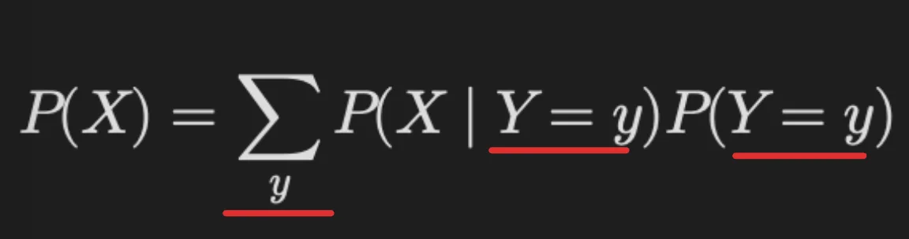

- 연속(continuous)
    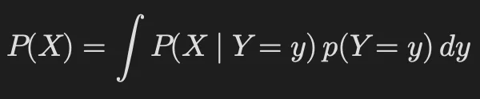

<a id="342eda9b0fe180ce9d4fdcf1c614c712"></a>

⇒ 조건부 확률 &#43; 주변화

</details>

<details>
<summary>의미</summary>

- <strong>Y를 모를 때, Y의 모든 경우를 고려한 X의 평균 확률</strong>
    <a id="342eda9b0fe1808786d9cefe28283df0"></a>

    ```yaml
    각 경우의 확률 × 그 경우가 일어날 확률  → 전부 더함
    ```

- 단순 평균이 아닌 가중 평균(weighted average)임

</details>

<details>
<summary><strong>관점 (Perspective)</strong></summary>

- 확률 계산 관점
    > Y를 모르는데 X 확률 어떻게 구하는가?

    <a id="342eda9b0fe180a0b90ce3a42e023bae"></a>

    → Y의 가능한 모든 경우를 나눠서 계산한 뒤 평균을 낸다&#46; 

- 해석
    - Y&#58; 불확실한 변수

    - X&#58; 구하려는 값

    <a id="342eda9b0fe1808db8edea03a5a16dfd"></a>

    따라서 불확실성을 평균으로 흡수한다&#46; 

</details>

<details>
<summary>예시</summary>

<a id="342eda9b0fe180b887d1d4ae2a74215e"></a>

<strong>상황</strong>

- Y&#58; 날씨
    - 맑음 (0&#46;7)

    - 비 (0&#46;3)

- X&#58; 지각 여부

<a id="342eda9b0fe180b4b974c7adfc53cc17"></a>

<strong>조건부 확률</strong>

- <code class="language-math">P(X &#92;mid 맑음) = 0&#46;1</code>

- <code class="language-math">P(X &#92;mid 비) = 0&#46;4</code>

<a id="342eda9b0fe1802ebb01f707ed181d9b"></a>

<strong><br>전확률 적용</strong>

<a id="342eda9b0fe1808fa839c2fb41b7dedb"></a>

```yaml
지각 확률 = (맑은 날 지각 확률 × 맑을 확률) + (비 오는 날 지각 확률 × 비 올 확률)
```

- <code class="language-math">P(X) = 0&#46;1 &#92;times 0&#46;7&#43;0&#46;4 &#92;times 0&#46;3</code>
    <a id="342eda9b0fe180159f9ac91b90189175"></a>

                <code class="language-math">= 0&#46;07 &#43; 0&#46;12 = 0&#46;19</code>

</details>

</details>

<details>
<summary><strong>🧐 주변화 (Marginalization)</strong></summary>

<details>
<summary>정의 </summary>

- 이산(discrete)
    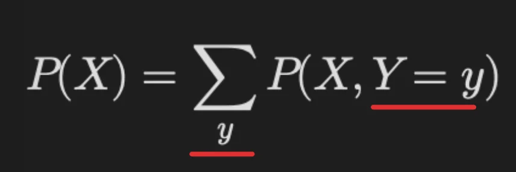

- <strong>연속(continuous)</strong>
    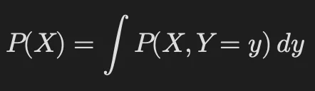

<a id="342eda9b0fe18000a934c1dd593bdf01"></a>

⇒  결합확률에서 특정 변수(Y)를 제거하는 연산

1. <strong>X는 항상 어떤 Y와 함께 발생한다</strong>
    > <code class="language-math">X 발생</code> <code class="language-math">= (X ∩ Y=y1) </code> or <code class="language-math">(X ∩ Y=y2) </code> or (<code class="language-math">X ∩ Y=y3) …</code>

    - 서로 겹치지 않는(disjoint) 사건이다&#46; 그래서 더할 수 있다&#46; 

1. 확률 기본 성질 &#45; 서로 겹치지 않는 사건이면 확률은 더할 수 있다&#46; 
    > <code class="language-math">P(X) = P(X &#92;cap Y=y1) &#43; P(X &#92;cap Y=y2) &#43; &#92;dots</code>
    > 
    > <a id="342eda9b0fe180ae9fc5e4e01d6f4ac8"></a>
    > 
    >      <code class="language-math">= &#92;sum&#95;y P(X, Y=y)</code>

</details>

<details>
<summary>의미</summary>

<a id="342eda9b0fe1803b9e7ed0b0b15928f0"></a>

<strong>⇒ </strong><strong>Y의 모든 경우를 다 합쳐서 X만 남긴다</strong>

<a id="342eda9b0fe1807a9888ec9f32771d91"></a>

→ X는 항상 어떤 Y와 함께 발생한다

<a id="342eda9b0fe18041a01bd24c0df6670f"></a>

→ Y의 모든 경우를 포함해서 더하면 X 전체가 된다

<a id="342eda9b0fe180a8af2dc7ad5359c9bd"></a>

⇒ Y를 무시하는 게 아니라 <strong><u>Y의 모든 경우를 다 포함시켜서 X만 남게 만든다</u></strong>

</details>

<details>
<summary>관점</summary>

- <strong>구조적 관점 (가장 중요)</strong>
    > 데이터/확률에서 Y라는 차원을 없애고 싶다

    <a id="342eda9b0fe1806c9fb0ee61f01f2e3e"></a>

    → (X, Y) → X

    - 다차원 → 저차원

    - feature 제거

    - latent variable 제거

</details>

<details>
<summary>예시 </summary>

<a id="342eda9b0fe180b3adf4d8e735346e5f"></a>

<strong>상황</strong>

- Y&#58; 성별 (남, 여)

- X&#58; 키 180 이상

<a id="342eda9b0fe18065913ff7280db5d741"></a>

<strong>데이터</strong>

| <code class="language-math">Y</code> | <code class="language-math">X &#92;cap  Y</code> |
| --- | --- |
| 남자 | 10 |
| 여자 | 5 |

<a id="342eda9b0fe1801cad51e41f6d360237"></a>

주변화

<a id="342eda9b0fe18043925debc743b97536"></a>

```yaml
x키 180 이상 = (남자 중 180 이상) + (여자 중 180 이상)
```

<a id="342eda9b0fe18028bef9d9289d13a7d0"></a>

<code class="language-math">P(X) = P(X, Y=&#92;text{남}) &#43; P(X, Y=&#92;text{여})</code>

- <code class="language-math">P(X) = &#92;frac{15}{100}</code>

- <code class="language-math">P(X, Y=&#92;text{남}) = &#92;frac{10}{100}</code>

- <code class="language-math">P(X, Y=&#92;text{여}) = &#92;frac{5}{100}</code>

<a id="342eda9b0fe180ac9474cacf3cdb56f5"></a>

⇒ <code class="language-math">P(X) = 0&#46;1 &#43; 0&#46;05 = 0&#46;15</code>

</details>

> 🤔 
> 
> <a id="342eda9b0fe18075af5ff4e99619215e"></a>
> 
> <strong>왜 “조건이 사라진다”고 표현하는가?</strong>
> 
> <a id="342eda9b0fe180a5b7b9ca611e674b7b"></a>
> 
> 수식적으로 보면
> 
> - 왼쪽&#58; P(X) → Y 없음
> 
> - 오른쪽&#58; P(X, Y=y) → Y 있음
> 
> <a id="342eda9b0fe1801c8bb5e2f0dadf0c6f"></a>
> 
> Y를 포함한 항들을 전부 더했더니 결과는 Y 없는 형태가 된다&#46; 
> 
> -  조건을 제거한다 &#45; ❌ 
> 
> - Y의 모든 경우를 합쳐서 <strong>X만 남긴다 &#45; ✅</strong>

</details>
