

## &#91;사전 개념&#93;  Random Variable X의 평균에 대한 Y 표현

---

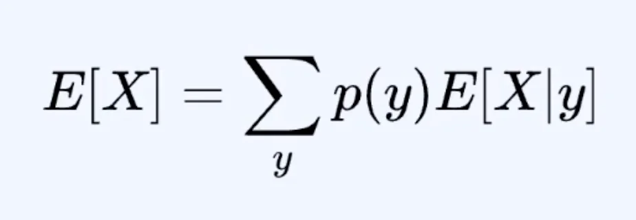

> ✏️ 
> 
> 
> 
> random variable X의 Expectation(평균)이 Y 라는 새로운 variable에 대해서 위 수식과 같이 표현될 수 있다&#46;
> 
> - <strong>전확률 법칙 기반의 기댓값 분해 (Law of Total Expectation)</strong>

### <strong>식 유도 </strong>

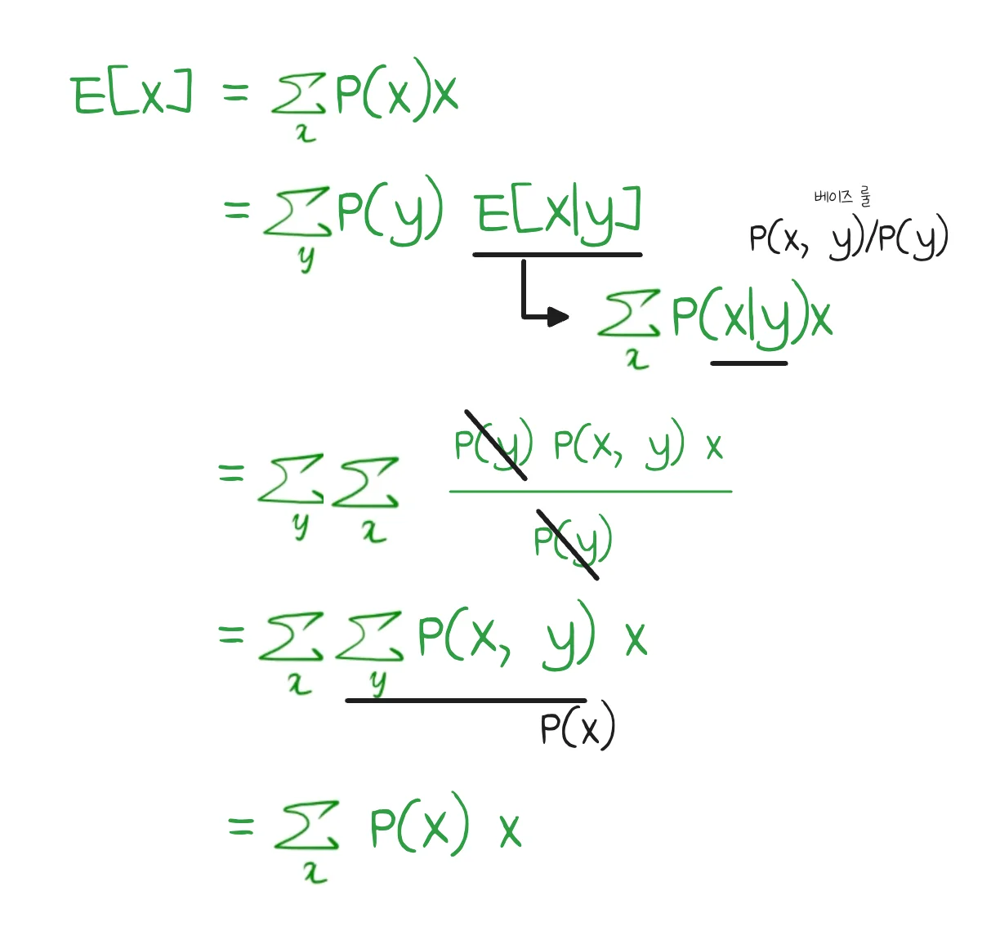

🧐 &#91;의문점&#93; <code>균등 분포</code>와 <u><code>일반 확률 분포</code></u>의 차이

### <strong>균등 분포 (일반적으로 아는 평균) </strong>

| <strong>값</strong> | <strong>확률</strong> |
| --- | --- |
| <code>10</code> | <code>0&#46;5 (1/2)</code> |
| <code>20</code> | <code>0&#46;5 (1/2)</code> |

<code class="language-math">= &#92;frac{1}{2} &#92;cdot 10 &#43; &#92;frac{1}{2} &#92;cdot 20</code>

= <code class="language-math">&#92;frac{10 &#43; 20}{2}</code>

<code class="language-math"> = 15</code>

즉, 확률이 <code class="language-math">&#92;frac {1}{n}</code>이라 나누기 <code>n</code>과 동일해 진 것이다&#46; 

### <strong>일반 확률 분포  &#45; </strong><strong>가중 평균(weighted average)</strong><strong>을 통한 평균 계산</strong>

| <strong>값</strong> | <strong>확률</strong> |
| --- | --- |
| <code>10</code> | <code>0&#46;7</code> |
| <code>&#45;5</code> | <code>0&#46;3</code> |

<code class="language-math">= 0&#46;7 &#92;cdot 10 &#43; 0&#46;3 &#92;cdot (&#45;5) = 5&#46;5</code>

여기서는 <strong><u>확률이 다르기</u></strong> 때문에 그래서 <strong><u>단순 평균 (n으로 나누기)</u></strong><strong><u>이 아니라 각각 요소들의 확률인 </u></strong> <strong>가중 평균(weighted average)</strong>으로 계산한다&#46; 

 

일반적으로 흔히 아는 발생 확률이 모두 동일한 균등 분포의 방식으로 평균을 구하는 것이 아닌

각 경우마다 발생 확률이 다른 <strong><u>가중 확률</u></strong>로  평균을 구하는 일반 확률 분포로 평균값을 구한다&#46;

<code class="language-math">⇒ E&#91;x&#93; = &#92;Sigma&#95;x P(x)x</code>

<strong>전확률 법칙 기반의 기댓값 분해 (Law of Total Expectation)</strong>

> <code class="language-math">E&#91;X&#93; = &#92;sum&#95;{y} p(y) E&#91;X &#92;mid y&#93;</code>

<strong>구성요소</strong>

- <code class="language-math">p(y)</code>&#58; 특정 조건 y가 발생할 확률

- <code class="language-math">E&#91;X &#124; y&#93;</code>&#58; 그 조건에서의 평균값

<strong>의미</strong>

- <strong>전체 평균 = (각 상활별 평균) x (그 상활이 일어날 확률)의 합</strong>

<strong>Value Function과의 연결</strong>

강화학습 에서는 해당 식이 아래와 같이 쓰인다&#46; 

> <code class="language-math">V(s) = &#92;sum &#92;pi(a &#92;mid s) Q(s, a)</code>

- 상태(<code>s</code>)의 가치는  가능한 행동들의 가치(<code class="language-math">Q(s, a)</code>)를 정책 확률(<code class="language-math">&#92;pi(a &#92;mid s)</code>)로  가중 평균한 것을 말한다&#46; 

<strong>예시</strong>

- 상황
    - 상태 s에서 행동 2개
        - a1&#58; 70% → 보상 기대값 10

        - a2&#58; 30% → 보상 기댓값 2

- 계산
    - <code class="language-math">V(s) = 0&#46;7 &#42; 10 &#43; 0&#46;3 &#42; 2 = 7 &#43; 0&#46;6 = 7&#46;6</code>

## MRP <code class="language-math">&#60;S, P, R, &#92;gamma&#62;</code>에서 Value function에 대한 Bellan equation

---

### <strong>유도 방법 1</strong>

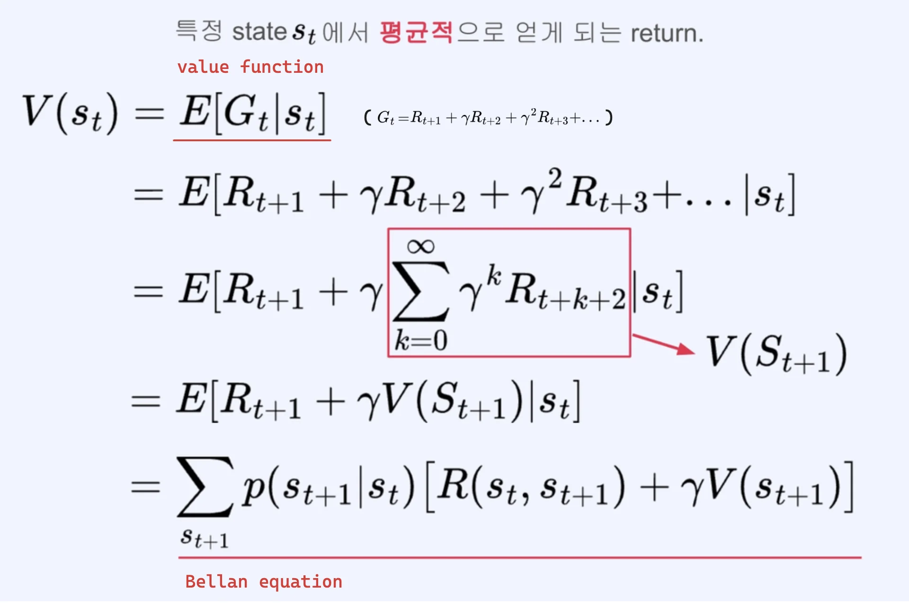

- 시점 t 에서의 <strong>총 미래 보상</strong> 
    

- <code class="language-math">V(S&#95;{t&#43;1})</code>에서 <code class="language-math">S</code>도 Random variable이기 때문에 Expectaion을 취하여 계산한다&#46; 
    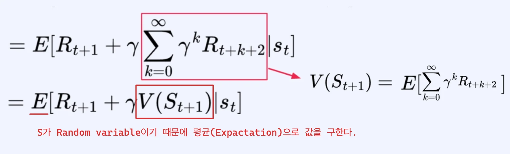

- 평균은 발생 가능한 경우의 수에 대한 <code>가중 확률 &#42; (reword &#43; value)</code>로  구한다&#46; 
    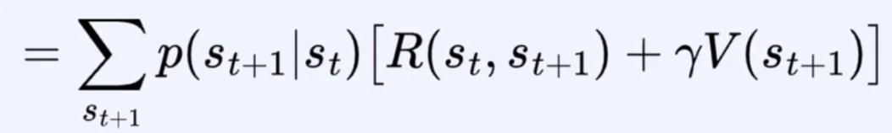

    - MRP 이기 때문에 Action을 고려하지 않는다&#46; 

### <strong>유도 방법 2</strong>

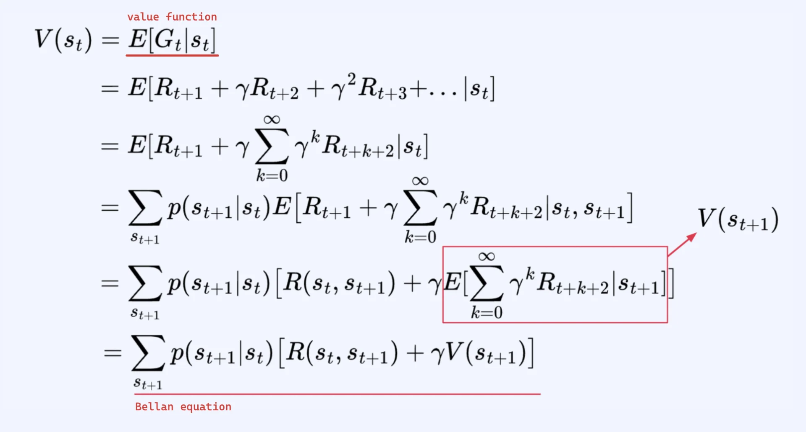

- <code class="language-math">S&#95;{t&#43;1}</code>에 대한 표현으로 변형
    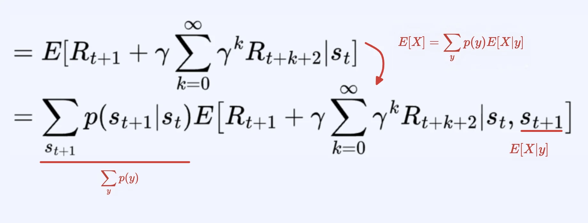

    - 위 &#91;사전개념&#93; 활용 &#45; 식 유도 방법은 위 참조

- 나머지 내용은 유도 방식 1과 동일

### 정리 &#45; Bellman equation for Value function (MRP)

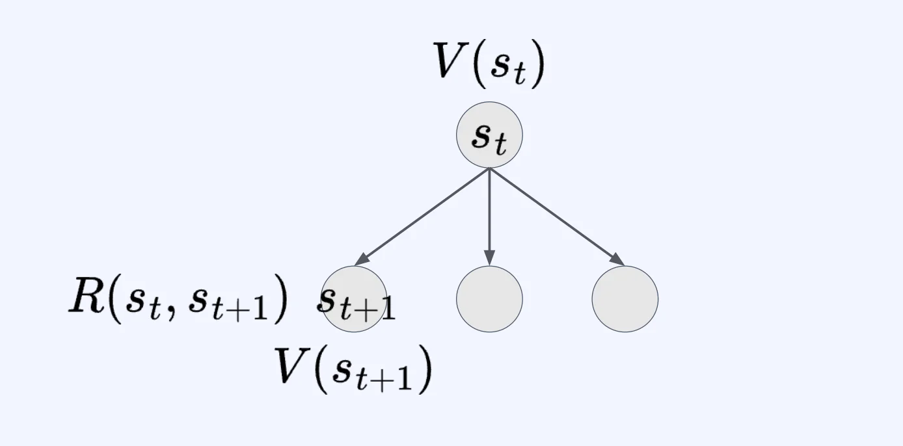

### Bellman equation for Value function (MRP)

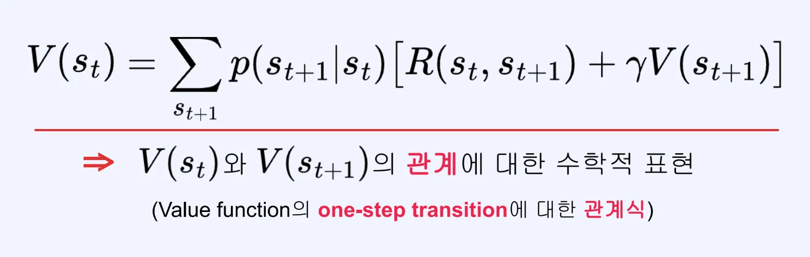

### 예제

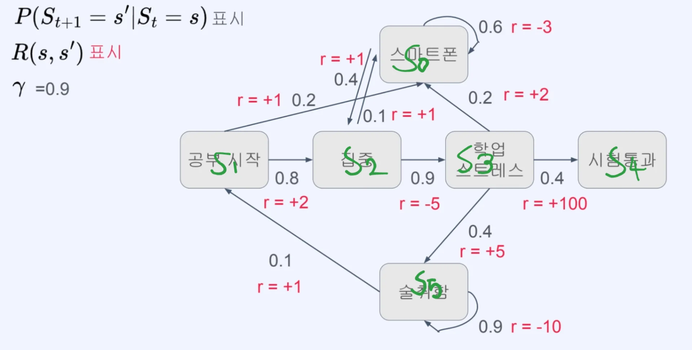

1. <code class="language-math">s&#95;0</code> 에 대한 value functiond에 대한 bellman equation
    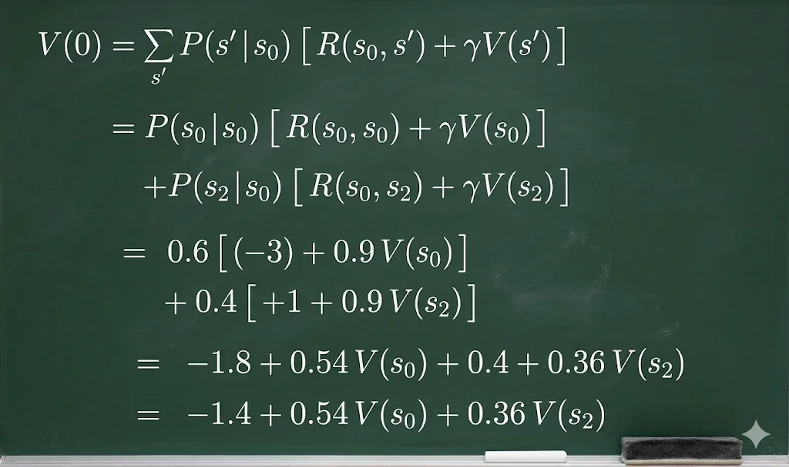

1. <code class="language-math">s&#95;3</code> 에 대한 value functiond에 대한 bellman equation
    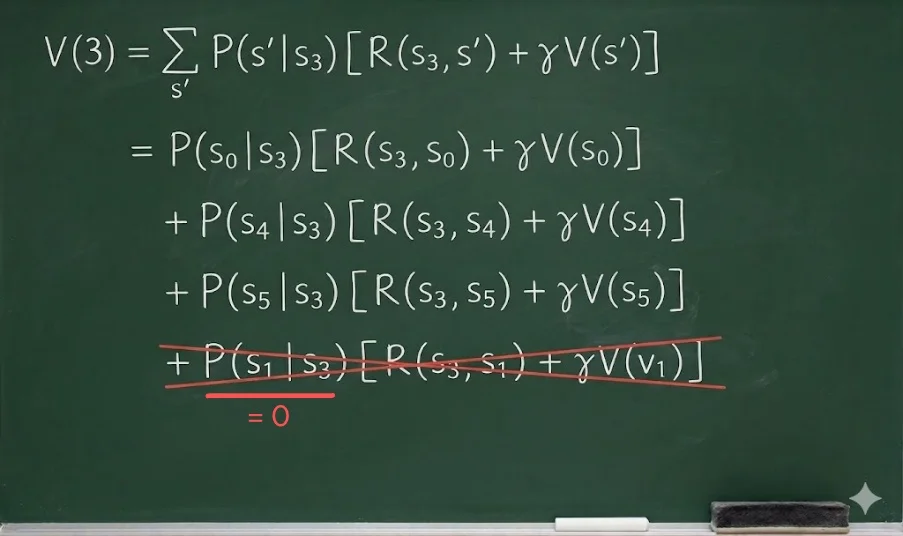

    - 가능한 next state가 아닌 경우,  transition probability(전이확률)이 0이기 때문에 생략한다&#46;
