

## <code>MRP</code>에서 <code>Value function</code>에 대한 Bellman equation의 행렬화

### Value function의 Bellman equation을 행렬화하여 가치함수 계산

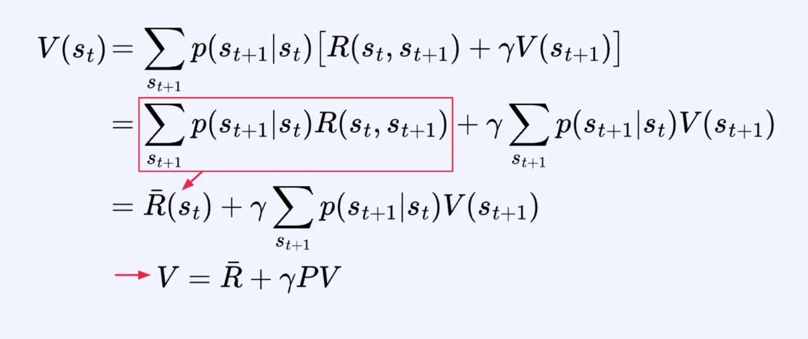

MRP에 대한 Value function의 Bellman equation에서 위 식의 관계를 만족한다&#46; 

- MRP에서는 policy가 존재하지 않기 때문에 <code class="language-math">&#92;pi</code> 기호를 생략한다&#46;

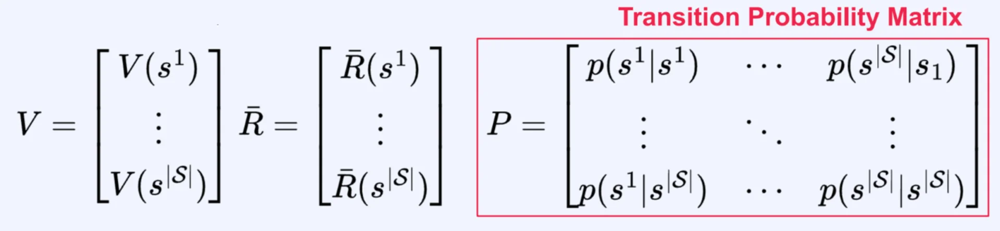

- <code class="language-math">&#124;s&#124;</code>
    - Cardinality s

    - s라는 집합에 있는 원소 개수 즉, 가능한 모든 state 대한 개수를 의미한다&#46; 

### 증명

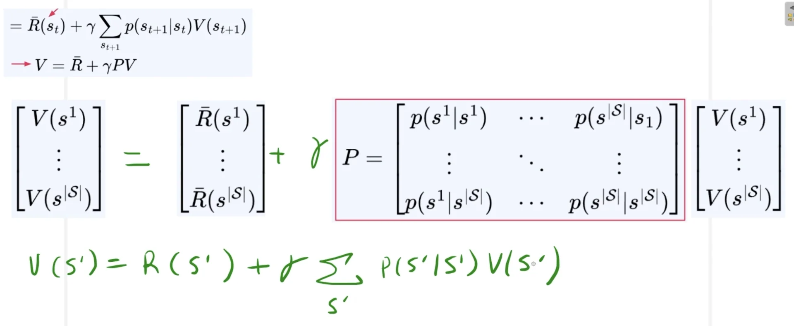

- <code class="language-math">V(s&#39;) = R(s&#39;) &#43; &#92;gamma &#92;Sigma&#95;{s&#39;} P(s&#39; &#124;s&#39;) V(s&#39;)</code>  성립하는 것을 확인할 수 있다&#46; 

### Value function 계산&#58; <code class="language-math">P</code><code>, </code><code class="language-math">&#92;bar{R}</code><code>  → </code><code class="language-math">V</code>

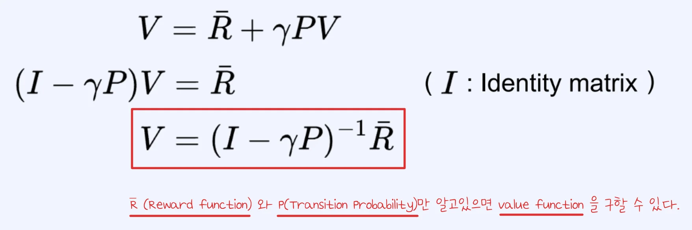

ex) <code class="language-math">P=I, &#92;gamma = 0&#46;9</code>

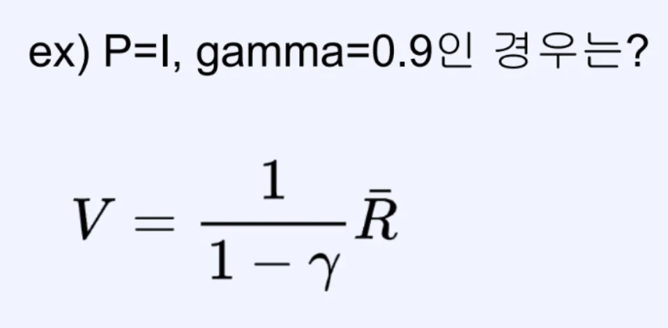

- <code class="language-math">P = I</code> 인 경우, 대각선만 1&#46;0이 된다&#46; 
    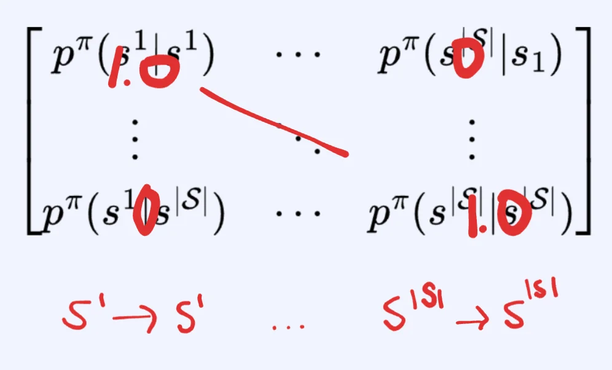

    - 동일한 state로 전이하는 재귀 구조만 가능하다&#46;

- <code class="language-math">&#92;bar{R} (S^1)</code>
    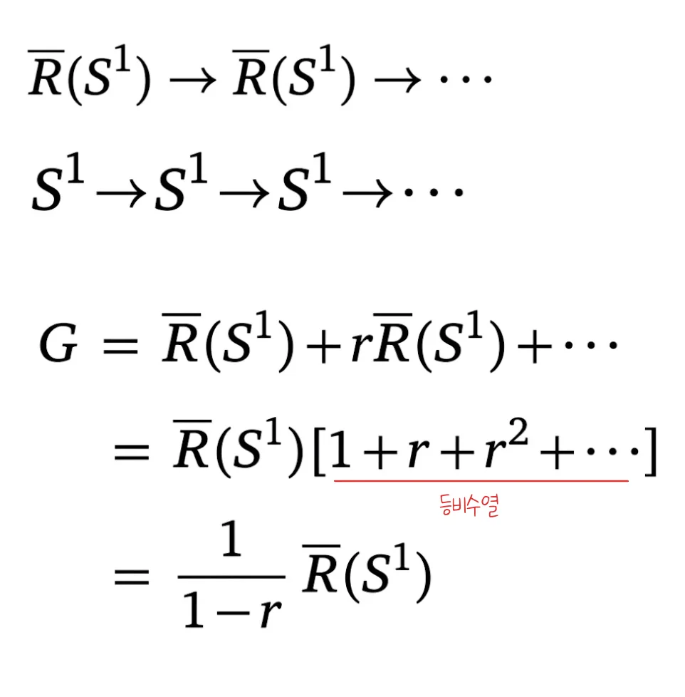

### 예제

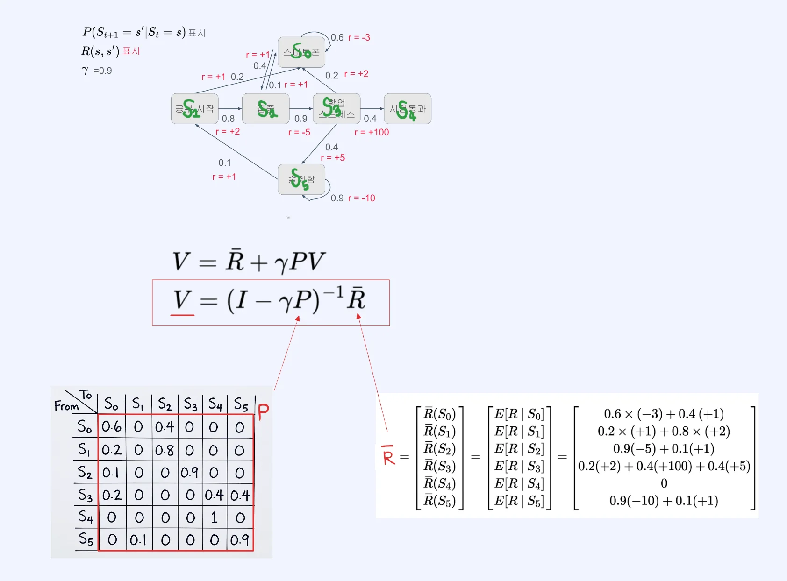

- <code class="language-math">P</code>, <code class="language-math">&#92;bar{R}</code> 을 통해 Value function을 구할 수 있다&#46; 

## <code>MDP</code>에서 <code>Value function</code>에 대한 Bellman equation의 행렬화

> ✏️ 
> 
> 
> 
> MDP 에서 부터는 policy가 포함된다&#46;

### MDP에서 Value function에 대한 Bellman equation의 행렬화

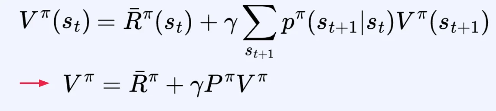

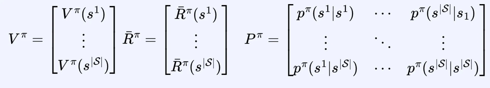

- policy에 대한 value function 
    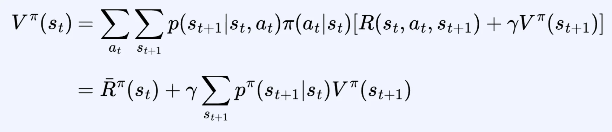

- policy에 대한 reward function
    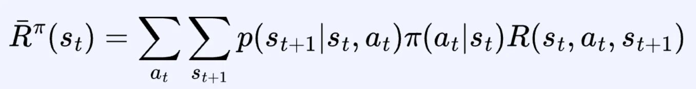

- policy에 대한 transition probability
    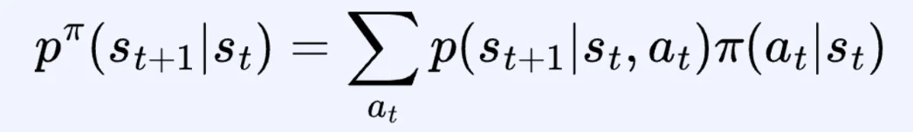

### Value function 계산 &#45; <code class="language-math">P^{&#92;pi}</code><code>, </code><code class="language-math">&#92;bar{R}^{&#92;pi}</code><code> → </code><code class="language-math">V^{&#92;pi}</code>

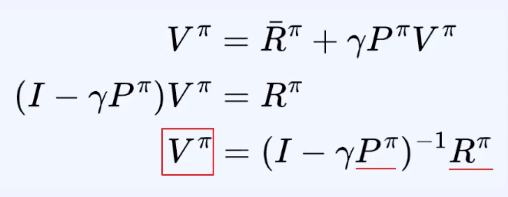

- 일일이 가능한 리턴을 직접 다 따져보고 가능한 리턴의 확률이 얼마인지 계산 후 평균을 구하는 것이 아닌 

- <code class="language-math">P^{&#92;pi}</code><code>(</code><strong><u><code>트랜지션 프로빌리티)</code></u></strong> 와 <code class="language-math">&#92;bar{R}^{&#92;pi}</code><strong><u><code>(리워드의 함수)</code></u></strong>만 알고있으면 <code class="language-math">V^{&#92;pi}</code><code>(value function)</code>을 구할 수 있다&#46; 

### 예제

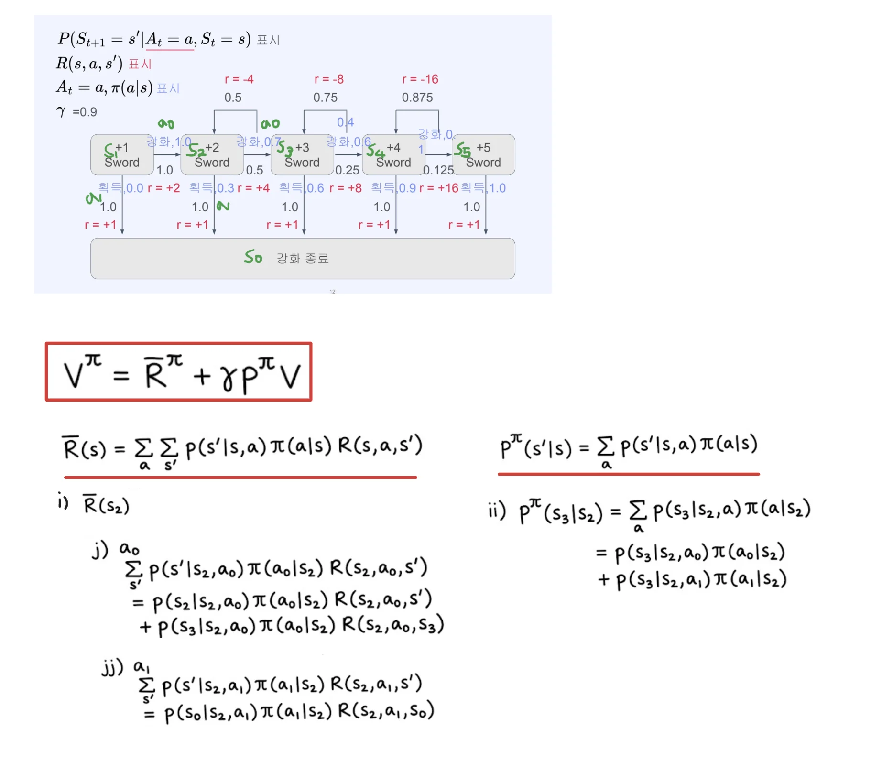

## <code>MDP</code>에서 <code>Action&#45;Value function</code>에 대한 Bellman equation의 행렬화

### MDP에서 Action&#45;Value function의 Bellman equation을 행렬화

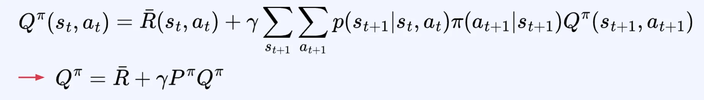

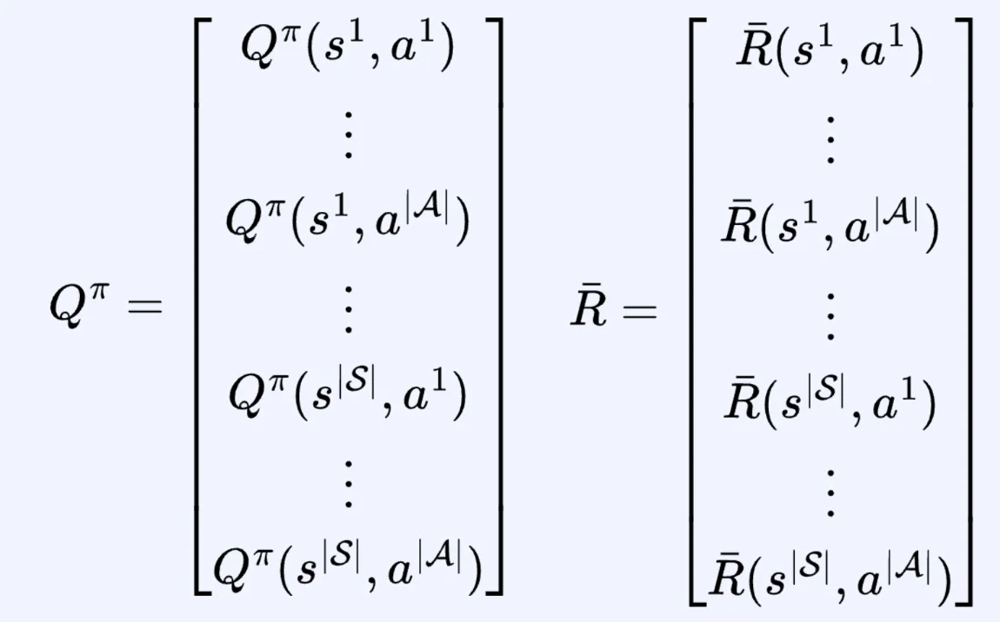

- policy에 대한 Action&#45;Value function
    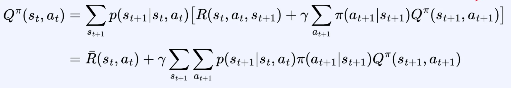

- policy에 대한 Reward function
    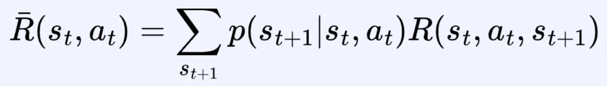

- policy에 대한 Transition Probability
    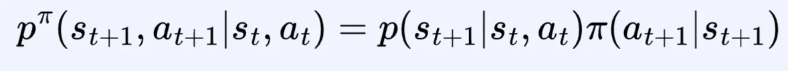

    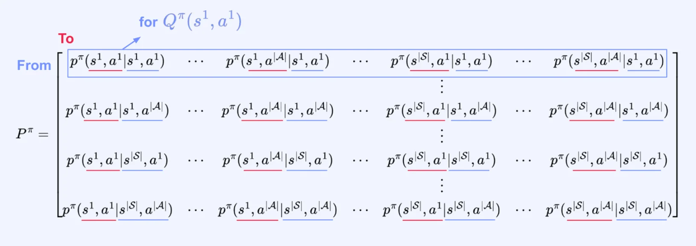

### 증명

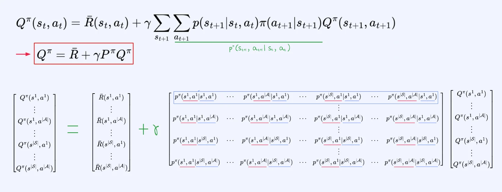

### Action&#45;Value function 계산 &#45; <code class="language-math">P^{&#92;pi}</code><code>, </code><code class="language-math">&#92;bar{R}</code><code> → </code><code class="language-math">Q^{&#92;pi} </code>

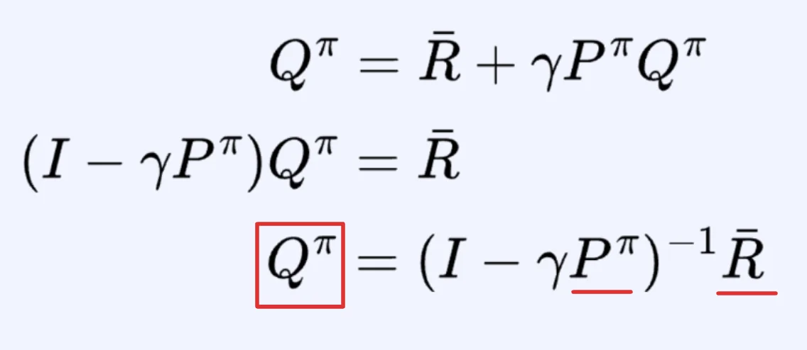

- <code class="language-math">P^{&#92;pi}</code><code>(</code><strong><u><code>트랜지션 프로빌리티)</code></u></strong> 와 <code class="language-math">&#92;bar{R}</code><strong><u><code>(리워드의 함수)</code></u></strong>를 통해 <code class="language-math">Q^{&#92;pi}</code><code>(Action&#45;Value function)</code>을 구할 수 있다&#46;
