> 🤔 
> 
> 
> 
> Action Value function은 Action을 고려한 관계식이다&#46;  즉, action을 고려하지 않는 MRP에서 Action&#45;Value function은 존재하지 않는다&#46;

## MDP <code class="language-math">&#60;S, A, P, R ,&#92;gamma&#62;</code>에서 Action&#45;Value function에 대한 Bellman Equation

---

### Action Value Function

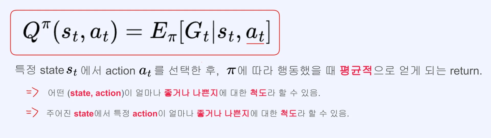

### 유도 방법 1

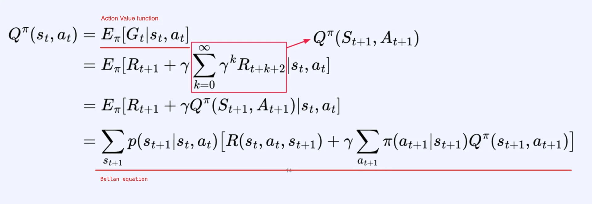

- <code class="language-math">A&#95;{t&#43;1}</code>은 Random variable이기 때문에  평균(Expectation)으로 구한다&#46;
    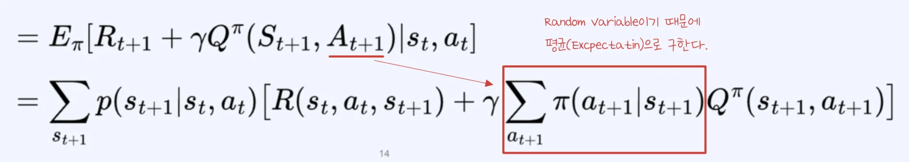

### 유도 방법 2

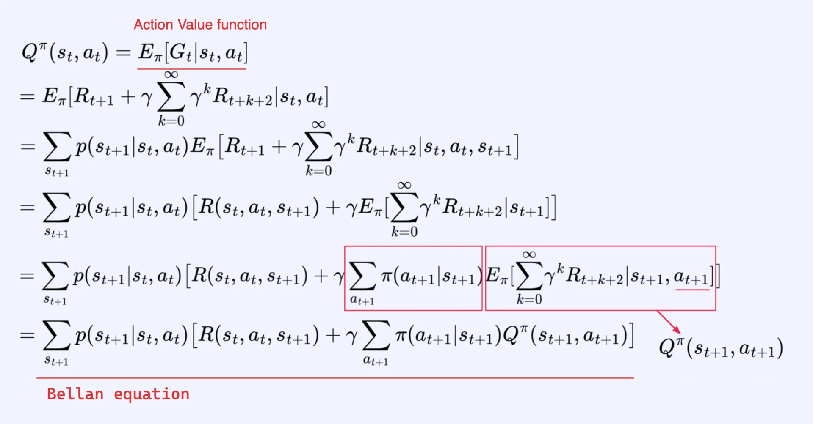

- <code class="language-math">s&#95;{t&#43;1}</code>에 대한 식 변형
    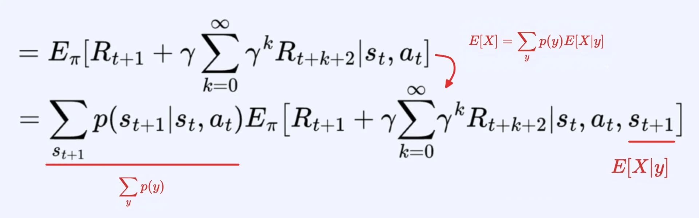

- <code class="language-math">s&#95;t</code>, <code class="language-math">a&#95;t</code>, <code class="language-math">s&#95;{t&#43;1}</code> 이 주어지면 Reward function을 계산할 수 있다&#46;  즉, 더이상 Random variable이 아닌 <strong><u>상수</u></strong>로써 <code class="language-math">E&#95;{&#92;pi}&#91;…&#93;</code>을 빠져나올 수 있다&#46; 
    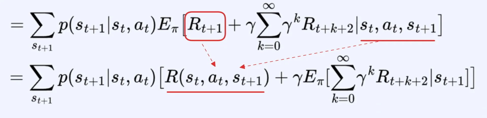

- <code class="language-math">a&#95;{t&#43;1}</code>에 대한 식 변형
    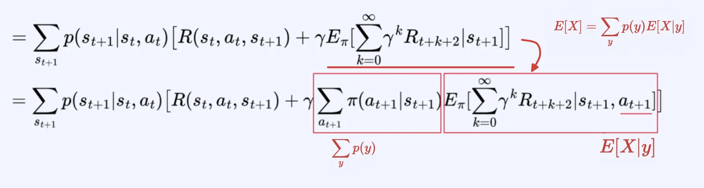

### 정리 &#45; Bellman equation for Action&#45;Value function

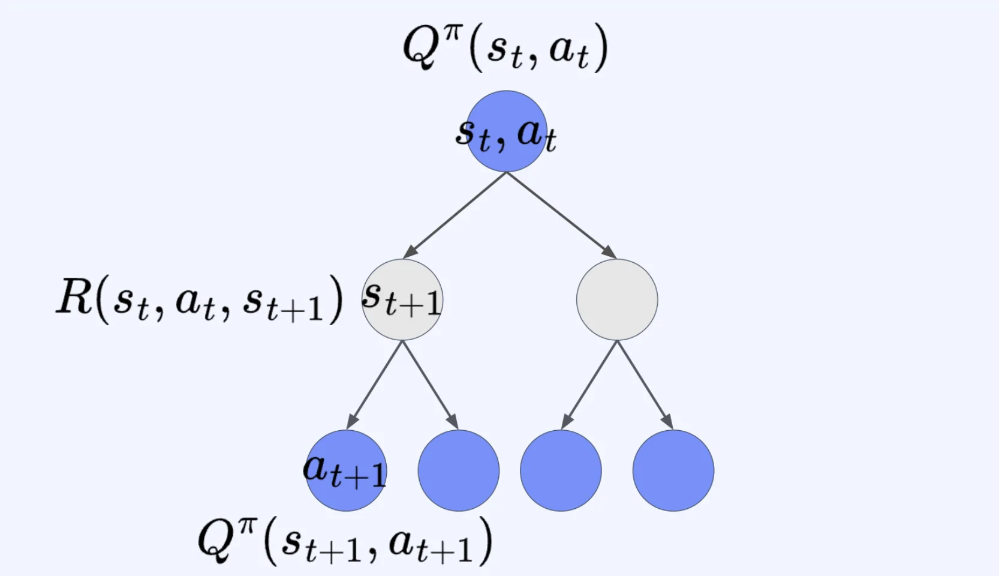

### Bellman equation for Action&#45;Value function

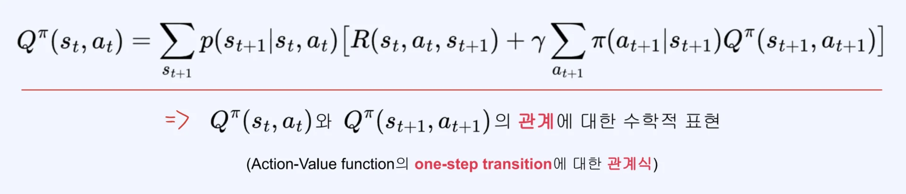

### 예제 

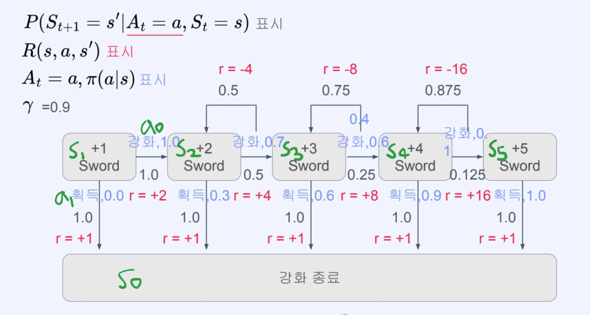

- <code class="language-math">Q^{&#92;pi}(s&#95;2, a&#95;0)</code>
    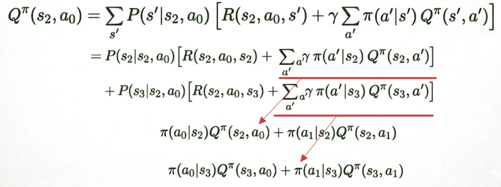

## MDP <code class="language-math">&#60;S, A, P, R ,&#92;gamma&#62;</code>에서 <code>Value function</code>, <code>Action&#45;Value function</code> 관련 수식

---

### Action&#45;Value function을 활용한 Value function 표현

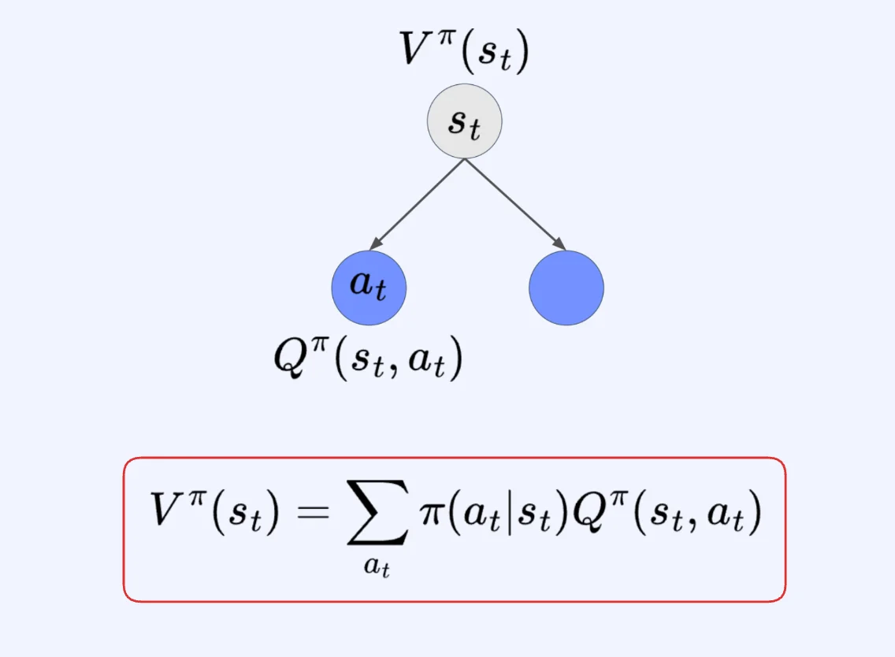

### Value function을 활용한 Action&#45;Value function 표현

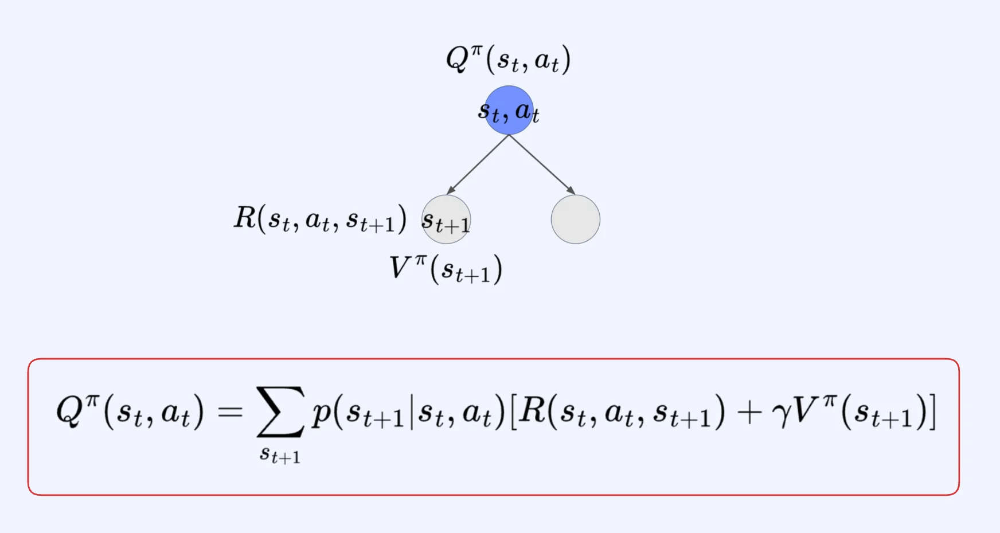
