

### Better policy 에 대한 표현

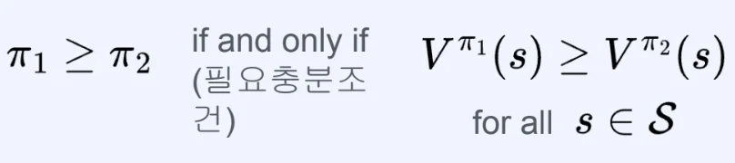

- <code class="language-math">&#92;pi&#95;1</code> ≥ <code class="language-math">&#92;pi&#95;2</code> 일때 모든 상태 S에 속하는 state s 에 대해서 <code class="language-math">&#92;pi&#95;1</code><code>의 value</code> 가 항상 <code class="language-math">&#92;pi&#95;2</code><code>의 value</code> 보다 크다 
    - 필요 충분 조건

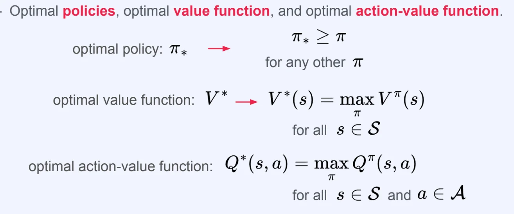

- optimal policy <code class="language-math">&#92;pi&#95;&#42;</code> 
    - 가장 큰 <code class="language-math">&#92;pi</code>  ( <code class="language-math">max&#95;{&#92;pi}</code> )

    - <code class="language-math">&#92;pi&#95;&#42;</code> ≥ <code class="language-math">&#92;pi</code> 

- optimal value function <code class="language-math">V^&#42;</code>
    - policy <code class="language-math">&#92;pi</code> 에 대해서 얻을 수 있는 가장 큰 value function

    - <code class="language-math">V^&#42;(s) = max&#95;{&#92;pi} V^{&#92;pi}(s)</code>

- optimal action&#45;value function <code class="language-math">Q^&#42;</code>
    - policy <code class="language-math">&#92;pi</code> 에 대해서 얻을 수 있는 가장 큰 action&#45;value function

    - <code class="language-math">Q^&#42;(s,a) = max&#95;{&#92;pi} Q^{&#92;pi}(s, a)</code>

### 이론 (Theorem)

> optimal policy <code class="language-math">&#92;pi&#95;&#42;</code>, optimal value function <code class="language-math">V^&#42;</code>, optimal action&#45;value function <code class="language-math">Q^&#42;</code> 에 대해서 아래 이론(Theorem)이 성립한다&#46; 

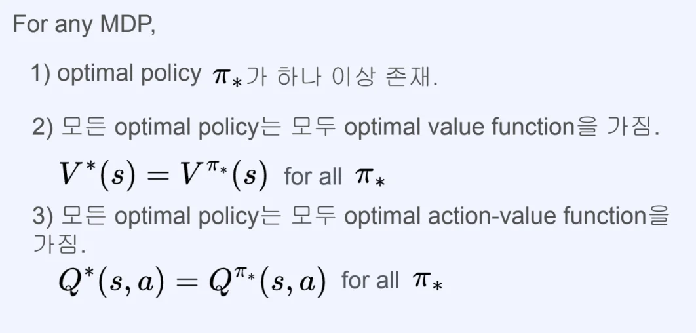

1. 어떤 MDP에 대해서 optimal policy <code class="language-math">&#92;pi&#95;&#42;</code> 는 하나 이상 존재한다&#46; 

1. 모든 optimal policy <code class="language-math">&#92;pi&#95;&#42;</code> 는 모두 optimal value function <code class="language-math">V^&#42;</code> 을 가진다&#46; 

1. 모든 optimal policy <code class="language-math">&#92;pi&#95;&#42;</code> 는 모두 optimal action&#45;value function <code class="language-math">Q^&#42;</code> 을 가진다&#46; 

> 어떤 MDP에 대해서든지  optimal policy <code class="language-math">&#92;pi&#95;&#42;</code> , optimal value function <code class="language-math">V^&#42;</code>, optimal action&#45;value function <code class="language-math">Q^&#42;</code>에 대해서 아래 이론이 성립함

> 만약 optimal action&#45;value function이 주어졌다면, optimal policy를 쉽게 찾을 수 있다&#46;

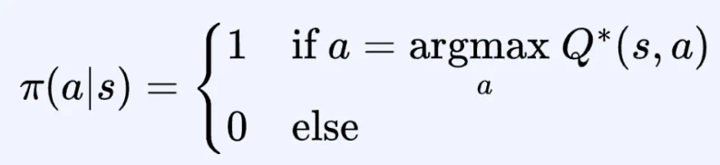

- 어떤 MDP라도, deterministic optimal policy를 갖고 있다&#46;

### Deterministic optimal policy의 예시

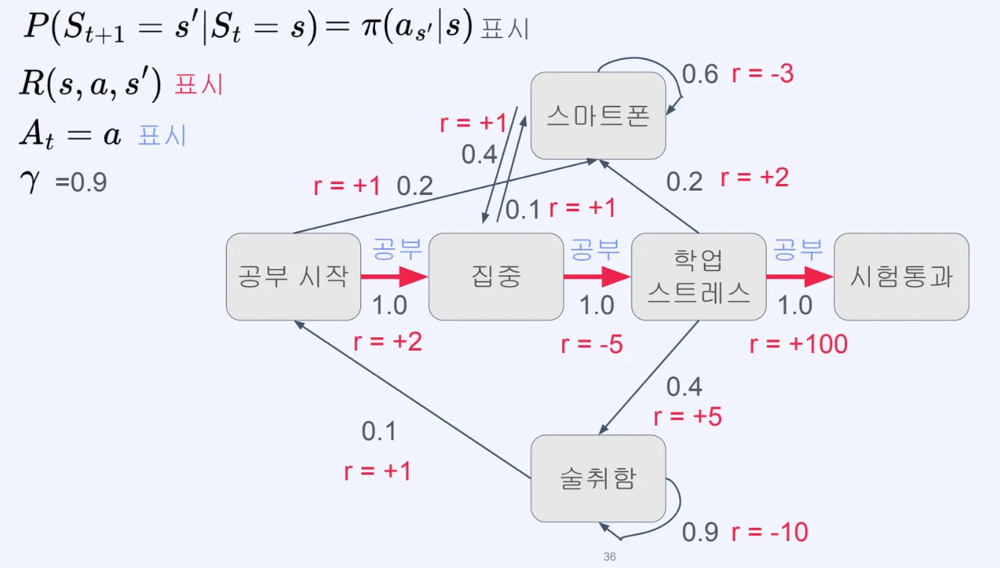

- 빨간색 화살표의 방향으로 행동을 취해 가장 빠르게 최대 보상을 얻을 수 있음

### Bellman optimality equation <u>for Value function</u>

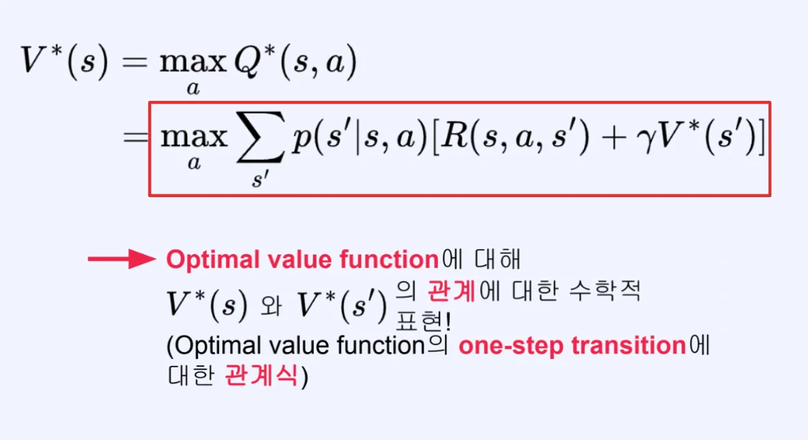

- 주어진 state s에서 optimal value (가장 높은 값)은 optimal value function에서 가장 좋은 action을 고른 것과 같다&#46; 

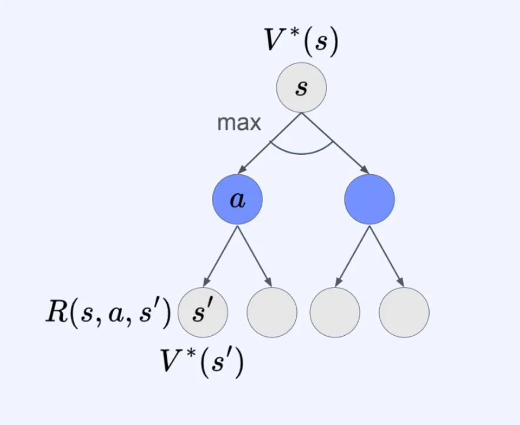

- <code class="language-math">R(s, a, s&#39;) &#43; &#92;gamma V^&#42;(s&#39;)</code><code>의 평균값</code>이  max가 되는 action a를 선택한다&#46; 

### 비교&#58; Value function에 대한 Bellman <u>optimality</u> equation, Bellman equation

> ✏️ 
> 
> 
> 
> Bellman optimality equation 은 최대의 action만을 고려한 값이기 때문에 <code class="language-math">&#92;Sigma&#95;{a&#95;{t}}</code><code> → </code><code class="language-math">max&#95;a</code> 가 된다&#46; 

#### Bellman optimality equation for Value function

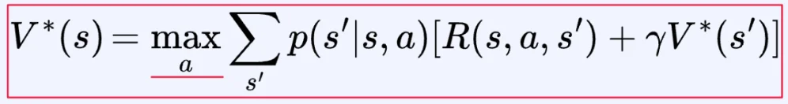

#### Bellman equation for Value function

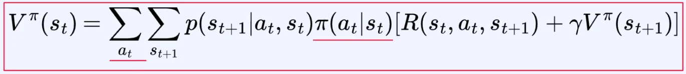

### Bellman optimality equation <u>for Action&#45;Value function</u>

<strong>Bellman equation for Action&#45;Value function</strong>

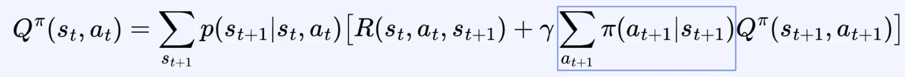

<strong>Bellman </strong><strong><u>optimality</u></strong><strong> equation for Action&#45;Value function</strong>

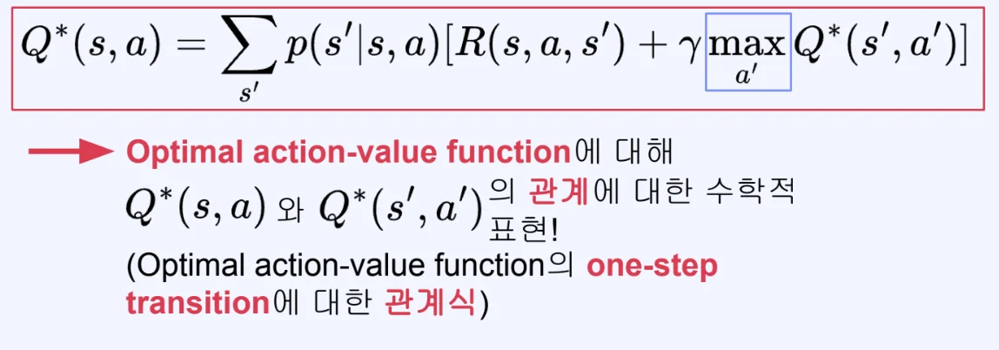

- 최대화하는 action  값에 대한 action&#45;value function

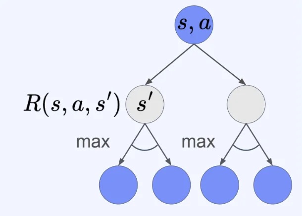

1. s, a 에서 트랜지션이 먼저 발생 → s’으로 가는 다양한 경우의 수가 존재
    - 이 트랜지션은 환경에 의한 것으로 에이전트가 컨트롤할 수 없음
        - 트랜지션 발생 후 보상까지 컨트롤 x

1. 이후 어떤 행동을 취할 지 에이전트가 컨트롤 가능함 그 중 항상 Optimal value function을 최대화하는 action을 고름

#### Bellman optimality equation은 <u>non&#45;linear equation</u>으로, 행렬화가 불가능하다&#46; 

#### Bellman optimality equation은 

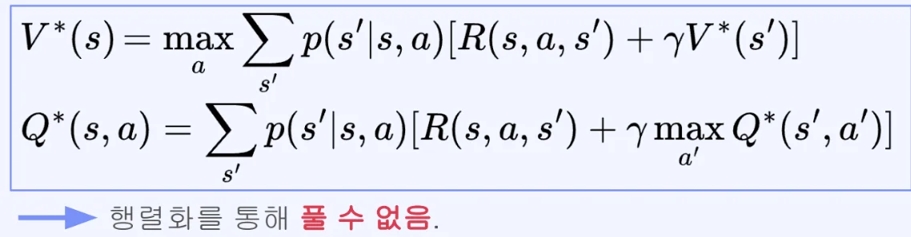

- 왜 행렬화가 불가능한가? 
    

    즉, 왜 non&#45;linear equation인가? 

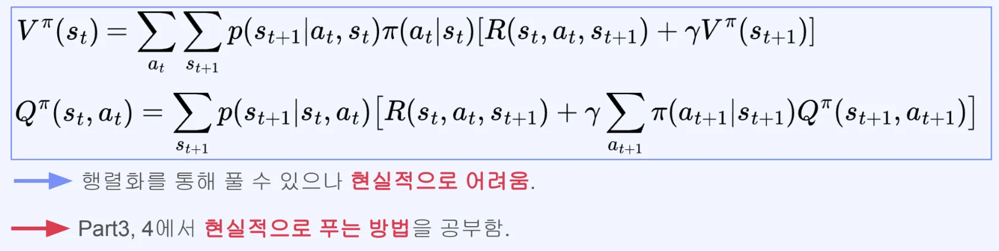

- bellman equation은 행렬화를 통해 풀 수 있지만, 매우 많은 계산 비용이 든다&#46; 

- 많은 컴퓨팅 자원이 필요하며 현실적으로 어렵다&#46; 
    - 비효율적인 듯 함

### Bellman optimality equation 예제

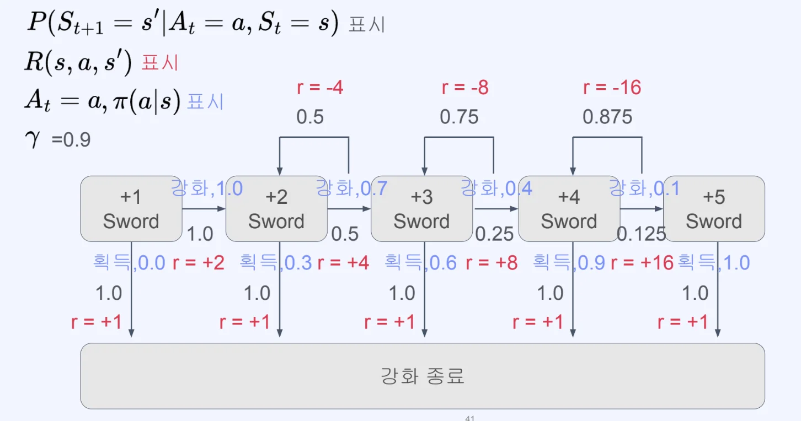

- <strong>Value function에 대한 bellman optimality equation</strong>
    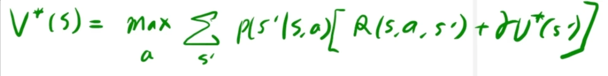

    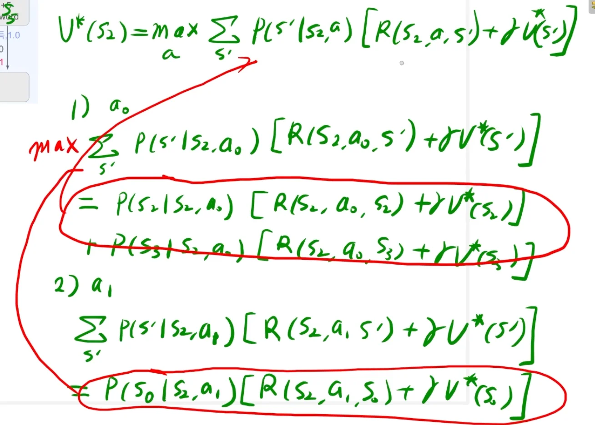

    - 각 state에서 action에 대한 value function의 max 값을 적용한다&#46; 

    - <code class="language-math">V^&#42;</code> 값을 알지 못하기 때문에 현재는 구할 수 없음 

- <strong>Action&#45;Value function에 대한 bellman optimality equation</strong>
    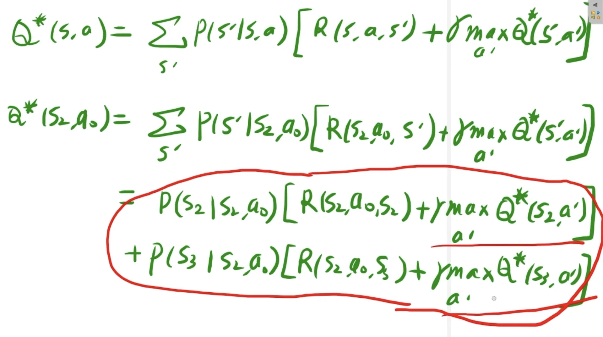

    - 각 state에서 action에 대한 action&#45;value function의 max 값을 적용한다&#46; 

    - <code class="language-math">Q^&#42;</code> 값을 알지 못하기 때문에 현재는 구할 수 없음
