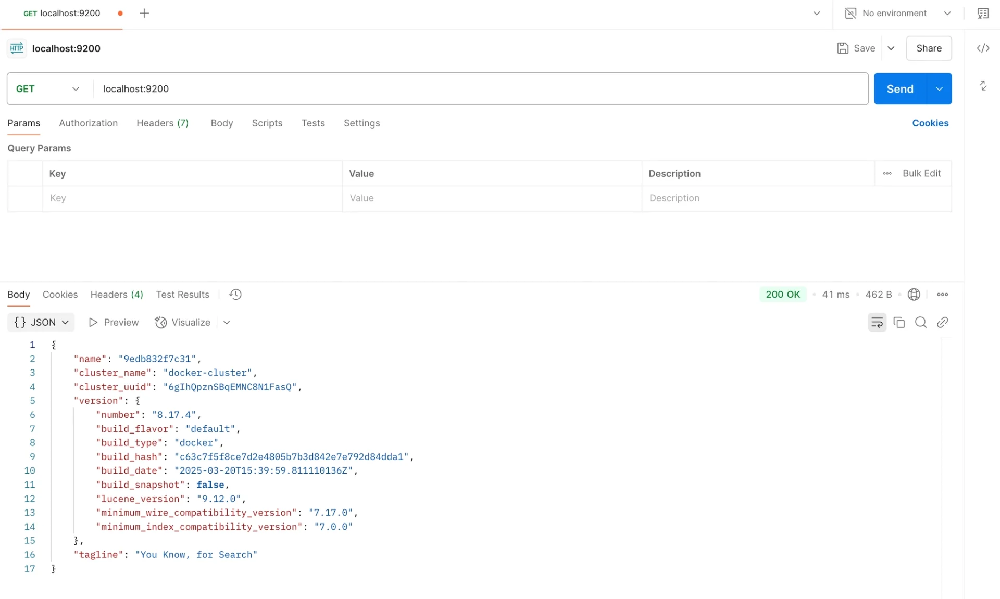

<a id="346eda9b0fe1807a8f5dd8603098f0d5"></a>

### Elasticsearch 세팅 &#45; Docker

1. <code>compose&#46;yml</code>
    <a id="346eda9b0fe1804b93b8d30765e721a4"></a>

    ```yaml
    services:
      elastic:
        image: docker.elastic.co/elasticsearch/elasticsearch:8.17.4 # Elastic 8.17.4 버전의 이미지
        ports:
        - 9200:9200 # 9200번 포트에서 Elasticsearch 실행
        environment:
        # 아래 설정은 개발/테스트 환경에서 간단하게 테스트하기 위한 옵션 (운영 환경에서는 설정하면 안 됨)
        - discovery.type=single-node # 단일 노드 (지금은 알 필요 없음)
        - xpack.security.enabled=false # 보안 설정
        - xpack.security.http.ssl.enabled=false # 보안 설정
    ```

1. compose 실행
    <a id="346eda9b0fe180dc93e6eaa5dbec5b71"></a>

    ```bash
    # 실행
    docker compose up -d

    # 확인
    docker ps

    # 중지
    docker compose down
    ```

1. <strong>잘 실행됐는 지 확인하기</strong>
    <a id="346eda9b0fe180fbab18cabe52d9b727"></a>

    Elasticsearch는 9200번 포트에서 실행된다&#46; 

    - Postman에서 <a href="http://localhost:9200">localhost&#58;9200</a>으로 <code>GET</code> 요청을 보내면 확인 가능

    <a id="346eda9b0fe180cd9559d8d516687aec"></a>

    ```bash
    GET localhost:9200
    ```

    
