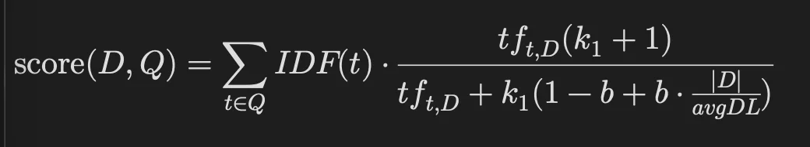
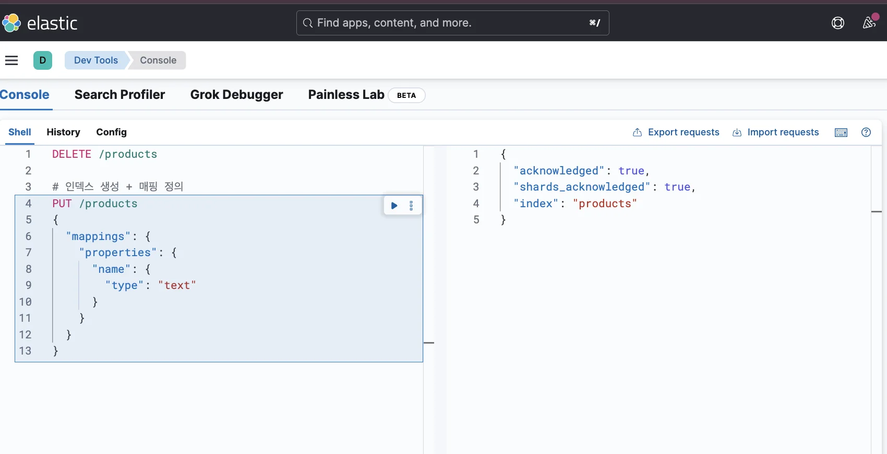
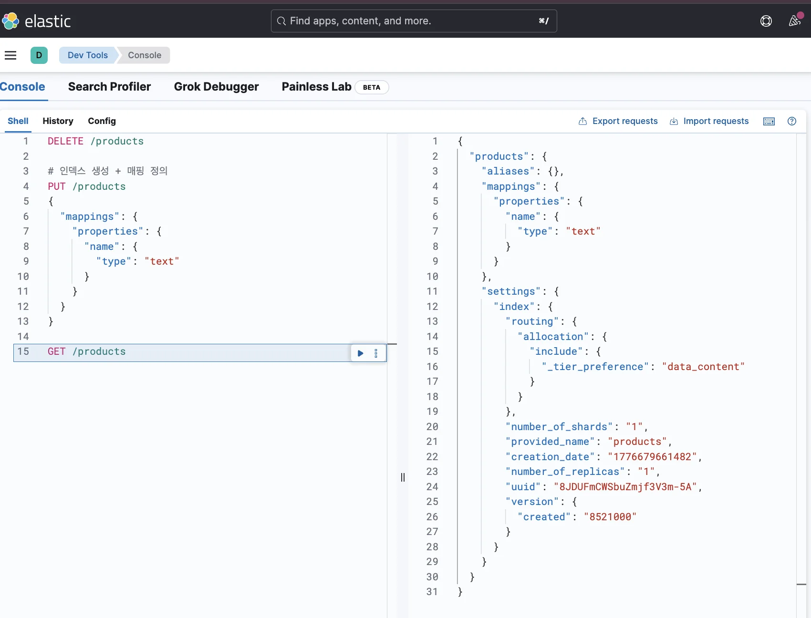
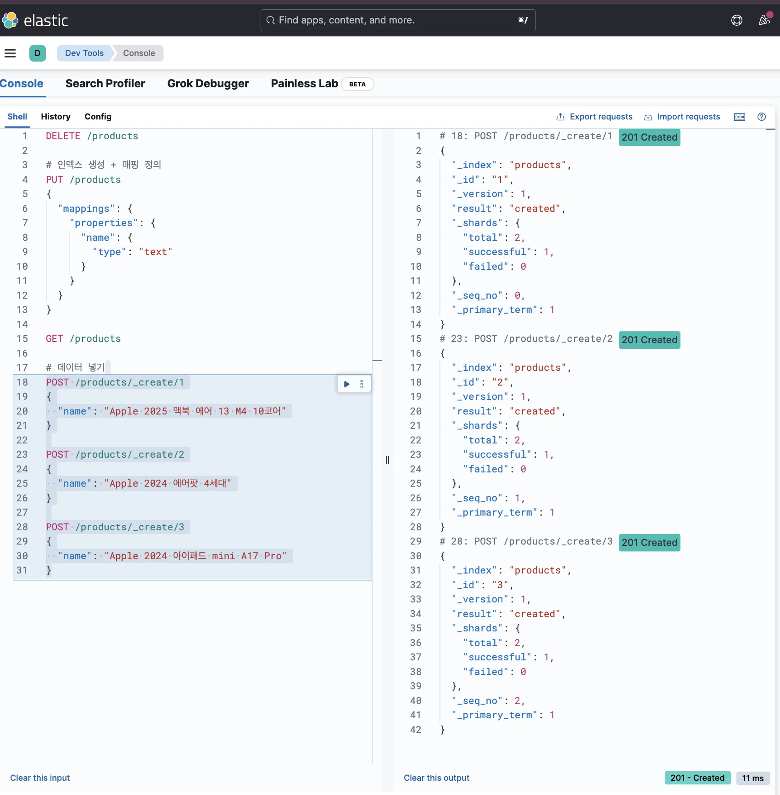
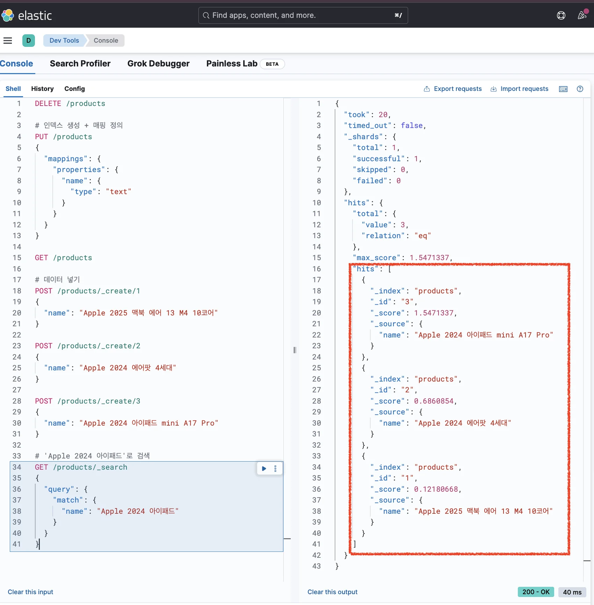

> 
> 
> <a id="348eda9b0fe1804495cddbbb2ac59b11"></a>
> 
> 목차
> 
> - [역인덱스 (Inverted Index)](#348eda9b0fe180ba996dd679a42a1352)
> - [역인덱스 생성 과정 및 검색 실습](#348eda9b0fe180cd95c1f42245f179b0)
> - [역인덱스 score 계산 로직](#348eda9b0fe180c6a6fad30b6f0fb6e7)
> - [[실습] 역인덱스(Inverted Index)를 활용한 데이터 조회](#348eda9b0fe18012840dcd517a974da5)

<a id="348eda9b0fe180ba996dd679a42a1352"></a>

## 역인덱스 (Inverted Index)

---

> 📖 
> 
> <a id="348eda9b0fe180ecb682ec2ce2d9fa40"></a>
> 
> <strong><code>역인덱스(Inverted Index)</code></strong>는 <strong>데이터를 전처리 및 토큰화</strong>하여 <strong><u>검색하기 쉽도록 인덱싱</u></strong>한 데이터이다&#46;  쉽게 말해, <strong><u>필드 값을 단어마다 쪼개서 찾기 쉽게 정리해놓은 목록</u></strong>이다&#46; 

<a id="348eda9b0fe180cd95c1f42245f179b0"></a>

### 역인덱스 생성 과정 및 검색 실습

1. 예제 &#45; 도큐먼크 3개 저장
    <a id="348eda9b0fe18026aab4ee60b1c813de"></a>

    ```bash
    POST /products/_create/1
    {
      "name": "Apple 2025 맥북 에어 13 M4 10코어"
    }
    ```

    <a id="348eda9b0fe18075b7f7e380fbaa5feb"></a>

    ```bash
    POST /products/_create/2
    {
      "name": "Apple 2024 에어팟 4세대"
    }
    ```

    <a id="348eda9b0fe180e597e4d5e14937abe7"></a>

    ```bash
    POST /products/_create/3
    {
      "name": "Apple 2024 아이패드 mini A17 Pro"
    }
    ```

    - 위 3개의 도큐먼트를 Elasticsearch에 저장한다&#46; 

1. 단어 단위로 자름
    <a id="348eda9b0fe1804cb0efccde3abc481e"></a>

    ```bash
    "name": "Apple 2025 맥북 에어 13 M4 10코어" 
    ```

    <a id="348eda9b0fe18048864fc7b10068b7f7"></a>

      → <code>&#91;Apple, 2025, 맥북, 에어, 13, M4, 10코어&#93;</code>

    <a id="348eda9b0fe18056b6afd4511712f072"></a>

    ```bash
    "name": "Apple 2024 에어팟 4세대"
    ```

    <a id="348eda9b0fe180c2a7c8d50d456d340d"></a>

      → <code>&#91;Apple, 2024, 에어팟, 4세대&#93;</code>

    <a id="348eda9b0fe18059b575d6e37935c03b"></a>

    ```bash
    "name": "Apple 2024 아이패드 mini A17 Pro"
    ```

    <a id="348eda9b0fe18078b0b7cac03d0d19db"></a>

      → <code>&#91;Apple, 2024, 아이패드, mini, A17, Pro&#93;</code>

<a id="348eda9b0fe18073ba99f03fe143af15"></a>

2&#46; 역인덱스로 저장 (Bag of words)

> ✏️ 
> 
> <a id="348eda9b0fe1804a9f6fe4e7bf24fddf"></a>
> 
> 필드값에서 추출돼 역인덱스에 저장된 단어를 보고 <strong><u>토큰(token)</u></strong>이라고 부르며<br>생성된 역인덱스는 시스템 내부적으로만 생성되어 직접 확인은 불가능하다&#46;

> <strong><code>products</code></strong><strong>의 </strong><strong><code>name</code></strong><strong> 필드에 대한 역인덱스</strong>

| 토큰(token) | 도큐먼트 id |
| --- | --- |
| Apple | &#91;1, 2, 3&#93; |
| 2025 | &#91;1&#93; |
| 맥북 | &#91;1&#93; |
| 에어 | &#91;1&#93; |
| 13 | &#91;1&#93; |
| M4 | &#91;1&#93; |
| 10코어 | &#91;1&#93; |
| 2024 | &#91;2, 3&#93; |
| 에어팟 | &#91;2&#93; |
| 4세대 | &#91;2&#93; |
| 아이패드 | &#91;3&#93; |
| mini | &#91;3&#93; |
| A17 | &#91;3&#93; |
| Pro | &#91;3&#93; |

1. 검색 → 역인덱스 활용
    > 검색&#58; <code>Apple 2024 아이패드</code>

    | 토큰(token) | 도큐먼트 id |
    | --- | --- |
    | <strong>Apple</strong> | <strong>&#91;1, 2, 3&#93;</strong> |
    | 2025 | &#91;1&#93; |
    | 맥북 | &#91;1&#93; |
    | 에어 | &#91;1&#93; |
    | 13 | &#91;1&#93; |
    | M4 | &#91;1&#93; |
    | 10코어 | &#91;1&#93; |
    | <strong>2024</strong> | <strong>&#91;2, 3&#93;</strong> |
    | 에어팟 | &#91;2&#93; |
    | 4세대 | &#91;2&#93; |
    | <strong>아이패드</strong> | <strong>&#91;3&#93;</strong> |
    | mini | &#91;3&#93; |
    | A17 | &#91;3&#93; |
    | Pro | &#91;3&#93; |

<a id="348eda9b0fe180c6a6fad30b6f0fb6e7"></a>

### 역인덱스 score 계산 로직

> ✏️ 
> 
> <a id="348eda9b0fe180bf87f0d7058d8b6b7a"></a>
> 
> <code>BM25</code>를 사용한 키워드 서칭을 사용한다&#46;  
> 
> 
> 
> - 자세한 내용은 <a href="https://beautiful-college-c84.notion.site/2cfeda9b0fe18048bb60d72c026bf68f">페이지</a><code> &#45; Keyword Search &#45; BM25</code> 참조

1. <strong><code>Term Frequency (TF)</code></strong>
    <a id="348eda9b0fe180ce8b6bdd367d041de3"></a>

    문서 내에서 검색어가 얼마나 자주 등장하냐

    <a id="348eda9b0fe180f5ad31f3acc796ea17"></a>

    → 많이 등장할수록 점수↑

1. <strong><code>Inverse Document Frequency (IDF)</code></strong>
    <a id="348eda9b0fe1807e8f6ce678cecd6cfc"></a>

    검색어가 전체 문서 중 얼마나 희귀하냐

    <a id="348eda9b0fe18054af57f481026b7f2e"></a>

    → 희귀할수록 점수↑ (흔한 단어일수록 점수↓)

1. <strong><code>Field Length Normalization</code></strong>
    <a id="348eda9b0fe1806b8dcce029ea5e31fb"></a>

    문서(필드)가 짧을수록 점수↑

    <a id="348eda9b0fe180f3abb6d37a1c1fd447"></a>

    → 검색어가 짧은 문서에서 등장하면 더 관련성 높다고 판단

<a id="348eda9b0fe18012840dcd517a974da5"></a>

### &#91;실습&#93; 역인덱스(Inverted Index)를 활용한 데이터 조회

1. <strong>기존 products 인덱스 삭제</strong>
    <a id="348eda9b0fe1801e852ad6ed87c8d325"></a>

    ```bash
    DELETE /products
    ```

1. <strong>인덱스 생성</strong>
    <a id="348eda9b0fe180b685c8e8ea6863948d"></a>

    ```bash
    # 인덱스 생성
    PUT /products

    # 매핑 정의
    PUT /products/_mappings
    {
      "properties": {
        "name": { 
          "type": "text"
        }
      }
    ```

    <a id="348eda9b0fe180e7bdeeef0f1c6bd2aa"></a>

    <strong>&#91;축약&#93; 인덱스 생성 &#43; 매핑 정의</strong>

    <a id="348eda9b0fe180449326c6433b4db12d"></a>

    ```bash
    # 인덱스 생성 + 매핑 정의
    PUT /products
    {
      "mappings": {
        "properties": {
          "name": {
            "type": "text"
          }
        }    
      }
    }
    ```

    

1. <strong>인덱스 생성 확인</strong>
    <a id="348eda9b0fe1807e984cf823decb8502"></a>

    ```bash
    GET /products
    ```

    

1. <strong>도큐먼트 삽입</strong>
    <a id="348eda9b0fe180aca946c6d09389fab1"></a>

    ```bash
    # 데이터 넣기
    POST /products/_create/1
    {
      "name": "Apple 2025 맥북 에어 13 M4 10코어"
    }

    POST /products/_create/2
    {
      "name": "Apple 2024 에어팟 4세대"
    }

    POST /products/_create/3
    {
      "name": "Apple 2024 아이패드 mini A17 Pro"
    }
    ```

    

1. <strong>도큐먼트 조회</strong>
    <a id="348eda9b0fe180b5a7d1c891c34c95dd"></a>

    ```bash
    # 'Apple 2024 아이패드'로 검색
    GET /products/_search
    {
      "query": {
        "match": {
          "name": "Apple 2024 아이패드"
        }
      }
    }
    ```

    

    <details>
    <summary>응답값 확인</summary>

    <a id="348eda9b0fe1808eadeddd2d15b55848"></a>

    ```bash
    {
      "took": 7,
      "timed_out": false,
      "_shards": {
        "total": 1,
        "successful": 1,
        "skipped": 0,
        "failed": 0
      },
      "hits": {
        "total": {
          "value": 3,
          "relation": "eq"
        },
        "max_score": 1.5471337,
        "hits": [
          {
            "_index": "products",
            "_id": "3",
            "_score": 1.5471337,
            "_source": {
              "name": "Apple 2024 아이패드 mini A17 Pro"
            }
          },
          {
            "_index": "products",
            "_id": "2",
            "_score": 0.6860854,
            "_source": {
              "name": "Apple 2024 에어팟 4세대"
            }
          },
          {
            "_index": "products",
            "_id": "1",
            "_score": 0.12180668,
            "_source": {
              "name": "Apple 2025 맥북 에어 13 M4 10코어"
            }
          }
        ]
      }
    }
    ```

    </details>

    <details>
    <summary>조회 스코어</summary>

    > ✏️ 
    > 
    > <a id="348eda9b0fe1804f8269fe462eff429c"></a>
    > 
    > 검색 키워드에 대하여 <strong><u>역인덱스를 활용</u></strong>해 <strong><u>일치하는 단어가 많은 도큐먼트</u></strong><strong><u>를 우선적으로 조회</u></strong>한다&#46; 

    | 토큰(token) | 도큐먼트 id |
    | --- | --- |
    | <strong>Apple</strong> | <strong>&#91;1, 2, 3&#93;</strong> |
    | 2025 | &#91;1&#93; |
    | 맥북 | &#91;1&#93; |
    | 에어 | &#91;1&#93; |
    | 13 | &#91;1&#93; |
    | M4 | &#91;1&#93; |
    | 10코어 | &#91;1&#93; |
    | <strong>2024</strong> | <strong>&#91;2, 3&#93;</strong> |
    | 에어팟 | &#91;2&#93; |
    | 4세대 | &#91;2&#93; |
    | <strong>아이패드</strong> | <strong>&#91;3&#93;</strong> |
    | mini | &#91;3&#93; |
    | A17 | &#91;3&#93; |
    | Pro | &#91;3&#93; |

    - id가 1인 도큐먼트&#58; <code>단어 1개 일치 </code>

    - id가 2인 도큐먼트&#58; <code>단어 2개 일치 </code>

    - id가 3인 도큐먼트&#58; <code>단어 3개 일치</code>

    <a id="348eda9b0fe180fb98f3e6f3bdb49c20"></a>

    따라서 score는 <code>id=3</code> → <code>id=2</code> → <code>id=1</code>으로  높게 나오며 해당 순서로 조회된다&#46;

    </details>
