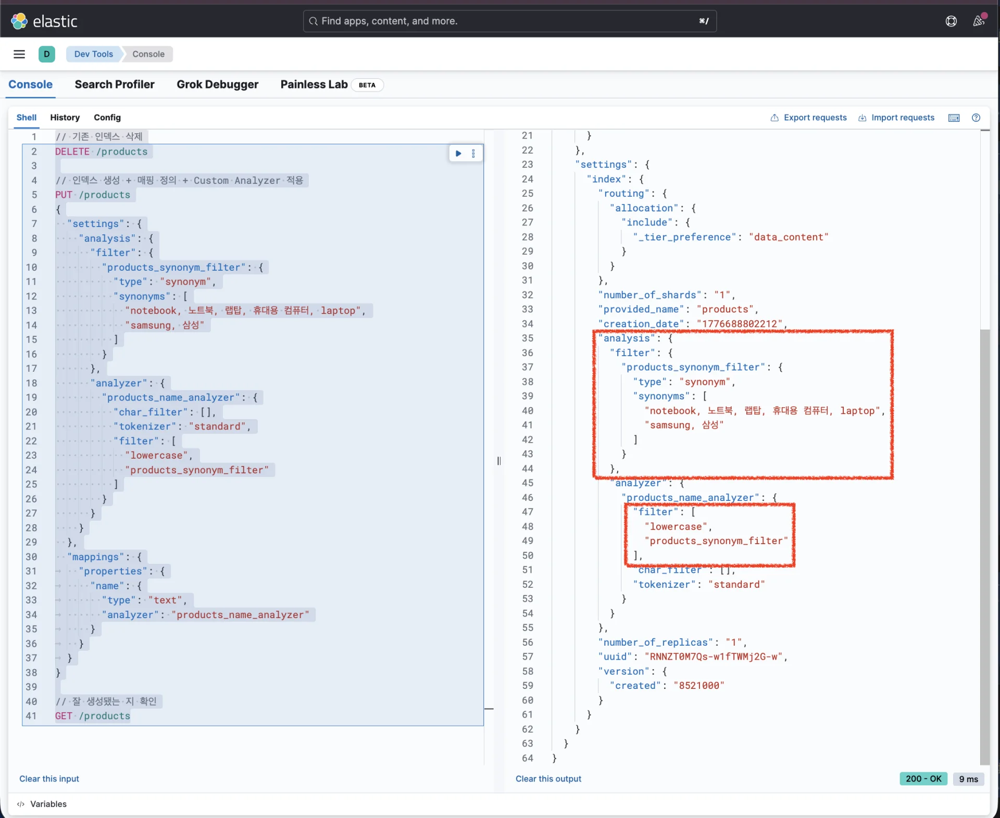
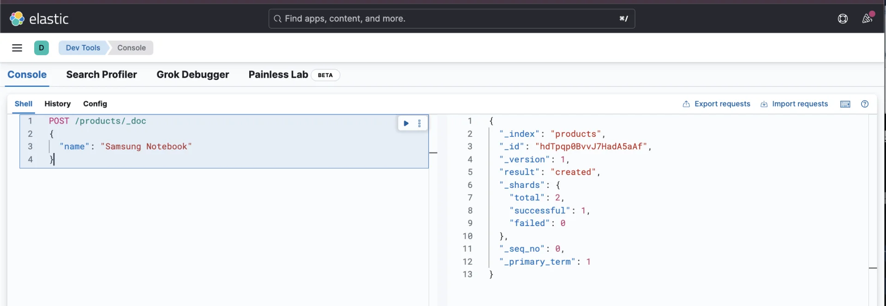
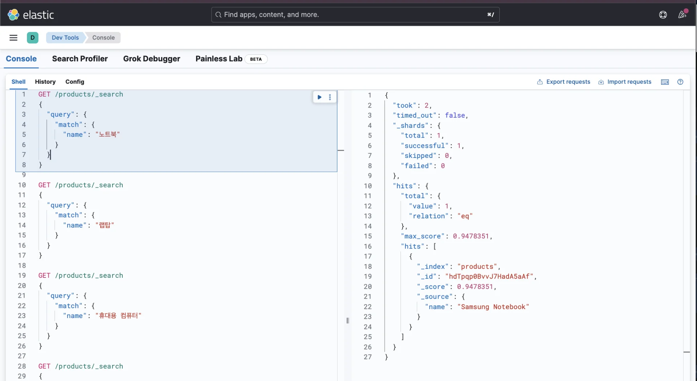
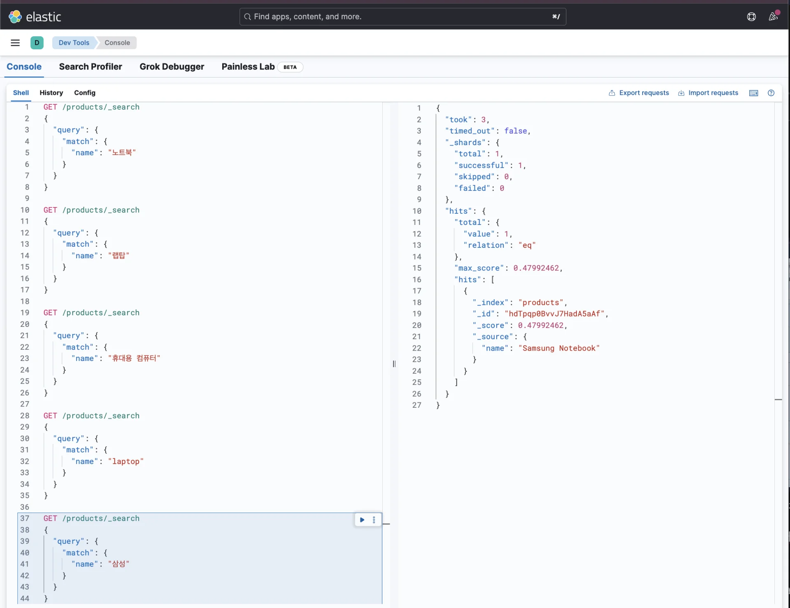
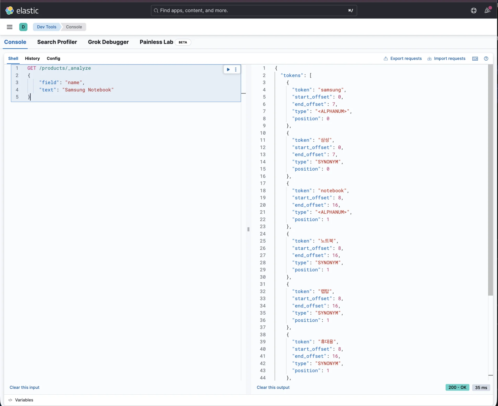

> 
> 
> <a id="348eda9b0fe181c7bbb9f3fe4f6f1e8e"></a>
> 
> 목차
> 
> - [동의어로 검색(전처리) 애널라이저: synonym](#348eda9b0fe18183bd06e605ce34a966)
> - [동의어로 검색하는 방법 (synonym)](#348eda9b0fe181e98e0cc512e3ce3973)

<a id="348eda9b0fe18183bd06e605ce34a966"></a>

## 동의어로 검색(전처리) 애널라이저&#58; <code>synonym</code>

---

> 📖 
> 
> <a id="348eda9b0fe181debe4fcb8fbeb35cd9"></a>
> 
> <code>Samaung Notebook</code>이라는 상품이 있다고 가정하자&#46; 
> 
> <a id="348eda9b0fe1803791a0f01008b2603d"></a>
> 
> 사람들은 검색할 때 <code>notebook</code>이라고 정확하게 검색할 수도 있지만, <code>노트북</code>, <code>랩탑</code>, <code>휴대용 컴퓨터</code>, <code>laptop</code>과 같이 동의어로 검색할 수도 있다&#46; 그리고 <code>samsung</code>이라고 검색할 수도 있지만 <code>삼성</code>이라고 검색할 수도 있다&#46; 
> 
> <a id="348eda9b0fe180c3aebee1c920e4ebf5"></a>
> 
> 이렇게 동의어로 검색하더라도 <code>Samsung notebook</code>이 나오게 하려면 Elasticsearch에서 제공하는 <strong><u>synonym 필터</u></strong>를 사용하면 쉽게 구현할 수 있다&#46; 

<a id="348eda9b0fe181e98e0cc512e3ce3973"></a>

#### 동의어로 검색하는 방법 (synonym)

<details>
<summary><strong>1&#46; 커스텀 필터를 통해 동의어 매핑</strong></summary>

<a id="348eda9b0fe18176bf87d4c4ad4e2d01"></a>

```json
// 기존 인덱스 삭제
DELETE /products

// 인덱스 생성 + 매핑 정의 + Custom Analyzer 적용
PUT /products
{
  "settings": {
    "analysis": {
      "filter": {
        "products_synonym_filter": {
          "type": "synonym",
          "synonyms": [
            "notebook, 노트북, 랩탑, 휴대용 컴퓨터, laptop",
            "samsung, 삼성"
          ]
        }
      },
      "analyzer": {
        "products_name_analyzer": {
          "char_filter": [],
          "tokenizer": "standard",
          "filter": [
            "lowercase",
            "products_synonym_filter"
          ]
        }
      }
    }
  },
  "mappings": {
	  "properties": {
	    "name": {
	      "type": "text",
	      "analyzer": "products_name_analyzer"
	    }
	  }
	}
}

// 잘 생성됐는 지 확인
GET /products
```



- 커스텀 필터 세팅 후 Analyzer에 추가

</details>

<details>
<summary>2&#46; <strong>데이터 삽입</strong></summary>

<a id="348eda9b0fe181f7829deeca5f323c74"></a>

```json
POST /products/_doc
{
  "name": "Samsung Notebook"
}
```



</details>

<details>
<summary>3&#46;<strong> 검색</strong></summary>

<a id="348eda9b0fe18183bfa9e9448bf6455b"></a>

```json
GET /products/_search
{
  "query": {
    "match": {
      "name": "노트북"
    }
  }
}

GET /products/_search
{
  "query": {
    "match": {
      "name": "랩탑"
    }
  }
}

GET /products/_search
{
  "query": {
    "match": {
      "name": "휴대용 컴퓨터"
    }
  }
}

GET /products/_search
{
  "query": {
    "match": {
      "name": "laptop"
    }
  }
}

GET /products/_search
{
  "query": {
    "match": {
      "name": "삼성"
    }
  }
}
```





<a id="348eda9b0fe181ac9732dc7fc87a4b43"></a>

<code>synonym</code> 설정 덕분에 위 쿼리로 검색해보면 데이터가 잘 조회된다&#46;

- 자세한 내용은 아래 <strong>Analyze API를 통해 디버깅하여 알아본다&#46; </strong>

</details>

<details>
<summary>4&#46; <strong>Analyze API 사용한 디버깅</strong></summary>

<a id="348eda9b0fe181e4a7a5fa1b3501ff9a"></a>

```json
GET /products/_analyze
{
    "field": "name",
    "text": "Samsung Notebook"
}
```

<a id="348eda9b0fe181358ffcddb15f574797"></a>

<strong>응답값</strong>



<a id="348eda9b0fe181c699a9f80cd84ea062"></a>

```json
{
  "tokens": [
    {
      "token": "samsung",
      "start_offset": 0,
      "end_offset": 7,
      "type": "<ALPHANUM>",
      "position": 0
    },
    {
      "token": "삼성",
      "start_offset": 0,
      "end_offset": 7,
      "type": "SYNONYM",
      "position": 0
    },
    {
      "token": "notebook",
      "start_offset": 8,
      "end_offset": 16,
      "type": "<ALPHANUM>",
      "position": 1
    },
    {
      "token": "노트북",
      "start_offset": 8,
      "end_offset": 16,
      "type": "SYNONYM",
      "position": 1
    },
    {
      "token": "랩탑",
      "start_offset": 8,
      "end_offset": 16,
      "type": "SYNONYM",
      "position": 1
    },
    {
      "token": "휴대용",
      "start_offset": 8,
      "end_offset": 16,
      "type": "SYNONYM",
      "position": 1
    },
    {
      "token": "laptop",
      "start_offset": 8,
      "end_offset": 16,
      "type": "SYNONYM",
      "position": 1
    },
    {
      "token": "컴퓨터",
      "start_offset": 8,
      "end_offset": 16,
      "type": "SYNONYM",
      "position": 2
    }
  ]
}
```

<a id="348eda9b0fe181ff95d1c0a6a536f450"></a>

분리된 토큰을 살펴보면 <strong><u>동의어까지 포함해서 토큰이 등록</u></strong>된 걸 확인할 수 있다&#46; 

<a id="348eda9b0fe18093989fdf3397cf5f95"></a>

이 때문에 동의어로 검색을 하더라도 원하는 데이터가 잘 조회된다&#46;

</details>
