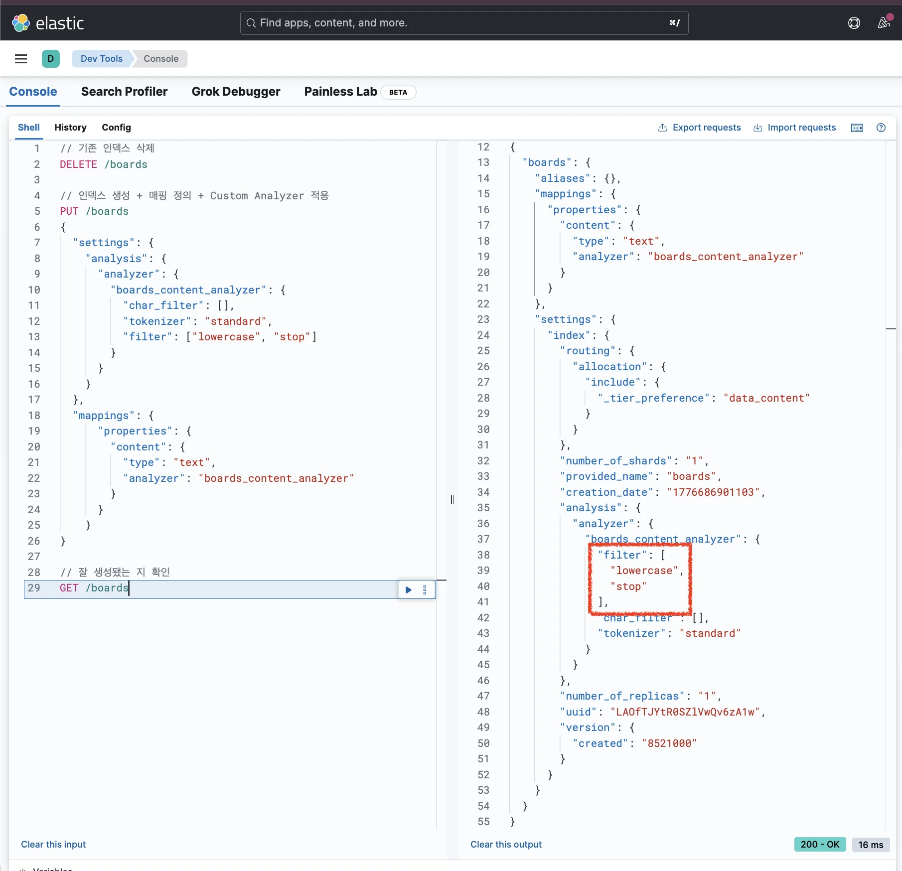
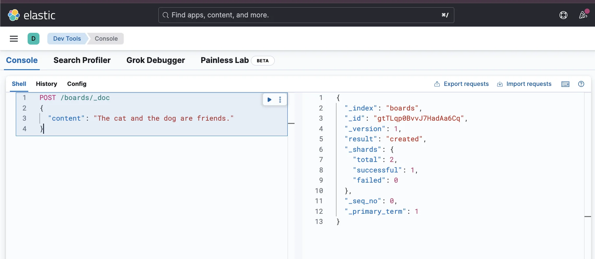
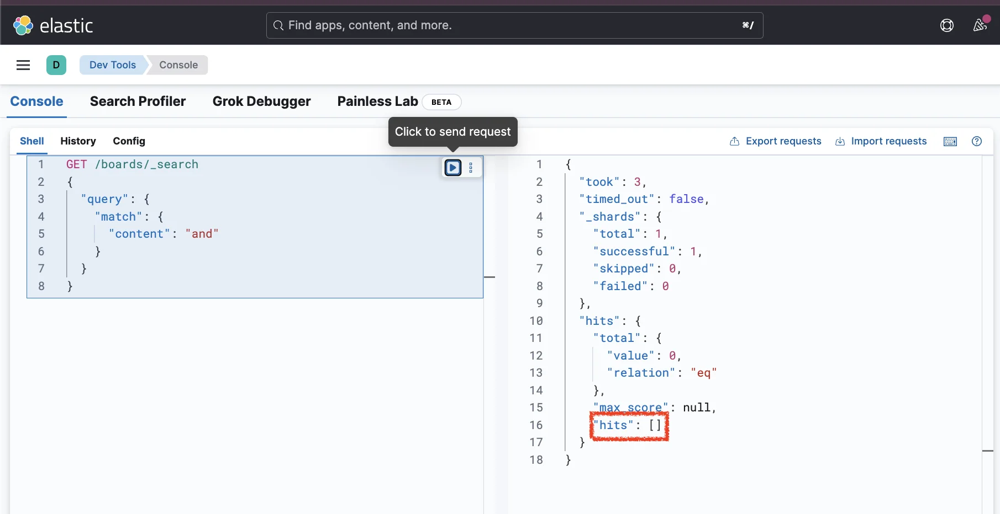
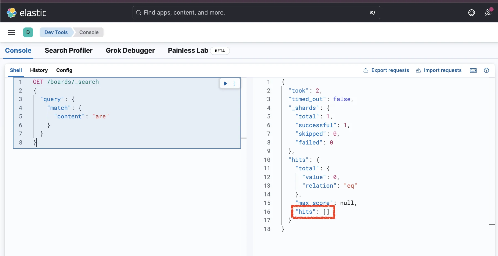
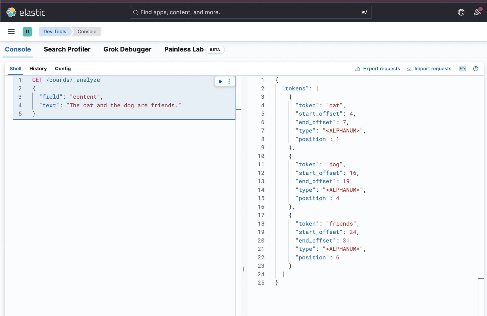

> 
> 
> <a id="348eda9b0fe18033b6aafc24a6ed0ffd"></a>
> 
> 목차
> 
> - [불용어(a, an, or) 제거(전처리) 애널라이저: stop](#348eda9b0fe180e09938e39d20610c97)
> - [검색할 때 필요없는 불용어(a, an, the, or, but 등) 제거](#348eda9b0fe180fda01adb7592148c36)

<a id="348eda9b0fe180e09938e39d20610c97"></a>

## 불용어(a, an, or) 제거(전처리) 애널라이저&#58; <code>stop</code>

---

> 📖 
> 
> <a id="348eda9b0fe18014a6d3c6edfdb47256"></a>
> 
> 영어로 작성된 게시글을 보면 검색어로 잘 사용하지 않는<strong> </strong><strong><code>a</code></strong><strong>, </strong><strong><code>an</code></strong><strong>, </strong><strong><code>the</code></strong><strong>, </strong><strong><code>or</code></strong><strong>과 같은 </strong><strong><u>불용어(= 의미없는 단어)</u></strong>가 많이 포함되어 있다&#46; 
> 
> <a id="348eda9b0fe180d59e30d0ae32012ce5"></a>
> 
> <strong><u>역인덱스의 효율적인 저장과 활용</u></strong>을 하기 위해 이를 <strong>전처리하여 </strong><strong><u>불용어 제거</u></strong><strong>를 하는 것이 좋다&#46;</strong> 
> 
> <a id="348eda9b0fe18089b1bcf88b9946349b"></a>
> 
> 이는 Elasticsearch에서 기본 제공하는 <strong><u>stop 필터</u></strong> 통해 쉽게 적용할 수 있다&#46;

<a id="348eda9b0fe180fda01adb7592148c36"></a>

#### 검색할 때 필요없는 불용어(a, an, the, or, but 등) 제거

<details>
<summary><strong>1&#46; Custom Analyzer를 활용해 인덱스 생성</strong></summary>

<a id="348eda9b0fe180f5a4a5c716335c404d"></a>

```json
// 기존 인덱스 삭제
DELETE /boards

// 인덱스 생성 + 매핑 정의 + Custom Analyzer 적용
PUT /boards
{
  "settings": {
    "analysis": {
      "analyzer": {
        "boards_content_analyzer": {
          "char_filter": [],
          "tokenizer": "standard",
          "filter": ["lowercase", "stop"]
        }
      }
    }
  },
  "mappings": {
	  "properties": {
	    "content": {
	      "type": "text",
	      "analyzer": "boards_content_analyzer"
	    }
	  }
	}
}

// 잘 생성됐는 지 확인
GET /boards
```



- 커스텀 Analyzer 필터에  <code>stop token filter</code>(불용어를 제거) 추가

</details>

<details>
<summary>2&#46; <strong>데이터 삽입</strong></summary>

<a id="348eda9b0fe1805f9e74ce472120f4d0"></a>

```json
POST /boards/_doc
{
  "content": "The cat and the dog are friends."
}
```



</details>

<details>
<summary>3&#46;<strong> 검색</strong></summary>

<a id="348eda9b0fe1801b8625df57a82d80b1"></a>

```json
GET /boards/_search
{
  "query": {
    "match": {
      "content": "the"
    }
  }
}
```


<a id="348eda9b0fe18077a443e53192e83f55"></a>

```json
GET /boards/_search
{
  "query": {
    "match": {
      "content": "and"
    }
  }
}
```



<a id="348eda9b0fe180e3856bc362bb677c13"></a>

```json
GET /boards/_search
{
  "query": {
    "match": {
      "content": "are"
    }
  }
}
```



<a id="348eda9b0fe1809aa983ed3287a7c5c9"></a>

위 쿼리로 검색해보면 아무 데이터도 조회되지 않는다&#46;

- 자세한 내용은 아래 <strong>Analyze API를 통해 디버깅하여 알아본다&#46; </strong>

</details>

<details>
<summary>4&#46; <strong>Analyze API 사용한 디버깅</strong></summary>

<a id="348eda9b0fe180ba8d33cc17cd44b71d"></a>

```json
GET /boards/_analyze
{
  "field": "content",
  "text": "The cat and the dog are friends."
}
```

<a id="348eda9b0fe1805f80ccff2d30bfbfa2"></a>

<strong>응답값</strong>



<a id="348eda9b0fe180e48127f06741423382"></a>

```json
{
  "tokens": [
    {
      "token": "cat",
      "start_offset": 4,
      "end_offset": 7,
      "type": "<ALPHANUM>",
      "position": 1
    },
    {
      "token": "dog",
      "start_offset": 16,
      "end_offset": 19,
      "type": "<ALPHANUM>",
      "position": 4
    },
    {
      "token": "friends",
      "start_offset": 24,
      "end_offset": 31,
      "type": "<ALPHANUM>",
      "position": 6
    }
  ]
}
```

- 토큰으로 저장될 필요 없는 불용어(<code>the</code>, <code>and</code>, <code>are</code>)가 제거 되어 저장된 것을 확인할 수 있다&#46; 

- 이로 인해 <code>the</code>, <code>and</code>, <code>are</code>로 검색했을 때 아무 데이터도 조회되지 않았다&#46;

</details>
