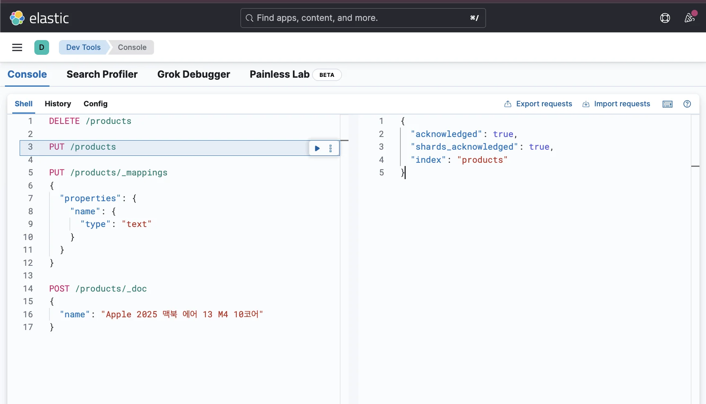
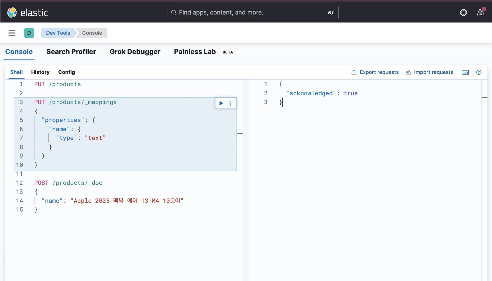
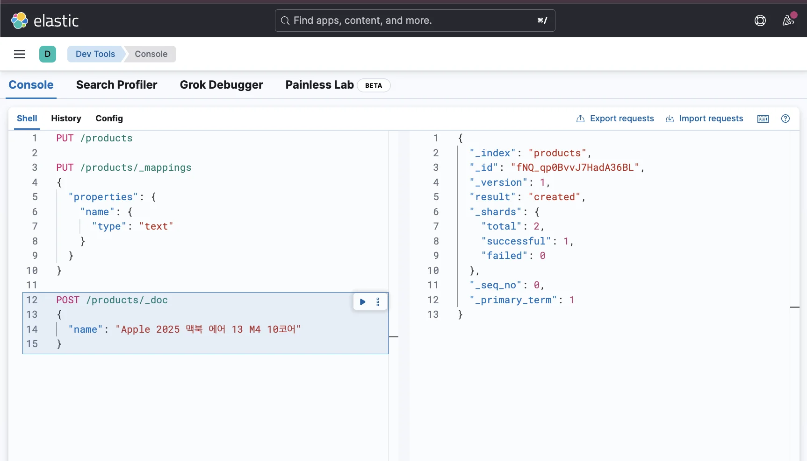
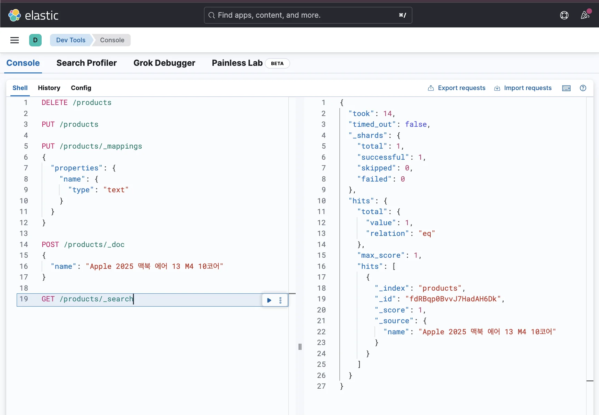
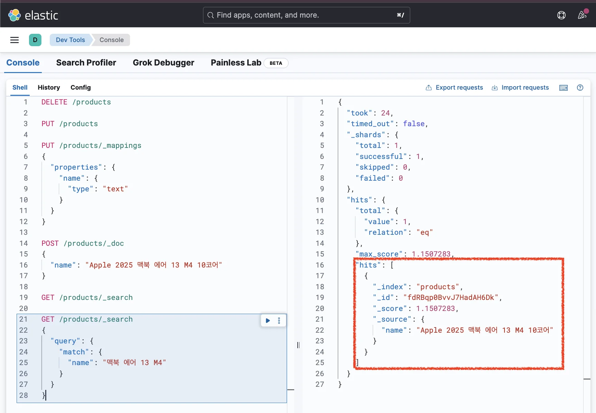
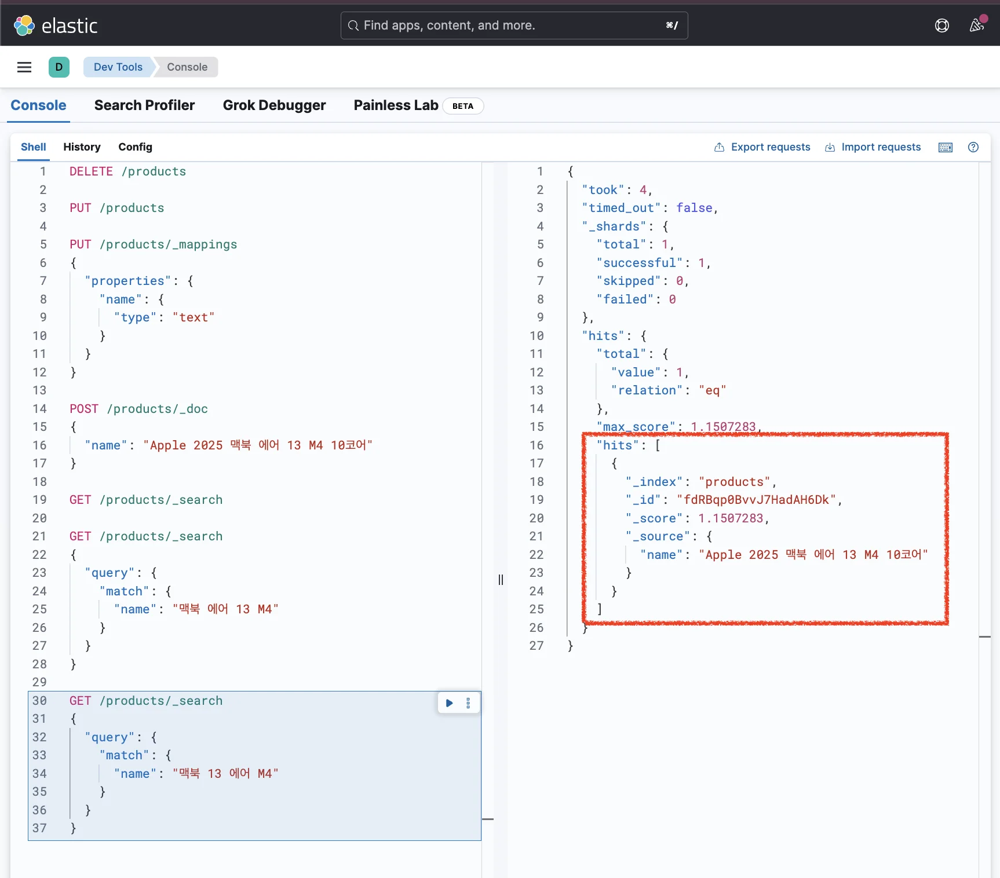

> 
> 
> <a id="348eda9b0fe181599436fdca7288d441"></a>
> 
> 목차
> 
> - [[실습] Elasitcsearch 검색 기능 테스트](#348eda9b0fe1809887e5d6936aaa82c4)

<a id="348eda9b0fe1809887e5d6936aaa82c4"></a>

## &#91;실습&#93; Elasitcsearch 검색 기능 테스트

---

1. 인덱스 생성
    <a id="348eda9b0fe180c4aea2ec28f1b66a4b"></a>

    ```plaintext
    PUT /products
    ```

    

1. 매핑 정의
    <a id="348eda9b0fe18056b71ed8ed7ddb0b30"></a>

    ```bash
    PUT /products/_mappings
    {
      "properties": {
        "name": { 
          "type": "text"
        }
      }
    }
    ```

    

1. 도큐먼트 삽입
    <a id="348eda9b0fe18028927dc9582f03682e"></a>

    ```bash
    # POST /{인덱스명}/_doc
    POST /products/_doc
    {
      "name": "Apple 2025 맥북 에어 13 M4 10코어"
    }
    ```

    

1. 도큐먼트 확인
    <a id="348eda9b0fe180b8bd6ed9c9d7aa32fc"></a>

    ```bash
    # 모든 도큐먼트 조회
    GET /products/_search
    ```

    

1. 도큐먼트 검색
    <a id="348eda9b0fe180e5a1e6eb45563335cc"></a>

    ```bash
    # 특정 조건을 만족하는 도큐먼트 조회 - name 필드에 '맥북 에어 13 M4'가 포함된 도큐먼트 조회
    GET /products/_search
    {
      "query": {
        "match": {
          "name": "맥북 에어 13 M4" 
        }
      }
    }
    ```

    - 특정 조건을 만족하는 도큐먼트를 조회 → <code>match</code> 쿼리 많이 사용

    

    <details>
    <summary>응답값 확인</summary>

    <a id="348eda9b0fe180aab439ca71070df231"></a>

    ```bash
    {
      "took": 4,
      "timed_out": false,
      "_shards": {
        "total": 1,
        "successful": 1,
        "skipped": 0,
        "failed": 0
      },
      "hits": {
        "total": {
          "value": 1,
          "relation": "eq"
        },
        "max_score": 1.1507283,

        # 조건을 만족하는 도큐먼트
        "hits": [
          {
            # _index : 인덱스명
            "_index": "products",
            
            # 데이터를 저장하면서 자동으로 생성된 '랜덤 고유 ID'
            "_id": "hU2MZ5YB5XfvBpblxof6",
            
            "_score": 1.1507283,
            
            # _source : 저장한 데이터가 들어있는 필드
            "_source": {
              "name": "Apple 2025 맥북 에어 13 M4 10코어"
            }
          }
        ]
      }
    }
    ```

    </details>

1. 단어 순서 바꿔서 검색
    <a id="348eda9b0fe180c985e0d26585f396de"></a>

    ```bash
    # 특정 조건을 만족하는 도큐먼트 조회 - name 필드에 '맥북 에어 13 M4'가 포함된 도큐먼트 조회
    GET /products/_search
    {
      "query": {
        "match": {
          "name": "맥북 13 에어 M4"
        }
      }
    }
    ```

    

    <details>
    <summary>응답값 확인</summary>

    <a id="348eda9b0fe180a1a382eb22d8531870"></a>

    ```bash
    {
      "took": 3,
      "timed_out": false,
      "_shards": {
        "total": 1,
        "successful": 1,
        "skipped": 0,
        "failed": 0
      },
      "hits": {
        "total": {
          "value": 1,
          "relation": "eq"
        },
        "max_score": 1.1507283,
        "hits": [
          {
            "_index": "products",
            "_id": "hU2MZ5YB5XfvBpblxof6",
            "_score": 1.1507283,
            "_source": {
              "name": "Apple 2025 맥북 에어 13 M4 10코어"
            }
          }
        ]
      }
    }
    ```

    </details>

    - <strong>단어 순서를 바꿔 검색</strong>해도 <u>정상적으로 검색</u>되는 것을 확인할 수 있다&#46;

    - 🧐 어떻게 가능한 것인가? 
        - 다음 챕터인 <a href="#/post/348eda9b-0fe1-8005-9187-c9953c9e30e4">페이지</a> 에서 다룬다&#46;
