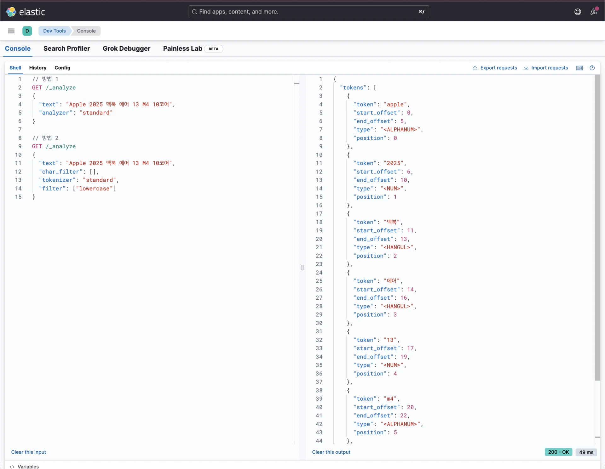
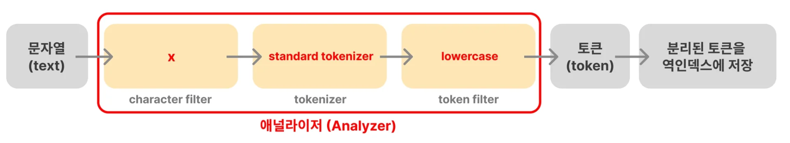

> 
> 
> <a id="348eda9b0fe180138dbced912318410f"></a>
> 
> 목차
> 
> - [[실습] Standard Analyzer의 토큰 분할 과정 확인](#348eda9b0fe18097ba95ea67615fb24d)
> - [ Analyze API](#348eda9b0fe18007b402e8cbc8847455)
> - [실제 적용](#348eda9b0fe180aab374ff09a662249a)
> - [응답값 확인](#348eda9b0fe180b78f36d27b38a26619)

<a id="348eda9b0fe18097ba95ea67615fb24d"></a>

## &#91;실습&#93; Standard Analyzer의 토큰 분할 과정 확인

---

<a id="348eda9b0fe18007b402e8cbc8847455"></a>

### <strong> Analyze API</strong>

<a id="348eda9b0fe180cab373eb3ed10358d0"></a>

```json
// 방법 1 
GET /_analyze
{
  "text": "_________",
  "analyzer": "standard"
}
```

<a id="349eda9b0fe180b0bf4cede94e534887"></a>

```json
// 방법 2 (standard analyer의 구성을 직접 명시)
GET /_analyze 
{
  "text": "_________",
  "char_filter": [],
  "tokenizer": "standard",
  "filter": ["lowercase"]
}
```

- <code>/&#95;analyze</code> api를 통해 analyzer 정의가 가능하다&#46; 

- 앞서 살펴봤듯이 위 2가지 방식으로 정의할 수 있다&#46; 

<a id="348eda9b0fe180aab374ff09a662249a"></a>

### <strong>실제 적용</strong>

<a id="348eda9b0fe180439e5acf6a0a838adc"></a>

```json
// 방법 1 
GET /_analyze
{
  "text": "Apple 2025 맥북 에어 13 M4 10코어",
  "analyzer": "standard"
}

// 방법 2
GET /_analyze
{
  "text": "Apple 2025 맥북 에어 13 M4 10코어",
  "char_filter": [],
  "tokenizer": "standard",
  "filter": ["lowercase"]
}
```

<a id="348eda9b0fe180b78f36d27b38a26619"></a>

### <strong>응답값 확인</strong>



<details>
<summary>응답값 확인</summary>

<a id="348eda9b0fe1807ab899e47c7aa42c4b"></a>

```json
{
  "tokens": [
    {
      "token": "apple",
      "start_offset": 0,
      "end_offset": 5,
      "type": "<ALPHANUM>",
      "position": 0
    },
    {
      "token": "2025",
      "start_offset": 6,
      "end_offset": 10,
      "type": "<NUM>",
      "position": 1
    },
    {
      "token": "맥북",
      "start_offset": 11,
      "end_offset": 13,
      "type": "<HANGUL>",
      "position": 2
    },
    {
      "token": "에어",
      "start_offset": 14,
      "end_offset": 16,
      "type": "<HANGUL>",
      "position": 3
    },
    {
      "token": "13",
      "start_offset": 17,
      "end_offset": 19,
      "type": "<NUM>",
      "position": 4
    },
    {
      "token": "m4",
      "start_offset": 20,
      "end_offset": 22,
      "type": "<ALPHANUM>",
      "position": 5
    },
    {
      "token": "10코어",
      "start_offset": 23,
      "end_offset": 27,
      "type": "<ALPHANUM>",
      "position": 6
    }
  ]
}
```

</details>



<a id="348eda9b0fe180b49031cf1e6776b034"></a>

토큰 분리 결과를 확인해보면 <code>standard tokenizer</code>(<code>공백</code> 또는 <code>,</code>, <code>&#46;</code>, <code>&#33;</code>, <code>?</code>와 같은 문장 부호를 기준으로 문자열을 자름)와 <code>lowercase token filter</code>(소문자로 변환)가 적용되어 인덱싱이 된 것을 확인할 수 있다&#46;
