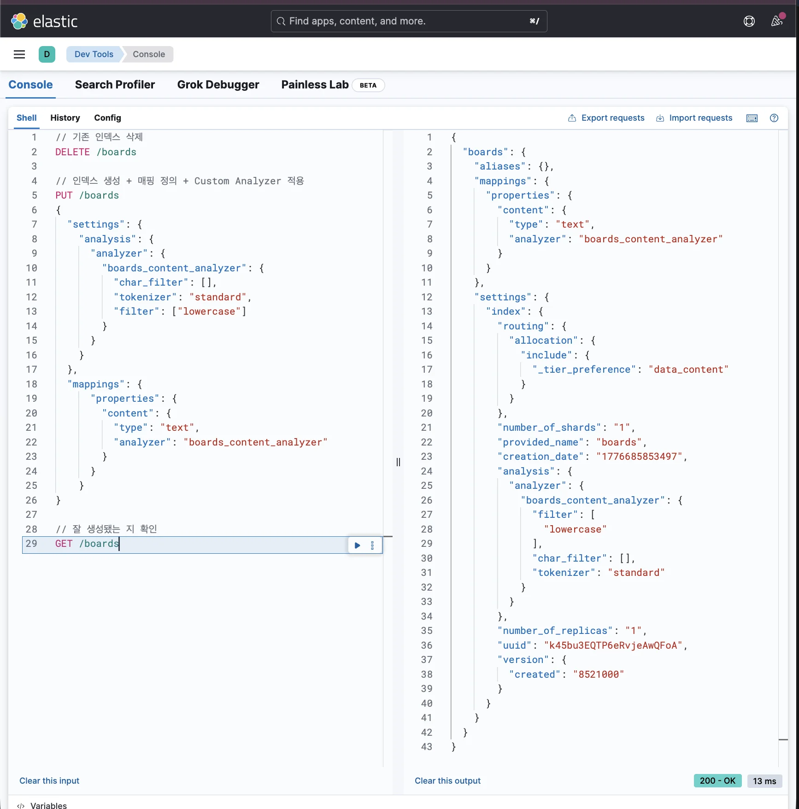
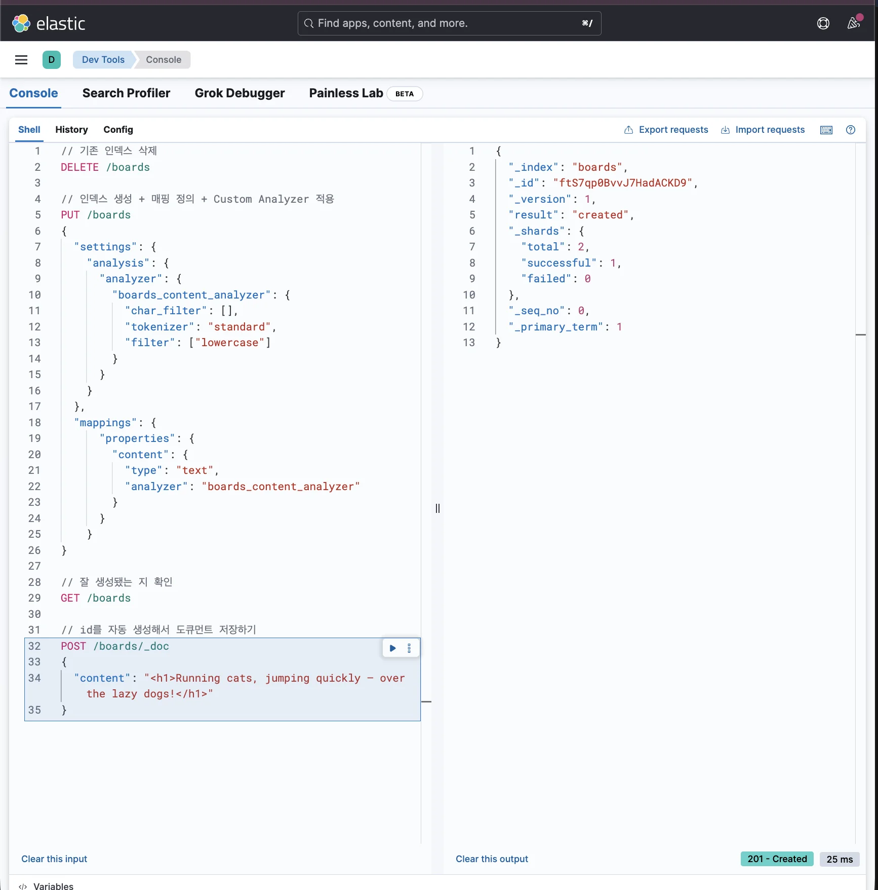
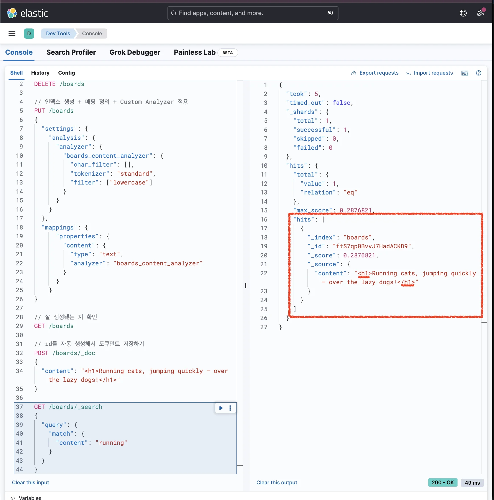
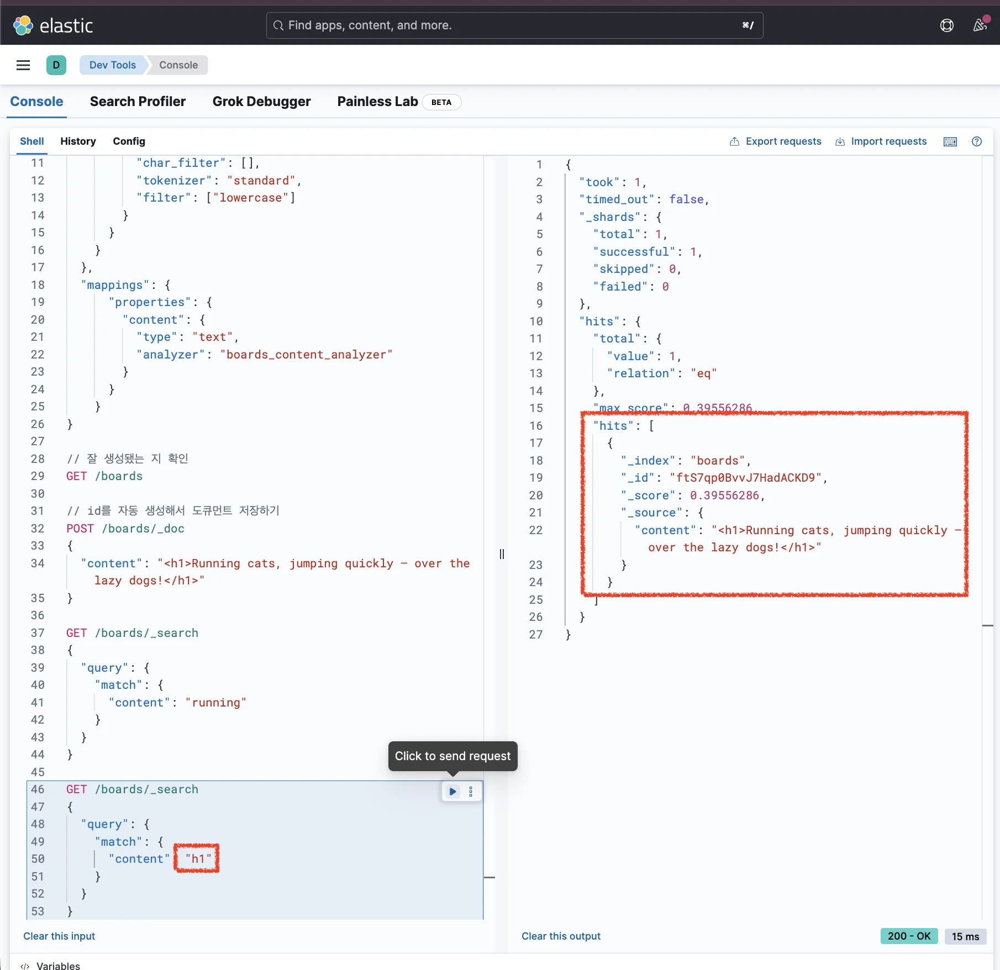
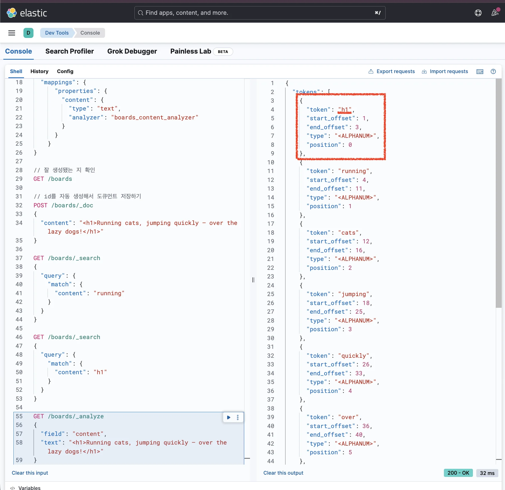
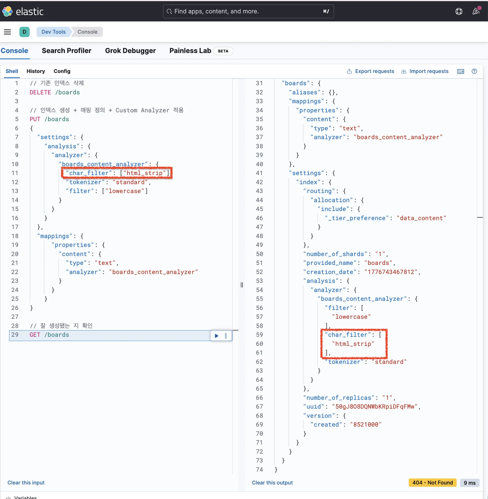
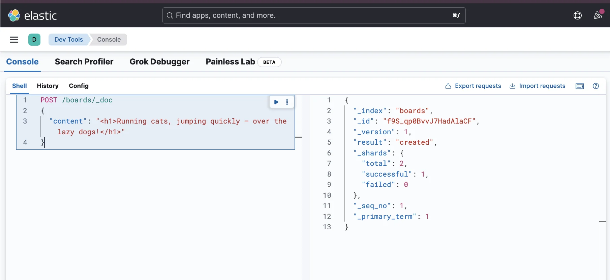
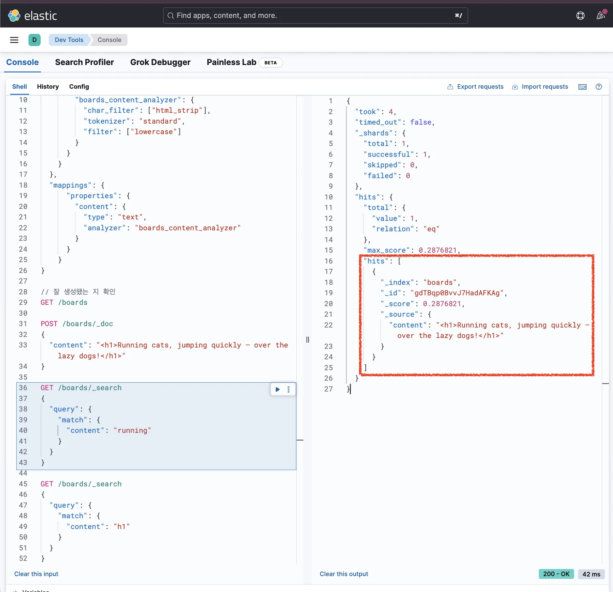
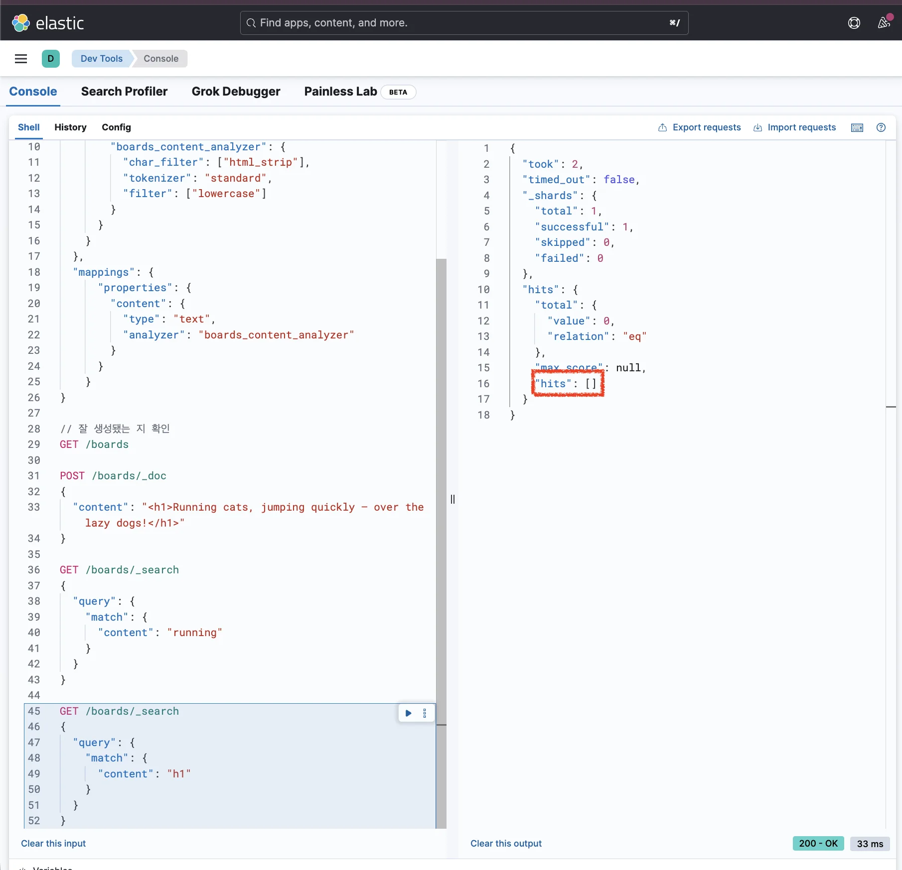
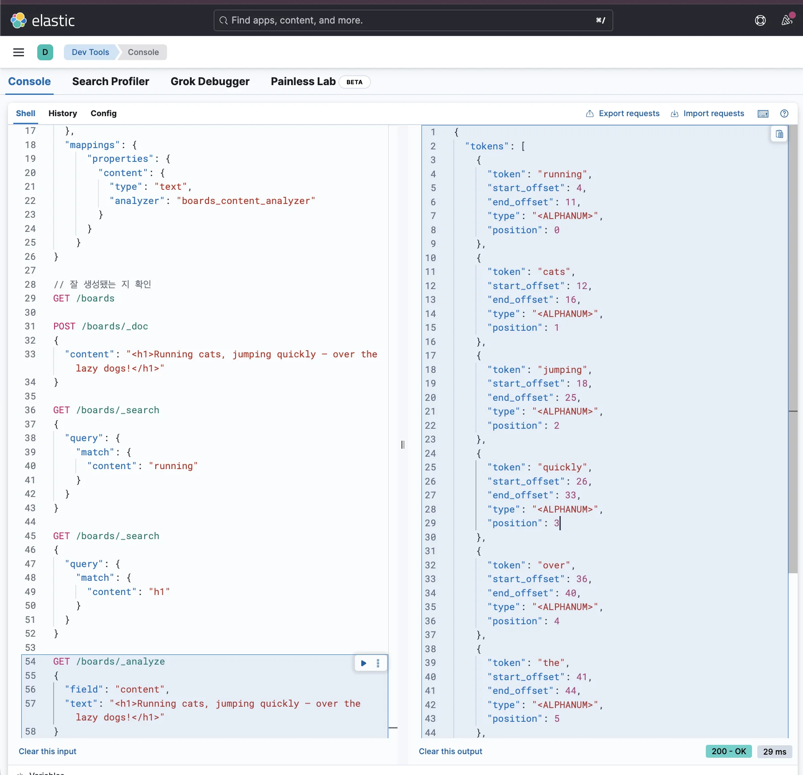

> 
> 
> <a id="348eda9b0fe180d388adf1efdb740e5c"></a>
> 
> 목차
> 
> - [HTML 태그 제거(전처리) 애널라이저: html_strip](#348eda9b0fe1804884c9d3730633f2c6)
> - [검색 시 필요없는 HTML 태그 제거](#348eda9b0fe1809abd3cecb5af8723ae)

<a id="348eda9b0fe1804884c9d3730633f2c6"></a>

## HTML 태그 제거(전처리) 애널라이저&#58; <code>html&#95;strip</code>

---

> 📖 
> 
> <a id="348eda9b0fe180768825ebd86bc5eeb2"></a>
> 
> 대부분의 게시글 서비스는 굵게, 기울임, 링크 등을 포함해서 작성할 수 있게 되어 있다&#46; <br>그러려면<strong><u> HTML 태그를 포함</u></strong>해서 그대로 DB에 저장해야 하는 경우가 많다&#46;
> 
> <a id="348eda9b0fe180099b86f95b4913ec9c"></a>
> 
> 그러나 실제 검색 쿼리에 HTML 태그 정보는 불필요하다&#46;
> 
> <a id="348eda9b0fe1808f9743de7a00601dd8"></a>
> 
> 이를 Elasticsearch에서 제공하는 <strong><u><code>html&#95;strip</code></u></strong><strong><u> 필터</u></strong>를 통해 <strong><u>전처리&#45;HTML 태그 제거</u></strong> 후 <strong>역인덱스을 할 수 있다&#46;</strong>

<a id="348eda9b0fe1809abd3cecb5af8723ae"></a>

#### 검색 시 필요없는 HTML 태그 제거

> <strong><code>html&#95;strip</code></strong><strong> 필터 </strong><strong><u>적용 전</u></strong>

<details>
<summary><strong>1&#46; Custom Analyzer를 활용해 인덱스 생성</strong></summary>

<a id="348eda9b0fe180958e89df9af3ef3ca9"></a>

```json
// 기존 인덱스 삭제
DELETE /boards

// 인덱스 생성 + 매핑 정의 + Custom Analyzer 적용
PUT /boards
{
  "settings": {
    "analysis": {
      "analyzer": {
        "boards_content_analyzer": {
          "char_filter": [],
          "tokenizer": "standard",
          "filter": ["lowercase"]
        }
      }
    }
  },
  "mappings": {
	  "properties": {
	    "content": {
	      "type": "text",
	      "analyzer": "boards_content_analyzer"
	    }
	  }
	}
}

// 잘 생성됐는 지 확인
GET /boards
```



- <code>standard tokenizer</code>(공백 또는 <code>,</code>, <code>&#46;</code>, <code>&#33;</code>, <code>?</code>와 같은 문장 부호를 기준으로 문자열을 자름)와 <code>lowercase token filter</code>(소문자로 변환)만 설정

- <code>html&#95;strip</code> 필터 ❌

</details>

<details>
<summary><strong>2&#46; 데이터 삽입</strong></summary>

<a id="348eda9b0fe1809c955edd0d61708c49"></a>

```json
// id를 자동 생성해서 도큐먼트 저장하기
POST /boards/_doc
{
  "content": "<h1>Running cats, jumping quickly — over the lazy dogs!</h1>"
}
```



</details>

<details>
<summary><strong>3&#46; 검색</strong></summary>

<a id="348eda9b0fe18028a0ddc7040e62e4f0"></a>

```json
GET /boards/_search
{
  "query": {
    "match": {
      "content": "running"
    }
  }
}
```



<a id="348eda9b0fe180429e76d6038e57dc4d"></a>

위 쿼리로 검색해보면 정상적으로 잘 조회가 된다&#46;

<a id="348eda9b0fe1802cbecbf6ffcfb02b72"></a>

```json
GET /boards/_search
{
  "query": {
    "match": {
      "content": "h1"
    }
  }
}
```



<a id="348eda9b0fe180deb6cbc275b4d1dd07"></a>

실제 게시글의 내용과는 상관없는 <code>h1</code>이라는 키워드에도 게시글이 조회됐다&#46; <br>즉,  <strong>HTML 태그에 대해서도 검색</strong>이 되다보니 <strong>검색 품질이 떨</strong>어지게 된다&#46; 

- 자세한 내용은 아래 <strong>Analyze API를 통해 디버깅</strong>하여 알아본다&#46; 

</details>

<details>
<summary><strong>4&#46; Analyze API 사용한 디버깅</strong></summary>

<a id="348eda9b0fe180769d5dd7e8f6268db3"></a>

```json
GET /boards/_analyze
{
  "field": "content",
  "text": "<h1>Running cats, jumping quickly — over the lazy dogs!</h1>"
}
```

<a id="348eda9b0fe1809490b6f44dc440a171"></a>

<strong>응답값</strong>



<a id="348eda9b0fe1808bb4e7e874e2c2da7b"></a>

```json
{
  "tokens": [
    {
      "token": "h1",
      "start_offset": 1,
      "end_offset": 3,
      "type": "<ALPHANUM>",
      "position": 0
    },
		...
  ]
}
```

- 토큰으로 저장될 필요 없는 HTML 태그까지도 역인덱스에 저장하다보니 <strong>디스크 공간을 낭비</strong>한다&#46; 

- 역인덱스에 불필요한 토큰까지 저장되므로 <strong>검색 속도도 떨</strong>어지게 된다&#46;

<a id="348eda9b0fe180139a10f5ad0105a0d1"></a>

따라서 <code>html&#95;strip</code>필터를 적용하여 HTML 태그는 제거하여 저장하는 방식으로 개선한다&#46; 

</details>

> <strong><code>html&#95;strip</code></strong><strong> 필터 적용</strong>

<details>
<summary><strong>5&#46; Custom Analyzer를 활용해 인덱스 다시 생성</strong></summary>

<a id="348eda9b0fe180c7a583d954234c037a"></a>

```json
// 기존 인덱스 삭제
DELETE /boards

// 인덱스 생성 + 매핑 정의 + Custom Analyzer 적용
PUT /boards
{
  "settings": {
    "analysis": {
      "analyzer": {
        "boards_content_analyzer": {
          "char_filter": ["html_strip"],
          "tokenizer": "standard",
          "filter": ["lowercase"]
        }
      }
    }
  },
  "mappings": {
	  "properties": {
	    "content": {
	      "type": "text",
	      "analyzer": "boards_content_analyzer"
	    }
	  }
	}
}

// 잘 생성됐는 지 확인
GET /boards
```



<a id="348eda9b0fe1800b9413d9b55112aa5c"></a>

<strong><u>HTML 태그를 제거한 뒤에 토큰을 만들어 저장</u></strong>하기 위해 <strong><u><code>html&#95;strip</code></u></strong><strong><u> character filter</u></strong>를 <br>추가하여 인덱스 재생성한다&#46;

</details>

<details>
<summary><strong>6&#46; 데이터 삽입</strong></summary>

<a id="348eda9b0fe18064912dd922d36229c2"></a>

```json
POST /boards/_doc
{
  "content": "<h1>Running cats, jumping quickly — over the lazy dogs!</h1>"
}
```



</details>

<details>
<summary><strong>7&#46; 검색</strong></summary>

<a id="348eda9b0fe180f2ae41ef7f1bf89d48"></a>

```json
GET /boards/_search
{
  "query": {
    "match": {
      "content": "running"
    }
  }
}
```



<a id="348eda9b0fe1807d8d48ee16cde202f8"></a>

```json
GET /boards/_search
{
  "query": {
    "match": {
      "content": "h1"
    }
  }
}
```



- <code>running</code>이라는 키워드로는 검색이 잘 되지만, <code>h1</code>이라는 키워드로는 검색이 잘 안되는 걸 확인 가능

</details>

<details>
<summary><strong>8&#46; Analyze API 사용한 디버깅</strong></summary>

<a id="348eda9b0fe1800bb0abdfa4ed794ec6"></a>

```json
GET /boards/_analyze
{
  "field": "content",
  "text": "<h1>Running cats, jumping quickly — over the lazy dogs!</h1>"
}
```

<a id="348eda9b0fe180fc8d3cd21c3fa47902"></a>

<strong>응답값</strong>



<a id="348eda9b0fe180979f9bf3cc97a65de3"></a>

```json
{
  "tokens": [
    {
      "token": "running",
      "start_offset": 4,
      "end_offset": 11,
      "type": "<ALPHANUM>",
      "position": 0
    },
		...
  ]
}
```

- 응답값 확인 시 <strong><u>h1 이 토큰이 제거</u></strong>된 것을 확인할 수 있다&#46; 

- 이로 인해 <u><code>h1</code></u><u>로 검색하더라도 조회가 되지 않</u>는다&#46; 

</details>
