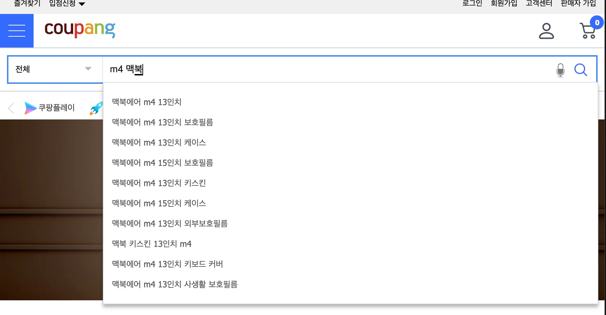
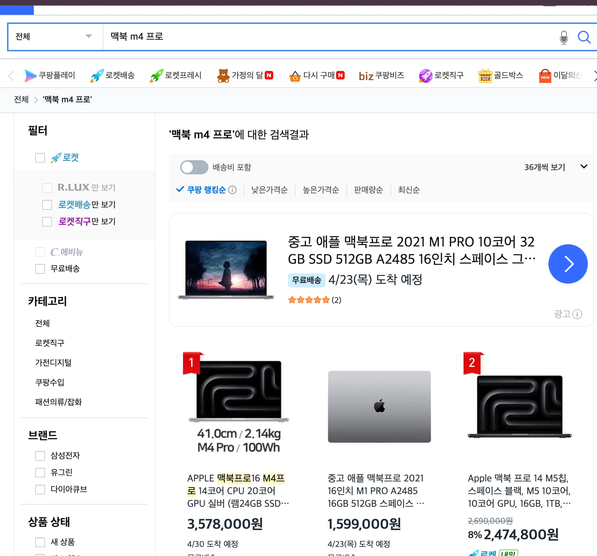
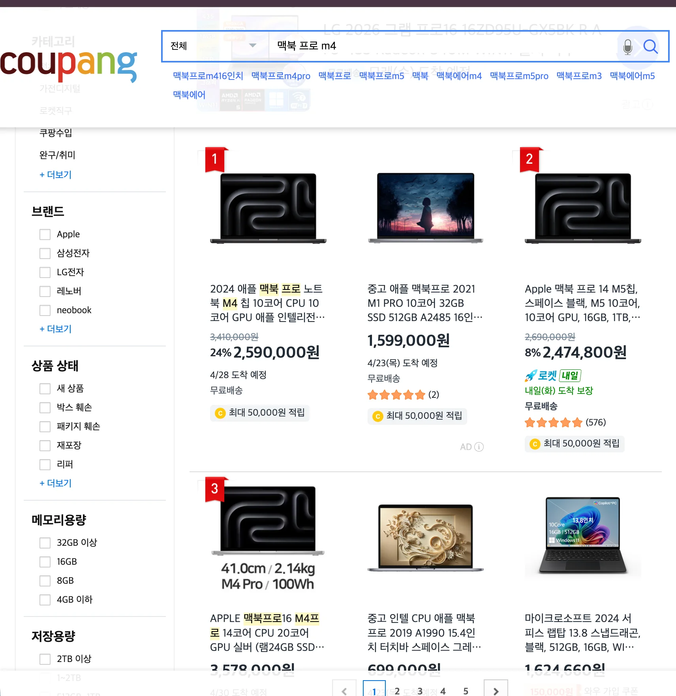

> 
> 
> <a id="348eda9b0fe1802da800f069a04c1989"></a>
> 
> 목차
> 
> - [Elasticsearch 를 활용한 검색 -  단어의 순서가 바뀌어도 검색 가능](#348eda9b0fe18123a755f9e8f645f4bb)
> - [ MySQL에서의 키워드 매칭 검색 기능](#348eda9b0fe18046ac56fcd4c21d31fe)
> - [ Elasticsearch를 사용한 쿠팡 검색 기능](#348eda9b0fe18039b898c0c910162a83)

<a id="348eda9b0fe18123a755f9e8f645f4bb"></a>

## Elasticsearch 를 활용한 검색 &#45;  <u>단어의 순서가 바뀌</u>어도 검색 가능

---

<a id="348eda9b0fe18046ac56fcd4c21d31fe"></a>

###  <u>MySQL</u>에서의 키워드 매칭 검색 기능

<a id="348eda9b0fe180b9b61efbd388db1fb5"></a>

```sql
SELECT * FROM products WHERE name = '%맥북 에어 13%';
```

- MySQL의 <code>products</code> 테이블의 <code>name</code> 컬럼에 <code>맥북 에어 13 M4</code>라고 저장 후, <br>특정 키워드로 데이터를 검색하려면 위와 같이 SQL문을 작성한다&#46; 

<a id="348eda9b0fe180cc8e95d17f353887d8"></a>

```sql
SELECT * FROM products WHERE name = '%맥북 13 에어%';
```

- 만약 위와 같이 <strong>단어의 순서를 바꾸</strong>면 해당하는 <strong><u>데이터가 검색되지 않</u></strong>는다&#46; 

<a id="348eda9b0fe18039b898c0c910162a83"></a>

###  <u>Elasticsearch</u>를 사용한 쿠팡 검색 기능








- 쿠팡에서 물건을 검색할 때 <strong>단어의 순서를 정확하게 기억하고 검색하진 않</strong>는다&#46; 

- 즉, <code>맥북 프로 m4</code>에 대해서 <strong><u>단어 순서 상관없이 검색 가능</u></strong>하며,  위와 같이 일관성 있게 검색 결과가 나오는 것을 확인할 수 있다&#46;
