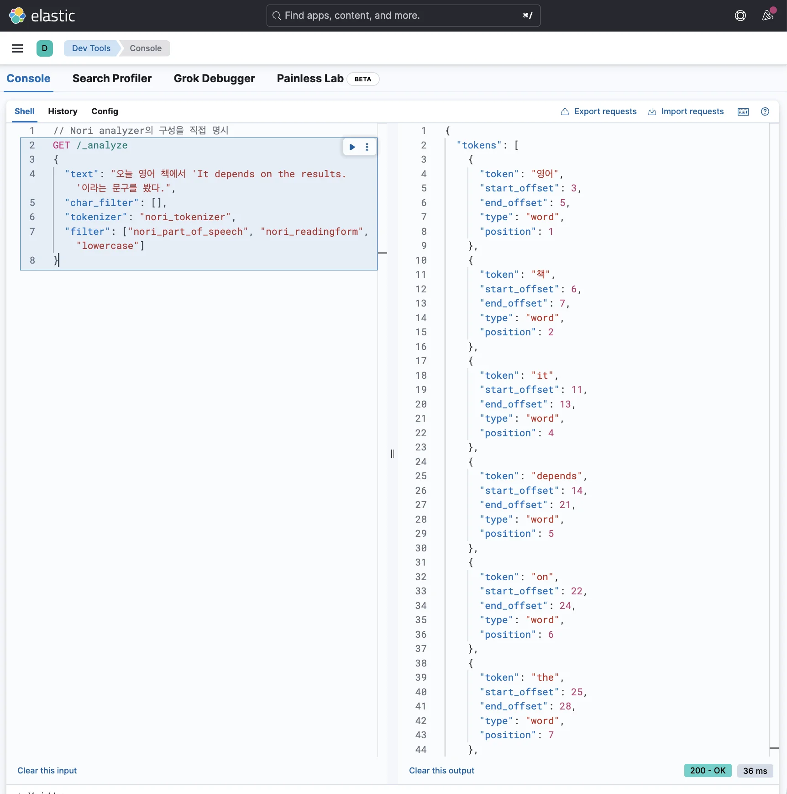
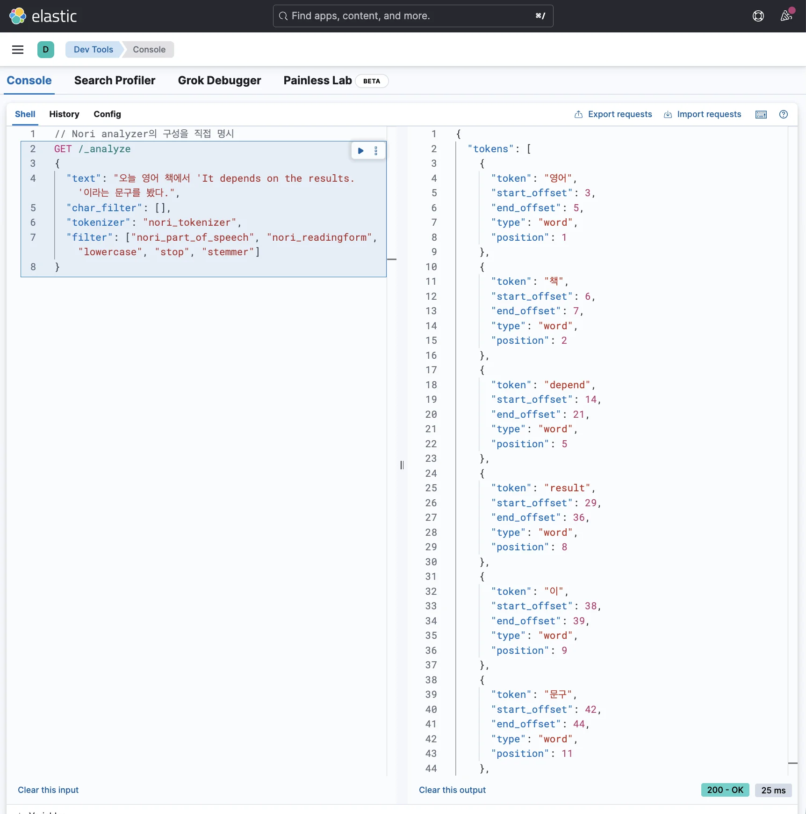

> 
> 
> <a id="348eda9b0fe181419a10c612b1465bce"></a>
> 
> 목차
> 
> - [[한글 + 영어] 검색 기능](#348eda9b0fe181de9a35ee8057833173)
> - [한글(korean)과 영어(english)가 섞인 글을 검색 가능하게 만들기](#349eda9b0fe18026916ed080d5bae455)

<a id="348eda9b0fe181de9a35ee8057833173"></a>

## &#91;한글 &#43; 영어&#93; 검색 기능

---

<a id="349eda9b0fe18026916ed080d5bae455"></a>

### 한글(korean)과 영어(english)가 섞인 글을 검색 가능하게 만들기

<details>
<summary><strong>1&#46; Analyze API 활용해 한글과 영어 섞인 문장을 어떻게 토큰으로 분해하는 지 디버깅</strong></summary>

<a id="349eda9b0fe180928ba6c0cb33e6103c"></a>

```json
// Nori analyzer의 구성을 직접 명시
GET /_analyze
{
  "text": "오늘 영어 책에서 'It depends on the results.'이라는 문구를 봤다.",
  "char_filter": [], 
	"tokenizer": "nori_tokenizer",
	"filter": [
		"nori_part_of_speech",
		"nori_readingform",
		"lowercase"
	]
}
```

<a id="349eda9b0fe1804fb13eff629b12d4b8"></a>

<strong>응답값</strong>



<a id="349eda9b0fe1803ab720ecc2ed75d55f"></a>

```json
{
  "tokens": [
    {
      "token": "영어",
      "start_offset": 3,
      "end_offset": 5,
      "type": "word",
      "position": 1
    },
    {
      "token": "책",
      "start_offset": 6,
      "end_offset": 7,
      "type": "word",
      "position": 2
    },
    {
      "token": "it",
      "start_offset": 11,
      "end_offset": 13,
      "type": "word",
      "position": 4
    },
    {
      "token": "depends",
      "start_offset": 14,
      "end_offset": 21,
      "type": "word",
      "position": 5
    },
    {
      "token": "on",
      "start_offset": 22,
      "end_offset": 24,
      "type": "word",
      "position": 6
    },
    {
      "token": "the",
      "start_offset": 25,
      "end_offset": 28,
      "type": "word",
      "position": 7
    },
    {
      "token": "results",
      "start_offset": 29,
      "end_offset": 36,
      "type": "word",
      "position": 8
    },
    {
      "token": "이",
      "start_offset": 38,
      "end_offset": 39,
      "type": "word",
      "position": 9
    },
    {
      "token": "문구",
      "start_offset": 42,
      "end_offset": 44,
      "type": "word",
      "position": 11
    },
    {
      "token": "보",
      "start_offset": 46,
      "end_offset": 47,
      "type": "word",
      "position": 13
    }
  ]
}
```

- Nori analyzer만 쓰더라도 한글과 영어 전부다 의미 단위로 잘 나누는 걸 확인할 수 있다&#46; 
    - <strong><u><code>lowercase</code></u></strong><strong><u> 필터</u></strong>가 적용 돼 영어 토큰을 소문자로 변환시켜 저장 

- 저장된 토큰이
    - 불용어(<code>it</code>, <code>on</code>, <code>the</code>)가 포함되며

    - 영단어의 기본 형태를 안 쓰고 있다(<code>depends</code>, <code>results</code>)

- 이를 <code>stop</code>, <code>stemmer</code> 필터를 적용하여 해결한다&#46;

</details>

<details>
<summary><strong>2&#46; Analyzer에 token filter 추가 &#45; </strong><code>stop</code>, <code>stemmer</code> </summary>

<a id="349eda9b0fe18005a1f4dfa50d1c35ab"></a>

```json
// Nori analyzer의 구성을 직접 명시
GET /_analyze
{
  "text": "오늘 영어 책에서 'It depends on the results.'이라는 문구를 봤다.",
  "char_filter": [], 
	"tokenizer": "nori_tokenizer", 
	"filter": [
			"nori_part_of_speech", 
			"nori_readingform", 
			"lowercase", 
			"stop", 
			"stemmer"
	]
}
```

<a id="349eda9b0fe1806e9cdaf2a4a1973a2f"></a>

<strong>응답값</strong>



<a id="349eda9b0fe1801aba09c2fb1500029d"></a>

```json
{
  "tokens": [
    {
      "token": "영어",
      "start_offset": 3,
      "end_offset": 5,
      "type": "word",
      "position": 1
    },
    {
      "token": "책",
      "start_offset": 6,
      "end_offset": 7,
      "type": "word",
      "position": 2
    },
    {
      "token": "depend",
      "start_offset": 14,
      "end_offset": 21,
      "type": "word",
      "position": 5
    },
    {
      "token": "result",
      "start_offset": 29,
      "end_offset": 36,
      "type": "word",
      "position": 8
    },
    {
      "token": "이",
      "start_offset": 38,
      "end_offset": 39,
      "type": "word",
      "position": 9
    },
    {
      "token": "문구",
      "start_offset": 42,
      "end_offset": 44,
      "type": "word",
      "position": 11
    },
    {
      "token": "보",
      "start_offset": 46,
      "end_offset": 47,
      "type": "word",
      "position": 13
    }
  ]
}
```

- <code>stop</code>, <code>stemmer</code>필터 적용을 통해 <strong><u>불용어가 제거</u></strong>되고 <strong><u>영단어가 기본 형태</u></strong>로 바뀌었다&#46; 

</details>
