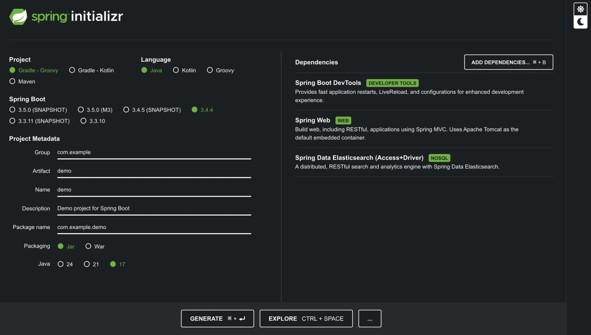
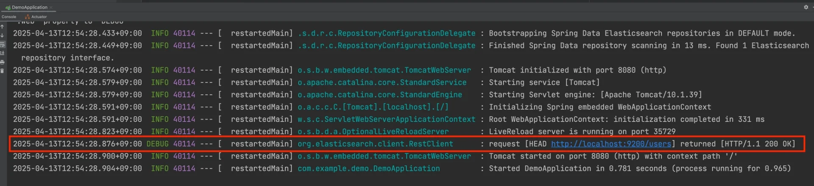
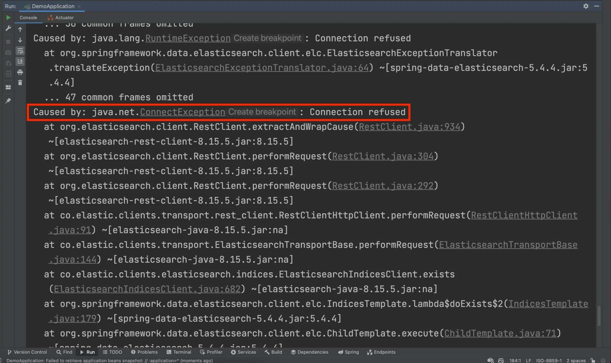
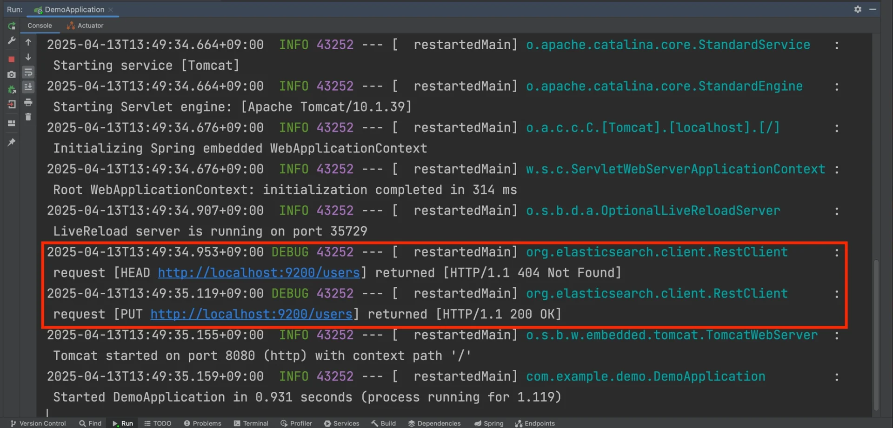
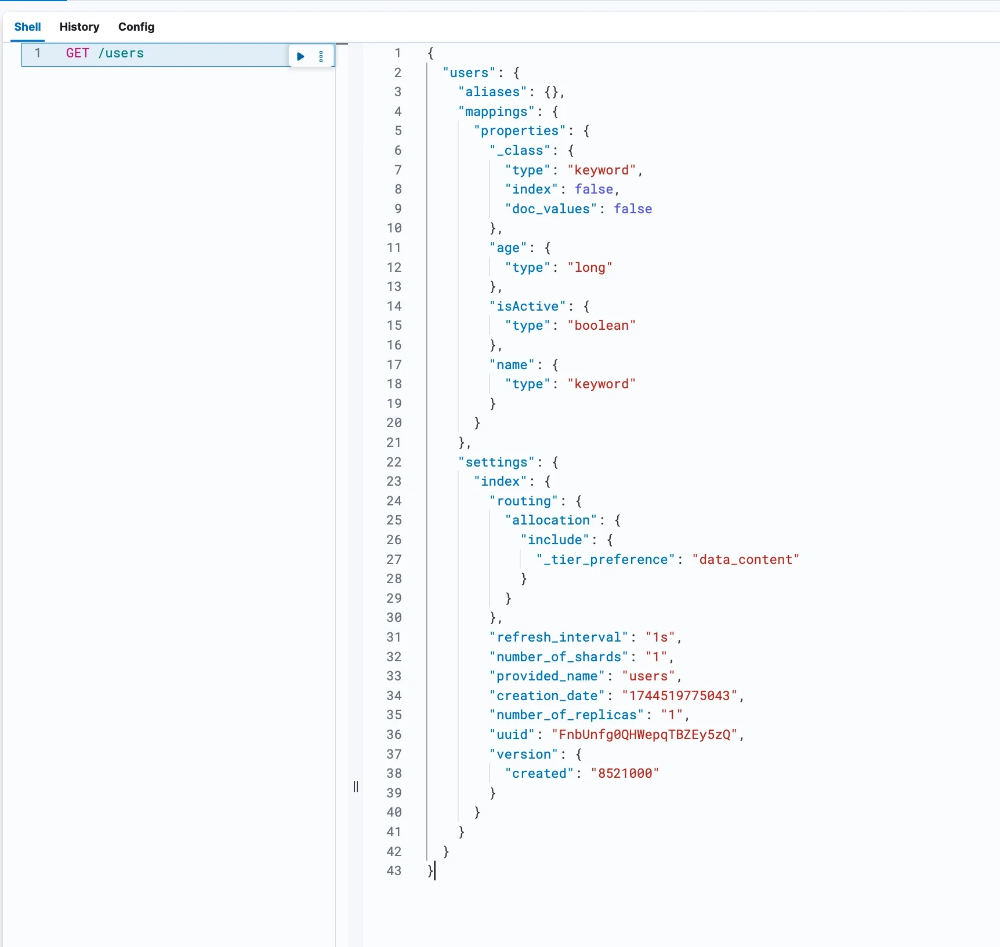

> 
> 
> <a id="348eda9b0fe181baae26ebe5f1cb2e7f"></a>
> 
> 목차
> 
> - [ Spring Boot에 Elasitcsearch 연결](#348eda9b0fe181d585c7c31b62ee9697)
> - [Connection 오류 확인](#348eda9b0fe18037bb80ea25c5ecd58b)
> - [Spring Data Elasticsearch의 인덱스 작동 매커니즘 확인](#348eda9b0fe18016bb65d722f5adfed3)

<a id="348eda9b0fe181d585c7c31b62ee9697"></a>

###  Spring Boot에 Elasitcsearch 연결

<details>
<summary><strong>1&#46; Spring Boot 프로젝트 세팅</strong></summary>

> ☝🏻 
> 
> <a id="348eda9b0fe1805f9fa4edcdd000cb21"></a>
> 
> 권장 버전
> 
> - Spring Boot 3&#46;x&#46;x
> 
> - JDK 17



- 의존성 (Dependencies)
    - <code>Spring Boot DevTools</code>

    - <code>Spring Web</code>

    - <code>Spring Data Elasticsearch (Access&#43;Driver)</code>

</details>

<details>
<summary>2&#46;<strong> Elasticsearch 연결 정보 세팅 &#45; </strong><strong><code>application&#46;yml </code></strong></summary>

<a id="348eda9b0fe180f39807e98777e513e1"></a>

```yaml
spring:
  elasticsearch:
    uris: http://localhost:9200 # 연결할 Elasticsearch 주소

logging:
  level:
    org.elasticsearch.client: TRACE # Elasticsearch의 쿼리 로그를 출력
```

</details>

<details>
<summary>3&#46; <strong>Document 생성</strong></summary>

<a id="348eda9b0fe180f7be03cf3ea17bf7bb"></a>

```java
@Getter
@Setter
@Document(indexName = "users") // users 인덱스의 Document임을 명시
public class UserDocument {
  @Id 
  private String id; // Elasticsearch에서는 Document ID를 문자열(String)으로 다룸

  @Field(type = FieldType.Keyword) // 매핑 정의 : keyword 타입
  private String name;

  @Field(type = FieldType.Long) // 매핑 정의 : long 타입
  private Long age; 

  @Field(type = FieldType.Boolean) // 매핑 정의 : boolean 타입
  private Boolean isActive; 
  
  public UserDocument(String id, String name, Long age, Boolean isActive) {
    this.id = id;
    this.name = name;
    this.age = age;
    this.isActive = isActive;
  }
}
```

</details>

<details>
<summary>4&#46;<strong> Repository 생성</strong></summary>

<a id="348eda9b0fe180788667f555fae3461c"></a>

```java
public interface UserDocumentRepository extends ElasticsearchRepository<UserDocument, String> {
}
```

- <code>ElasticsearchRepository</code>를 상속하여 구현
    - JPA와 거의 유사

</details>

<details>
<summary>5&#46; <strong>Spring Boot 프로젝트 실행</strong></summary>



- Spring Boot 프로젝트를 실행시켰을 때 에러가 뜨지 않고 위 로그가 찍혀있다면 정상적으로 Elasticsearch와 연결이 된 것이다&#46; 

</details>

<a id="348eda9b0fe18037bb80ea25c5ecd58b"></a>

### Connection 오류 확인

<a id="348eda9b0fe1800a9a43d884a240aaec"></a>

```yaml
spring:
  elasticsearch:
	  # Elasticsearch가 실행이 안 되고 있다는 걸 가정 or 주소를 잘못 입력했을 때를 가정
    uris: http://localhost:9999

logging:
  level:
    org.elasticsearch.client: TRACE
```



<a id="348eda9b0fe18030b2abd5ea39512f08"></a>

Elasticsearch 연결 x → 에러 메시지&#58; <code>Connection refused</code>

<a id="348eda9b0fe1800fb00fc74c6f73bcee"></a>

```yaml
spring:
  elasticsearch:
    uris: http://localhost:9200

logging:
  level:
    org.elasticsearch.client: TRACE
```

<a id="348eda9b0fe18016bb65d722f5adfed3"></a>

### Spring Data Elasticsearch의 인덱스 작동 매커니즘 확인



- 로그를 확인 해보면 users 인덱스를 조회 후 인덱스가 없으면 users 인덱스를 생성하는 것을 확인할 수 있다&#46; 

<details>
<summary><strong>Kibana에서 users 인덱스 조회</strong></summary>



<details>
<summary>응답값</summary>

<a id="348eda9b0fe180dfa83cd33efe87bb74"></a>

```json
{
  "users": {
    "aliases": {},
    "mappings": {
      "properties": {
        "_class": {
          "type": "keyword",
          "index": false,
          "doc_values": false
        },
        // UserDocument에서 정의한 Field에 맞게 매핑(mapping)이 정의되어있다.
        "age": {
          "type": "long"
        },
        "isActive": {
          "type": "boolean"
        },
        "name": {
          "type": "keyword"
        }
      }
    },
    "settings": {
      "index": {
        "routing": {
          "allocation": {
            "include": {
              "_tier_preference": "data_content"
            }
          }
        },
        "refresh_interval": "1s",
        "number_of_shards": "1",
        "provided_name": "users",
        "creation_date": "1744519775043",
        "number_of_replicas": "1",
        "uuid": "FnbUnfg0QHWepqTBZEy5zQ",
        "version": {
          "created": "8521000"
        }
      }
    }
  }
}
```

</details>

</details>
