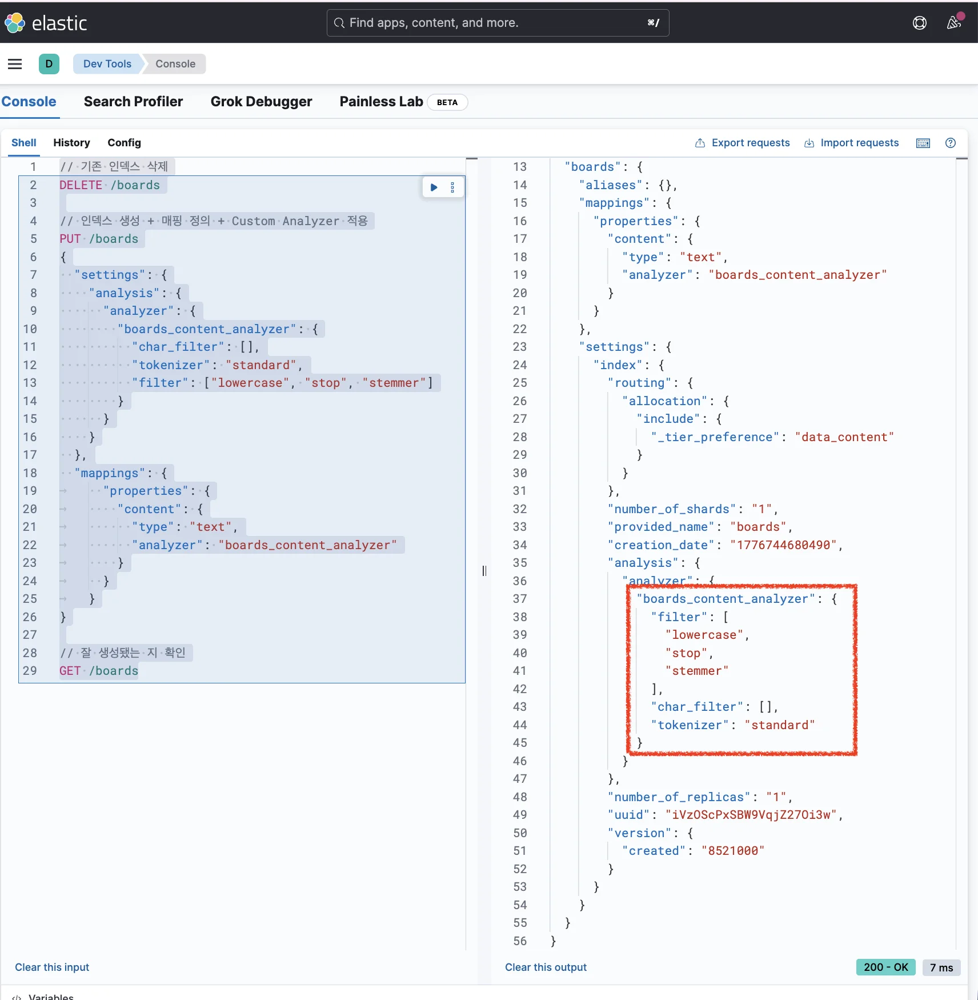
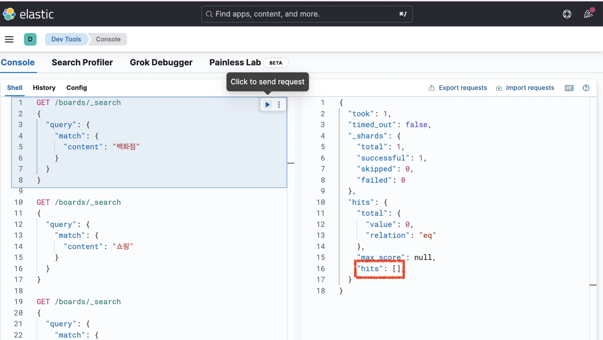
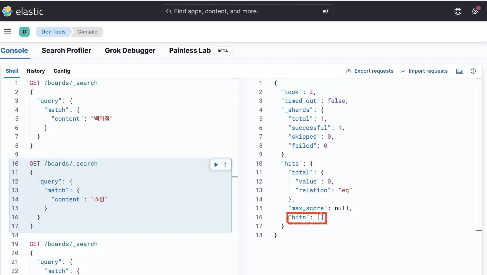
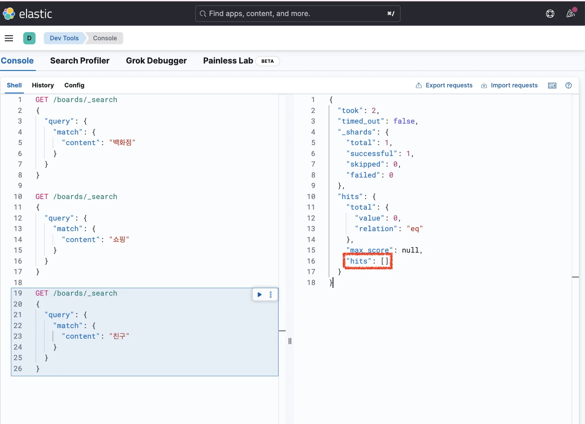
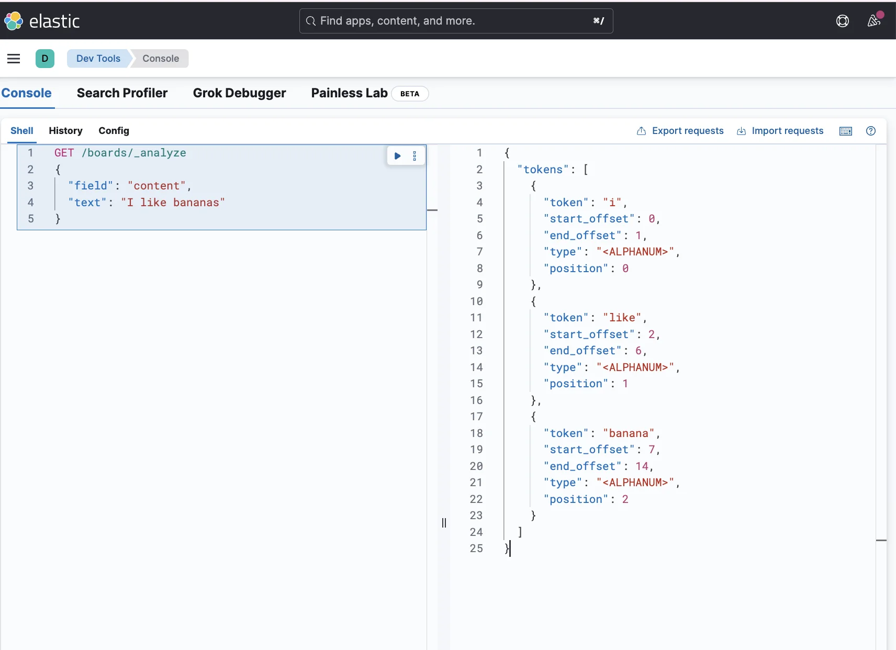
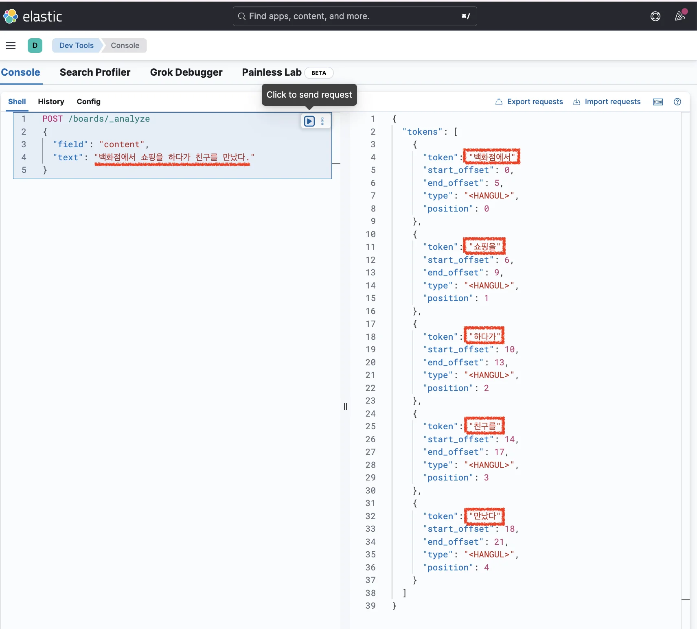

> 
> 
> <a id="348eda9b0fe180f580a6f2f3e920499e"></a>
> 
> 목차
> 
> - [[문제] 한글(korean) 전처리 시,  기존  애널라이저 오류](#349eda9b0fe180e297aaf7f8d3bc5ec2)
> - [🧐 [문제] 한글(korean)이 제대로 검색되지 않는 현상](#349eda9b0fe180289e0cf2d2c3ebd0ca)

<a id="349eda9b0fe180e297aaf7f8d3bc5ec2"></a>

## &#91;문제&#93; 한글(korean) 전처리 시,  기존  애널라이저 오류

---

> 📖 
> 
> <a id="349eda9b0fe1803aa81fdb8d99057f4e"></a>
> 
> <code>Samaung Notebook</code>이라는 상품이 있다고 가정하자&#46; 
> 
> <a id="349eda9b0fe1802e964fe53085e5331a"></a>
> 
> 사람들은 검색할 때 <code>notebook</code>이라고 정확하게 검색할 수도 있지만, <code>노트북</code>, <code>랩탑</code>, <code>휴대용 컴퓨터</code>, <code>laptop</code>과 같이 동의어로 검색할 수도 있다&#46; 그리고 <code>samsung</code>이라고 검색할 수도 있지만 <code>삼성</code>이라고 검색할 수도 있다&#46; 
> 
> <a id="349eda9b0fe1804a9f71fbda9d347776"></a>
> 
> 이렇게 동의어로 검색하더라도 <code>Samsung notebook</code>이 나오게 하려면 Elasticsearch에서 제공하는 <strong><u>synonym 필터</u></strong>를 사용하면 쉽게 구현할 수 있다&#46; 

<a id="349eda9b0fe180289e0cf2d2c3ebd0ca"></a>

#### 🧐 &#91;문제&#93; 한글(korean)이 제대로 검색되지 않는 현상

<details>
<summary><strong>1&#46; 인덱스 생성</strong></summary>

<a id="349eda9b0fe1808ba1a3e45cec91b4bc"></a>

```json
// 기존 인덱스 삭제
DELETE /boards

// 인덱스 생성 + 매핑 정의 + Custom Analyzer 적용
PUT /boards
{
  "settings": {
    "analysis": {
      "analyzer": {
        "boards_content_analyzer": {
          "char_filter": [],
          "tokenizer": "standard",
          "filter": ["lowercase", "stop", "stemmer"]
        }
      }
    }
  },
  "mappings": {
	  "properties": {
	    "content": {
	      "type": "text",
	      "analyzer": "boards_content_analyzer"
	    }
	  }
	}
}

// 잘 생성됐는 지 확인
GET /boards
```



</details>

<details>
<summary>2&#46; <strong>데이터 삽입</strong></summary>

<a id="349eda9b0fe180ac9c38d4eaeac8a6f0"></a>

```json
POST /boards/_doc
{
  "content": "백화점에서 쇼핑을 하다가 친구를 만났다."
}
```

</details>

<details>
<summary>3&#46;<strong> 검색</strong></summary>

<a id="349eda9b0fe180f3b7e0c264778c7e06"></a>

```json
GET /boards/_search
{
  "query": {
    "match": {
      "content": "백화점"
    }
  }
}
```



<a id="349eda9b0fe180b38885cb0f258b289f"></a>

```json
GET /boards/_search
{
  "query": {
    "match": {
      "content": "쇼핑"
    }
  }
}
```



<a id="349eda9b0fe1801a82d6df12f0368789"></a>

```json
GET /boards/_search
{
  "query": {
    "match": {
      "content": "친구"
    }
  }
}
```



<a id="349eda9b0fe1802d941eec707cfc2737"></a>

위 쿼리로 검색해보면 아무 데이터도 조회되지 않는다&#46;

- 자세한 내용은 아래 <strong>Analyze API를 통해 디버깅하여 알아본다&#46; </strong>

</details>

<details>
<summary>4&#46;1 <strong>Analyze API 사용한 디버깅&#58; </strong><strong><code>영어</code></strong></summary>

> 🤔 
> 
> <a id="349eda9b0fe180389fa7f25e7fd431c7"></a>
> 
> <code>영어</code>는 <strong><u>띄어쓰기로 단어가 명확하게 구분</u></strong>되다보니 <strong><u>standard tokenizer</u></strong>(<code>공백</code> 또는 <code>,</code>, <code>&#46;</code>, <code>&#33;</code>, <code>?</code>와 같은 문장 부호를 기준으로 자름)로도 잘 나눌 수 있다&#46; 

<a id="349eda9b0fe1801fab9fd2759db42aa5"></a>

```json
GET /boards/_analyze
{
  "field": "content",
  "text": "I like bananas"
}
```

<a id="349eda9b0fe180dca1f5e68dcbead31c"></a>

<strong>응답값</strong>



<a id="349eda9b0fe18060ab60e442c263da64"></a>

```json
{
  "tokens": [
    {
      "token": "i",
      "start_offset": 0,
      "end_offset": 1,
      "type": "<ALPHANUM>",
      "position": 0
    },
    {
      "token": "like",
      "start_offset": 2,
      "end_offset": 6,
      "type": "<ALPHANUM>",
      "position": 1
    },
    {
      "token": "banana",
      "start_offset": 7,
      "end_offset": 14,
      "type": "<ALPHANUM>",
      "position": 2
    }
  ]
}
```

- 위와 같이 단어들이 잘 나눠져서 인덱스를 형성한 것을 확인할 수 있다&#46; 

</details>

<details>
<summary>4&#46;2 <strong>Analyze API 사용한 디버깅&#58; </strong><strong><code>한글</code></strong><strong> </strong></summary>

> ❗ 
> 
> <a id="349eda9b0fe180f8a196c12e28d168d1"></a>
> 
> 하지만<strong> 한글은 좀 다르다</strong>&#46; <strong><u>조사(&#45;는, &#45;를), 어미(&#45;다, &#45;해요)를 붙여서 쓰는 말</u></strong>이 많다&#46;<br>그리고 <strong><u>띄어쓰기가 비교적 자유롭다</u></strong><strong><u>&#46;</u></strong> 
> 
> <a id="349eda9b0fe1800585a8df068a2341fc"></a>
> 
> 그러다보니 <strong><u>standard tokenizer</u></strong>로 단어를 나눠보면 <strong>제대로 잘 나누지 못</strong>하는 문제가 생긴다&#46; 

<a id="349eda9b0fe1809ca0dff5237a9b0e35"></a>

```json
POST /boards/_analyze
{
  "field": "content",
  "text": "백화점에서 쇼핑을 하다가 친구를 만났다."
}
```

<a id="349eda9b0fe180bc9e70e1036ed6df6b"></a>

<strong>응답값</strong>



<a id="349eda9b0fe180ca8067d9726ad63348"></a>

```json
{
  "tokens": [
    {
      "token": "백화점에서",
      "start_offset": 0,
      "end_offset": 5,
      "type": "<HANGUL>",
      "position": 0
    },
    {
      "token": "쇼핑을",
      "start_offset": 6,
      "end_offset": 9,
      "type": "<HANGUL>",
      "position": 1
    },
    {
      "token": "하다가",
      "start_offset": 10,
      "end_offset": 13,
      "type": "<HANGUL>",
      "position": 2
    },
    {
      "token": "친구를",
      "start_offset": 14,
      "end_offset": 17,
      "type": "<HANGUL>",
      "position": 3
    },
    {
      "token": "만났다",
      "start_offset": 18,
      "end_offset": 21,
      "type": "<HANGUL>",
      "position": 4
    }
  ]
}
```

<a id="349eda9b0fe180419b80d77f0badb0ec"></a>

Elasticsearch에서 제공하는 Analyzer를 통해 역인덱스 생성 시,  <strong><u>명사 &#43; 조사 형태</u></strong>로 토큰이 나뉘기 때문에 <strong><u>백화점</u></strong><strong>, </strong><strong><u>쇼핑</u></strong><strong>, </strong><strong><u>친구</u></strong><strong>로 검색하더라도 </strong><strong>검색이 안 되는 문제</strong>가 발생한다&#46; 

<a id="349eda9b0fe180a6b43cff8e260eacfc"></a>

따라서 해당 문제를 해결하기 위해 <strong>한글에 맞는 전용 Analyzer</strong>인 <strong><u>Nori(노리) Analyzer</u></strong>를 써야 한다&#46;

- <a href="#/post/348eda9b-0fe1-80db-8fe1-de321f68e376">페이지</a> 

</details>
