> 
> 
> <a id="348eda9b0fe18002815cd69226e2fc80"></a>
> 
> 목차
> 
> - [단어의 형태(-ed, -ing, -s 등) 제거(전처리) 애널라이저: stemmer](#348eda9b0fe18054a388cceee9da1852)
> - [단어의 형태(-ed, -ing, -s, -er 등)에 상관없이 검색하는 방법](#348eda9b0fe180c4bba3c7a098da170a)

<a id="348eda9b0fe18054a388cceee9da1852"></a>

## 단어의 형태(&#45;ed, &#45;ing, &#45;s 등) 제거(전처리) 애널라이저&#58; <code>stemmer</code>

---

> 📖 
> 
> <a id="348eda9b0fe180af87a4e6d3f9b3629f"></a>
> 
> 영어 단어를 보면 <code>play</code>, <code>play</code><u><code>ing</code></u>, <code>play</code><u><code>ed</code></u>, <code>play</code><u><code>er</code></u> 등 <strong>다양한 형태로 사용</strong>된다&#46; 
> 
> <a id="348eda9b0fe180f890aef416732ab641"></a>
> 
> 검색을 할 때 <strong>단어의 형태에 상관없이 검색이 가능</strong>하다면 <strong><u>훨씬 편하게 원하는 데이터를 조회</u></strong>할 수 있을 것이다&#46;
> 
> <a id="348eda9b0fe180cd8fabe3d6656daa58"></a>
> 
> 이는 Elasticsearch에서 제공하는 <strong><u>stemmer 필터</u></strong>를 통해 간단하게 적용 가능하다&#46; 

<a id="348eda9b0fe180c4bba3c7a098da170a"></a>

#### 단어의 형태(&#45;ed, &#45;ing, &#45;s, &#45;er 등)에 상관없이 검색하는 방법

> <strong><code>stemmer</code></strong><strong> 필터 </strong><strong><u>적용 전</u></strong>

<details>
<summary><strong>1&#46; Custom Analyzer를 활용해 인덱스 생성</strong></summary>

<a id="348eda9b0fe1803a92ecd6193c1196c2"></a>

```json
// 기존 인덱스 삭제
DELETE /boards

// 인덱스 생성 + 매핑 정의 + Custom Analyzer 적용
PUT /boards
{
  "settings": {
    "analysis": {
      "analyzer": {
        "boards_content_analyzer": {
          "char_filter": [],
          "tokenizer": "standard",
          "filter": ["lowercase"]
        }
      }
    }
  },
  "mappings": {
	  "properties": {
	    "content": {
	      "type": "text",
	      "analyzer": "boards_content_analyzer"
	    }
	  }
	}
}

// 잘 생성됐는 지 확인
GET /boards
```

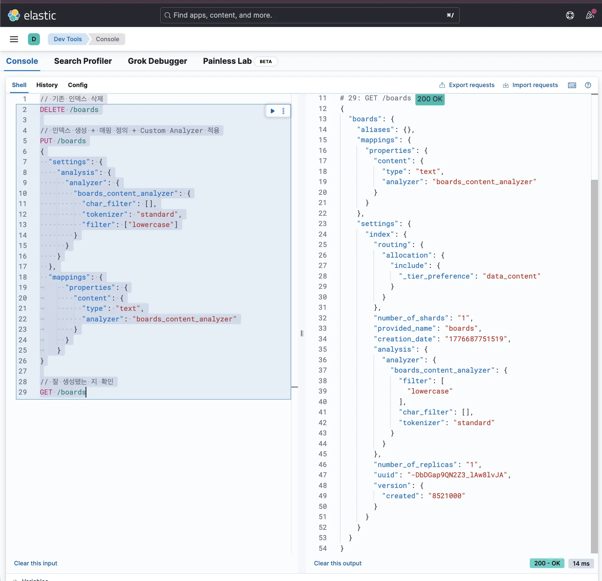

- <code>standard tokenizer</code>(공백 또는 <code>,</code>, <code>&#46;</code>, <code>&#33;</code>, <code>?</code>와 같은 문장 부호를 기준으로 문자열을 자름)와 <code>lowercase token filter</code>(소문자로 변환)만 설정

- <strong><code>stemmer</code></strong> 필터 ❌

</details>

<details>
<summary>2&#46; <strong>데이터 삽입</strong></summary>

<a id="348eda9b0fe180eeb7adeecf8dc2af00"></a>

```json
POST /boards/_doc
{
  "content": "Running cats, jumping!"
}
```

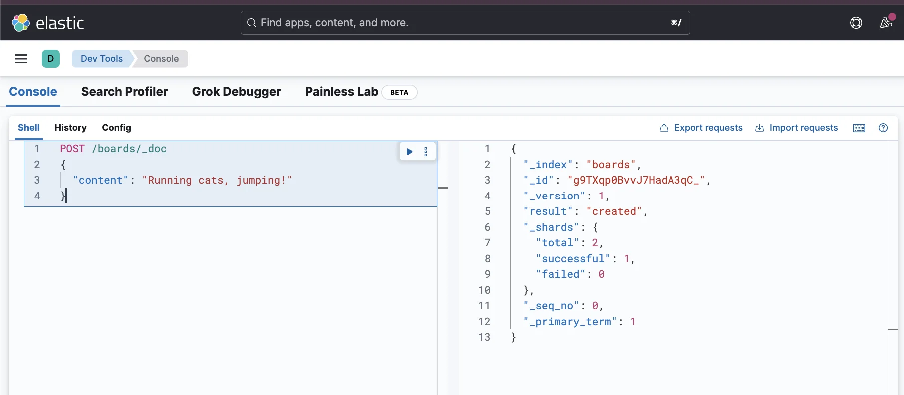

</details>

<details>
<summary>3&#46;<strong> 검색</strong></summary>

<a id="348eda9b0fe180978eeefe953bbbf122"></a>

```json
GET /boards/_search
{
  "query": {
    "match": {
      "content": "run"
    }
  }
}
```

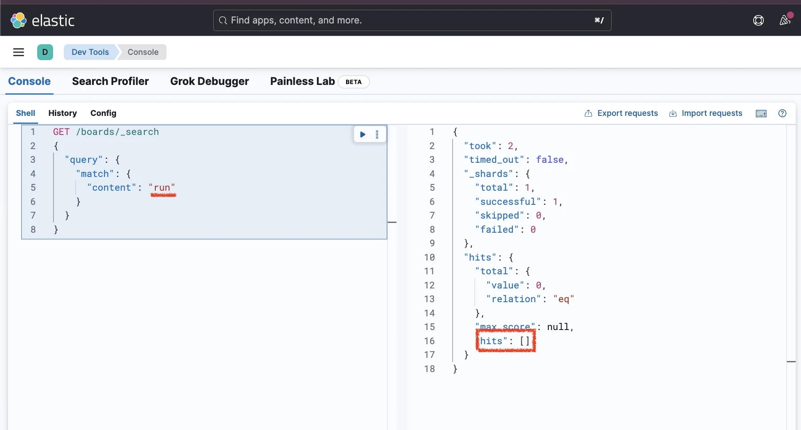

<a id="348eda9b0fe18074960ec44dba4cd7e2"></a>

```json
GET /boards/_search
{
  "query": {
    "match": {
      "content": "cat"
    }
  }
}
```


<a id="348eda9b0fe1806e8156c0086b57d120"></a>

```json
GET /boards/_search
{
  "query": {
    "match": {
      "content": "jumped"
    }
  }
}
```

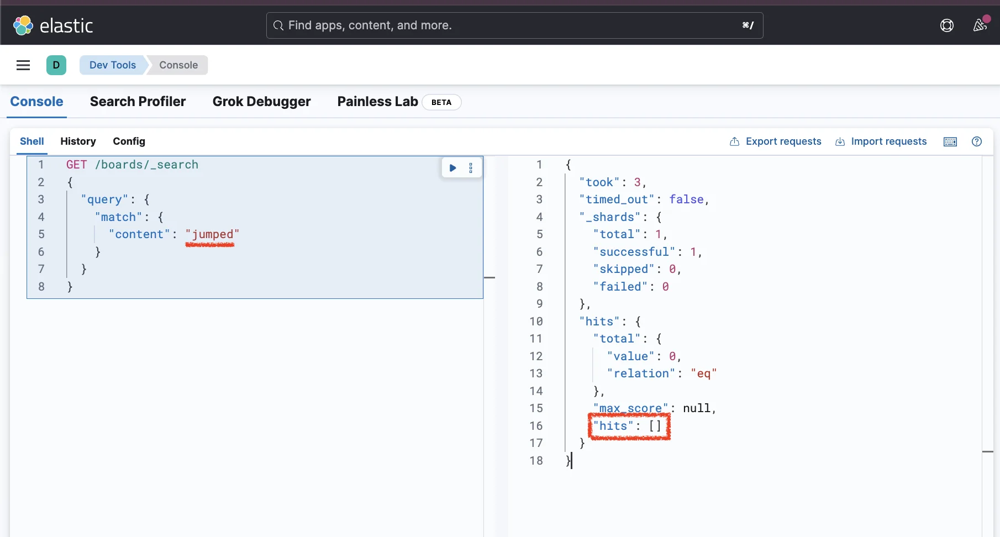

<a id="348eda9b0fe180d7981dcd7c88771f51"></a>

위 쿼리로 검색해보면 데이터가 조회되지 않는다&#46; 

- 자세한 내용은 아래 <strong>Analyze API를 통해 디버깅하여 알아본다&#46; </strong>

</details>

<details>
<summary>4&#46; <strong>Analyze API 사용한 디버깅</strong></summary>

<a id="348eda9b0fe180c8887bd7e3b6cf1f6e"></a>

```json
GET /boards/_analyze
{
  "field": "content",
  "text": "Running cats, jumping!"
}
```

<a id="348eda9b0fe18069b7b0cd7fc82e7016"></a>

응답값

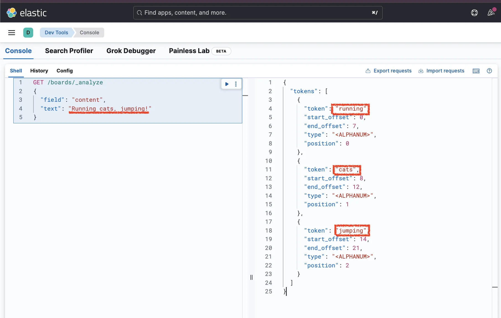

<a id="348eda9b0fe18048bedfc51cff03b254"></a>

```json
{
  "tokens": [
    {
      "token": "running",
      "start_offset": 0,
      "end_offset": 7,
      "type": "<ALPHANUM>",
      "position": 0
    },
    {
      "token": "cats",
      "start_offset": 8,
      "end_offset": 12,
      "type": "<ALPHANUM>",
      "position": 1
    },
    {
      "token": "jumping",
      "start_offset": 14,
      "end_offset": 21,
      "type": "<ALPHANUM>",
      "position": 2
    }
  ]
}
```

<a id="348eda9b0fe180c8a1a2e8cbbc2693bf"></a>

분리된 토큰을 살펴보면 검색할 때 <strong>영어 단어의 형태까지 일치시켜서 정확하게 입력</strong>해야만 <u>검색이 된다</u>는 걸 알 수 있다

<a id="348eda9b0fe18065b711dff74f35863a"></a>

 하지만 실제 검색을 하다보면 정확한 단어 형태가 떠오르지 않아서 비슷한 단어를 입력해서 검색을 하는 경우가 대부분이다&#46; 

<a id="348eda9b0fe1805d8361d66aed06406b"></a>

<strong>⇒  </strong><strong><code>stemmer</code></strong><strong> 필터 적용를 적용하여 해결한다&#46; </strong>

</details>

> <strong><code>stemmer</code></strong><strong> 필터 적용</strong>

<details>
<summary>5&#46; <strong>Custom Analyzer를 활용해 인덱스 다시 생성</strong></summary>

<a id="348eda9b0fe180aab667ce9e44ba5fac"></a>

```json
// 기존 인덱스 삭제
DELETE /boards

// 인덱스 생성 + 매핑 정의 + Custom Analyzer 적용
PUT /boards
{
  "settings": {
    "analysis": {
      "analyzer": {
        "boards_content_analyzer": {
          "char_filter": [],
          "tokenizer": "standard",
          "filter": ["lowercase", "stemmer"]
        }
      }
    }
  },
  "mappings": {
	  "properties": {
	    "content": {
	      "type": "text",
	      "analyzer": "boards_content_analyzer"
	    }
	  }
	}
}

// 잘 생성됐는 지 확인
GET /boards
```

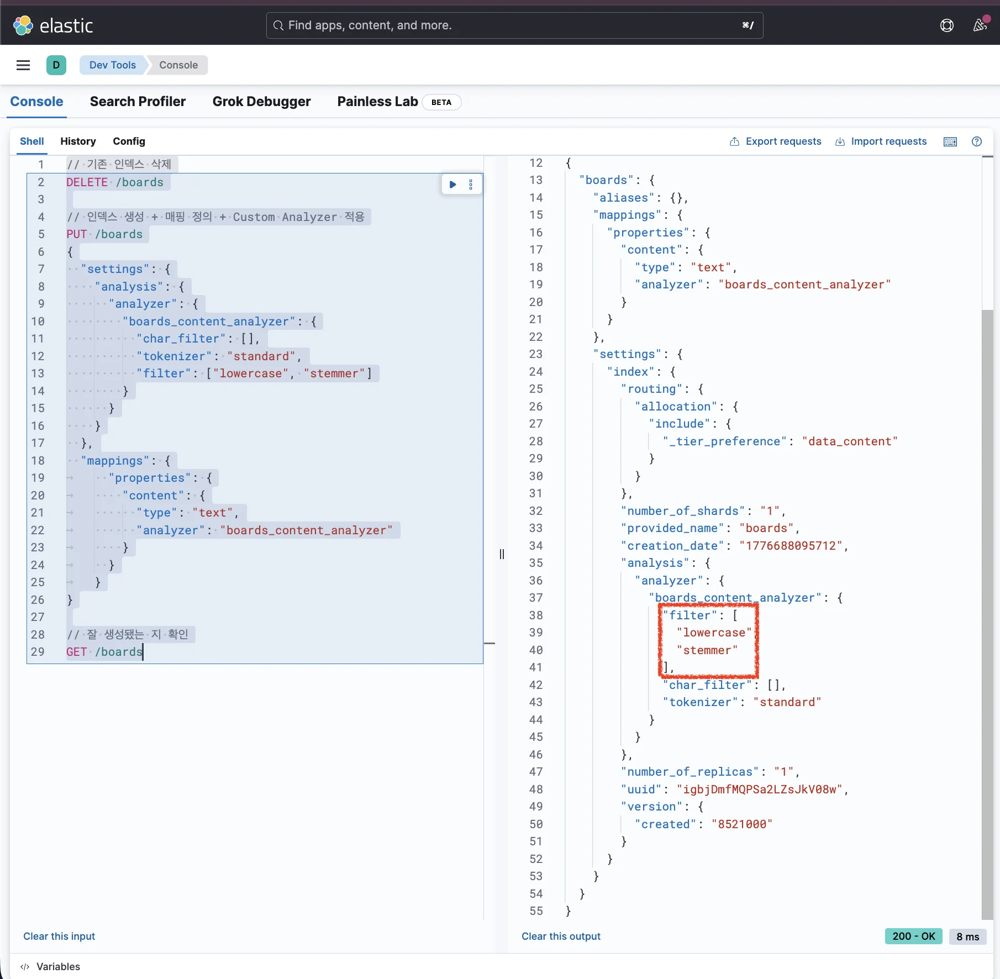

<a id="348eda9b0fe180d69694dcf25921de73"></a>

 token filter에 <code>stemmer</code>을 추가해 인덱스 생성

- <code>stemmer</code>은 영단어를 기본형으로 변환한 후에 토큰으로 저장한다&#46;

</details>

<details>
<summary>6&#46; <strong>데이터 삽입</strong></summary>

<a id="348eda9b0fe1808c8289c657ca143596"></a>

```json
POST /boards/_doc
{
  "content": "Running cats, jumping!"
}
```

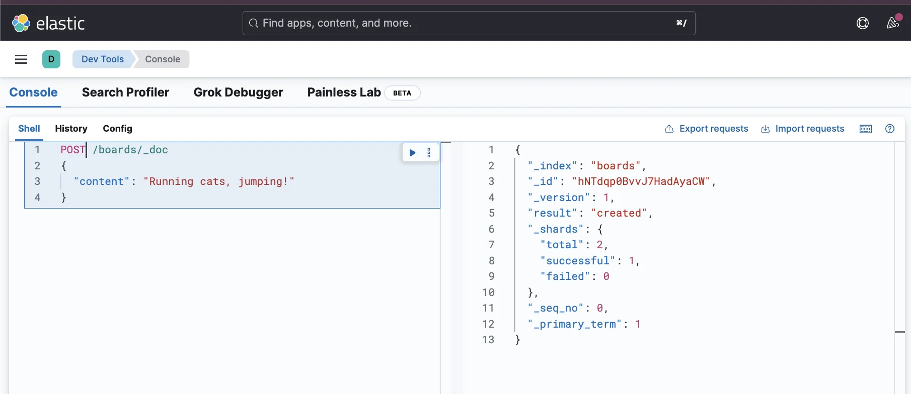

</details>

<details>
<summary><strong>7&#46; 검색</strong></summary>

<a id="348eda9b0fe18059873dc059bb5a7082"></a>

```json
GET /boards/_search
{
  "query": {
    "match": {
      "content": "run"
    }
  }
}
```

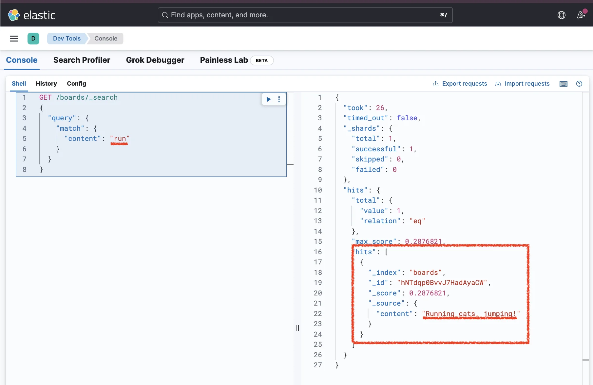

<a id="348eda9b0fe18055b021e7f17d9548c8"></a>

```json
GET /boards/_search
{
  "query": {
    "match": {
      "content": "cat"
    }
  }
}
```

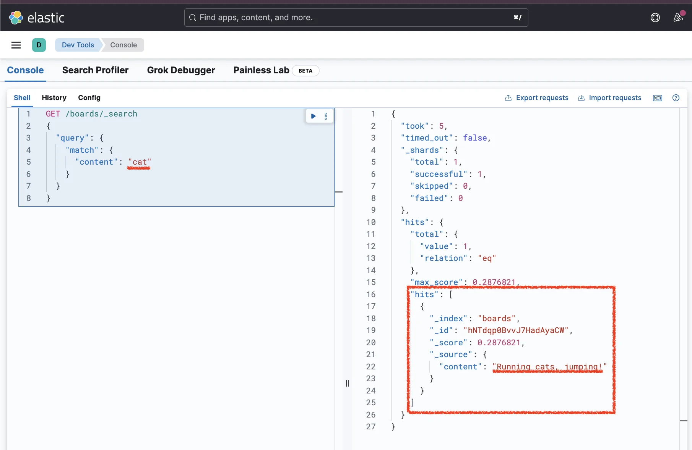

<a id="348eda9b0fe1808bab8fff9804b1ff83"></a>

```json
GET /boards/_search
{
  "query": {
    "match": {
      "content": "jumped"
    }
  }
}
```

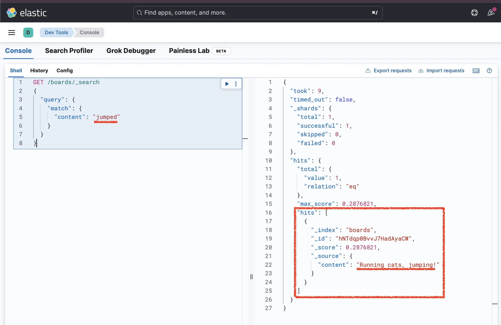

<a id="348eda9b0fe1804d84f7d938aa1f0935"></a>

token filter로 <code>stemmer</code>를 추가한 이후로 변형된 단어로도 검색이 잘 되는 것을 확인할 수 있다&#46; 

</details>

<details>
<summary>8&#46; <strong>Analyze API 사용한 디버깅</strong></summary>

<a id="348eda9b0fe18059b772dc60384d8d6f"></a>

```json
GET /boards/_analyze
{
    "field": "content",
    "text": "Running cats, jumping!"
}
```

<a id="348eda9b0fe18024b826fdd2115c5413"></a>

<strong>응답값</strong>

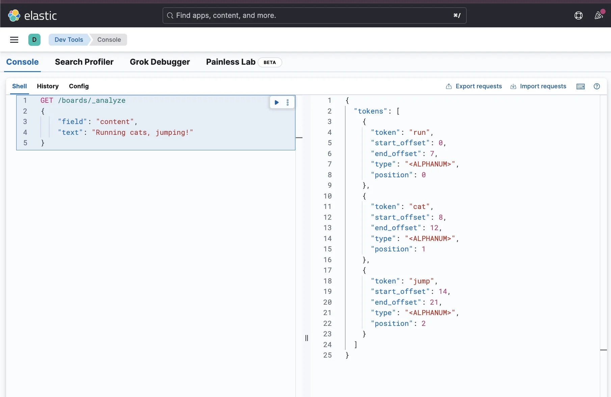

<a id="348eda9b0fe180b7ad44f645ae244887"></a>

```json
{
  "tokens": [
    {
      "token": "run",
      "start_offset": 0,
      "end_offset": 7,
      "type": "<ALPHANUM>",
      "position": 0
    },
    {
      "token": "cat",
      "start_offset": 8,
      "end_offset": 12,
      "type": "<ALPHANUM>",
      "position": 1
    },
    {
      "token": "jump",
      "start_offset": 14,
      "end_offset": 21,
      "type": "<ALPHANUM>",
      "position": 2
    }
  ]
}
```

<a id="348eda9b0fe180ba8208f38469605e73"></a>

응답값을 보면 영단어의 기본 형태로 저장되어 있는 걸 확인할 수 있다

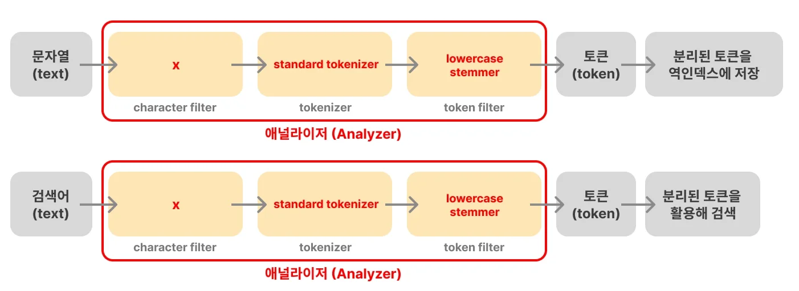

<a id="348eda9b0fe180ce9a9ae604f34c0d77"></a>

<strong><u>검색 쿼리도 동일한 애널라이저를 거쳐서 전처리 과정을 거친 후 검색에 사용</u></strong>되기 때문에 

<a id="348eda9b0fe18091a259e6e41de6b17a"></a>

<code>jumped</code>, <code>jumpping</code>, <code>jump</code> 등이 모두 <code>jump</code>로 전처리 되어 검색이 정상 동작한 것을 알 수 있다&#46;

</details>
