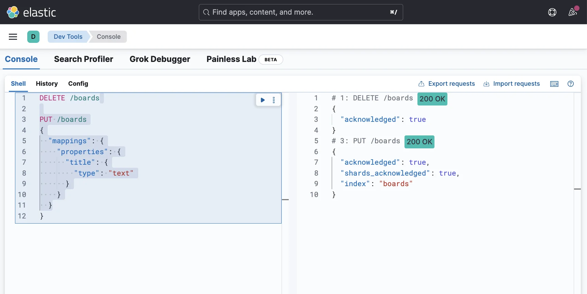
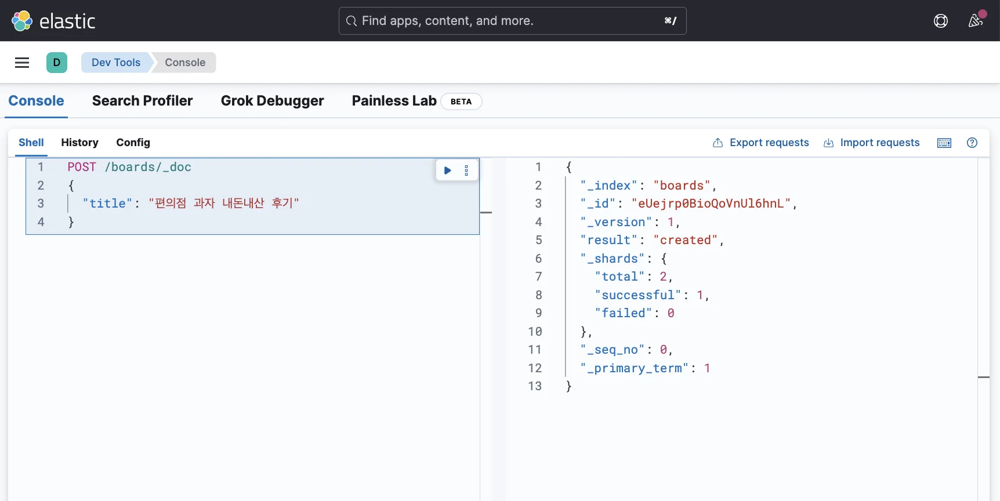
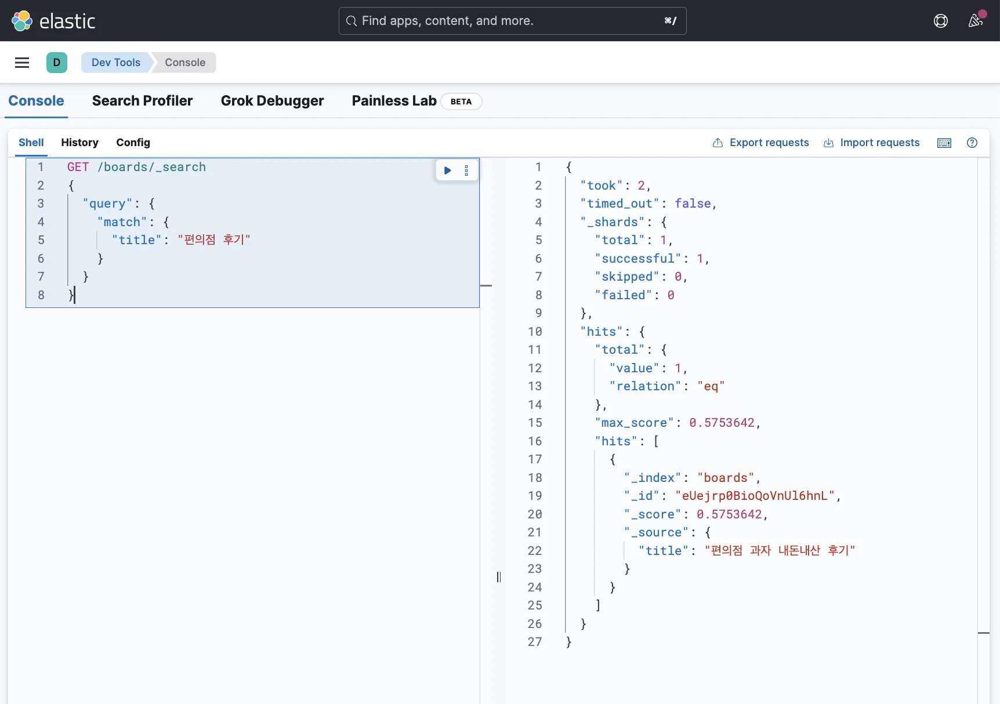

> 
> 
> <a id="348eda9b0fe180c691a1f6d14624d281"></a>
> 
> 목차
> 
> - [검색 키워드가 포함된 데이터 조회: match](#348eda9b0fe180aea4fffdca3721aaa1)
> - [검색 키워드가 포함된 데이터를 조회하고 싶을 때: match](#349eda9b0fe18091ab09c083e7c963b4)

<a id="348eda9b0fe180aea4fffdca3721aaa1"></a>

## 검색 키워드가 포함된 데이터 조회&#58; <code>match</code>

---

> 📖 
> 
> <a id="349eda9b0fe18084a550f2f40ab720a2"></a>
> 
> <code>match</code> 쿼리는 <strong>검색 키워드가 포함된 모든 도큐먼트를 조회</strong>한다&#46;
> 
> - <strong><u>text 타입의 필드</u></strong>에서만 사용한다&#46;
> 
> - <strong><code>keyword</code></strong><strong>,</strong><strong><code>long</code></strong><strong>, </strong><strong><code>integer</code></strong><strong>와 같은 타입의 필드</strong>에서는 <strong><u>사용하지 않</u></strong>는다&#46;

<a id="349eda9b0fe18091ab09c083e7c963b4"></a>

### 검색 키워드가 포함된 데이터를 조회하고 싶을 때&#58; <code>match</code>

<details>
<summary><strong>1&#46; 인덱스 생성 및 매핑 정의</strong></summary>

<a id="349eda9b0fe180d28c1bf868cc3c757b"></a>

```json
DELETE /boards

PUT /boards
{
  "mappings": {
    "properties": {
      "title": {
        "type": "text"
      }
    }
  }
}
```



</details>

<details>
<summary><strong>2&#46; 데이터 삽입</strong></summary>

<a id="349eda9b0fe1800da3a0df8f87cf2af4"></a>

```json
POST /boards/_doc
{
  "title": "편의점 과자 내돈내산 후기"
}
```



</details>

<details>
<summary><strong>3&#46; 도큐먼트 검색</strong></summary>

<a id="349eda9b0fe180939963de93c7013aa8"></a>

```json
GET /boards/_search
{
  "query": {
    "match": {
      "title": "편의점 후기" 
    }
  }
}
```



</details>
