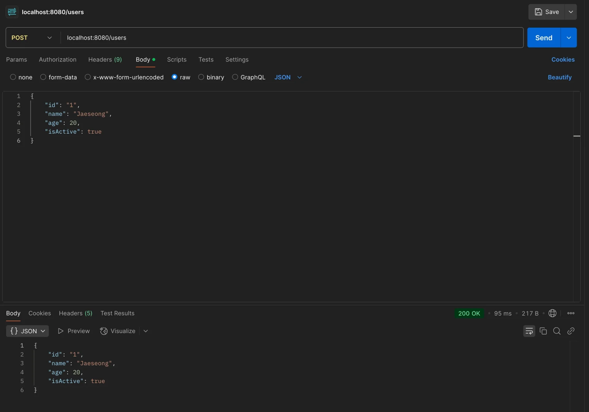
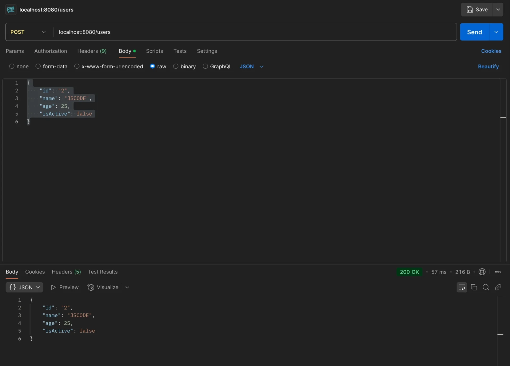
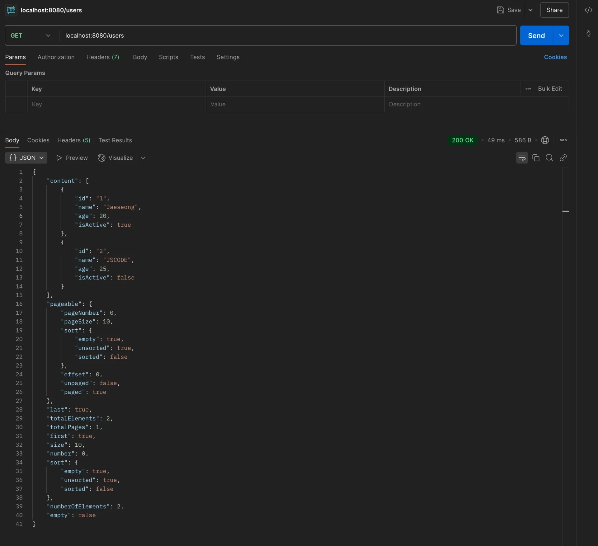
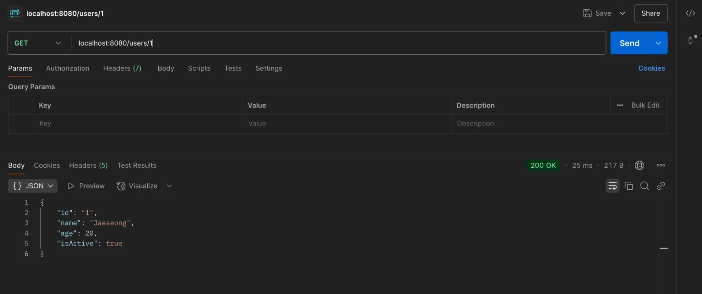
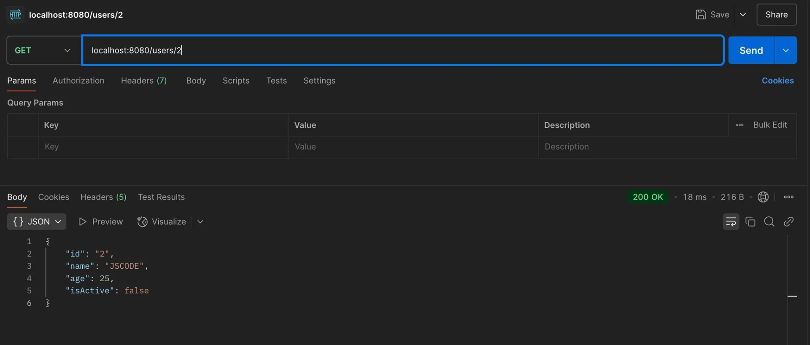
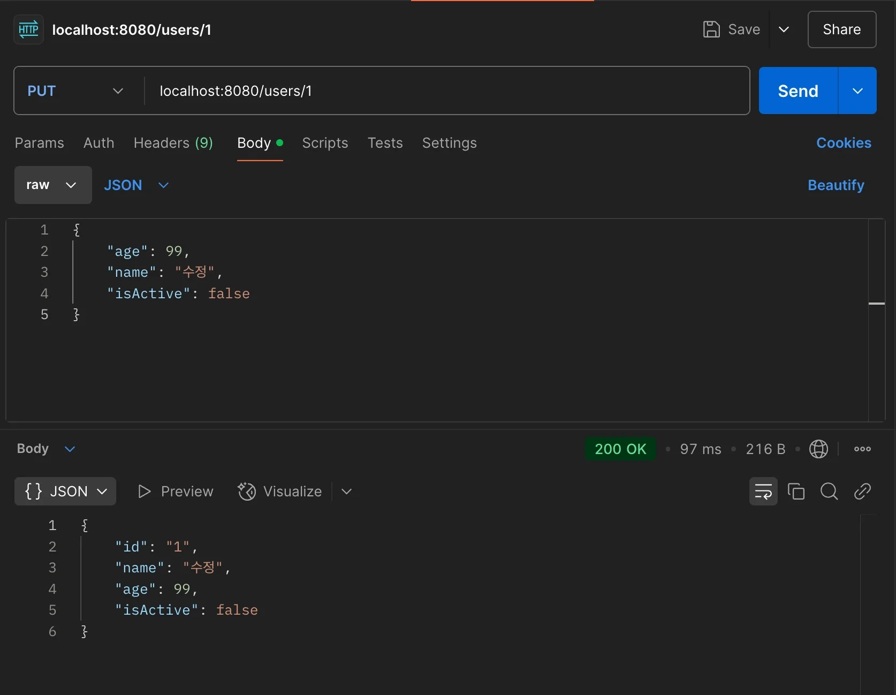
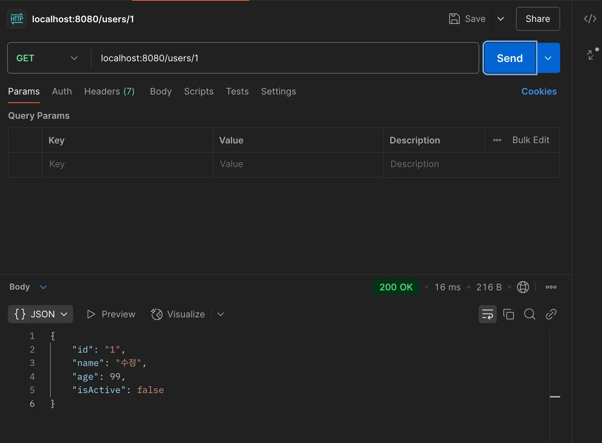
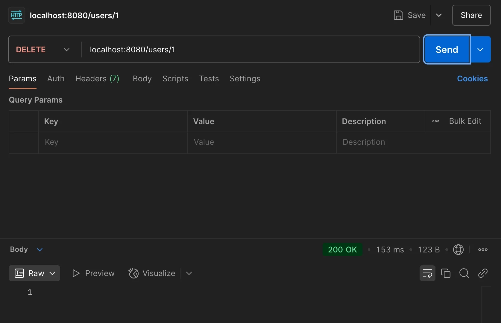
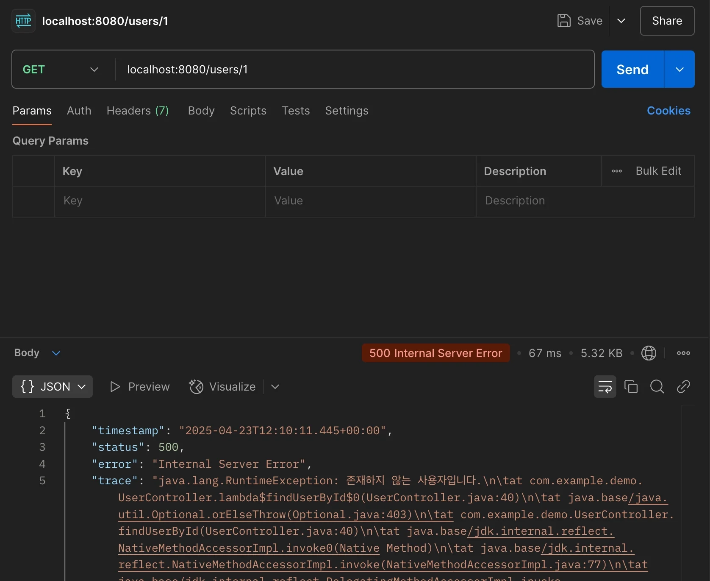

> 
> 
> <a id="348eda9b0fe1814a8863ff692a0adf15"></a>
> 
> 목차
> 
> - [ 1. 사용자 생성 API](#348eda9b0fe18185a39fcfc47c63da23)
> - [ 2. 사용자 조회 API](#348eda9b0fe18076a2dee93c845c559c)
> - [ 3. 사용자 정보 수정 API](#348eda9b0fe18081a77acb1fd7f9058d)
> - [ 4. 사용자 삭제 API](#348eda9b0fe18078bc7ecaa04b2fb6c2)

<a id="348eda9b0fe18185a39fcfc47c63da23"></a>

###  1&#46; 사용자 생성 API

<details>
<summary><strong>1&#46; controller</strong></summary>

<a id="348eda9b0fe180549908d70207ea378a"></a>

```java
@RestController
@RequestMapping("users")
public class UserController {
  private UserDocumentRepository userDocumentRepository;

  public UserController(UserDocumentRepository userDocumentRepository) {
    this.userDocumentRepository = userDocumentRepository;
  }

  @PostMapping()
  public UserDocument createUser(@RequestBody UserCreateRequestDto requestDto) {
    UserDocument user = new UserDocument(requestDto.getId(), requestDto.getName(), requestDto.getAge(), requestDto.getIsActive());
    return userDocumentRepository.save(user);
  }
}

```

</details>

<details>
<summary>2&#46; <strong>Request DTO</strong></summary>

<a id="348eda9b0fe1807694b6c1d8332f48ec"></a>

```java
public class UserCreateRequestDto {
	  private String id;
	  private String name;
	  private Long age;
	  private Boolean isActive;
	
	  public String getId() {
	    return id;
	  }
	
	  public String getName() {
	    return name;
	  }
	
	  public Long getAge() {
	    return age;
	  }
	
	  public Boolean getIsActive() {
	    return isActive;
	  }
}
```

</details>

<details>
<summary><strong>3&#46; 포스트맨 테스트</strong></summary>

<a id="348eda9b0fe180ff8eb7de6b7bc35927"></a>

```java
{
    "id": "1",
    "name": "Jaeseong",
    "age": 20,
    "isActive": true
}
```



<a id="348eda9b0fe18063847bf90374ea7bbe"></a>

```java
{
    "id": "2",
    "name": "JSCODE",
    "age": 25,
    "isActive": false
}
```



</details>

<a id="348eda9b0fe18076a2dee93c845c559c"></a>

###  2&#46; 사용자 조회 API

<details>
<summary><strong>1&#46; controller</strong></summary>

<a id="348eda9b0fe180569723d499e7348103"></a>

```java
@RestController
@RequestMapping("users")
public class UserController {
  private UserDocumentRepository userDocumentRepository;

  public UserController(UserDocumentRepository userDocumentRepository) {
    this.userDocumentRepository = userDocumentRepository;
  }
  
  ...

  @GetMapping()
  public Page<UserDocument> findUsers() {
    return userDocumentRepository.findAll(PageRequest.of(0, 10));
  }

  @GetMapping("/{id}")
  public UserDocument findUserById(@PathVariable String id) {
    return userDocumentRepository.findById(id)
        .orElseThrow(() -> new RuntimeException("존재하지 않는 사용자입니다."));
  }
}

```

</details>

<details>
<summary><strong>2&#46; 포스트맨 테스트</strong></summary>

<a id="348eda9b0fe18026ad49c2a82b024cea"></a>

```java
GET localhost:8080/users
```



<a id="348eda9b0fe18089872debc220fa41e0"></a>

```java
GET localhost:8080/users/1
```



<a id="348eda9b0fe180ffbf9ccbf2d67fb447"></a>

```java
GET localhost:8080/users/2
```



</details>

<a id="348eda9b0fe18081a77acb1fd7f9058d"></a>

###  3&#46; 사용자 정보 수정 API

<details>
<summary><strong>1&#46; controller</strong></summary>

<a id="348eda9b0fe180fb83bcf9bab6239e35"></a>

```java
@RestController
@RequestMapping("users")
public class UserController {
  private UserDocumentRepository userDocumentRepository;

  public UserController(UserDocumentRepository userDocumentRepository) {
    this.userDocumentRepository = userDocumentRepository;
  }

  ...

  @PutMapping("/{id}")
  public UserDocument updateUser(@PathVariable String id, @RequestBody UserUpdateRequestDto requestDto) {
    UserDocument existingUser = userDocumentRepository.findById(id)
        .orElseThrow(() -> new RuntimeException("존재하지 않는 사용자입니다."));
    existingUser.setAge(requestDto.getAge());
    existingUser.setName(requestDto.getName());
    existingUser.setIsActive(requestDto.getIsActive());
    return userDocumentRepository.save(existingUser);
  }
}

```

</details>

<details>
<summary>2&#46; <strong>Request DTO</strong></summary>

<a id="348eda9b0fe180f79a38d68a7dc97642"></a>

```java
public class UserUpdateRequestDto {
  private String name;
  private Long age;
  private Boolean isActive;

  public String getName() {
    return name;
  }

  public Long getAge() {
    return age;
  }

  public Boolean getIsActive() {
    return isActive;
  }
}
```

</details>

<details>
<summary><strong>3&#46; 포스트맨 테스트</strong></summary>





</details>

<a id="348eda9b0fe18078bc7ecaa04b2fb6c2"></a>

###  4&#46; 사용자 삭제 API

<details>
<summary><strong>1&#46; controller</strong></summary>

<a id="348eda9b0fe180c28dfdecf2775fac3b"></a>

```java
@RestController
@RequestMapping("users")
public class UserController {
  private UserDocumentRepository userDocumentRepository;

  public UserController(UserDocumentRepository userDocumentRepository) {
    this.userDocumentRepository = userDocumentRepository;
  }

  ...

  @DeleteMapping("/{id}")
  public void deleteUser(@PathVariable String id) {
    UserDocument user = userDocumentRepository.findById(id)
        .orElseThrow(() -> new RuntimeException("존재하지 않는 사용자입니다."));

    userDocumentRepository.delete(user);
  }
}

```

</details>

<details>
<summary><strong>2&#46; 포스트맨 테스트</strong></summary>





</details>
