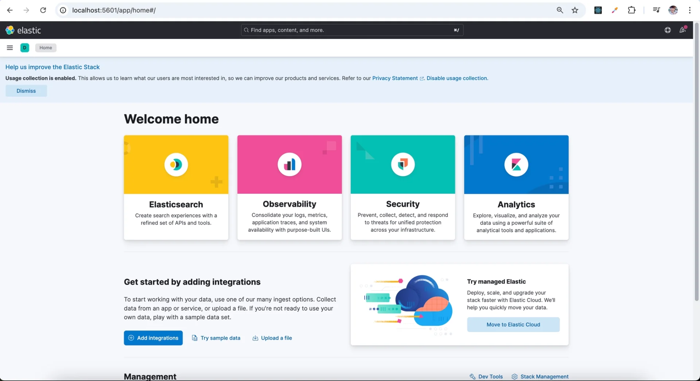
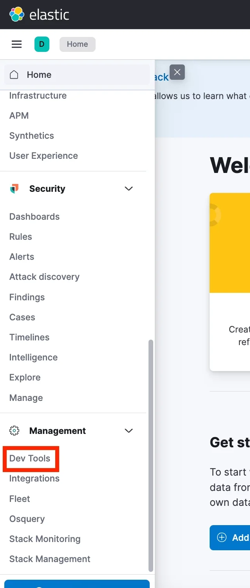
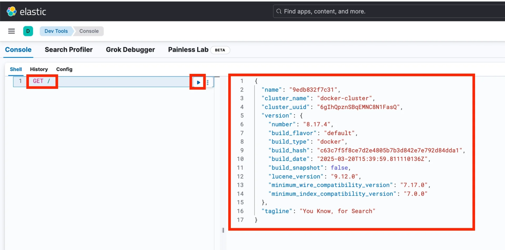

> 
> 
> <a id="348eda9b0fe180afb750e0657cfe251f"></a>
> 
> 목차
> 
> - [Kibana, Elasticsearch 설치 및 실행](#348eda9b0fe180eeaa72d3869061b1f8)
> - [ Kibana로 Elasticsearch 조작하기](#348eda9b0fe1802baa19fe75cdadca21)


<a id="348eda9b0fe180eeaa72d3869061b1f8"></a>

### Kibana, Elasticsearch 설치 및 실행

1. docker compose 파일 작성
    <a id="348eda9b0fe180ca8e7cec2b8f67be99"></a>

    ```yaml
    services:
      elastic:
        image: docker.elastic.co/elasticsearch/elasticsearch:8.17.4 # 8.17.4 버전
        ports:
          - 9200:9200 # 9200번 포트에서 Elasticsearch 실행
        environment:
          # 아래 설정은 개발/테스트 환경에서 간단하게 테스트하기 위한 옵션 (운영 환경에서는 설정하면 안 됨)
          - discovery.type=single-node # 단일 노드 (지금은 알 필요 없음)
          - xpack.security.enabled=false # 보안 설정
          - xpack.security.http.ssl.enabled=false # 보안 설정
      kibana:
        image: docker.elastic.co/kibana/kibana:8.17.4 # 8.17.4 버전
        ports:
          - 5601:5601 # 5601번 포트에서 kibana 실행
        environment:
          - ELASTICSEARCH_HOSTS=http://elastic:9200 # kibana가 통신할 Elasticsearch 주소 알려주기

    ```

1. compose 실행
    <a id="348eda9b0fe18052bff7e717f4f71802"></a>

    ```bash
    docker compose up -d 
    ```

1. 정상 실행 확인
    

    - Kibana는 <code>5601</code>번 포트로 실행된다&#46; 
        <a id="348eda9b0fe180a28b26ce95565fef98"></a>

        → <a href="http://localhost:5601/">http&#58;//localhost&#58;5601/</a>

<a id="348eda9b0fe1802baa19fe75cdadca21"></a>

###  Kibana로 Elasticsearch 조작하기

1. Kibana 왼쪽 메뉴 &#45; Dev Tools
    

1. <strong>Kibana로 Elasticsearch에 요청 보내기 (RESTful API)</strong>
    

    - <code>GET /</code> &#45;&#62; 응답값 (오른쪽)
