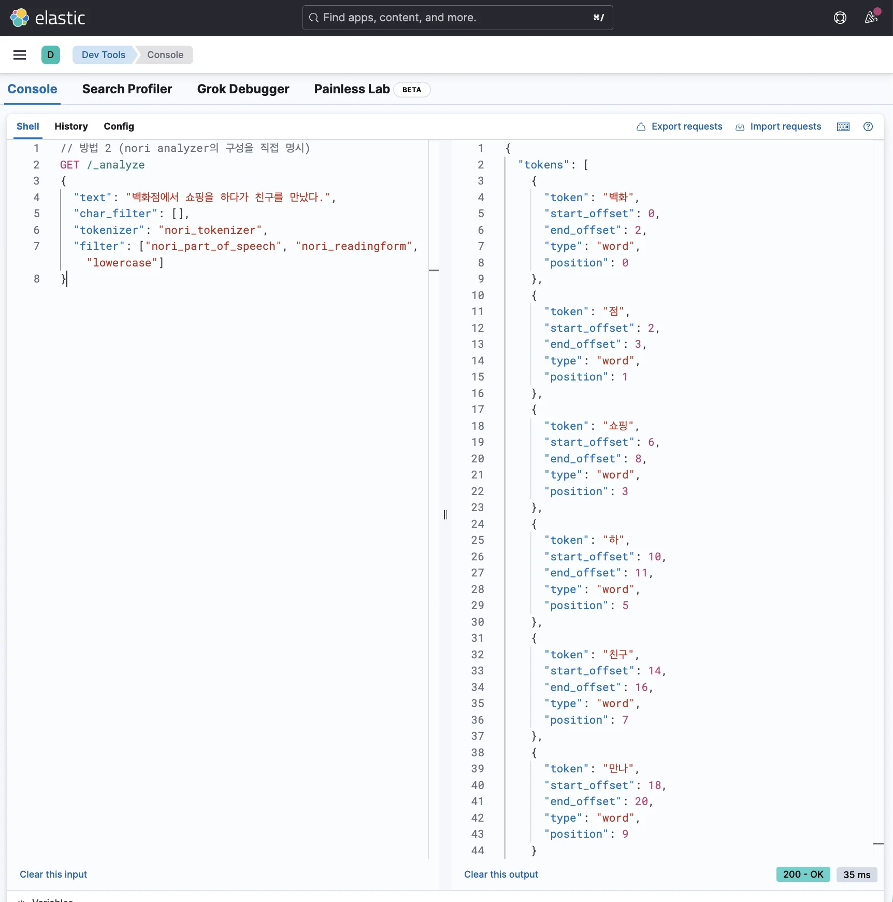
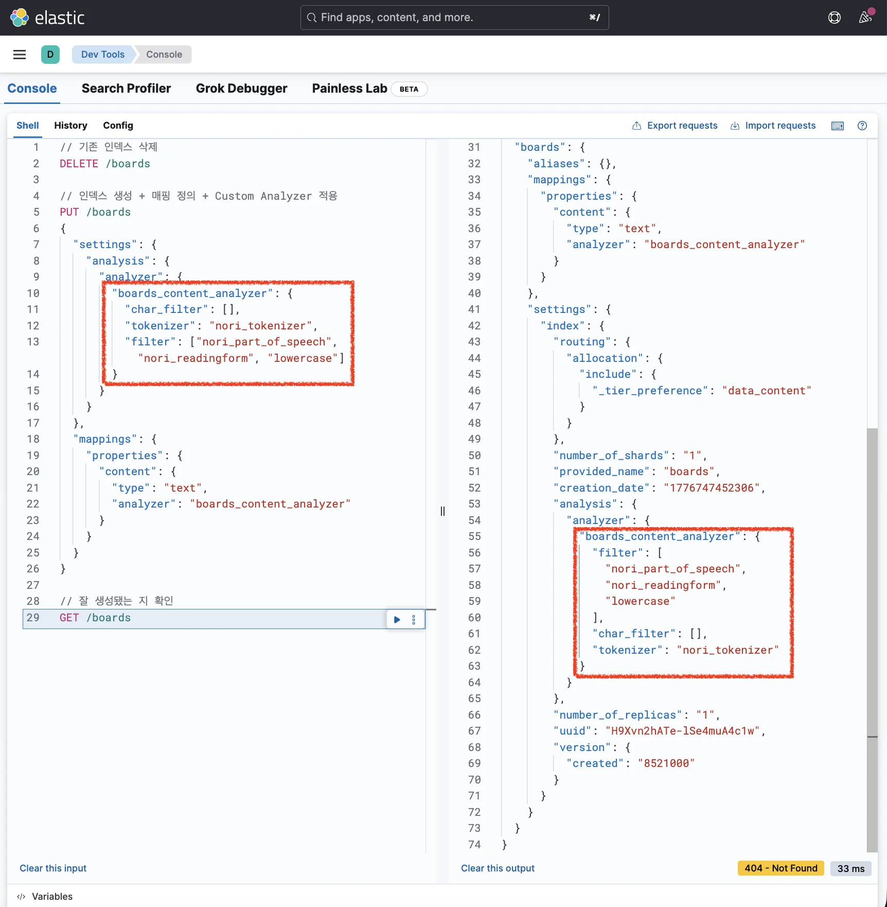
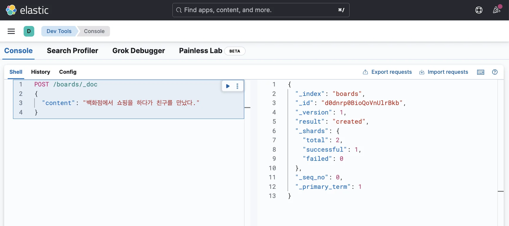
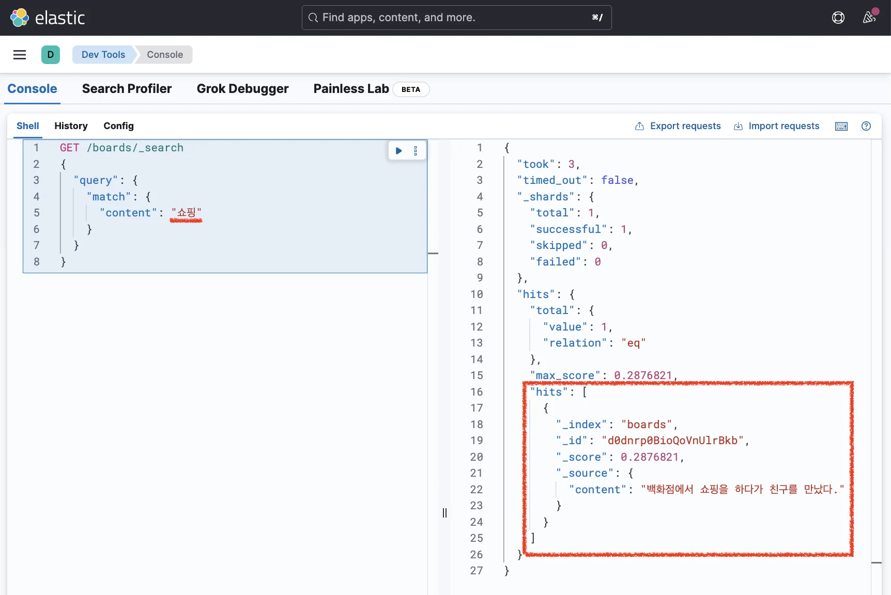

> 
> 
> <a id="348eda9b0fe1814d96aec95fff3d936d"></a>
> 
> 목차
> 
> - [[실습] Nori Analyzer를 활용한 한글 전처리 및 검색](#348eda9b0fe1810aa99df725497a9b00)
> - [Nori Analyzer를 활용해 한글(korean)이 제대로 검색되게 만들기](#349eda9b0fe180d38414da8d1059830c)

<a id="348eda9b0fe1810aa99df725497a9b00"></a>

## &#91;실습&#93; Nori Analyzer를 활용한 한글 전처리 및 검색

---

> 📖 
> 
> <a id="349eda9b0fe180ea8b6ee6c25b17ed1b"></a>
> 
> Elasticsearch의 <code>Nori Analyzer</code>는 <strong><u>한국어 텍스트</u></strong><strong>를 </strong><strong><u>형태소 단위로 분석</u></strong>해서 <strong>검색 정확도를 높</strong>여주는 <strong>공식 한글 분석기</strong>이다&#46; 
> 
> <a id="349eda9b0fe1803a9607c8c71d27a26f"></a>
> 
> 영어처럼 공백 기준으로 단어가 잘 나뉘지 않는 한국어에서, <strong>복합명사나 조사·어미를 더 적절하게 처리</strong>하도록 돕는다&#46;
> 
> <details>
> <summary><strong>주요 설정</strong></summary>
> 
> - <code>decompound&#95;mode</code>&#58; 복합어를 어떻게 나눌지 결정
> 
> - <code>none</code>&#58; 복합어를 그대로 둠
> 
> - <code>discard</code>&#58; 분해된 단어만 저장
> 
> - <code>mixed</code>&#58; 원형과 분해형을 함께 저장해 검색 유연성을 높임
> 
> - <code>user&#95;dictionary</code>&#58; 도메인 용어를 사용자 사전에 추가할 때 사용
> 
> - <code>stoptags</code>&#58; 제거할 품사 태그 지정
> 
> </details>

<a id="349eda9b0fe180d38414da8d1059830c"></a>

### Nori Analyzer를 활용해 한글(korean)이 제대로 검색되게 만들기

> ✏️ 
> 
> <a id="349eda9b0fe1807992e4d9818845cd4a"></a>
> 
> <strong>Nori Analyzer를 사용</strong>하려면 <strong><u>플러그인을 설치</u></strong>해야 한다&#46; 
> 
> <a id="349eda9b0fe18055ba2feb2976629412"></a>
> 
> 플러그인을 설치한 채로 Docker 컨테이너를 다시 띄우기 위해 기존에 실행하던 컨테이너를 종료하고 다시 실습을 진행한다&#46; 

<details>
<summary><strong>1&#46; 기존 컨테이너 종료</strong></summary>

<a id="349eda9b0fe1806f9115f3dfbe98c057"></a>

```bash
# 실행되고 있는 컨테이너 확인
docker ps

# compose 종료
docker compose down 

# 종료 확인
docker ps
```

</details>

<details>
<summary><strong>2&#46; 파일 작성</strong></summary>

<a id="349eda9b0fe1807fb6e7f538f792251f"></a>

<strong>Dockerfile</strong>

<a id="349eda9b0fe180e19d37cac94c09617a"></a>

```docker
FROM docker.elastic.co/elasticsearch/elasticsearch:8.17.4 

# Nori Analyzer 플러그인 설치
RUN bin/elasticsearch-plugin install analysis-nori 
```

<a id="349eda9b0fe18004a706edc287df353f"></a>

<strong>compose&#46;yml</strong>

<a id="349eda9b0fe1805ab84de762a2015dd6"></a>

```yaml
services:
  elastic:
    image: docker.elastic.co/elasticsearch/elasticsearch:8.17.4 # 8.17.4 버전
    build:
      context: .
      dockerfile: Dockerfile
    ports:
      - 9200:9200 # 9200번 포트에서 Elasticsearch 실행
    environment:
      # 아래 설정은 개발/테스트 환경에서 간단하게 테스트하기 위한 옵션 (운영 환경에서는 설정하면 안 됨)
      - discovery.type=single-node # 단일 노드 (지금은 알 필요 없음)
      - xpack.security.enabled=false # 보안 설정
      - xpack.security.http.ssl.enabled=false # 보안 설정
  kibana:
    image: docker.elastic.co/kibana/kibana:8.17.4 # 8.17.4 버전
    ports:
      - 5601:5601 # 5601번 포트에서 kibana 실행
    environment:
      - ELASTICSEARCH_HOSTS=http://elastic:9200 # kibana에게 통신할 Elasticsearch 주소 알려주기

```

</details>

<details>
<summary><strong>3&#46; 컨테이너 띄우기</strong></summary>

<a id="349eda9b0fe18044965ceb53ce61c956"></a>

```bash
# compose 실행
docker compose up -d

# 실행 확인
docker ps
```

</details>

<details>
<summary><strong>4&#46; Analyze API 활용해 디버깅</strong></summary>

<a id="349eda9b0fe180b9b21dc127943e1bcf"></a>

```json
// 방법 1
GET /_analyze
{
  "text": "백화점에서 쇼핑을 하다가 친구를 만났다.",
  "analyzer": "nori"
}
```

<a id="349eda9b0fe180c1b7cdd02a35d7b8f3"></a>

```json
// 방법 2 (nori analyzer의 구성을 직접 명시)
GET /_analyze
{
  "text": "백화점에서 쇼핑을 하다가 친구를 만났다.",
  "char_filter": [], 
	"tokenizer": "nori_tokenizer", 
	"filter": ["nori_part_of_speech", "nori_readingform", "lowercase"]
}
```

- <code>nori&#95;part&#95;of&#95;speech</code> &#58; 의미 없는 조사(<code>을</code>, <code>의</code> 등), 접속사 등을 제거

- <code>nori&#95;readingform</code> &#58; 한자를 한글로 바꿔서 토큰으로 저장

<a id="349eda9b0fe1806cb607f333d892d0d4"></a>

<strong>응답값</strong>



<a id="349eda9b0fe180e1a983d1726ee7f686"></a>

```json
{
  "tokens": [
    {
      "token": "백화",
      "start_offset": 0,
      "end_offset": 2,
      "type": "word",
      "position": 0
    },
    {
      "token": "점",
      "start_offset": 2,
      "end_offset": 3,
      "type": "word",
      "position": 1
    },
    {
      "token": "쇼핑",
      "start_offset": 6,
      "end_offset": 8,
      "type": "word",
      "position": 3
    },
    {
      "token": "하",
      "start_offset": 10,
      "end_offset": 11,
      "type": "word",
      "position": 5
    },
    {
      "token": "친구",
      "start_offset": 14,
      "end_offset": 16,
      "type": "word",
      "position": 7
    },
    {
      "token": "만나",
      "start_offset": 18,
      "end_offset": 20,
      "type": "word",
      "position": 9
    }
  ]
}
```

<a id="349eda9b0fe180258ad1e7f0de2bb867"></a>

 이전에 standard analyze를 썼을 때와 달리 <strong><u>한글의 의미 단위로 토큰이 잘 나눠</u></strong>진 것을 확인할 수 있다&#46; 

</details>

<details>
<summary><strong>5&#46; 인덱스 생성</strong></summary>

<a id="349eda9b0fe1805db6b0cbd536075ecf"></a>

```json
// 기존 인덱스 삭제
DELETE /boards

// 인덱스 생성 + 매핑 정의 + Custom Analyzer 적용
PUT /boards
{
  "settings": {
    "analysis": {
      "analyzer": {
        "boards_content_analyzer": {
          "char_filter": [],
          "tokenizer": "nori_tokenizer",
          "filter": ["nori_part_of_speech", "nori_readingform", "lowercase"]
        }
      }
    }
  },
  "mappings": {
	  "properties": {
	    "content": {
	      "type": "text",
	      "analyzer": "boards_content_analyzer"
	    }
	  }
	}
}

// 잘 생성됐는 지 확인
GET /boards
```



</details>

<details>
<summary><strong>6&#46; 데이터 삽입</strong></summary>

<a id="349eda9b0fe180c6a0c8eb934b83f30e"></a>

```json
POST /boards/_doc
{
  "content": "백화점에서 쇼핑을 하다가 친구를 만났다."
}
```



</details>

<details>
<summary><strong>7&#46; 검색</strong></summary>

<a id="349eda9b0fe1801e9266fd9c2cbe006c"></a>

```json
GET /boards/_search
{
  "query": {
    "match": {
      "content": "백화점"
    }
  }
}
```


<a id="349eda9b0fe1809e9025f44e4754e7f5"></a>

```json
GET /boards/_search
{
  "query": {
    "match": {
      "content": "쇼핑"
    }
  }
}
```



<a id="349eda9b0fe180d2953addbd62b1abeb"></a>

```json
GET /boards/_search
{
  "query": {
    "match": {
      "content": "친구"
    }
  }
}
```


<a id="349eda9b0fe180a1ae3cdb31a168a195"></a>

이전과 달리 잘 검색되는 것을 확인 할 수있다&#46; 

</details>
