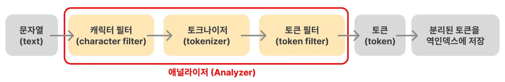

> 
> 
> <a id="348eda9b0fe18078af03f4305bec850a"></a>
> 
> 목차
> 
> - [애널라이저 (Analyzer)](#348eda9b0fe180eeaab0d9600d7d1cee)
> - [캐릭터 필터(character filter)](#348eda9b0fe180269e9dced6c0fffcd6)
> - [토크나이저(tokenizer)](#348eda9b0fe180228cccccba39a1eefd)
> - [토큰 필터(token filter)](#348eda9b0fe1809cb842f4139ade420a)

<a id="348eda9b0fe180eeaab0d9600d7d1cee"></a>

## 애널라이저 (Analyzer)

---

> 📖 
> 
> <a id="348eda9b0fe180e2bf1eed5b0fc7e90b"></a>
> 
>  이전 챕터에서 <code>products</code>의 <code>name</code> 필드값을 <strong>토큰(token)으로 분리해 역인덱스(Inverted Index)로 저장</strong>하는 과정을 살펴봤다&#46;
> 
> - <a href="#/post/348eda9b-0fe1-8005-9187-c9953c9e30e4">페이지</a> 
> 
> 
> 
> <a id="348eda9b0fe1801e9002fce8036b6c93"></a>
> 
> 이때, <strong><u>문자열(text) 토큰 변환</u></strong> 등의 <strong>전처리 과정들을 담당하는 계층</strong>을 <strong><u>애널라이저(Analyzer)</u></strong>라고 한다&#46; 

<a id="348eda9b0fe180269e9dced6c0fffcd6"></a>

### <strong>캐릭터 필터(character filter)</strong>

> ✏️ 
> 
> <a id="348eda9b0fe18056a498efd7bf86309d"></a>
> 
> <code>캐릭터 필터(character filter)</code>는 <strong><u>문자열을 토큰으로 자르기 전 문자열을 다듬는 역할</u></strong>을 한다&#46; 
> 
> <a id="348eda9b0fe18077a687fb485cf265c7"></a>
> 
> 다양한 종류의 필터가 존재하며, 여러 필터를 적용 시킬 수도 있다&#46; 

- <strong><code>html&#95;strip 필터</code></strong><strong>&#58; HTML 태그를 제거</strong>
    <a id="348eda9b0fe180baa90aec7e636acb49"></a>

    ```plaintext
    <h1>아이폰 15 사용 후기</h1> → 아이폰 15 사용 후기
    ```

- mapping 필터, pattern replace 필터 등

<a id="348eda9b0fe180228cccccba39a1eefd"></a>

### <strong>토크나이저(tokenizer)</strong>

> ✏️ 
> 
> <a id="348eda9b0fe180669463d4875dee19e8"></a>
> 
> <code>토크나이저(tokenizer)</code>는 <strong><u>문자열을 토큰으로 자르는 역할</u></strong>을 한다&#46; 

- <strong><code>standard 토크나이저</code></strong><strong>&#58; </strong><strong><code>공백</code></strong><strong> 또는 </strong><strong><code>,</code></strong><strong>, </strong><strong><code>&#46;</code></strong><strong>, </strong><strong><code>&#33;</code></strong><strong>, </strong><strong><code>?</code></strong><strong>와 같은 문장 부호를 기준으로 자름</strong>
    <a id="348eda9b0fe18039aac3fc02445ce27b"></a>

    ```plaintext
    	The Brown-Foxes jumped over the roof.
    	
    	→ [The, Brown, Foxes, jumped, over, the, roof]
    ```

- classic 토크나이저, keyword 토크나이저, pattern 토크나이저 등

<a id="348eda9b0fe1809cb842f4139ade420a"></a>

### <strong>토큰 필터(token filter)</strong>

> ✏️ 
> 
> <a id="348eda9b0fe1803eb811e4bd5f899662"></a>
> 
> <code>토큰 필터(token filter)</code>는 <strong><u>잘린 토큰을 최종적으로 다듬는 역할</u></strong>을 한다&#46; 
> 
> <a id="348eda9b0fe1804196dcc729c351f920"></a>
> 
> 다양한 종류의 필터가 존재하며, 여러 개의 필터를 적용시킬 수 있다&#46; 

- <strong><code>lowercase 필터</code></strong><strong>&#58; 소문자로 변환</strong>
    <a id="348eda9b0fe180e2bd41f3363f50c086"></a>

    ```plaintext
    [The, Brown, Foxes, jumped, over, the, roof]

    → [the, brown, foxes, jumped, over, the, roof]
    ```

- <strong><code>stop 필터</code></strong><strong>&#58; </strong><strong><code>a</code></strong><strong>, </strong><strong><code>the</code></strong><strong>, </strong><strong><code>is</code></strong><strong>와 같은 특별한 의미를 가지지 않는 단어 제거</strong>
    <a id="348eda9b0fe180058097c0dc4ba548ca"></a>

    ```plaintext
    [the, brown, foxes, jumped, over, the, roof]

    → [brown, foxes, jumped, roof]
    ```

- <strong><code>stemmer 필터</code></strong><strong>&#58; 단어의 원래 형태로 변환</strong>
    <a id="348eda9b0fe180acaddbd3f00a02cbbb"></a>

    ```plaintext
    [brown, foxes, jumped, roof]

    → [brown, fox, jump, roof]
    ```

- asciifolding 필터, synonym 필터, edge&#95;ngram 필터, kstem 필터 등등
