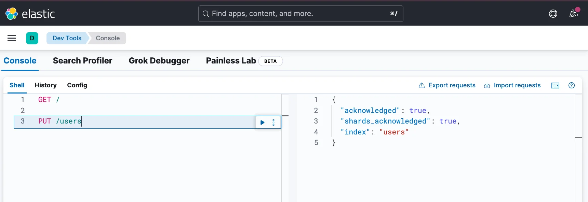
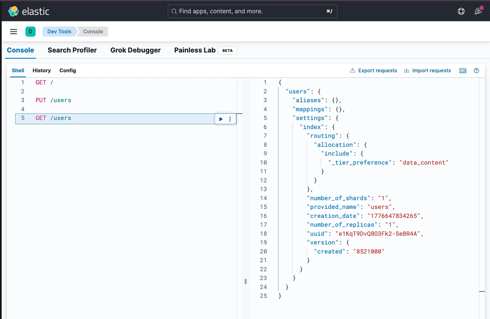
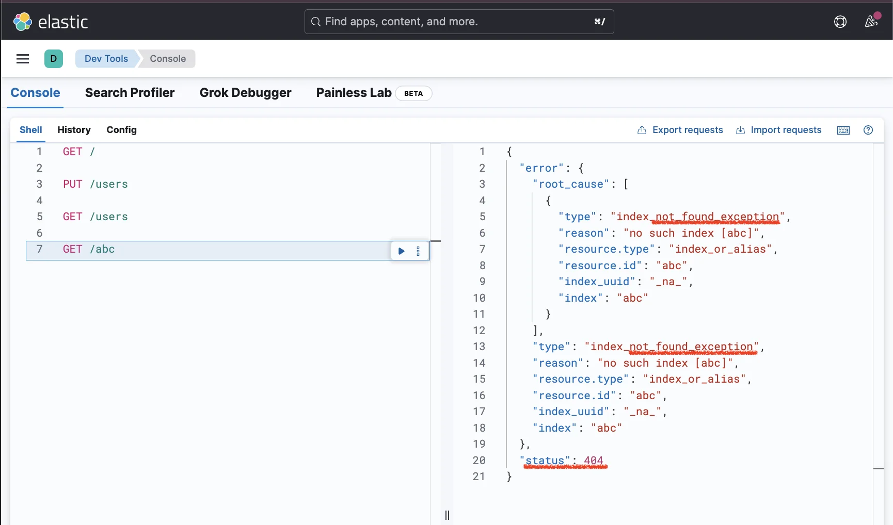
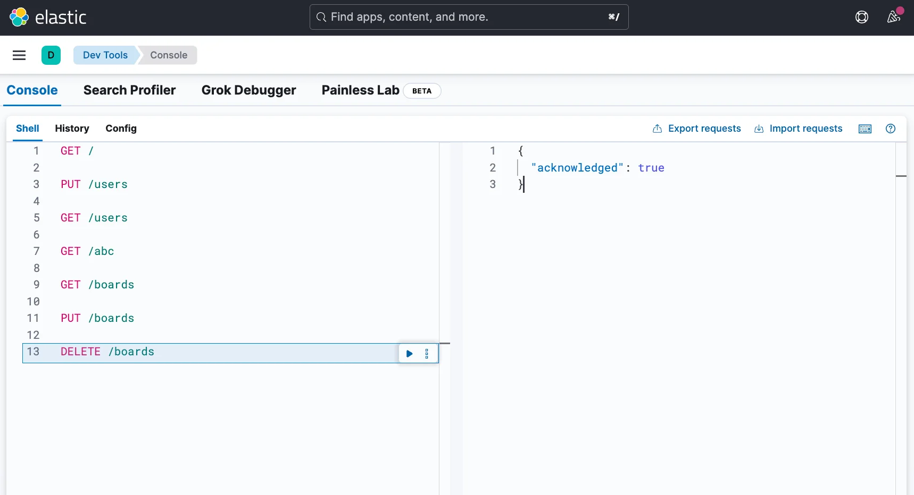
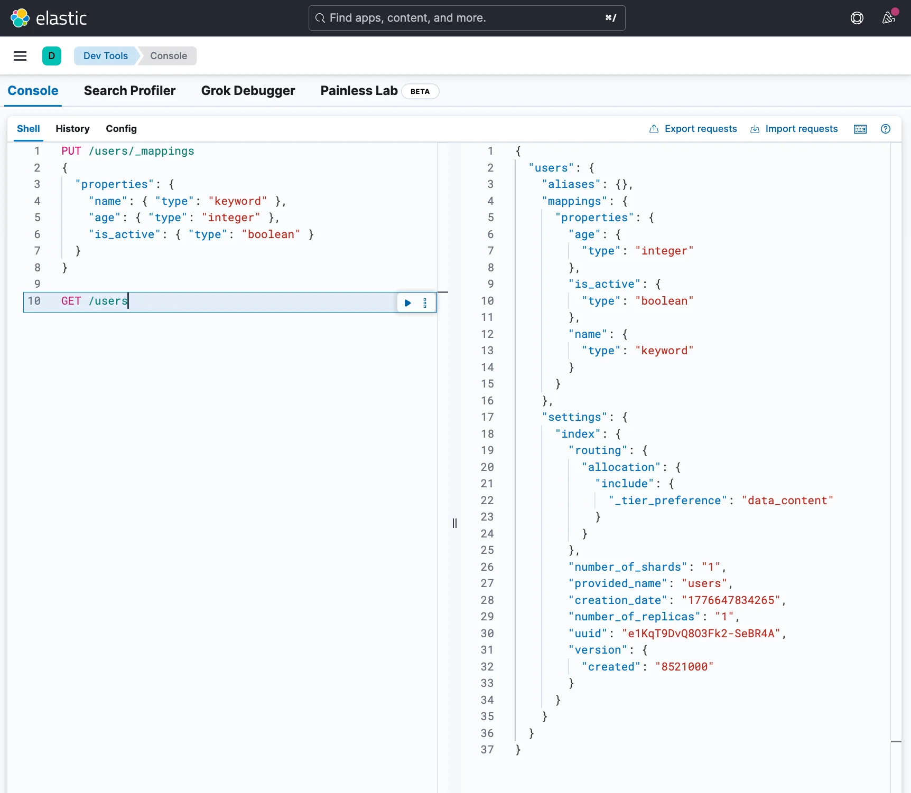
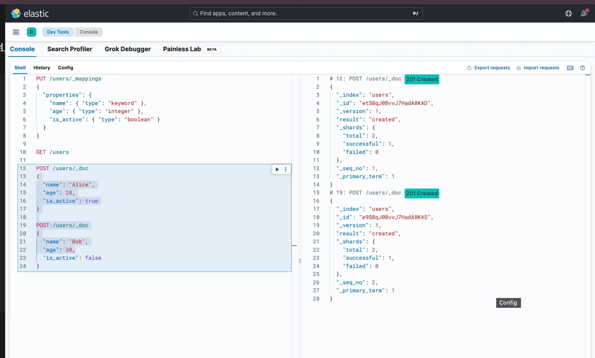
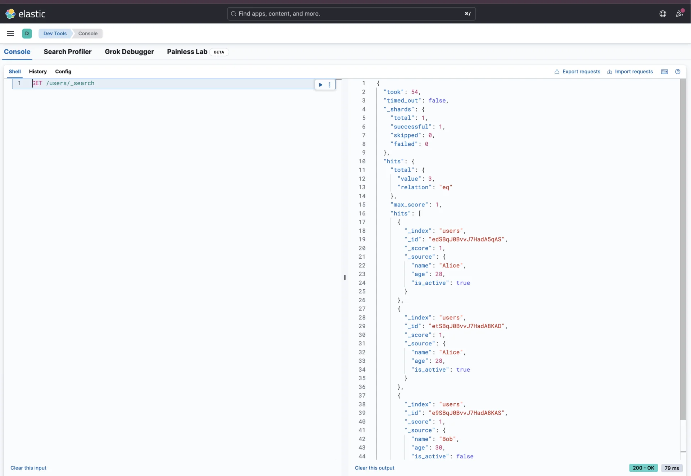

> 
> 
> <a id="348eda9b0fe180fcae70fce68e80d192"></a>
> 
> 목차
> 
> - [ 인덱스(index) 생성, 조회 및 삭제](#348eda9b0fe1800ba36fe0113f9f7a9d)
> - [ 매핑(mapping) 정의 ](#348eda9b0fe1809f833cda1d904bfb01)
> - [ 도큐먼트(document) 삽입 및 조회](#348eda9b0fe18006b1d1e2a67c58f80c)

<a id="348eda9b0fe1800ba36fe0113f9f7a9d"></a>

###  인덱스(index) 생성, 조회 및 삭제

> ✏️ 
> 
> <a id="348eda9b0fe1808cbc53f662ad79b663"></a>
> 
> <strong><u>Elasticsearch에서 인덱스(index)를 생성</u></strong>하는 건 <strong><u>MySQL에서 테이블(table)을 생성</u></strong>하는 것과 같다&#46; 

<details>
<summary><strong>인덱스 생성</strong></summary>

<a id="348eda9b0fe18085b9b3fee439010883"></a>

```bash
# PUT /{인덱스명}
PUT /users
```



</details>

<details>
<summary><strong>인덱스 조회</strong></summary>

<a id="348eda9b0fe180309a92eaddb6e9d54f"></a>

```bash
# GET /{인덱스명}
GET /users
```



</details>

<details>
<summary><strong>존재하지 않는 인덱스 조회 → </strong><strong><code>404</code></strong></summary>

<a id="348eda9b0fe1801380d9d5bdc9e44316"></a>

```bash
GET /abc
```



</details>

<details>
<summary><strong>인덱스 삭제</strong></summary>

<a id="348eda9b0fe180608c11c83531efab8b"></a>

```bash
# 인덱스 생성
PUT /boards

# 인덱스 생성됐는 지 확인하기
GET /boards

# 인덱스 삭제
# DELETE /{인덱스명}
DELETE /boards

# 삭제됐는 지 확인하기
GET /boards  # 404 Not Found 
```



</details>

<a id="348eda9b0fe1809f833cda1d904bfb01"></a>

###  매핑(mapping) 정의 

> ✏️ 
> 
> <a id="348eda9b0fe180c4abfbe76d43d831c3"></a>
> 
> <strong><u>lasticsearch에서 매핑(mapping)을 정의</u></strong>하는 건 <strong><u>MySQL에서 테이블의 스키마(schema)를 정의하는 것</u></strong>과 같다

<details>
<summary>매핑 정의 &#45; <code>&#95;mappings</code></summary>

<a id="348eda9b0fe180e195c7f376ad0c0288"></a>

```bash
# 매핑 정의
# PUT /{인덱스명}/_mappings
PUT /users/_mappings
{
  "properties": {
    "name": { "type": "keyword" },
    "age": { "type": "integer" },
    "is_active": { "type": "boolean" }
  }
}


# 정의한 매핑 확인
GET /users
```



</details>

<a id="348eda9b0fe18006b1d1e2a67c58f80c"></a>

###  도큐먼트(document) 삽입 및 조회

> ✏️ 
> 
> <a id="348eda9b0fe180cfa4d6e236b0cf3896"></a>
> 
> <strong><u>Elasticsearch에서 도큐먼트(document)을 삽입</u></strong>하는 건 <strong><u>MySQL에서 테이블에 레코드(record)를 삽입하는 것</u></strong>과 같다&#46; 

<details>
<summary><strong>도큐먼트 삽입 &#45; </strong><strong><code>&#95;doc</code></strong></summary>

<a id="348eda9b0fe180499769fb66a233274e"></a>

```bash
# POST /{인덱스명}/_doc
POST /users/_doc
{
  "name": "Alice",
  "age": 28,
  "is_active": true
}

POST /users/_doc
{
  "name": "Bob",
  "age": 30,
  "is_active": false
}
```



- <code>201 Created</code>로 정상 생성된 것을 확인할 수 있음

</details>

<details>
<summary><strong>도큐먼트 조회  &#45; </strong><strong><code>&#95;search</code></strong></summary>

<a id="348eda9b0fe180f39a67efc1d7f751fb"></a>

```bash
# GET /{인덱스명}/_search
GET /users/_search
```

<a id="348eda9b0fe1806b82e9c9c475aa9afc"></a>

<strong>응답 확인</strong>



<a id="348eda9b0fe180509ac2e9337c619eff"></a>

```bash
{
  "took": 1,
  "timed_out": false,
  "_shards": {
    "total": 1,
    "successful": 1,
    "skipped": 0,
    "failed": 0
  },
  "hits": {
    "total": {
      "value": 2,
      "relation": "eq"
    },
    "max_score": 1,
    "hits": [
      {
        # _index : 인덱스명
        "_index": "users",
        
        # 데이터를 저장하면서 자동으로 생성된 '랜덤 고유 ID'
        "_id": "0imoJ5YBVwYHNUofQSQc",
        
        "_score": 1,

        # _source : 저장한 데이터가 들어있는 필드
        "_source": {
          "name": "Alice",
          "age": 28,
          "is_active": true
        }
      },
      {
        "_index": "users",
        "_id": "0ymoJ5YBVwYHNUofRSRX",
        "_score": 1,
        "_source": {
          "name": "Bob",
          "age": 30,
          "is_active": false
        }
      }
    ]
  }
}
```

</details>
