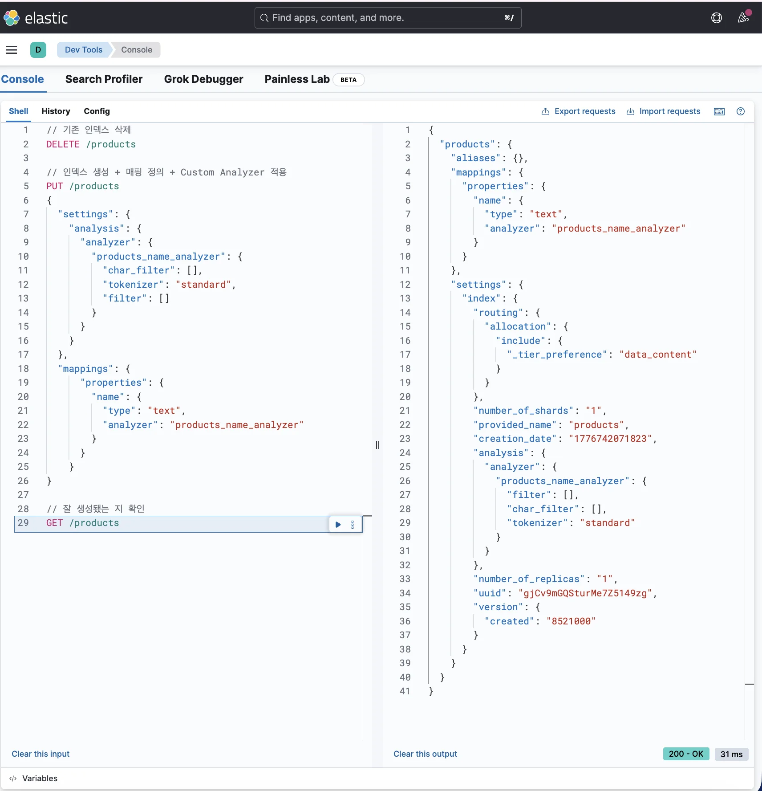
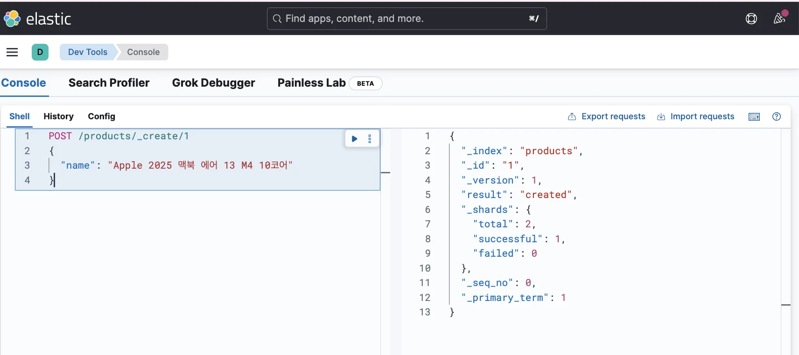
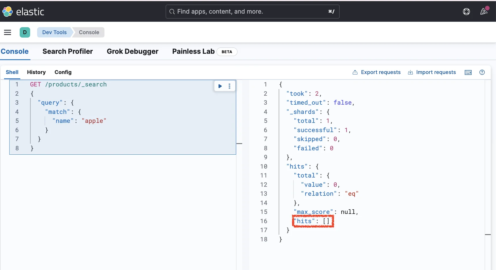
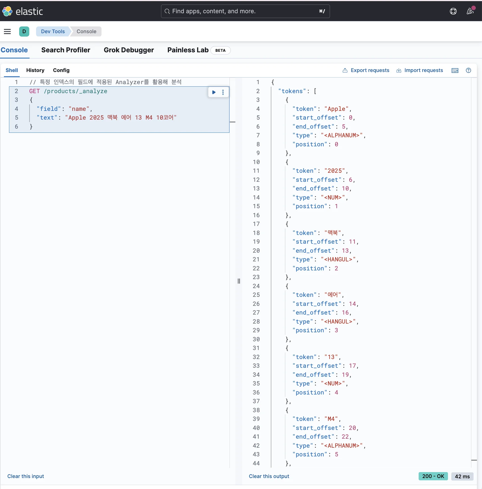
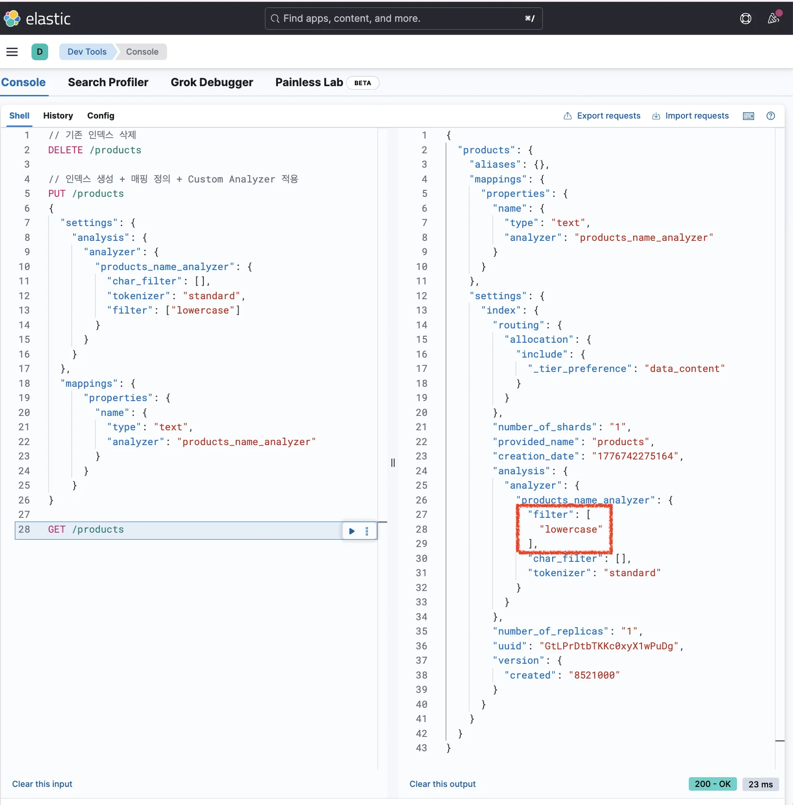
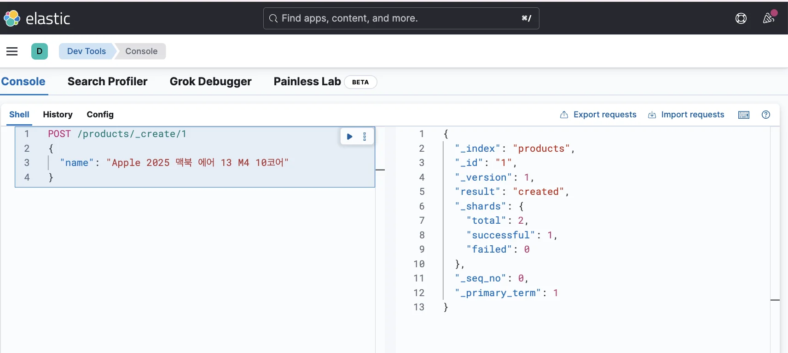
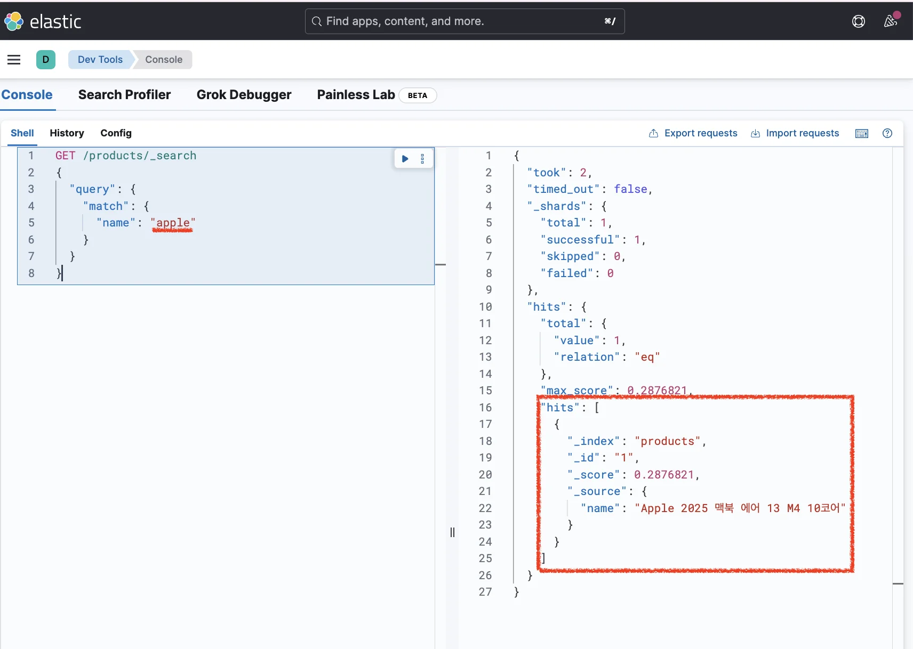
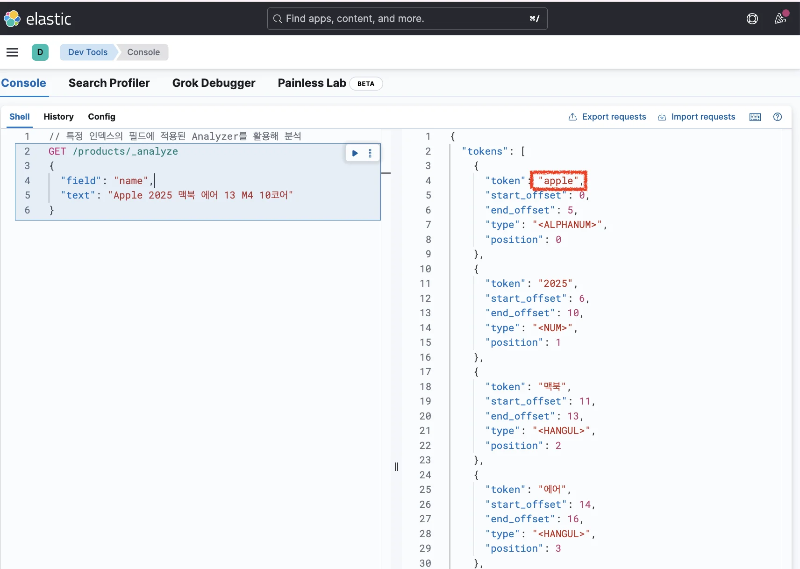
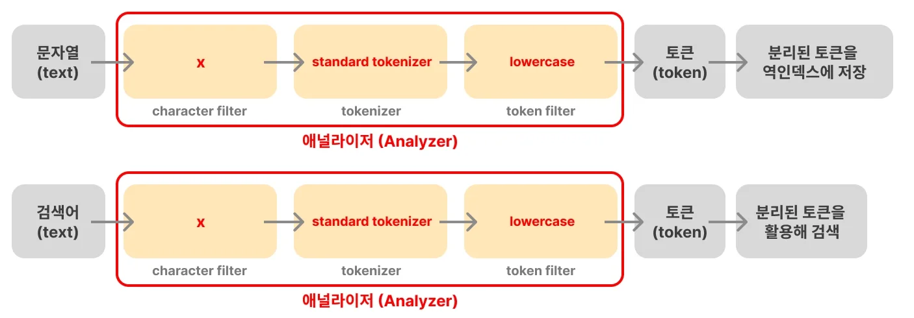

> 
> 
> <a id="348eda9b0fe180c3a752ced8044193b4"></a>
> 
> 목차
> 
> - [소문자 변환(전처리) 애널라이저: lowercase](#348eda9b0fe18092904df0c8d464207a)
> - [ 대소문자 구분없이 검색하는 방법 ](#348eda9b0fe180919b2decffbccc0b96)

<a id="348eda9b0fe18092904df0c8d464207a"></a>

## 소문자 변환(전처리) 애널라이저&#58; <code>lowercase</code>

---

> 📖 
> 
> <a id="348eda9b0fe18009818bf6f9ab29bc7b"></a>
> 
> <code>lowercase</code> 필터는 <strong><u>소문자 변환 전처리</u></strong>를 가능케 하는 기본 제공 Analyzer이다&#46; 

<a id="348eda9b0fe180919b2decffbccc0b96"></a>

###  대소문자 구분없이 검색하는 방법 

> ✏️ 
> 
> <a id="348eda9b0fe180dc8a70c6fd10449b85"></a>
> 
> 아무 설정 없이 인덱스를 생성하면 <code>standard analyzer</code>가 설정되며<br><strong><u>직접 filter, tokenizer를 설정</u></strong>해 <strong>커스텀 Analyzer 정의</strong>도 가능하다&#46; 

> <strong><code>lowercase</code></strong><strong> 필터 적용</strong>

<details>
<summary><strong>1&#46; </strong><strong><u>Custom Analyzer를 활용</u></strong><strong>해 인덱스 생성</strong></summary>

<a id="348eda9b0fe18077a9a3e7b3d093eb62"></a>

```json
// 기존 인덱스 삭제
DELETE /products
```

<a id="348eda9b0fe180a9ae16d55cf6baae01"></a>

```json
// 인덱스 생성 + 매핑 정의 + Custom Analyzer 적용
PUT /products
{
  "settings": {
    "analysis": {
      "analyzer": {
        "products_name_analyzer": {
          "char_filter": [],
          "tokenizer": "standard",
          "filter": []
        }
      }
    }
  },
  "mappings": {
	  "properties": {
	    "name": {
	      "type": "text",
	      "analyzer": "products_name_analyzer"
	    }
	  }
	}
}
```

<a id="348eda9b0fe180128097f93d1ac298ff"></a>

```json
// 잘 생성됐는 지 확인
GET /products
```



- <code>products</code> 인덱스의 <code>name</code> 필드에 <code>products&#95;name&#95;analyzer</code>라는 Custom Analyzer적용

- <code>standard tokenizer</code>(공백 또는 <code>,</code>, <code>&#46;</code>, <code>&#33;</code>, <code>?</code>와 같은 문장 부호를 기준으로 문자열을 자름)만 설정
    - <code>lowercase token filter</code>(소문자로 변환)은 설정 ❌

</details>

<details>
<summary><strong>2&#46; 데이터 삽입</strong></summary>

<a id="348eda9b0fe1804d85b5c55118f79186"></a>

```json
POST /products/_create/1
{
  "name": "Apple 2025 맥북 에어 13 M4 10코어"
}
```



</details>

<details>
<summary><strong>3&#46; 검색 해보기</strong></summary>

<a id="348eda9b0fe18033bdcafbc056aba64d"></a>

```json
GET /products/_search
{
  "query": {
    "match": {
      "name": "apple"
    }
  }
}
```



<a id="348eda9b0fe18024a351ed0031a42646"></a>

```json
GET /products/_search
{
  "query": {
    "match": {
      "name": "Apple"
    }
  }
}
```


- <strong>lowercase 필터를 적용하지 않</strong>았기 때문에 <code>apple</code>로는 <strong>검색되지 않</strong>는 것을 확인할 수 있다&#46; 
    - Analyze API를 활용하여 디버깅 ←아래 확인

</details>

<details>
<summary><strong>4&#46; Analyze API 사용한 디버깅</strong></summary>

<a id="348eda9b0fe1809ca51ed8afaa4a1fa3"></a>

```json
// 특정 인덱스의 필드에 적용된 Analyzer를 활용해 분석
GET /products/_analyze
{
  "field": "name",
  "text": "Apple 2025 맥북 에어 13 M4 10코어"
}
```

<a id="348eda9b0fe180d6bb66e5c81bbca1f4"></a>

<strong>응답값</strong>



<a id="348eda9b0fe180fcb322f0091eb1de45"></a>

```json
{
  "tokens": [
    {
      "token": "Apple",
      "start_offset": 0,
      "end_offset": 5,
      "type": "<ALPHANUM>",
      "position": 0
    },
		...
  ]
}
```

- Analyze API를 사용해 저장된 토큰 확인 시<strong> </strong><strong><code>Apple</code></strong><strong> 토큰으로 저장</strong>되어 <strong>검색이 되지 않</strong>았던 것을 확인할 수 있다&#46; 

</details>

> <strong><code>lowercase</code></strong><strong> 필터 적용</strong>

<details>
<summary><strong>5&#46; Custom Analyzer를 활용해 </strong><strong><u>다시</u></strong><strong> 인덱스 생성</strong></summary>

<a id="348eda9b0fe180be8119dc97857b1385"></a>

```json
// 기존 인덱스 삭제
DELETE /products
```

<a id="348eda9b0fe18001a254cfaf4e0652ec"></a>

```json
// 인덱스 생성 + 매핑 정의 + Custom Analyzer 적용
PUT /products
{
  "settings": {
    "analysis": {
      "analyzer": {
        "products_name_analyzer": {
          "char_filter": [],
          "tokenizer": "standard",
          "filter": ["lowercase"]
        }
      }
    }
  },
  "mappings": {
	  "properties": {
	    "name": {
	      "type": "text",
	      "analyzer": "products_name_analyzer"
	    }
	  }
	}
}
```

<a id="348eda9b0fe180c2a44ddcaa690f8195"></a>

```json
// 잘 생성됐는 지 확인
GET /products
```



- filter에 lowercase 필터를 명시하여 다시 인덱스가 잘 생성된 것을 확인할 수 있다&#46; 

</details>

<details>
<summary><strong>6&#46; 다시 데이터 삽입</strong></summary>

<a id="348eda9b0fe1807a8044daaafa120949"></a>

```json
POST /products/_create/1
{
  "name": "Apple 2025 맥북 에어 13 M4 10코어"
}
```



</details>

<details>
<summary><strong>7&#46; 재검색</strong></summary>

<a id="348eda9b0fe18025b208da897d765229"></a>

```json
GET /products/_search
{
  "query": {
    "match": {
      "name": "apple"
    }
  }
}
```



<a id="348eda9b0fe1804fa16ac43665f7f3e3"></a>

```json
GET /products/_search
{
  "query": {
    "match": {
      "name": "Apple"
    }
  }
}
```


- 앞선 실습과 다르게 <code>apple</code>로 검색해도 검색 결과가 잘 나오는 것을 확인할 수 있다&#46; 

- <strong>🧐 그렇다면 어떻게 가능한 것인가? </strong>
    - 해당 내용은 아래 <strong> Analyze API 사용</strong>하여 디버깅하면서 다룬다&#46; 

</details>

<details>
<summary><strong>8&#46; Analyze API 사용하여 다시 디버깅</strong></summary>

<a id="348eda9b0fe18044a386f7aac8e3ac3a"></a>

```json
// 특정 인덱스의 필드에 적용된 Analyzer를 활용해 분석
GET /products/_analyze
{
  "field": "name",
  "text": "Apple 2025 맥북 에어 13 M4 10코어"
}
```

<a id="348eda9b0fe1806f8db6f34420ae8ca1"></a>

<strong>응답값</strong>



<a id="348eda9b0fe18029bee5edd6258646c2"></a>

```json
{
  "tokens": [
    {
      "token": "apple",
      "start_offset": 0,
      "end_offset": 5,
      "type": "<ALPHANUM>",
      "position": 0
    },
		...
  ]
}
```



- 도큐먼트를 생성할 때 Analyzer가 문자열을 토큰으로 분리해 역인덱스를 생성한다&#46; 

- 이와 같이 <strong><u>검색 쿼리도 애널라이저를 통해 전처리</u></strong>시킨 후 검색에 활용한다&#46;

- 이 때문에 <code>Apple</code>이라고 검색 했는데도 <strong><u>lowercase 필터</u></strong><strong>를 통해 </strong><strong><u>apple</u></strong><strong>로 전처리</strong>되어 검색이 잘 된 것이다&#46; 

</details>

<a id="348eda9b0fe18011a6faefc458c65ff3"></a>

<br>

> ✏️ 
> 
> <a id="348eda9b0fe180ecb04dc412cc9b3cbd"></a>
> 
> <strong><code>검색 쿼리</code></strong><strong>도 </strong><strong><u>Analyzer를 통해 전처리 후 검색</u></strong><strong>한다&#46; </strong>
> 
> 
> 
> - 도큐먼트를 생성할 때 Analyzer가 문자열을 토큰으로 분리해 역인덱스를 생성한다&#46; 
> 
> - 이와 같이 <strong><u>검색 쿼리도 애널라이저를 통해 전처리</u></strong>시켜 검색한다&#46;
