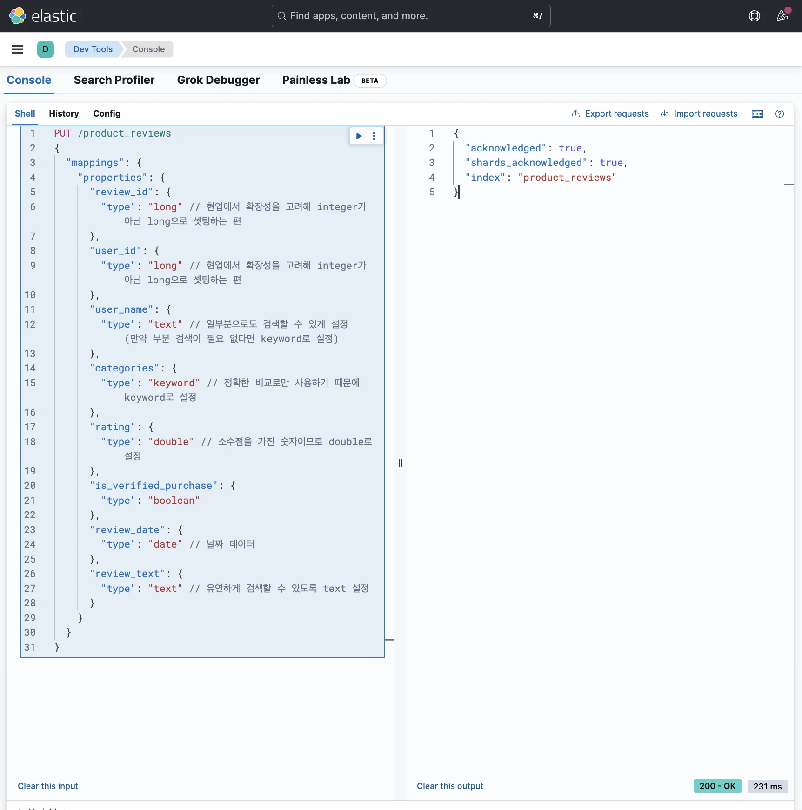
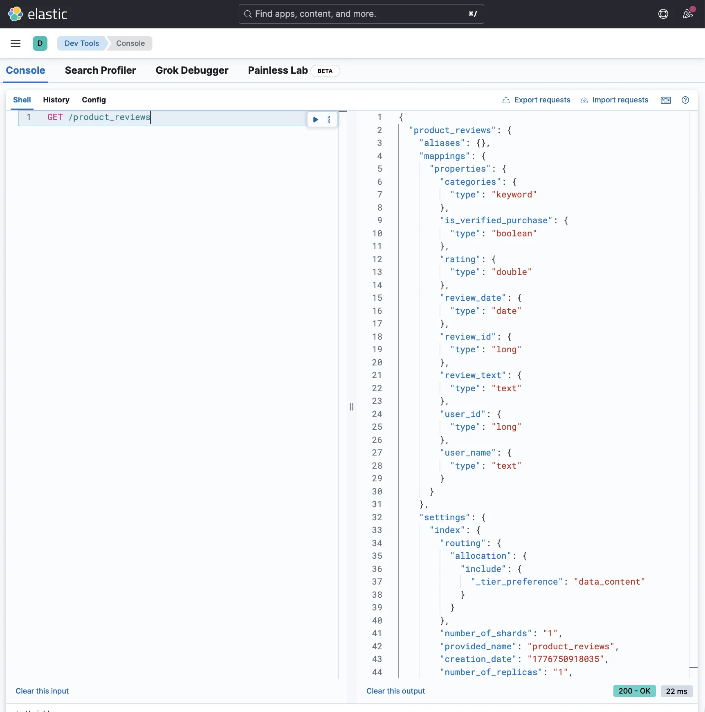
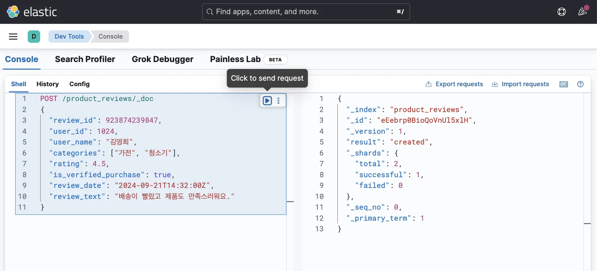
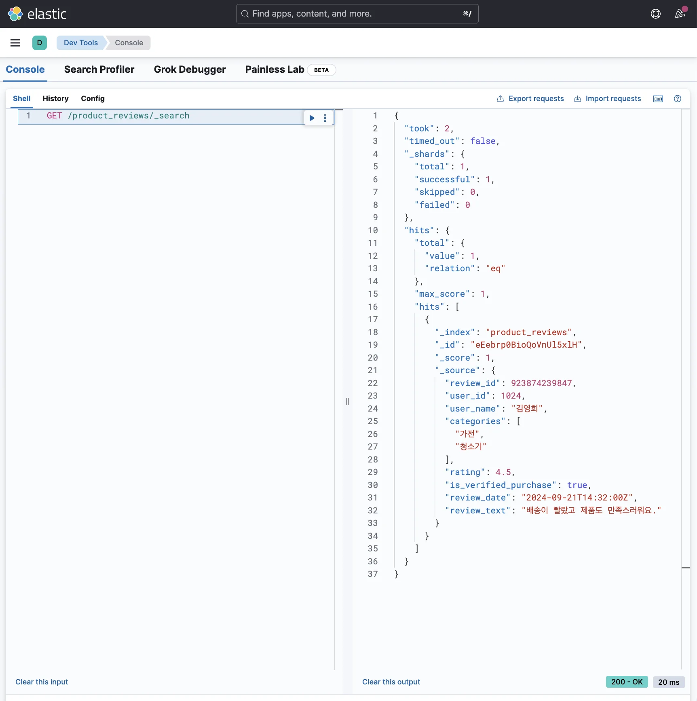

> 
> 
> <a id="349eda9b0fe181d3bb30c55496d6c36f"></a>
> 
> 목차
> 
> - [[실습] 인덱스 매핑 및 도큐먼트 저장](#349eda9b0fe18175a062c1f5a8f0bfe1)
> - [저장할 데이터에 맞게 매핑 정의](#349eda9b0fe1801b81c5da8beddef481)

<a id="349eda9b0fe18175a062c1f5a8f0bfe1"></a>

## &#91;실습&#93; 인덱스 매핑 및 도큐먼트 저장

---

<a id="349eda9b0fe1801b81c5da8beddef481"></a>

### 저장할 데이터에 맞게 매핑 정의

<a id="349eda9b0fe180d9ab14e4940c8f8c28"></a>

<strong>예제</strong>

<a id="349eda9b0fe18046b7e9e71367b6e079"></a>

```json
{
  "review_id": 923874239847,           
  "user_id": 1024,                     
  "user_name": "김영희",                
  "categories": ["가전", "청소기"],            
  "rating": 4.5,                      
  "is_verified_purchase": true,       
  "review_date": "2024-09-21T14:32:00Z", 
  "review_text": "배송이 빨랐고 제품도 만족스러워요." 
}
```

<details>
<summary>1&#46; <strong>매핑 정의 &#43; 인덱스 생성</strong></summary>

<a id="349eda9b0fe1805692a3ce1f57b23f36"></a>

```json
PUT /product_reviews
{
  "mappings": {
    "properties": {
      "review_id": {
        "type": "long" // 현업에서 확장성을 고려해 integer가 아닌 long으로 셋팅하는 편
      },
      "user_id": {
        "type": "long" // 현업에서 확장성을 고려해 integer가 아닌 long으로 셋팅하는 편
      },
      "user_name": {
        "type": "text" // 일부분으로도 검색할 수 있게 설정 (만약 부분 검색이 필요 없다면 keyword로 설정)
      },
      "categories": {
        "type": "keyword" // 정확한 비교로만 사용하기 때문에 keyword로 설정
      },
      "rating": {
        "type": "double" // 소수점을 가진 숫자이므로 double로 설정
      },
      "is_verified_purchase": {
        "type": "boolean" 
      },
      "review_date": {
        "type": "date" // 날짜 데이터
      },
      "review_text": {
        "type": "text" // 유연하게 검색할 수 있도록 text 설정
      }
    }
  }
}
```



</details>

<details>
<summary><strong>2&#46; 인덱스 정상 생성 확인</strong></summary>

<a id="349eda9b0fe18044b366e14255f4becb"></a>

```json
GET /product_reviews
```



</details>

<details>
<summary><strong>3&#46; 데이터 삽입 (도큐먼트 생성)</strong></summary>

<a id="349eda9b0fe18033b367d30ab258618f"></a>

```json
POST /product_reviews/_doc
{
  "review_id": 923874239847,           
  "user_id": 1024,                     
  "user_name": "김영희",                
  "categories": ["가전", "청소기"],            
  "rating": 4.5,                      
  "is_verified_purchase": true,       
  "review_date": "2024-09-21T14:32:00Z", 
  "review_text": "배송이 빨랐고 제품도 만족스러워요." 
}
```



</details>

<details>
<summary><strong>4&#46; 데이터 정상 생성(삽입) 확인</strong></summary>

<a id="349eda9b0fe1806caa9df26150271fd6"></a>

```json
GET /product_reviews/_search
```



</details>
