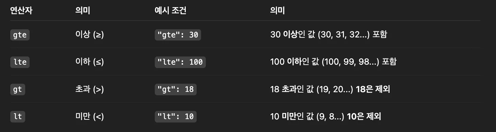

> 
> 
> <a id="349eda9b0fe1806aade8de2b71056256"></a>
> 
> 목차
> 
> - [숫자/날짜의 값에 대한 범위 조건으로 데이터 조회: range](#349eda9b0fe180468e3ae654d4dc0964)
> - [숫자/날짜의 값에 대해 범위 조건으로 데이터를 조회하고 싶을 때](#349eda9b0fe180a4be95fba9eacc570e)

<a id="349eda9b0fe180468e3ae654d4dc0964"></a>

## 숫자/날짜의 값에 대한 범위 조건으로 데이터 조회&#58; <code>range</code>

---

> 📖 
> 
> <a id="349eda9b0fe180dab064e0e349dd83ee"></a>
> 
> <code>range</code> 쿼리는 <strong><u>숫자, 날짜, IP 같은 값의 범위를 조건으로 도큐먼트를 검색</u></strong>할 때 사용한다&#46; 
> 
> <a id="349eda9b0fe18048ac32e920400ee1c6"></a>
> 
> 예를 들어 <strong><u>“가격이 100 이상 200 이하”,</u></strong> “<strong><u>생성일이 특정 날짜 이후”</u></strong> 같은 범위 검색에 적합하다&#46;
> 
> <details>
> <summary><strong>핵심 연산자&#58; 4개</strong></summary>
> 
> - <code>gte (greater than or equal)</code> &#58; 크거나 같음&#46;
> 
> - <code>gt (greater than)</code> &#58; 큼&#46;
> 
> - <code>lte (less than or equal)</code>&#58; 작거나 같음&#46;
> 
> - <code>lt (less than)</code> &#58; 작음
> 
> </details>
> 
> <details>
> <summary><strong>예시</strong></summary>
> 
> <a id="349eda9b0fe1802687aedf9f2c2af233"></a>
> 
> ```json
> {
>   "query": {
>     "range": {
>       "price": {
>         "gte": 700,
>         "lt": 900
>       }
>     }
>   }
> }
> ```
> 
> - <code>price</code>가 700 이상 900 미만인 문서 검색
> 
> </details>

<a id="349eda9b0fe180a4be95fba9eacc570e"></a>

### 숫자/날짜의 값에 대해 범위 조건으로 데이터를 조회하고 싶을 때

<details>
<summary><strong>1&#46; 인덱스 생성 및 매핑 정의</strong></summary>

<a id="349eda9b0fe180c7b2d8c7e8d1730cfb"></a>

```json
DELETE /users

PUT /users
{
  "mappings": {
    "properties": {
	   "name": {
	     "type": "keyword"
	   },
      "age": {
        "type": "integer"
      },
      "created_at": {
        "type": "date"
      }
    }
  }
}
```

</details>

<details>
<summary><strong>2&#46; 데이터 삽입</strong></summary>

<a id="349eda9b0fe1802c85cbcc24357e42d9"></a>

```json
POST /users/_doc
{
  "name": "kim_jisoo",
  "age": 28,
  "created_at": "2024-09-01"
}

POST /users/_doc
{
  "name": "lee_joon",
  "age": 35,
  "created_at": "2024-12-15"
}

POST /users/_doc
{
  "name": "park_saejin",
  "age": 32,
  "created_at": "2025-03-25"
}
```

</details>

<details>
<summary><strong>3&#46; </strong><strong>도큐먼트 검색</strong></summary>

> ❗ 
> 
> <a id="349eda9b0fe1803696cec5f2d6dac6f3"></a>
> 
> <strong>요구사항</strong>
> 
> <a id="349eda9b0fe18086bfc7d938aae016d5"></a>
> 
> <strong><u>나이가 30살 이상</u></strong>이면서 <strong><u>회원가입 날짜가 2025년 1월 1일 이후</u></strong>인 사용자 조회

<a id="349eda9b0fe1809c840be6ec4bde38d1"></a>

```json
GET /users/_search
{
  "query": {
    "bool": {
      "filter": [
        {
          "range": {
            "age": {
              "gte": 30
            }
          }
        },
        {
          "range": {
            "created_at": {
              "gte": "2025-01-01"
            }
          }
        }
      ]
    }
  }
}
```

<a id="349eda9b0fe1802e9450f4e9b43f41a2"></a>

위와 같이 숫자 또는 날짜 데이터에 대해 <code>range</code> 쿼리를 활용해 범위로 검색 가능하다&#46;

<a id="349eda9b0fe1807098a8d165fc5208ef"></a>

<strong><code>range</code></strong><strong> 쿼리에서 사용하는 연산자 (위 내용과 동일)</strong>



</details>
