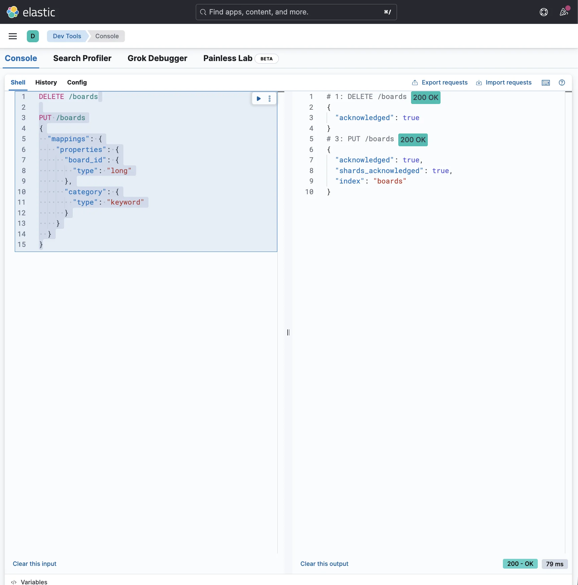
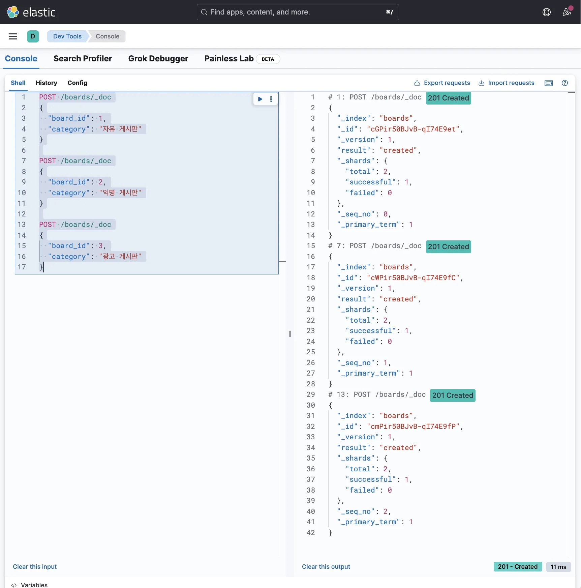
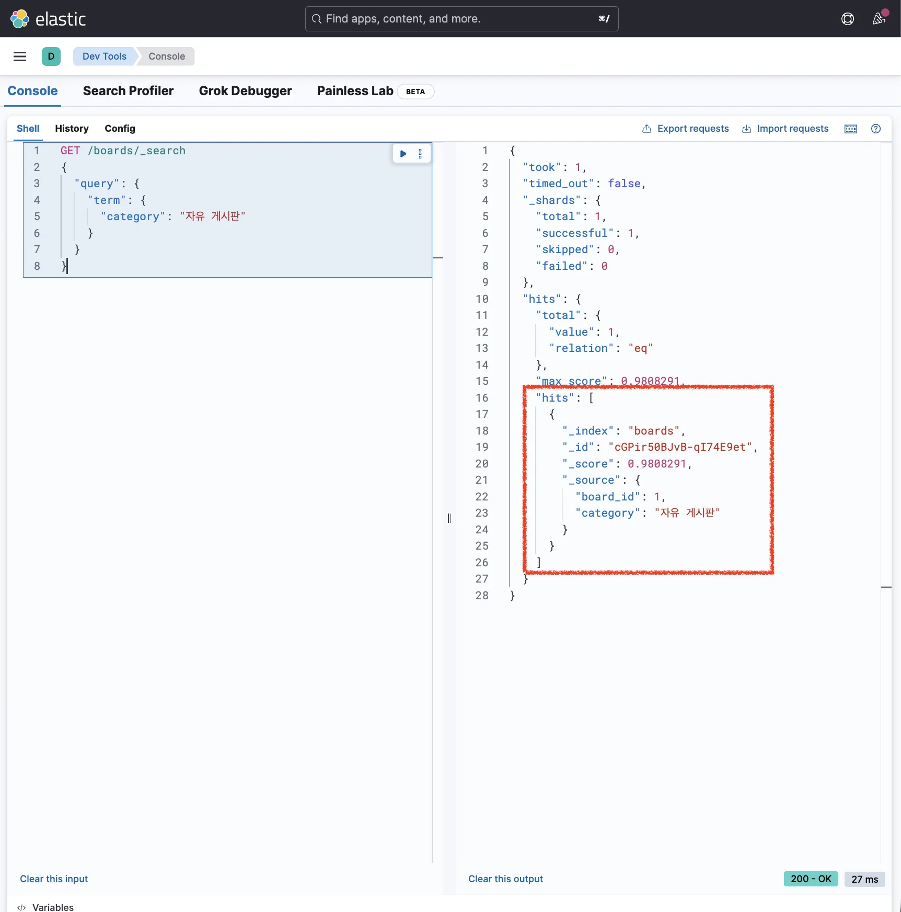
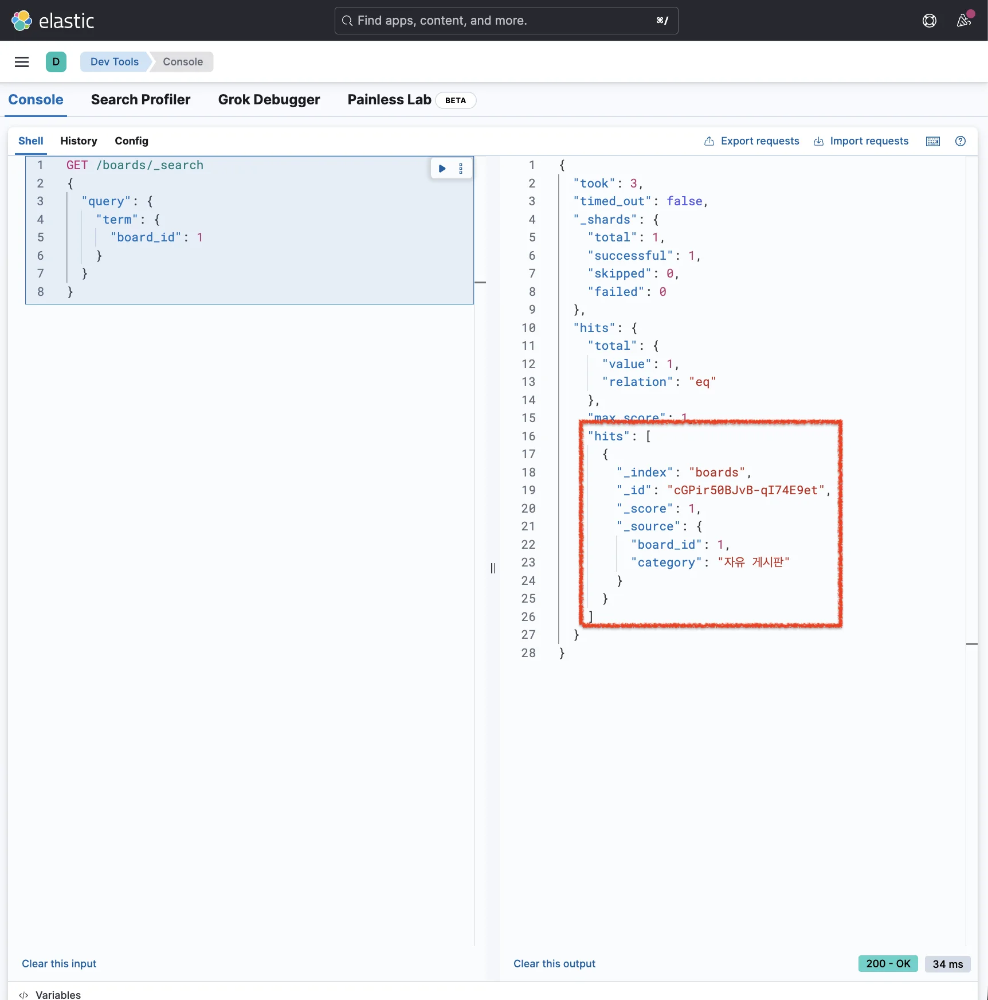
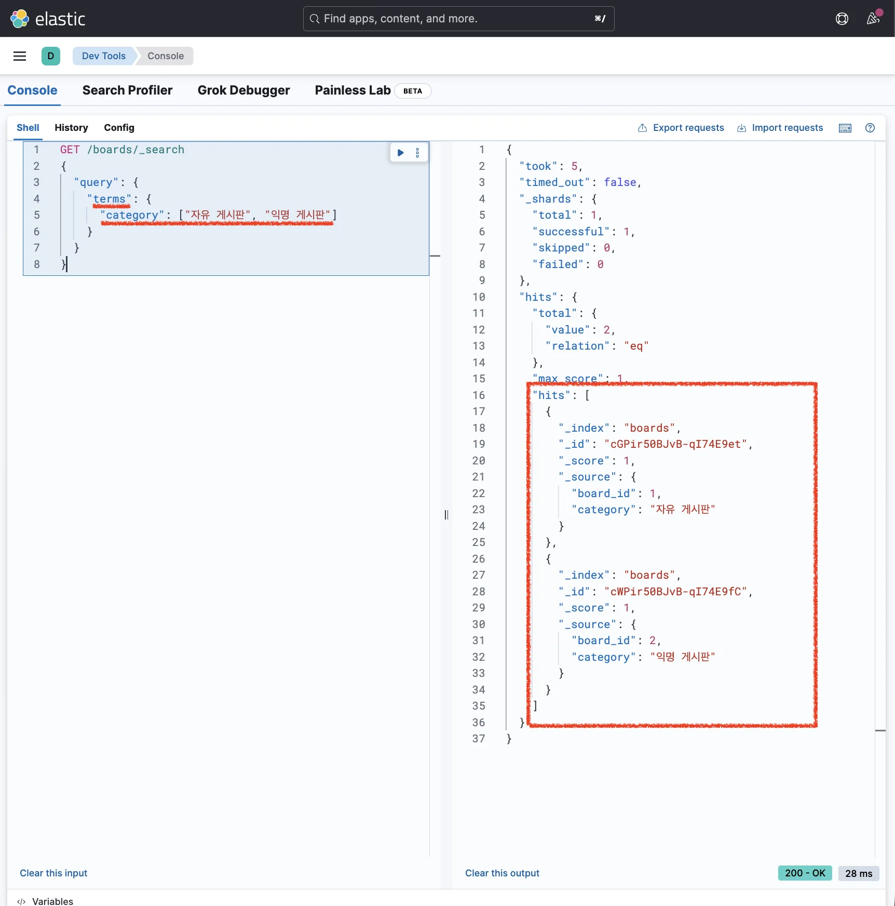
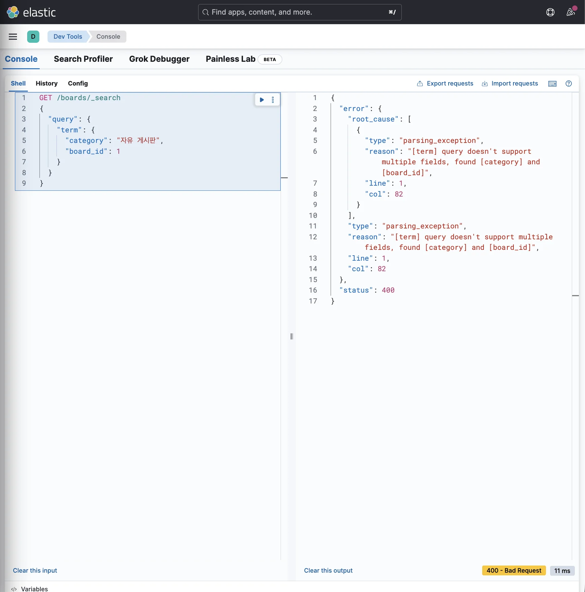
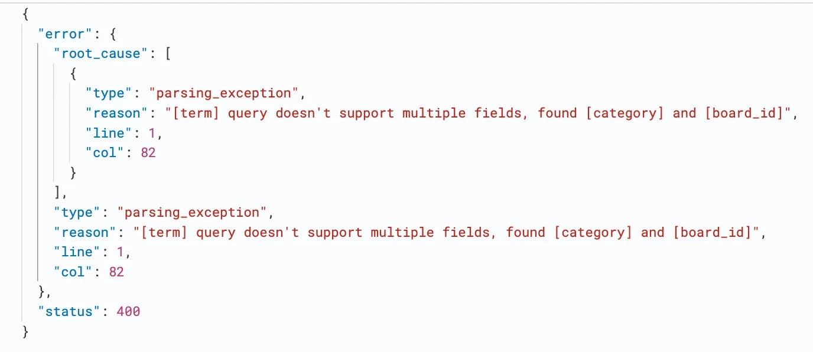

> 
> 
> <a id="349eda9b0fe1802d9c94e44f93d92da0"></a>
> 
> 목차
> 
> - [특정 값과 정확하게 일치하는 데이터 조회: term, terms](#349eda9b0fe180abb1d9d40278d818b0)
> - [검색 키워드가 포함된 데이터 조회: term](#349eda9b0fe180a2adfde255ae067df7)
> - [[실습] term 쿼리를 사용한 검색](#349eda9b0fe18042a00dd813569f09ba)
> - [여러 검색 키워드가 포함된 데이터 조회: terms](#349eda9b0fe180339283ee55a609090a)
> - [[실습] terms 쿼리를 사용한 검색](#349eda9b0fe18035be19e9d1be7c02b6)
> - [🧐 [오류] 여러 개의 조건을 동시에 만족하는 데이터 조회 → term 사용](#349eda9b0fe180a1900ddd62bb2c55c9)

<a id="349eda9b0fe180abb1d9d40278d818b0"></a>

## 특정 값과 정확하게 일치하는 데이터 조회&#58; <code>term</code>, <code>terms</code>

---

<a id="349eda9b0fe180a2adfde255ae067df7"></a>

### 검색 키워드가 포함된 데이터 조회&#58; <code>term</code>

> ✏️ 
> 
> <a id="349eda9b0fe1809db0dec3798838a4ef"></a>
> 
> <code>term</code> 쿼리는 <strong>특정 값과 정확히 일치하는 모든 도큐먼트를 조회</strong>한다&#46; 
> 
> - <strong><u>text를 제외</u></strong><strong><u>한 모든 타입에서 사용</u></strong>한다&#46; 
> 
> - t<strong>ext 타입에서도 사용은 가능</strong>하나 <strong>의도대로 작동하지 않</strong>을 수 있어서 <strong><u>사용하지 않는 걸 권장</u></strong>한다&#46;

<a id="349eda9b0fe18042a00dd813569f09ba"></a>

### &#91;실습&#93; <code>term</code> 쿼리를 사용한 검색

<details>
<summary><strong>1&#46; 인덱스 생성 및 매핑 정의</strong></summary>

<a id="349eda9b0fe18016b642c78dda8dd54f"></a>

```json
DELETE /boards

PUT /boards
{
  "mappings": {
    "properties": {
      "board_id": {
        "type": "long"
      },
      "category": {
        "type": "keyword"
      }
    }
  }
}
```



</details>

<details>
<summary><strong>2&#46; 데이터 삽입</strong></summary>

<a id="349eda9b0fe18023953ac38f6124f359"></a>

```json
POST /boards/_doc
{
  "board_id": 1,
  "category": "자유 게시판"
}

POST /boards/_doc
{
  "board_id": 2,
  "category": "익명 게시판"
}

POST /boards/_doc
{
  "board_id": 3,
  "category": "광고 게시판"
}
```



</details>

<details>
<summary><strong>3&#46; 도큐먼트 검색</strong></summary>

<details>
<summary><strong>❌ 검색 </strong></summary>

<a id="349eda9b0fe180cfa13cc23fda11dfd6"></a>

```json
GET /boards/_search
{
  "query": {
    "term": {
      "category": "자유"
    }
  }
}
```

<a id="349eda9b0fe180468b1dc4328ba5b6bc"></a>

```json
GET /boards/_search
{
  "query": {
    "term": {
      "category": "자유게시판"
    }
  }
}
```

<a id="349eda9b0fe1805c8caec34433ae40b6"></a>

```json
GET /boards/_search
{
  "query": {
    "term": {
      "board_id": 13
    }
  }
}
```

- 데이터가 <strong>가진 값과 정확히 일치하게 검색하지 않</strong>으면<strong><u> 도큐먼트가 조회되지 않</u></strong>는다&#46; 

</details>

- <strong>✅ 검색</strong>
    <a id="349eda9b0fe180fe9c50caf95f7574e5"></a>

    ```json
    GET /boards/_search
    {
      "query": {
        "term": {
          "category": "자유 게시판"
        }
      }
    }
    ```

    

    <a id="349eda9b0fe18004b1cdc6aa737b8905"></a>

    ```json
    GET /boards/_search
    {
      "query": {
        "term": {
          "board_id": 1
        }
      }
    }
    ```

    

    - <strong><u>정확한 값으로 검색</u></strong>하면 <strong>도큐먼트가 잘 조회</strong>된다&#46;

    - SQL문 표현
        <a id="349eda9b0fe1800585bcd1da424796b8"></a>

        ```sql
        SELECT * FROM boards WHERE category = "자유 게시판"

        SELECT * FROM boards WHERE board_id = 152
        ```

</details>

<a id="349eda9b0fe180339283ee55a609090a"></a>

### 여러 검색 키워드가 포함된 데이터 조회&#58; <code>terms</code>

> ✏️ 
> 
> <a id="349eda9b0fe180b981b9debc76644443"></a>
> 
> <code>terms</code> 쿼리는 <strong><u>여러 개의 값 중 하나라도 일치</u></strong>하는 <strong>모든 도큐먼트를 조회</strong>한다&#46;
> 
> - SQL문의 <code>IN</code>과 비슷한 역할을 한다&#46; 

<a id="349eda9b0fe18035be19e9d1be7c02b6"></a>

### &#91;실습&#93; <code>terms</code> 쿼리를 사용한 검색

<details>
<summary><strong>도큐먼트 검색</strong></summary>

<a id="349eda9b0fe180d59e8cf060c02dd016"></a>

```json
GET /boards/_search
{
  "query": {
    "terms": {
      "category": ["자유 게시판", "익명 게시판"]
    }
  }
}
```



- <code>category</code>가 <code>자유 게시판</code> 또는 <code>익명 게시판</code>인 모든 데이터 조회

- SQL문 표현
    <a id="349eda9b0fe18044a6d1f109e8fba8c8"></a>

    ```sql
    SELECT * FROM boards WHERE category IN ("자유 게시판", "익명 게시판")
    ```

</details>

<a id="349eda9b0fe180a1900ddd62bb2c55c9"></a>

### 🧐 &#91;오류&#93; 여러 개의 조건을 <u>동시에 만족</u>하는 데이터 조회 → <code>term</code> 사용

<a id="349eda9b0fe180bea39ffe26e6169449"></a>

```sql
SELECT * FROM boards WHERE category = “자유 게시판” AND board_id = 1
```

<a id="349eda9b0fe1802a8455ccf295075ecf"></a>

위 SQL과 같이 2가지 이상의 조건을 활용해 검색하고 싶을 수도 있다&#46; 

<a id="349eda9b0fe18007a330c6d1e12dddda"></a>

```json
GET /boards/_search
{
  "query": {
    "term": {
      "category": "자유 게시판",
      "board_id": 1
    }
  }
}
```

<a id="349eda9b0fe180c08a2efb7ca03976dd"></a>

따라서 이를 elasticsearch에서 적용 시 위와 같이 <code>term</code> 쿼리를 통해 여러 키워드를 넘겨 검색하는 방식으로 구현할 수 있다&#46; 





<a id="349eda9b0fe18088bbf5d18da0705d62"></a>

그러나 해당 쿼리를 실행시켜보면 위와 같이 에러가 발생한다&#46; 

<a id="349eda9b0fe1807196f0d3ff5e6fd8ed"></a>

<strong>🧐 그렇다면 </strong><strong><u>2가지 이상의 조건을 활용한 데이터 검색</u></strong><strong>은 어떻게 쿼리를 작성하는가?</strong>

- 해당 내용은 <a href="#/post/349eda9b-0fe1-80de-9002-e92febb5250c">페이지</a> 참조
