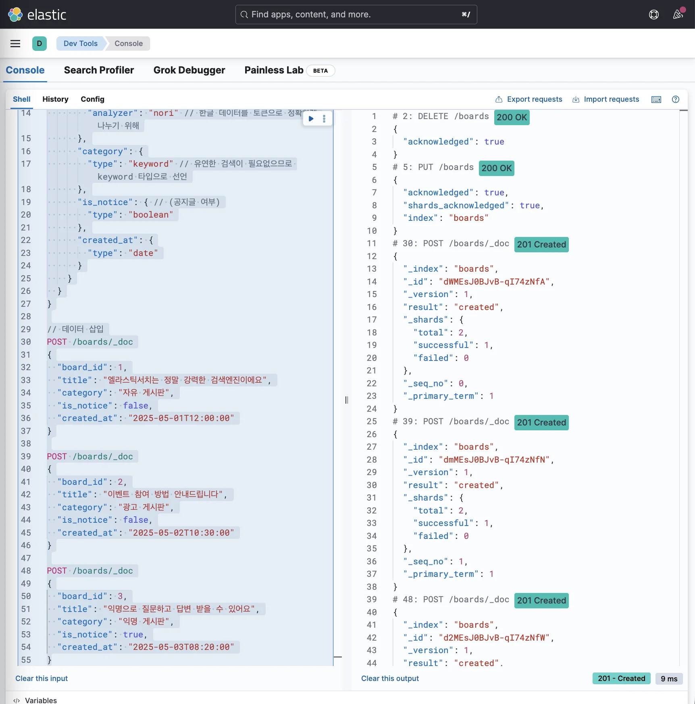
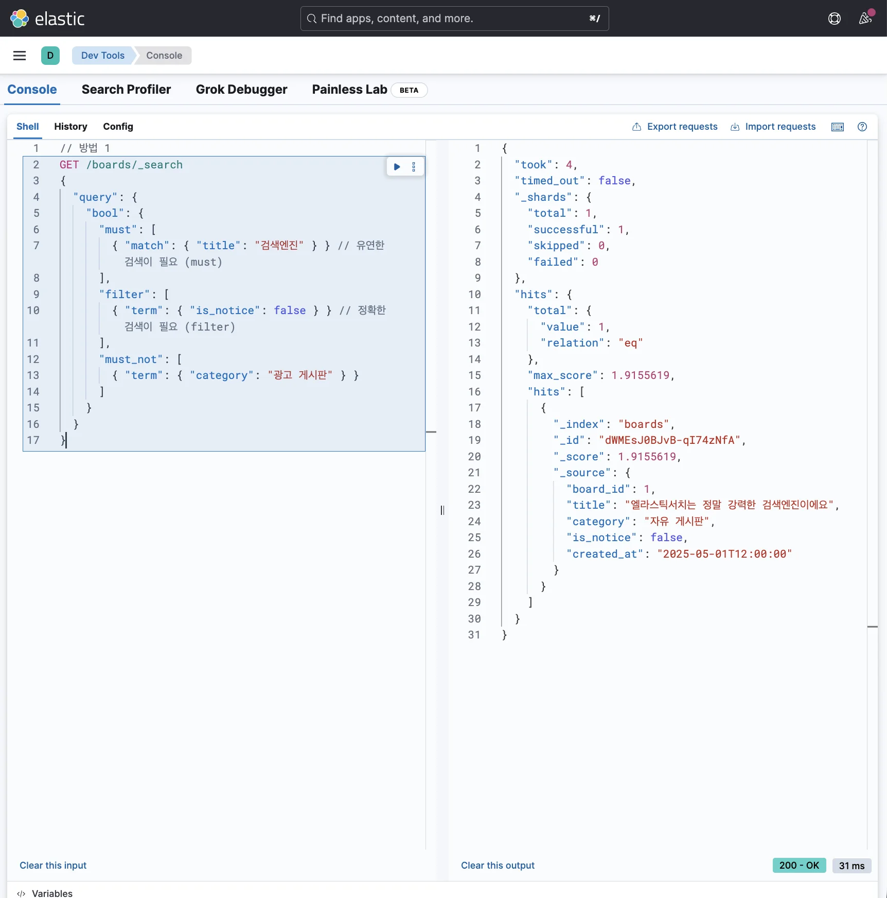
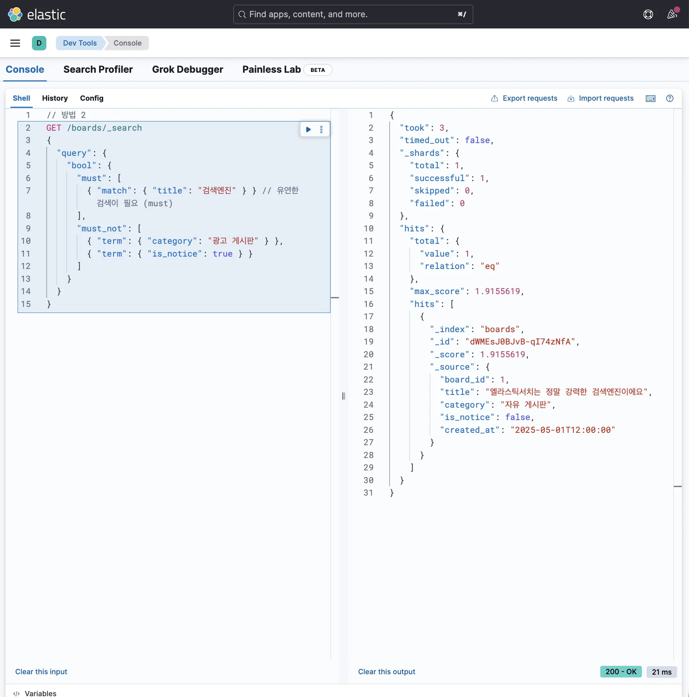

> 
> 
> <a id="349eda9b0fe180849950ceb1953f43e8"></a>
> 
> 목차
> 
> - [특정 조건을 만족하지 않는 데이터 조회: bool - must_not](#349eda9b0fe180689b17e9a6368e0010)
> - [특정 조건을 만족하지 않는 데이터를 조회하고 싶을 때](#349eda9b0fe180d793e6ff7e0596286f)

<a id="349eda9b0fe180689b17e9a6368e0010"></a>

## 특정 조건을 만족하지 않는 데이터 조회&#58; bool &#45; <code>must&#95;not</code>

---

> 📖 
> 
> <a id="349eda9b0fe180afa1c6d229716373c8"></a>
> 
> Elasticsearch의  bool 쿼리에서의  <code>must&#95;not</code>는 <strong><u>특정 조건에 해당하는 문서를 제외</u></strong>할 때 사용한다&#46; 
> 
> <a id="349eda9b0fe1801195e7fb1f2e5a0d78"></a>
> 
> 즉,  <strong><u>해당 조건이 아닌 문서</u></strong>만 가져온다&#46;

> 🤔 
> 
> <a id="349eda9b0fe180159f8ff609178bfd31"></a>
> 
> <strong>자주 헷갈리는 점</strong>
> 
> <a id="349eda9b0fe1801b8c38c34d63886aa9"></a>
> 
> <code>must&#95;not</code>는 <strong>반드시 만족해야 하는 조건이 아닌</strong><strong> </strong><strong><u>매칭되면 제외되는 조건</u></strong>이다&#46; 
> 
> <a id="349eda9b0fe180d798eec83d545a761b"></a>
> 
> 그래서  <code>must</code> 와 같이 쓰면  <code>must</code>조건을 만족하면서도  <code>must&#95;not</code> 조건에는 걸리지 않는 문서만 남는다&#46;
> 
> <details>
> <summary>예제 </summary>
> 
> <a id="349eda9b0fe1808aaf30cf341e43c633"></a>
> 
> ```json
> {
>   "query": {
>     "bool": {
>       "must": [
>         { "match": { "message": "open" } }
>       ],
>       "must_not": [
>         { "match": { "level": "info" } }
>       ]
>     }
>   }
> }
> ```
> 
> - 위 경우  <code>message=open</code> 조건은 만족하지만  <code>level=info</code>인 문서는 결과에서 빠진다&#46; 
> 
> </details>

<a id="349eda9b0fe180d793e6ff7e0596286f"></a>

### <u>특정 조건을 만족하지 않</u>는 데이터를 조회하고 싶을 때

<details>
<summary><strong>1&#46; 인덱스 생성 및 데이터 삽입</strong></summary>

<a id="349eda9b0fe180cb9d3fdb89fe10a228"></a>

```json
// 기존 인덱스 삭제
DELETE /boards

// 인덱스 생성
PUT /boards
{
  "mappings": {
    "properties": {
      "board_id": {
        "type": "long"
      },
      "title": {
        "type": "text", // 유연한 검색이 필요하므로 text 타입으로 선언
        "analyzer": "nori" // 한글 데이터를 토큰으로 정확하게 나누기 위해
      },
      "category": {
        "type": "keyword" // 유연한 검색이 필요없으므로 keyword 타입으로 선언
      },
      "is_notice": { // (공지글 여부)
        "type": "boolean"
      },
      "created_at": {
        "type": "date"
      }
    }
  }
}

```

<a id="34aeda9b0fe1809c9556fabb17abbd44"></a>

```json
// 데이터 삽입
POST /boards/_doc
{
  "board_id": 1,
  "title": "엘라스틱서치는 정말 강력한 검색엔진이에요",
  "category": "자유 게시판",
  "is_notice": false,
  "created_at": "2025-05-01T12:00:00"
}

POST /boards/_doc
{
  "board_id": 2,
  "title": "이벤트 참여 방법 안내드립니다",
  "category": "광고 게시판",
  "is_notice": false,
  "created_at": "2025-05-02T10:30:00"
}

POST /boards/_doc
{
  "board_id": 3,
  "title": "익명으로 질문하고 답변 받을 수 있어요",
  "category": "익명 게시판",
  "is_notice": true,
  "created_at": "2025-05-03T08:20:00"
}
```



</details>

<details>
<summary><strong>2&#46; 검색 쿼리</strong></summary>

> ❗ 
> 
> <a id="349eda9b0fe180a59dc0dceb0d18529f"></a>
> 
> <strong>요구사항</strong>
> 
> <a id="349eda9b0fe18054b9fede982f3f1fb8"></a>
> 
> <code>광고 게시판</code>의 글이 아니면서 <code>공지 글</code>이 아니며 <code>검색엔진</code>의 키워드와 관련된 게시글 조회
> 
> - 공지 글&#58; <code>is&#95;notice=true</code> 

<a id="349eda9b0fe180da9fffd7c63d0cea44"></a>

```json
// 방법 1
GET /boards/_search
{
  "query": {
    "bool": {
      "must": [
        { "match": { "title": "검색엔진" } } // 유연한 검색이 필요 (must)
      ],
      "filter": [
        { "term": { "is_notice": false } } // 정확한 검색이 필요 (filter)
      ],
      "must_not": [
        { "term": { "category": "광고 게시판" } }
      ]
    }
  }
}
```



<a id="349eda9b0fe1800abea7e8fb1f0bf8dd"></a>

```json
// 방법 2
GET /boards/_search
{
  "query": {
    "bool": {
      "must": [
        { "match": { "title": "검색엔진" } } // 유연한 검색이 필요 (must)
      ],
      "must_not": [
        { "term": { "category": "광고 게시판" } },
        { "term": { "is_notice": true } }
      ]
    }
  }
}
```



</details>
