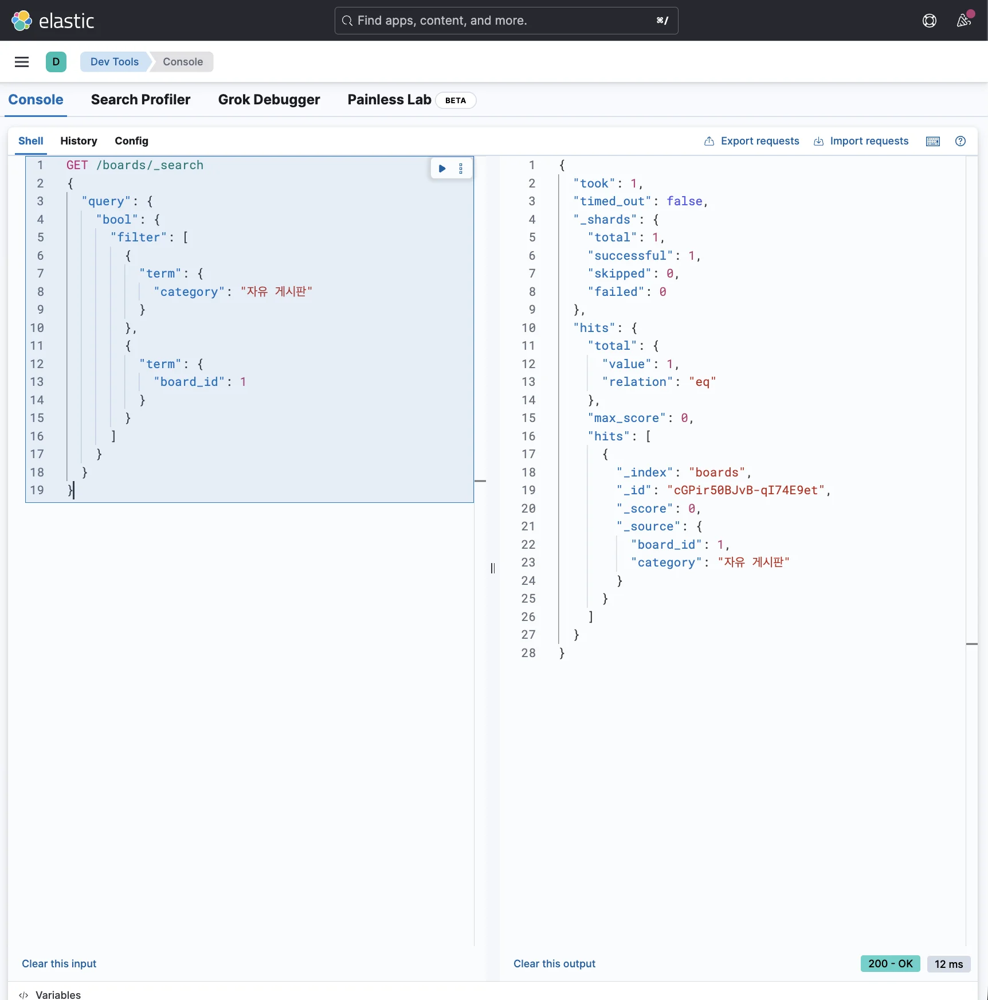
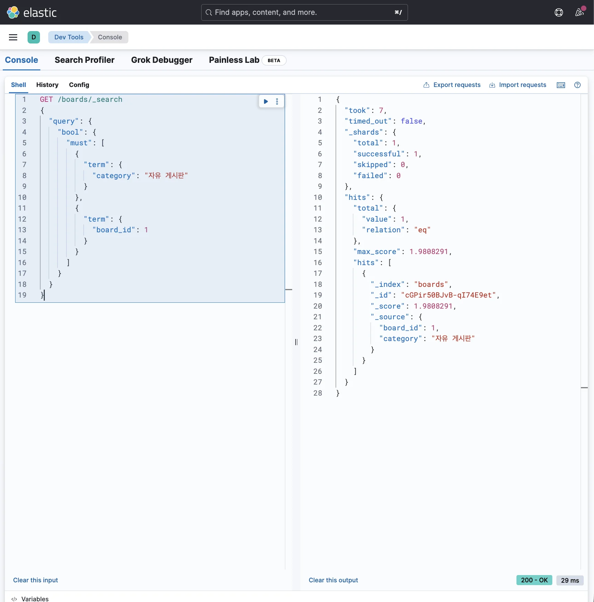
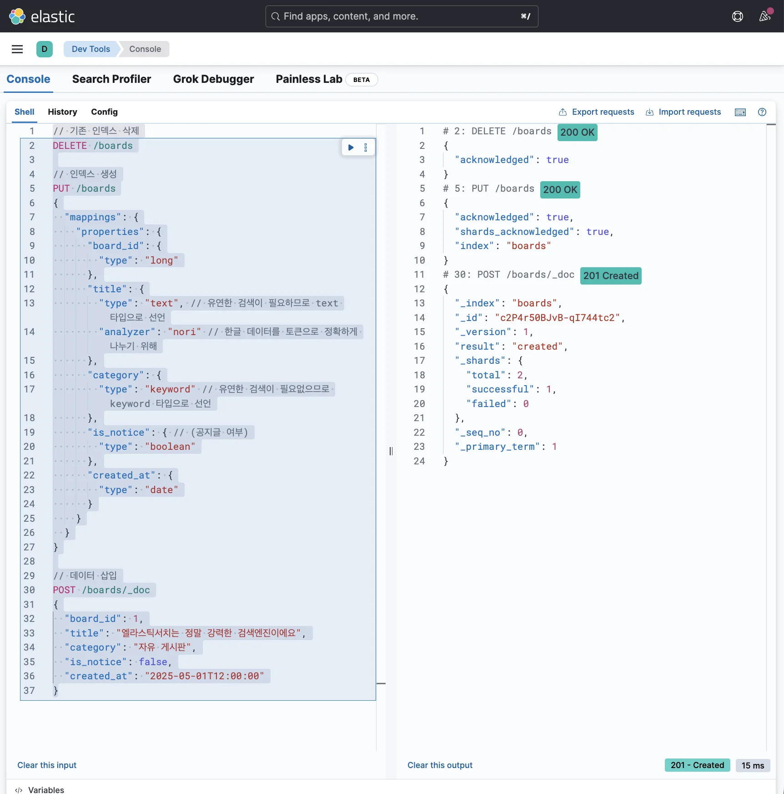
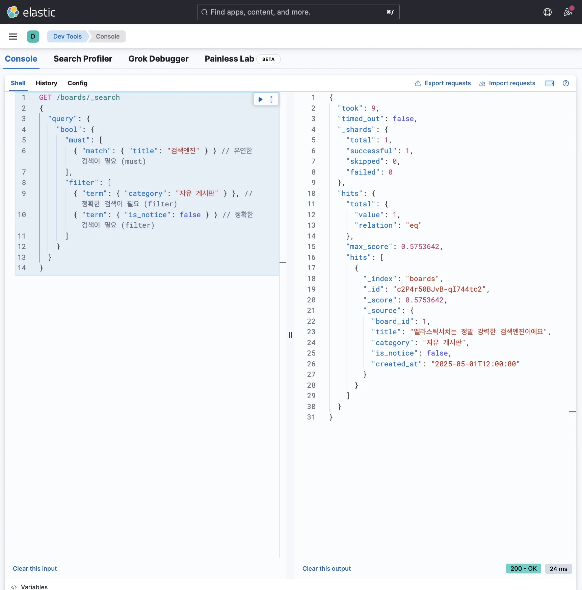

> 
> 
> <a id="349eda9b0fe1805682f8eae6affbba1c"></a>
> 
> 목차
> 
> - [2가지 이상의 조건을 만족시키는 데이터 조회: bool - filter, must](#349eda9b0fe180f99dbdfcde59c77280)
> - [ 2가지 이상의 조건을 만족시키는 데이터 조회](#349eda9b0fe180ee86b7cffed03a258c)
> - [filter vs must](#349eda9b0fe1808fb39bf413eae0c8f7)
> - [[실습] filter와 must 구분](#349eda9b0fe180a5ad96c73cc137f8c4)

<a id="349eda9b0fe180f99dbdfcde59c77280"></a>

## 2가지 이상의 조건을 만족시키는 데이터 조회&#58; bool &#45; <code>filter</code>, <code>must</code>

---

> 📖 
> 
> <a id="349eda9b0fe180e78b2dd5b18721842f"></a>
> 
> <strong><u>2가지 이상의 조건을 만족시키는 쿼리</u></strong>를 작성하려면 <strong>bool 쿼리</strong>를 활용해야 한다&#46;
> 
> <a id="349eda9b0fe18034a0ade2b9a051ab3e"></a>
> 
>  즉, bool 쿼리는 <strong><u>여러 쿼리를 조합</u></strong>하기 위해서 사용하는 개념이다&#46; 
> 
> > <strong><u>bool 쿼리</u></strong>에는 크게 4가지 기능이 있다&#46; 
> > 
> > - <code>must</code> &#58; SQL문에서의 <code>AND</code> 와 유사
> > 
> > - <code>filter</code> &#58; SQL문에서의 <code>AND</code> 와 유사
> > 
> > - <code>must&#95;not</code> &#58; SQL문에서의 <code>NOT</code> 과 유사
> > 
> > - <code>should</code> &#58; 조건을 만족하면 좋고, 아니면 말고
> 
> <a id="349eda9b0fe180d89940c7d4494164d6"></a>
> 
> 이 중에서 <strong><u>2가지 조건을 전부 만족시키는 데이터를 조회</u></strong>하기 위해 사용하는 <br><code>must</code>와 <code>filter</code>에 대해 알아본다&#46; 

<a id="349eda9b0fe180ee86b7cffed03a258c"></a>

###  2가지 이상의 조건을 만족시키는 데이터 조회

<details>
<summary>이전 챕터(<a href="#/post/349eda9b-0fe1-8084-937d-d85a12b8dca1">페이지</a> )<br>→  <strong><u>2개 이상의 조건에서 </u></strong><strong><u><code>term</code></u></strong><strong><u> 쿼리 </u></strong><strong><u>사용 시</u></strong><u> </u><strong><u>오류 </u></strong><strong><u>발생</u></strong></summary>

<a id="349eda9b0fe180e4ba21d2afc27a08c4"></a>

```json
GET /boards/_search
{
  "query": {
    "term": {
      "category": "자유 게시판",
      "board_id": 1
    }
  }
}
```


- <strong>400 bad request </strong>발생

</details>

-  예제 
    <a id="349eda9b0fe180e0b601f7e4b5449ebb"></a>

    ```json
    GET /boards/_search
    {
      "query": {
        "bool": {
          "filter": [
            {
    		      "term": {
    		        "category": "자유 게시판"
    		      }
    		    },
    		    {  
    		      "term": {
      		      "board_id": 1
      		    }
      		  }
      		]
        }
      }
    }
    ```

    

    <a id="349eda9b0fe1804eb636e31cac1846e0"></a>

    ```json
    GET /boards/_search
    {
      "query": {
        "bool": {
          "must": [
            {
    		      "term": {
    		        "category": "자유 게시판"
    		      }
    		    },
    		    {  
    		      "term": {
      		      "board_id": 1
      		    }
      		  }
      		]
        }
      }
    }
    ```

    

    <a id="349eda9b0fe18085a6faed3fe981e0d4"></a>

    위 두 쿼리를 실행시켜보면 정상적으로 원하는 데이터를 잘 불러온다&#46; 

    <a id="349eda9b0fe180ca8a70cc423658c4d7"></a>

    그러나 2번째 쿼리의 <code>must</code>는 용도에 맞지 않게 잘못 사용한 경우이다&#46; 

    <a id="349eda9b0fe180adb028c08e2c326c50"></a>

    따라서 <code>filter</code>와 <code>must</code>의 차이에 대해 알아보고 각 기능은 언제 사용해야 하는 지 알아보자&#46;

<a id="349eda9b0fe1808fb39bf413eae0c8f7"></a>

### <code>filter</code> vs <code>must</code>

<a id="349eda9b0fe1809c80e2d32510bfdb91"></a>

둘의 가장 큰 차이점은 아래와 같다&#46; 

- <strong><code>filter</code></strong>는 <strong><u>score(점수)에 영향을 주지 않</u></strong>는다&#46;  

- <strong><code>must</code></strong>는 <strong><u>score(점수)에 영향을 준</u></strong>다&#46;

---

- <strong><code>score(점수)</code></strong><strong>&#58;</strong> 검색을 할 때 관련도가 얼마나 높은 지를 나타내는 수치이다&#46;

<a id="349eda9b0fe180269e4cdfaded8dd8c0"></a>

<strong><u>score(점수)가 활용</u></strong>되는 대표적인 쿼리가 <code>match</code>이다&#46; 

<a id="349eda9b0fe180f48050e48ca28a6cba"></a>

<code>match</code>는 <strong>score(점수)를 활용</strong>해 <strong><u>관련도가 높은 도큐먼트를 우선적으로 조회</u></strong>해온다&#46; <br>즉, <strong><u>정확하게 일치하지 않</u></strong><u>아도 </u><strong><u>도큐먼트를 조회</u></strong>해온다&#46; 

<a id="349eda9b0fe1807e94cdd9174a371e77"></a>

반면, <code>term</code> 쿼리는 <strong><u>조건을 정확하게 일치시키지 않</u></strong><strong><u>으</u></strong><strong><u>면 </u></strong><strong><u>도큐먼트를 조회 할 수 없</u></strong><strong>다&#46;</strong><br>즉, <strong>score(점수)</strong>를 <strong><u>사용하지 않</u></strong>는다&#46; 

<a id="349eda9b0fe18049922ed229c30dea6f"></a>

<code>filter</code>와 <code>must</code>의 사용 용도는 score(점수)에 영향을 주는 쿼리인지 아닌지로 구분해서 사용해야 한다&#46; 

- <code>filter</code> &#58; score(점수)와 상관없는 쿼리인 경우 →  <code>term</code>

- <code>must</code> &#58; score(점수)와 상관있는 쿼리인 경우 → <code>match</code>

<a id="349eda9b0fe180a0a76defe7b4db7531"></a>

따라서 <code>term</code> 쿼리는 score(점수)와 상관없는 쿼리이므로 <code>must</code>가 아닌 <code>filter</code> 내부에서 사용하는 것이 올바른 사용 방식이다&#46; 

<details>
<summary>❌ 잘못된 사용 방식&#58; <code>must&#45;term</code></summary>

<a id="349eda9b0fe18072b411dc78238498f3"></a>

```json
// 잘못된 방식: must-term
GET /boards/_search
{
  "query": {
    "bool": {
      "must": [
        {
		      "term": {
		        "category": "자유 게시판"
		      }
		    },
		    {  
		      "term": {
  		      "board_id": 1
  		    }
  		  }
  		]
    }
  }
}
```

</details>

- ✅ 올바른 사용 방식&#58; <code>filter&#45;term</code>
    <a id="349eda9b0fe1802ea240d5c751b00e95"></a>

    ```json
    // 올바른 사용 방식: filter-term
    GET /boards/_search
    {
      "query": {
        "bool": {
          "filter": [
            {
    		      "term": {
    		        "category": "자유 게시판"
    		      }
    		    },
    		    {  
    		      "term": {
      		      "board_id": 1
      		    }
      		  }
      		]
        }
      }
    }
    ```

<a id="349eda9b0fe180a5ad96c73cc137f8c4"></a>

### &#91;실습&#93; <code>filter</code>와 <code>must</code> 구분

<details>
<summary>1&#46; 인덱스 생성 및 데이터 삽입</summary>

<a id="349eda9b0fe180439618d12b2f89ea28"></a>

```json
// 기존 인덱스 삭제
DELETE /boards

// 인덱스 생성
PUT /boards
{
  "mappings": {
    "properties": {
      "board_id": {
        "type": "long"
      },
      "title": {
        "type": "text", // 유연한 검색이 필요하므로 text 타입으로 선언
        "analyzer": "nori" // 한글 데이터를 토큰으로 정확하게 나누기 위해
      },
      "category": {
        "type": "keyword" // 유연한 검색이 필요없으므로 keyword 타입으로 선언
      },
      "is_notice": { // (공지글 여부)
        "type": "boolean"
      },
      "created_at": {
        "type": "date"
      }
    }
  }
}

// 데이터 삽입
POST /boards/_doc
{
  "board_id": 1,
  "title": "엘라스틱서치는 정말 강력한 검색엔진이에요",
  "category": "자유 게시판",
  "is_notice": false,
  "created_at": "2025-05-01T12:00:00"
}
```



</details>

<details>
<summary>2&#46; 검색 쿼리</summary>

> ❗ 
> 
> <a id="349eda9b0fe180688ae8cda75a904ec3"></a>
> 
> 요구사항
> 
> - <code>자유 게시판</code>의 게시글 중에서 <code>‘검색엔진&#39;</code>과 관련된 글
> 
> - <code>공지글</code>이 아닌 게시글 (<code>is&#95;notice=false</code>)

<a id="349eda9b0fe180e0a57ac1efa93d233c"></a>

```json
GET /boards/_search
{
  "query": {
    "bool": {
      "must": [
        { "match": { "title": "검색엔진" } } // 유연한 검색이 필요 (must)
      ],
      "filter": [
        { "term": { "category": "자유 게시판" } }, // 정확한 검색이 필요 (filter)
        { "term": { "is_notice": false } } // 정확한 검색이 필요 (filter)
      ]
    }
  }
}
```



<a id="349eda9b0fe180eeb562eddb859670af"></a>

위와 같이 <code>must&#45;match</code>, <code>filter&#45;term</code>을 복합적으로 사용하여 복잡한 요구사항에 맞게 검색이 가능하다&#46; 

</details>

> 📝 
> 
> <a id="349eda9b0fe180baa8f5f10069fd8555"></a>
> 
> <strong><code>filter</code></strong><strong>와 </strong><strong><code>must</code></strong><strong>를 쉽게 구분하기</strong>
> 
> <a id="349eda9b0fe180c08f54ef7bb02dd081"></a>
> 
> 점수(score)를 활용하는 쿼리는 <code>text</code> 타입을 기반으로 검색을 유연하게 해주는 쿼리이다&#46;
> 
> - <code>match</code>, <code>match&#95;phrase</code>, <code>multi&#95;match</code> 등
> 
> <a id="349eda9b0fe18087857ee26a92d42bf8"></a>
> 
> 즉, 정확하게 일치하지 않더라도 관련성이 있는 데이터까지 조회하는 쿼리에 대해서만 <code>must</code>를 사용하고 그 외에는 전부 <code>filter</code>를 쓴다&#46; 
> 
> - <strong>유연한 검색 필요</strong>
>     - <strong> </strong><strong><code>text</code></strong><strong> 타입 →  </strong><strong><code>match</code></strong><strong> 쿼리</strong>
> 
>     -  bool의 <strong><code>must</code></strong>
> 
> - <strong>정확한 검색 필요</strong>
>     - <strong><code>text</code></strong><strong> 이외의 타입 →  </strong><strong><code>term</code></strong><strong> 쿼리 </strong>
> 
>     - bool의 <strong><code>filter</code></strong>
